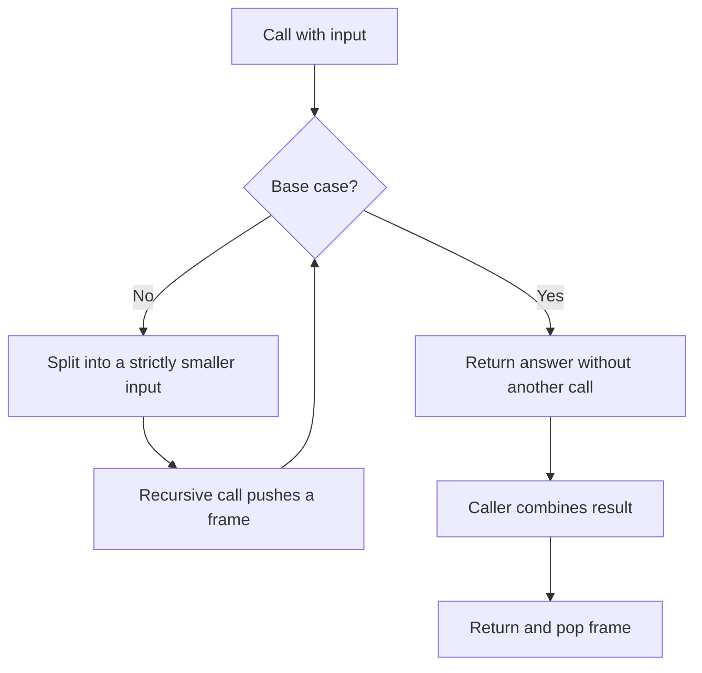

## Why this matters

Trees, nested JSON, nested comments, and divide-and-conquer algorithms are recursive in shape. A recursive function mirrors that shape: handle the smallest case, then solve smaller pieces and combine them. Interviews still ask for factorial and Fibonacci as warm-ups, then switch to "flatten this nested list" or "walk a directory." The Python-specific failure is not the idea of recursion. It is a recursion depth of a few thousand blowing up with `RecursionError` on a linked list that a loop would walk safely, and a naive Fibonacci that does exponential work because it recomputes the same arguments.

You need three skills: write the base case first, state the smaller problem in one sentence, and decide whether the call stack is the right stack.

## Intuition

Each call gets a frame with its own parameters and locals. The frames form a stack. The deepest frame hits a base case and returns a value. The caller combines that value and returns to its caller. When you draw the calls, you are looking at the stack the interpreter will build.

A base case is an input that does not recurse: empty list, `n == 0`, a leaf node. Without it, the stack grows until CPython raises `RecursionError`. A wrong base case returns a plausible wrong answer instead of crashing, which is worse. Test the smallest input before you test a flattering one.

## Core concept in depth

### Structure of a correct recursion

Write the function in this order:

1. State the contract, including what happens on empty input.
2. Write the base case and return.
3. Write one recursive call on a strictly smaller input.
4. Combine the recursive result with the work for the current element.

"Strictly smaller" means a measure decreases: list length, `n`, tree height, remaining interval length. If the measure does not decrease, you do not have a proof of termination. `f(n)` calling `f(n)` is an infinite loop with extra frames. `f(n)` calling `f(n - 1)` and `f(n - 2)` terminates only if both arguments move toward the base and the base covers every path. Fibonacci's `n - 2` path must handle `n == 1` and `n == 0`, or a call with `1` computes `f(-1)`.

### Linear recursion versus a loop

Factorial is linear: one recursive call, then multiply. The stack depth is `n`. The work is Θ(n). An iterative accumulator does the same work in Θ(1) extra memory. In Python, prefer the loop for linear reductions over sequences and counters. Use recursion when the data is a tree or a nest, where the depth is logarithmic or naturally small, or when the clarity of the recursive statement is worth a depth you can bound.

`sys.getrecursionlimit()` is 1000 by default. The real ceiling can be lower because each Python frame also consumes C stack. Do not raise the limit to process a user-supplied linked list of unknown length. Rewrite as a loop or an explicit stack. Raising the limit is acceptable for a trusted tree you measured, and you should still have a plan for a deeper tree.

### Binary recursion and overlapping subproblems

Naive Fibonacci `f(n) = f(n-1) + f(n-2)` is correct and exponential. The call tree recomputes `f(2)` many times. The fix is not "recursion is bad." The fix is to remember answers: a top-down cache, or a bottom-up table, or a loop with two rolling variables. Memoization turns the exponential tree into Θ(n) calls for Fibonacci. `functools.cache` does this if the arguments are hashable and the function is pure. A cached recursive function still uses O(n) stack on the first descent unless you structure the recursion to avoid a long chain. For Fibonacci, the loop is the honest solution. For a tree-shaped search with overlapping states, the cache is the point.

### Divide and conquer

Merge sort and binary search are recursive because each call works on a smaller interval. Binary search's depth is Θ(log n), which is safe under the recursion limit for any array you can allocate. The bug in recursive binary search is the interval: `mid`, `low = mid + 1`, `high = mid - 1`, and a base case when `low > high`. An interval that does not shrink loops until `RecursionError`. Test a missing target and a target at both ends.

### Nested structures

Flattening a nested list is the practical recursion you will write in product code and in interviews:

```python
def flatten(node):
    if not isinstance(node, list):
        return [node]
    out = []
    for child in node:
        out.extend(flatten(child))
    return out
```

The base case is "not a list." The recursive case extends by the flattened child. Depth equals the nesting depth, not the total number of leaves. A million leaves in a shallow tree is fine. A million levels of single-element nesting is a `RecursionError` even though the output length is one. Know which measure is the depth.

Walking nested dicts from JSON uses the same pattern: if the value is a dict, recurse into values; if it is a list, recurse into items; otherwise it is a leaf. Guard cycles if a malicious or buggy payload can point at itself. Python lists do not form cycles through literals easily, but objects can. A `seen` set of ids stops a cycle from recursing forever.

### Explicit stacks

Any recursion can be rewritten with a list used as a stack. You push frames you would have called, and you loop until the stack is empty. This is how you traverse a deep tree without using the Python call stack. The iterative version is longer and easier to get wrong around "process after children" versus "process before children." Preorder is natural with a stack. Postorder needs a marker or two stacks. Use the iterative form when depth is unbounded. Use recursion when depth is bounded and the code matches the data.

Tail recursion is not optimized in CPython. A tail call still consumes a frame. Do not write a tail-recursive function expecting it to run like a loop. Write the loop.

## Diagram / flowchart



### Dry-run: factorial(3) and a bad Fibonacci

| Frame | Waiting to compute | Returns |
| --- | --- | --- |
| fact(3) | 3 * fact(2) | 6 |
| fact(2) | 2 * fact(1) | 2 |
| fact(1) | base, return 1 | 1 |

Stack depth 3. Iterative factorial uses one variable.

Naive `fib(5)` calls `fib(4)` and `fib(3)`, and `fib(4)` calls `fib(3)` again. `fib(3)` is fully recomputed. Count the leaves if you want the proof of exponential work. A cache keyed by `n` means each `n` runs its body once. A loop from 0 to n with two variables does not build a call stack at all.

Flatten dry-run on `[1, [2, 3], 4]`:

| Call | Sees | Emits |
| --- | --- | --- |
| flatten of the outer list | three children | concatenation of the three results |
| flatten of 1 | not a list | a one-item list containing 1 |
| flatten of `[2, 3]` | two ints | 2 then 3 |
| flatten of 4 | not a list | a one-item list containing 4 |

Result: 1, 2, 3, 4. An empty list returns an empty list because the loop appends nothing. That is the correct base for "no elements," and it is different from the non-list base case. Both are required.

## Code

```python
def factorial(n: int) -> int:
    if isinstance(n, bool) or not isinstance(n, int) or n < 0:
        raise ValueError("n must be a non-negative int")
    result = 1
    for k in range(2, n + 1):
        result *= k
    return result


def flatten(node: object) -> list:
    if isinstance(node, list):
        out: list = []
        for child in node:
            out.extend(flatten(child))
        return out
    return [node]


def bisect_left(nums: list[int], target: int) -> int:
    low, high = 0, len(nums)
    while low < high:
        mid = (low + high) // 2
        if nums[mid] < target:
            low = mid + 1
        else:
            high = mid
    return low


if __name__ == "__main__":
    print(factorial(5))
    print(flatten([1, [2, [3]], 4]))
    print(bisect_left([1, 3, 3, 7], 3))
```

Factorial is a loop on purpose, so the lesson is not "always recurse." Flatten recurses because the data is nested. Binary search is written iteratively so the index interval is visible and the depth cannot blow the stack. A recursive binary search of the same interval logic is also correct; the loop makes the progress obvious in an interview setting where off-by-one bugs are the risk.

## Complexity analysis

| Algorithm | Time | Stack or extra space |
| --- | --- | --- |
| Linear recursion over n, one call | Θ(n) | Θ(n) Python frames |
| The same reduction as a loop | Θ(n) | Θ(1) extra |
| Naive Fibonacci | Θ(φ^n) calls | Θ(n) depth |
| Fibonacci with cache or rolling variables | Θ(n) | Θ(n) cache or Θ(1) rolling |
| Balanced divide and conquer like merge sort | Θ(n log n) | Θ(log n) frames plus Θ(n) merge space |
| Recursive flatten | Θ(number of nodes) | Θ(depth) frames plus the output size |
| Recursive walk on a cycle without a seen set | Unbounded | RecursionError or a hang if you raised the limit |

State both time and stack. Interviewers who ask "recursive solution" still want the space of the frames. A candidate who says factorial is O(1) space while writing recursion is describing the loop they did not write.

## Tricks, tips and patterns

- Write the base case before the recursive case, and test it first.
- Name the measure that shrinks. If you cannot, do not recurse.
- Prefer a loop for linear numeric recursion and for linked structures of unbounded length.
- Use `functools.cache` only on pure functions with hashable arguments. Cache is process memory. Clear it in tests if the function is not a pure math helper.
- For nested JSON, recurse on dict values and list items, and track `id(obj)` if cycles are possible.
- Binary search: use a half-open interval `[low, high)` so the loop condition and the mid update stay consistent.
- An explicit list stack replaces the call stack when depth is hostile.
- Do not expect tail-call elimination. It is not coming in CPython.

## Common mistakes and edge cases

- No base case, or a base case that the recursive arguments skip over, so you recurse into negatives.
- Recursive calls that do not shrink the input, especially `mid` computed so one side stays the same length. That is the binary-search infinite recursion.
- Exponential recursion left in a service path. Fibonacci-style code against a user-controlled `n` will time out and may hit the depth limit first.
- Raising `sys.setrecursionlimit` to parse untrusted input. You turned a clean error into a possible C-stack crash.
- Flattening that treats strings as sequences of characters and recurses forever or splits words into letters. A string is not a list. The `isinstance(..., list)` check is doing that job. If you used a generic "iterable" test, strings qualify and you will recurse into characters... actually a one-character string is still a string, so a bad iterable test recurses forever. Check the container type you mean.
- Forgetting that each frame holds references, so a recursive function over a large object graph pins those objects until the recursion returns.
- Mutable default caches shared across calls. Same bug as any default argument.

## Interview notes

Talk in this order: base case, smaller problem, combine step, complexity including stack depth. For trees, recursion is the default and you should say preorder, inorder, or postorder in words before code. For a linked list of unknown length, say you will iterate, and mention `RecursionError` as the reason.

Follow-ups:

- **What is the default recursion limit?** 1000, via `sys.getrecursionlimit()`. It is not a property of the algorithm.
- **How do you memoize?** `functools.cache` on a pure function, or an explicit dict. State the memory.
- **Can Python optimize tail calls?** No.
- **How do you flatten nested lists?** Recurse with a non-list base case. Mention strings if they ask about a generic sequence test.

Offer one iterative alternative when the recursive solution is linear. That shows you are choosing, not reciting.

## Practice problems

1. **Factorial Loop** (easy) — non-negative factorial without recursion, rejecting bools and negatives. [Practice: python-ex-factorial]
2. **Flatten Nested** (medium) — flatten nested lists, leaving strings and numbers as leaves. [Practice: python-ex-flatten-nested]
3. **Recursive Sum** (easy) — sum a nested list of ints. [Practice: python-ex-nested-sum]
4. **Fib Rolling** (medium) — return Fibonacci n in linear time and constant extra space. [Practice: python-ex-fib-rolling]
5. **Bisect** (medium) — leftmost index where target could be inserted in a sorted list. [Practice: python-ex-bisect-left]
6. **Max Depth** (medium) — maximum nesting depth of a list, where a non-list has depth 0. [Practice: python-ex-max-depth]

## Summary / cheat sheet

- Every recursion needs a base case and a strictly smaller subproblem. Test the empty input first.
- Each call is a frame. Depth matters in Python because there is no tail-call elimination and the default limit is about 1000.
- Linear recursions should usually be loops. Tree-shaped data should usually be recursive until the depth is untrusted.
- Naive Fibonacci is exponential. Cache it or compute it with two rolling variables.
- Binary search stays logarithmic only if every recursive interval shrinks. Half-open intervals prevent off-by-one loops.
- Do not treat strings as nested containers. Test for `list` or `dict` explicitly.
- An explicit stack is the escape hatch when the data can be deeper than the call stack.

## Further reading

- [Recursion limit in sys](https://docs.python.org/3/library/sys.html#sys.getrecursionlimit)
- [functools.cache](https://docs.python.org/3/library/functools.html#functools.cache)
- [bisect — Array bisection algorithm](https://docs.python.org/3/library/bisect.html)
- [The Python tutorial on defining functions, including recursive scope](https://docs.python.org/3/tutorial/controlflow.html#defining-functions)
