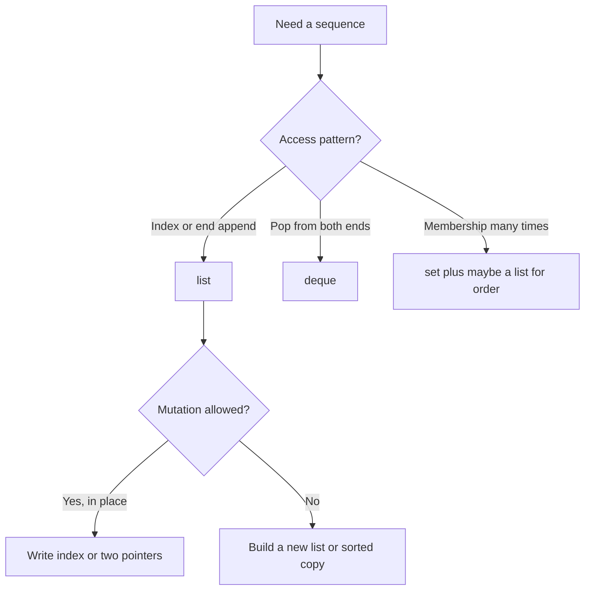

## Why this matters

A Python list is the structure underneath most interview problems that say "array." It is a dynamic array of pointers, not a linked list. Indexing is constant time. Append is amortized constant time. Inserting at the front is linear. Candidates who treat `insert(0, x)` as cheap write quadratic solutions and call them linear. Candidates who slice without noticing the copy blow memory on a large buffer and still think they took a view.

Production code has the same object: request batches, in-memory windows, rows you accumulate before a bulk insert. Knowing when to append, when to preallocate, and when to stop deleting from the middle is ordinary backend judgment.

## Intuition

Picture a row of slots that point at objects, plus some empty slots at the end held in reserve. `append` fills the next empty slot. When the reserve is gone, the list allocates a larger row and copies the pointers. That copy is expensive once and cheap when you spread it over the many appends that follow. The objects themselves are not copied, only the pointers.

Slicing builds a new row. It does not share storage with the original the way a memory view of bytes might. The new list has new slots pointing at the same objects. Shallow copy, new container.

## Core concept in depth

### Indexing and slicing

Indexes start at 0. Negative indexes count from the end: `-1` is the last item. An index past the end raises `IndexError`. A slice never raises for being out of range; it returns a shorter list. `nums[1:4]` includes index 1 and excludes 4. Omitting a bound means the start or the end. A step is the third component: `nums[::2]` takes every second item, `nums[::-1]` is a reversed copy.

Assigning to a slice replaces that span. `nums[1:3] = [9]` can shorten the list. `nums[1:1] = [7, 8]` inserts. This is powerful and easy to misread. Prefer `append`, `extend`, and explicit loops in shared code unless slice assignment is the clearest way to splice.

`del nums[i]` and `nums.pop(i)` both shift the tail. `pop()` with no argument removes the last item and is amortized constant time. `pop(0)` is linear. If you need a queue, use `collections.deque`, not a list.

### Growth

`append` is amortized O(1). The resize factor is implementation-defined; CPython over-allocates so repeated appends of n items are O(n) total, not O(n²). `insert(0, x)` is O(n) every time, and n of those are O(n²). `extend` of k items is O(k) and is the right way to concatenate onto an existing list. `a = a + b` builds a new list and rebinds, copying both sides. Inside a loop, `a = a + [x]` is quadratic. `a += [x]` on a list calls extend and is amortized constant per item. The difference is the same rebind-versus-mutate split you already know, now with a cost.

Pre-sizing is rarely needed. If you know the length, a list comprehension or `[0] * n` creates n slots. `[0] * n` repeats the same pointer n times. That is safe for immutable ints and catastrophic for `[[]] * n`, because every row is the same list. Build rows with a comprehension: `[[] for _ in range(n)]`.

### In-place interview patterns

Two patterns cover a large fraction of array problems.

**Write index.** Walk with a read index, and write kept items at a `write` index that only advances when you keep. At the end, `del nums[write:]` drops the tail. This removes elements in linear time and constant extra memory. It is the answer to "remove duplicates from a sorted array" and "move zeros."

**Opposite ends.** One index starts at the left, one at the right, and they move toward each other. Sorted two-sum and reversing in place use this. The loop ends when they meet. Moving the wrong pointer is the bug; state which side is too small or too large before you code.

Reversal of a slice in place is `nums[i:j] = reversed(nums[i:j])` or a pair of indexes. `reversed` returns an iterator, so the slice assignment consumes it into the same list. Assigning `nums[i:j] = nums[j-1:i-1:-1]` also works and is harder to read. A write index or a pair of pointers is easier to defend.

### Copying and aliasing

`b = a` aliases. `b = a.copy()` or `b = a[:]` is a shallow copy. Nested lists are still shared. `list(a)` is also a shallow copy. Deep copy is `copy.deepcopy` and is slower and more surprising with objects that define custom copying. For interview data that is a list of ints, shallow copy is a real copy of the structure you care about.

Sorting: `nums.sort()` mutates and returns `None`. `sorted(nums)` returns a new list. Know which one the prompt allows. Stable sort matters when you sort records twice. The lambda lesson covered keys; the list lesson's contribution is the mutation contract.

### Lists are not thread-safe

One list shared by threads without a lock can lose appends or raise during iteration. The GIL does not make `append` a synchronization tool you should rely on for compound actions like "check then append." Use a queue from the concurrency module for producer-consumer work. For single-threaded code, ignore this paragraph except to avoid claiming lists are a lock-free queue.

## Diagram / flowchart



### Dry-run: remove evens with a write index

Start with `1, 2, 3, 4, 5`. Keep odds.

| Read | Value | Action | List and write |
| --- | --- | --- | --- |
| 0 | 1 | keep, write at 0 | 1, 2, 3, 4, 5 and write becomes 1 |
| 1 | 2 | skip | write stays 1 |
| 2 | 3 | write at 1 | 1, 3, 3, 4, 5 and write becomes 2 |
| 3 | 4 | skip | write stays 2 |
| 4 | 5 | write at 2 | 1, 3, 5, 4, 5 and write becomes 3 |
| end | | delete from index 3 | 1, 3, 5 |

The tail after `write` is garbage until you delete it. Forgetting the delete leaves old values and fails hidden tests that check length.

## Code

```python
def drop_in_place(nums: list[int]) -> int:
    """Keep odd numbers in place. Return the new length."""
    write = 0
    for value in nums:
        if value % 2:
            nums[write] = value
            write += 1
    del nums[write:]
    return write


def move_zeros(nums: list[int]) -> None:
    write = 0
    for value in nums:
        if value != 0:
            nums[write] = value
            write += 1
    for i in range(write, len(nums)):
        nums[i] = 0


def window_sums(nums: list[int], k: int) -> list[int]:
    if k <= 0 or k > len(nums):
        return []
    total = sum(nums[:k])
    out = [total]
    for i in range(k, len(nums)):
        total += nums[i] - nums[i - k]
        out.append(total)
    return out


if __name__ == "__main__":
    data = [1, 2, 3, 4, 5]
    print(drop_in_place(data), data)
    zeros = [0, 1, 0, 3, 12]
    move_zeros(zeros)
    print(zeros)
    print(window_sums([1, 2, 3, 4], 2))
```

`window_sums` is the sliding window you should reach for before a nested loop. The first window is a real sum. Each step adds the incoming item and subtracts the item that left. That is O(n) after the initial O(k), not O(n·k).

## Complexity analysis

| Operation | Time | Notes |
| --- | --- | --- |
| Index read or write | O(1) | |
| `append`, `pop()` | Amortized O(1) | Occasional resize copies pointers |
| `insert(0)` or `pop(0)` | O(n) | Shifts the tail |
| Slice of length k | O(k) | New list |
| `in` on a list | O(n) | Scans |
| n appends | O(n) total | Amortized |
| n times `a = a + [x]` | O(n²) | Copies the growing list |
| Write-index filter | O(n) time, O(1) extra | |
| Sliding window sum | O(n) | After the first window |

Say "amortized" for append. Saying O(1) worst case is wrong for a single append that resizes, and saying O(n) for every append is wrong for a sequence of them.

## Tricks, tips and patterns

- Append at the end. If the problem is a queue, switch to `deque`.
- Remove items in place with a write index, then delete or overwrite the tail.
- Slide a window by adding the new element and removing the old one.
- Build a list of distinct rows with a comprehension, never with multiplication of one nested list.
- Copy with `a[:]` when the caller must not see later appends. Remember it is shallow.
- Use `enumerate` when you need the index. Use two pointers when the array is sorted.
- `reversed` and slicing with a negative step allocate unless you swap in place with indexes.

## Common mistakes and edge cases

- `insert(0, x)` in a loop and claiming linear time.
- `[[]] * n` sharing one inner list across every row.
- Forgetting that a slice is a copy, then mutating the slice and expecting the original to change. Item mutation of a mutable element does show up in both, because the pointers match. Rebinding a slot in the copy does not.
- `pop` on an empty list raises `IndexError`.
- Slice assignment with the wrong length silently changing the length when you thought it was a replace of equal size.
- `nums.sort()` used as a value.
- Off-by-one in a window: the loop should start at `k`, and the outgoing element is `nums[i - k]`.
- Modifying a list while a `for` iterates it. The write-index loop iterates values and writes by index into the same list, which is safe only because you never change the length until the loop ends. Do not `del` inside that loop.

## Interview notes

Clarify in-place versus new list, and whether the caller needs the removed items. Then name the pattern: write index, two pointers, or sliding window. State O(n) time and O(1) extra before you code the in-place version. If you build an output list, say O(n) extra and why the prompt allows it.

Follow-ups:

- **Why is append amortized constant?** Resizes are rare and copy a geometric series of sizes, which sums to linear overall.
- **List versus deque?** List is for index access and end growth. Deque is for both ends. Deque indexing in the middle is not O(1).
- **Shallow versus deep?** A shallow copy shares nested objects. For a list of ints that does not matter.
- **How do you remove duplicates in a sorted array in place?** Write index, skip when equal to the previous kept value.

Mention the shared-row multiplication bug if they ask you to make a matrix. It is a favorite follow-up because the first row update "mysteriously" updates every row.

## Practice problems

1. **Drop In Place** (easy) — keep odds in place and return the new length. [Practice: python-ex-drop-in-place]
2. **Move Zeros** (easy) — push zeros to the end, preserving nonzero order. [Practice: python-ex-move-zeros]
3. **Window Sums** (medium) — sliding window sums of size k. [Practice: python-ex-window-sums]
4. **Dedup Sorted** (medium) — remove adjacent duplicates in a sorted list in place. [Practice: python-ex-dedup-sorted]
5. **Two Sum Sorted** (medium) — indexes of a pair that sums to a target, ends moving inward. [Practice: python-ex-two-sum-sorted]
6. **Rotate Right** (medium) — rotate a list right by k using reversal, O(1) extra memory. [Practice: python-ex-rotate-right]

## Summary / cheat sheet

- A list is a dynamic array of pointers. Indexing is O(1). Append is amortized O(1). Insert or pop at the front is O(n).
- Slices copy. They do not raise when bounds are past the ends. Assignment to a slice can change length.
- Repeated `a = a + [x]` is quadratic. `append` or `extend` is linear overall.
- `[obj] * n` repeats one pointer. Never use it for nested mutable rows.
- In-place filters use a write index and a tail delete. Windows slide by add and subtract. Sorted scans use two ends.
- `sort` mutates and returns `None`. `sorted` returns a new list.
- Shallow copy shares nested objects. Alias (`b = a`) shares the list itself.

## Further reading

- [More on lists](https://docs.python.org/3/tutorial/datastructures.html#more-on-lists)
- [Sequence types](https://docs.python.org/3/library/stdtypes.html#sequence-types-list-tuple-range)
- [Time complexity of list operations in the Python wiki](https://wiki.python.org/moin/TimeComplexity)
- [Sorting HOW TO](https://docs.python.org/3/howto/sorting.html)
