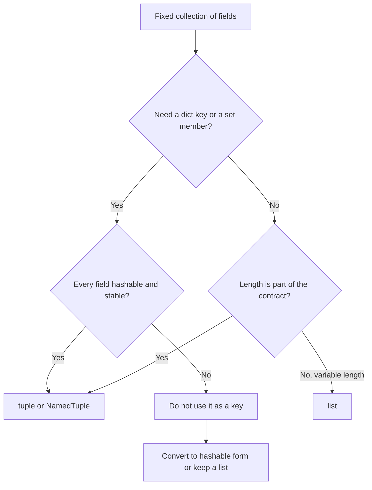

## Why this matters

Tuples are how Python returns multiple values, how dict keys represent a coordinate or a cache key, and how a function promises not to append to a sequence. The promise is narrower than people think. A tuple cannot grow or shrink, and its slots cannot be rebound, but the objects in those slots might still be mutable. Put a list inside a tuple and the tuple's hash changes if you mutate the list, which is why that tuple cannot be a dict key at all.

Interviews use tuples as points, as intervals, and as the return type of "find the pair." Backend code uses them as composite cache keys `(user_id, day)` because a list cannot be a key. Choosing a tuple is a correctness choice about hashing and about accidental mutation, not a style whim.

## Intuition

A tuple is a sealed row of slots. You can read any slot. You cannot replace a slot, add a slot, or delete a slot. Unpacking is the natural way to read a short tuple: `x, y = point`. The sealed row is hashable only when every object it points at is hashable, because the hash is a combination of the hashes of the contents. If a content can change its hash later, the dict that stored the tuple would look in the wrong bucket. Python refuses to hash such a tuple up front.

A named tuple is the same sealed row with field names, so `point.x` beats `point[0]` once the record leaves the function that built it.

## Core concept in depth

### Construction and the single-element trap

Parentheses are grouping, not the tuple. The comma makes the tuple. `1, 2` is a tuple. `(1, 2)` is the same tuple, and the parentheses are wise when you pass it as an argument so the comma is not read as two arguments. A one-element tuple needs a comma: `(1,)` is a tuple, `(1)` is the integer 1. An empty tuple is `()`. Forgetting the comma wraps nothing and your "pair" is a bare value. Tests then fail in unpacking with a confusing error.

`tuple(iterable)` copies the top level into a new tuple. It does not freeze nested lists. `tuple([[1], [2]])` is a tuple of two lists.

### What immutability covers

Item assignment raises `TypeError`. `append` does not exist. Concatenation `a + b` returns a new tuple and is O(n). Repeated concatenation in a loop is quadratic, same as for lists. If you are accumulating, append to a list and convert once with `tuple(items)` at the boundary.

Because slots cannot be rebound, a tuple is a reasonable record to share across callers without fearing `append`. It is not a deep freeze. If slot 0 is a list, `pair[0].append(1)` mutates that list and every alias sees it. Immutability of the container is not immutability of the graph.

### Hashability

An object is hashable when it has a hash that stays stable for its lifetime as a dict key, and when equal objects have equal hashes. Tuples of hashable objects qualify: ints, strings, other tuples, frozensets, `None`, bools. Tuples that contain a list, a dict, or a set do not. `hash(pair)` raises `TypeError`. The check walks the contents.

This is why a cache key of coordinates works and a cache key of "the list of tags in whatever order the client sent" does not, twice over: the list is unhashable, and order probably should not matter. Sort the tags and store a tuple, or use a frozenset if order is irrelevant and duplicates are irrelevant.

Do not implement `__hash__` on a class whose equality depends on a mutable field. The tuple rule is the same rule you will apply to your own objects: if it can change, it cannot be a key.

### Unpacking

`a, b = pair` requires exactly two items. `a, *rest = values` puts the first item in `a` and the remainder in a new list `rest`. `*rest` can sit in the middle: `first, *mid, last = values`. This is the clean way to split a header and a tail without indexes. Unpacking also swaps: `a, b = b, a` builds the right-hand tuple first.

Starred unpacking in a call is the other star: `f(*pair)` passes the items as positional arguments. Same character, different side of the call. You already saw this with `*args`.

### Named tuples

`collections.namedtuple` and `typing.NamedTuple` give fields. `typing.NamedTuple` is the one to prefer in typed code because the fields are annotated. A named tuple is still a tuple: it indexes, iterates, unpacks, and hashes if the fields hash. It is not a place to hide mutable state. For records that need defaults, mutation, or methods that change data, use a dataclass. Named tuples win when the record is a value: a point, a token, a parsed coordinate.

`_replace` returns a new named tuple with a field changed. It does not mutate. That is the honest update style for a value object.

### Tuples versus lists as a signal

Return a tuple when the length is part of the contract (always two) and callers should not append. Return a list when the length varies and callers may extend. Accept either in a helper by iterating, not by checking the type, unless you must reject mutation. `Sequence` in typing covers both.

Using a tuple to "make it faster" is rarely measurable next to I/O. Using a tuple so a bug cannot `append` is measurable in review.

## Diagram / flowchart



### Dry-run: hash and the one-comma trap

| Expression | What you actually built | Usable as a dict key? |
| --- | --- | --- |
| `(1, 2)` | tuple of two ints | Yes |
| `(1)` | int 1 | Yes, but it is not a pair |
| `(1,)` | tuple of one int | Yes |
| a tuple containing one list | tuple, unhashable contents | No, `hash` raises |
| `("u", 3)` after you wished to change the 3 | a new tuple `("u", 4)` if you rebuilt it | Yes, the old key is unchanged |

The last row is the update pattern. You do not edit the key. You build a new tuple and, if needed, move the dict value from the old key to the new key.

## Code

```python
from typing import NamedTuple


class Point(NamedTuple):
    x: int
    y: int


def as_key(user_id: int, day: str) -> tuple[int, str]:
    return (user_id, day)


def head_tail(items: tuple[int, ...]) -> tuple[int, tuple[int, ...]]:
    if not items:
        raise ValueError("empty")
    head, *rest = items
    return head, tuple(rest)


def move(point: Point, dx: int, dy: int) -> Point:
    return point._replace(x=point.x + dx, y=point.y + dy)


if __name__ == "__main__":
    cache = {as_key(7, "2026-11-26"): "ok"}
    print(cache[as_key(7, "2026-11-26")])
    print(head_tail((10, 20, 30)))
    print(move(Point(1, 2), 3, -1))
```

`as_key` returns a tuple, so it can sit in a dict. `head_tail` shows the comma split and then re-seals the rest as a tuple so the return type stays immutable. `move` returns a new point. The old point is still `(1, 2)` if the caller kept it.

## Complexity analysis

| Operation | Cost |
| --- | --- |
| Index | O(1) |
| `len` | O(1) |
| Concatenate two tuples of size n and m | O(n + m), new tuple |
| `in` | O(n) |
| Hash, if hashable | O(n) in the number of fields, cached on the tuple object by CPython after the first hash in many cases |
| Build a tuple from a list | O(n) |
| Repeated `t = t + (x,)` | O(n²) |

The hash cache is a CPython detail. Do not depend on it for complexity claims in an interview beyond "hashing a tuple walks its items." Do depend on this: mutating a list that was hashed through some other path is undefined as a key strategy, and tuples that contain lists are rejected so you do not have to debug it.

## Tricks, tips and patterns

- Write one-element tuples with a comma, always.
- Accumulate in a list, convert to a tuple once at the boundary.
- Use a tuple as a composite dict key when every field is immutable and part of the identity.
- Prefer `NamedTuple` over index soup when the record has more than two fields or leaves the function.
- Update records by building a new tuple or calling `_replace`, then rebind the name.
- Unpack with `first, *rest` instead of slicing when you want the head.
- If order of a collection does not matter and items are hashable, a `frozenset` is the hashable set. A tuple of a sorted list is the hashable ordered unique key.

## Common mistakes and edge cases

- `(1)` instead of `(1,)`, then failing to unpack or hashing the int by accident and colliding with a different key.
- Assuming a tuple of lists is frozen. The inner list still mutates, and the tuple will not hash.
- Quadratic tuple concatenation in a loop.
- Using a tuple as a key and also expecting to update a field in place. Build a new key.
- Named tuple `_replace` ignored, so the "update" vanished because you did not use the return value. Same class of bug as `sort`.
- Comparing tuples of different lengths and meanings. `(1, 2) < (1, 2, 0)` is lexicographic and true. If the tuples are records, lexicographic order may be nonsense. Do not sort records by raw tuple order unless the field order is the sort order you want.
- Putting a dict in a tuple and being surprised `hash` fails. Values that are dicts need a deliberate canonical form, not hope.

## Interview notes

When a problem says "return the two indexes," a tuple is the return type. When a problem needs a visited set of coordinates, store tuples of ints, not lists. Say "lists are unhashable, tuples of ints are hashable." That sentence unlocks grid and graph problems in Python.

Follow-ups:

- **Is a tuple always hashable?** No. Contents must be hashable.
- **What is the difference between a tuple and a list?** Mutability of the container, and therefore hashability when contents allow it. Both are random-access sequences.
- **How do you change a named tuple?** `_replace` returns a new one. You do not assign to the field.
- **Why the trailing comma?** Parentheses group. The comma constructs.

If they ask about `@dataclass(frozen=True)` versus `NamedTuple`, say frozen dataclasses are the modern record, named tuples stay useful when you want tuple unpacking and a guaranteed sequence layout. Both can be hashable if the fields are.

## Practice problems

1. **Pair Key** (easy) — build a hashable user-day key and look it up. [Practice: python-ex-pair-key]
2. **Head Tail** (easy) — split a non-empty tuple into head and a tail tuple. [Practice: python-ex-head-tail]
3. **Move Point** (easy) — return a new point shifted by dx, dy. [Practice: python-ex-move-point]
4. **Unique Key** (medium) — canonical tuple key for a bag of tags: strip, lower, sort, unique. [Practice: python-ex-tag-key]
5. **Swap Fields** (easy) — swap two tuple fields by unpacking, returning a new tuple. [Practice: python-ex-swap-pair]

## Summary / cheat sheet

- A tuple is a fixed-length sequence. The comma constructs it. `(1,)` is one element; `(1)` is not a tuple.
- Slots cannot be reassigned. Objects inside those slots might still be mutable.
- A tuple is hashable only when every item is hashable. That is why it can be a dict key and a list cannot.
- Concatenation copies. Accumulate with a list, then call `tuple` once.
- Unpack with `a, b = pair` or `first, *rest`. Stars in the call unpack into arguments.
- `NamedTuple` adds field names. `_replace` returns a new record. It does not mutate.
- Use a tuple when length and identity are the contract. Use a list when the collection grows.

## Further reading

- [Tuples and sequences](https://docs.python.org/3/tutorial/datastructures.html#tuples-and-sequences)
- [typing.NamedTuple](https://docs.python.org/3/library/typing.html#typing.NamedTuple)
- [collections.namedtuple](https://docs.python.org/3/library/collections.html#collections.namedtuple)
- [Hashable glossary](https://docs.python.org/3/glossary.html#term-hashable)
