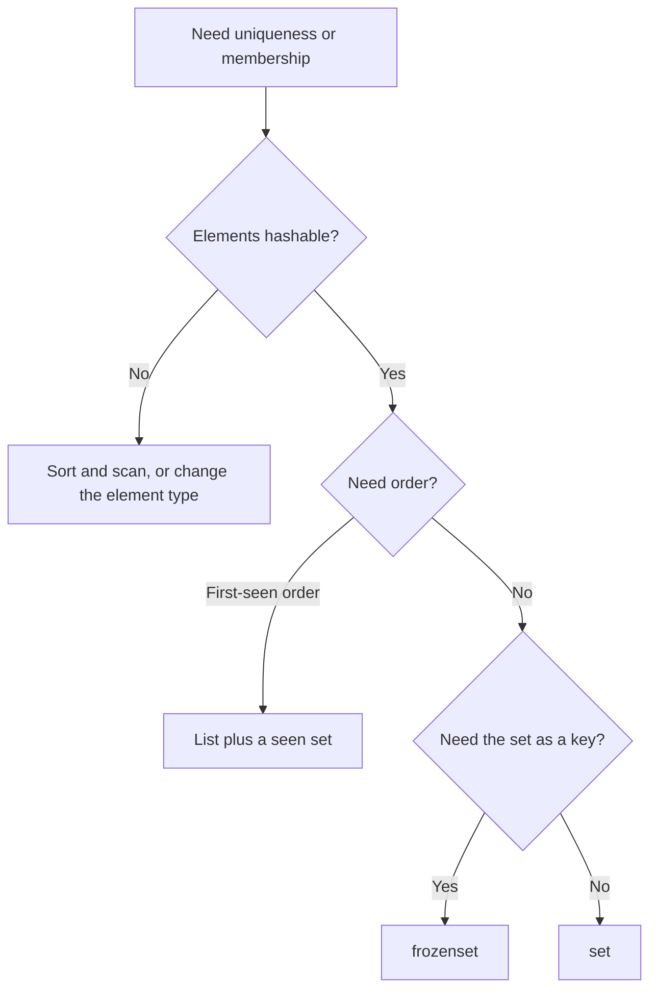

## Why this matters

A set turns an O(n) membership scan into an average O(1) lookup. That is the entire reason a nested loop over "have I seen this value?" becomes a linear pass. Interviews that are "easy" with a set become "time limit exceeded" with a list. Backend code uses the same trick for dedupe, allow-lists, and graph visited-sets.

The cost is the hash contract. Elements must be hashable and their equality must not change while they sit in the set. Violate that and you get `TypeError`, or worse, a set that cannot find an element you just mutated. This lesson is the hash contract plus the set algebra you will actually use.

## Intuition

A set is a hash table of keys with no values. Adding an element computes its hash, picks a bucket, and stores the element if an equal element is not already there. Lookup repeats the hash and compares equals inside the bucket. Two objects that compare equal must have the same hash, or the lookup looks in the wrong bucket and misses. Python's built-in immutables obey this. A list does not, because it is mutable and unhashable. A tuple of ints does.

Order is not part of the contract you should teach to callers. CPython's set order is deterministic for a process and a insertion history, and it is still not a promise. If you need first-seen order, keep a list and a set together.

## Core concept in depth

### Building and updating

A set literal needs elements; an empty pair of braces is a dict, not a set. Build an empty set with `set()`. Build a set from an iterable with `set(items)`, which drops duplicates. `add` inserts one element. `update` inserts every element from an iterable. `discard` removes an element if it is present and does nothing otherwise. `remove` removes it or raises `KeyError`. Prefer `discard` when absence is normal, `remove` when absence is a bug.

`pop` removes an arbitrary element. It is not a queue and not "the last one." Do not use `pop` when the element matters. Use it when you need any element, such as grabbing a seed in an algorithm that truly does not care which.

### Algebra

`a | b` is the union, a new set. `a & b` is the intersection. `a - b` is the difference: in `a` but not in `b`. `a ^ b` is the symmetric difference: in one but not both. In-place versions exist: `|=`, `&=`, `-=`, `^=`. Methods `union`, `intersection`, `difference`, and `symmetric_difference` accept any iterable, not only sets, which is useful when the other side is a list. The operators require both sides to be sets.

`issubset` and `issuperset` answer containment of whole sets. `<=` does the same for set objects. Do not confuse this with `in`, which tests a single element.

These operations are how you express permissions: effective permissions are the union of roles, the forbidden set is a difference, the overlap of two allow-lists is an intersection. Say the English, then the operator.

### Hashing rules that bite

- Elements must implement `__hash__` and `__eq__`. Lists, dicts, and sets do not.
- Equal elements share a hash. If you define equality on a class, define hash from the same fields, or set `__hash__ = None` to make instances unhashable on purpose.
- Do not mutate an object that is already in a set. A dataclass with `frozen=False` and a hash based on fields will corrupt the table if you change a field. Frozen tuples avoid the temptation.
- Hash collisions are rare with the built-in hash and are the table's problem. Worst-case lookup is linear if every hash collides. You do not write interview code for that case. You do not use a set of untrusted attacker-controlled hash keys as a denial-of-service surface without knowing that Python randomizes hash salts per process for strings. Mention randomization if they ask why a set of strings is safe to expose to the public internet. It is a reason, not a complete security design.

`frozenset` is the immutable set. It is hashable when its elements are, so it can be a dict key or a member of another set. Use it for a cache key that means "this combination of flags," and for a set you want to pass around without a caller adding to it. There is no literal syntax worth using beyond `frozenset(iterable)`.

### Deduping while keeping order

`list(set(items))` drops duplicates and loses order. The pattern that preserves first-seen order is a list plus a seen set:

```python
def unique(items):
    seen = set()
    out = []
    for item in items:
        if item in seen:
            continue
        seen.add(item)
        out.append(item)
    return out
```

That is O(n) average time and preserves order. If the items are unhashable, you cannot use a set. Sort and scan adjacent duplicates, which is O(n log n) and changes order unless you remember indexes. For lists of lists, convert each inner list to a tuple first if order inside the inner list matters.

### Sets and truthiness

An empty set is falsy. A non-empty set is truthy. `if seen:` means "we have recorded something," not "the set exists."

## Diagram / flowchart



### Dry-run: intersection of permissions

Role A grants `read` and `write`. Role B grants `write` and `admin`. The user has both roles.

| Operation | English | Result |
| --- | --- | --- |
| Union | anything either role grants | read, write, admin |
| Intersection | granted by both | write |
| A minus B | only A | read |
| Symmetric difference | exactly one role | read, admin |

Membership `admin in union` is true. Membership in the intersection is false. An allow-check must say which set is the policy. "Has admin" against the intersection would deny a user who does have admin from one role. That is a product bug caused by the right data structure and the wrong operator.

## Code

```python
def unique_preserve(items: list[str]) -> list[str]:
    seen: set[str] = set()
    out: list[str] = []
    for item in items:
        if item in seen:
            continue
        seen.add(item)
        out.append(item)
    return out


def shared(a: list[str], b: list[str]) -> set[str]:
    return set(a) & set(b)


def is_subset_allow(requested: set[str], allowed: set[str]) -> bool:
    return requested <= allowed


if __name__ == "__main__":
    print(unique_preserve(["b", "a", "b", "c", "a"]))
    print(sorted(shared(["read", "write"], ["write", "admin"])))
    print(is_subset_allow({"read"}, {"read", "write"}))
```

Printing a set directly is noisy in tests because order is not part of the contract. `sorted` makes the demo stable. In unit tests, compare sets to sets, not to a joined string that depends on order.

## Complexity analysis

| Operation | Average | Worst case |
| --- | --- | --- |
| `add`, `discard`, `in` | O(1) | O(n) if hashes collide pathologically |
| Build a set from n items | O(n) | O(n²) pathological |
| Union or intersection of size n and m | O(n + m) | Pathological hashing aside |
| `list(set(items))` | O(n) | Order not preserved |
| Ordered dedupe with list plus set | O(n) | Order preserved |
| `in` on a list, for contrast | O(n) | O(n), every time |

The interview sentence: "I will record seen ids in a set so each membership test is average constant time, and the whole scan is linear." Then mention the elements are hashable. If they are not, say so and switch plans.

## Tricks, tips and patterns

- Empty set is `set()`, never a pair of braces.
- `discard` when missing is fine, `remove` when missing is a bug.
- Express policies with union, intersection, and difference, and name the English in a variable: `effective = role_a | role_b`.
- Preserve order with a seen set beside a list.
- Use `frozenset` for a set that is itself a key.
- Convert pairs and coordinates to tuples before adding them to a visited set.
- Compare sets in tests without sorting, unless you are snapshotting a string for humans.

## Common mistakes and edge cases

- Using a pair of braces for an empty set and getting a dict. The first `add` then fails with `AttributeError`, because dicts have no `add`. The bug appears late if you thought the literal was a set.
- Expecting insertion order to be a public guarantee for sets. It is not your API.
- `pop` assumed to return the minimum or the first inserted. It returns an arbitrary element.
- Mutating an element that lives in the set. Lookups then miss.
- Adding a list. `TypeError`. Convert to a tuple.
- Using subtraction on lists and expecting set difference. Lists do not support `-`.
- A seen set of unnormalized strings, so `"Py"` and `"py"` both survive. Normalize before `add` and before `in`.
- Symmetric difference when you meant difference. The extra elements are the bug report.

## Interview notes

Reach for a set the moment you hear "duplicates," "seen," or "two arrays, find common." State hashability. State average O(1) membership and O(n) for the pass. If order matters, say you will keep a list too.

Follow-ups:

- **Can a set contain a list?** No. Tuple of hashables, yes.
- **What does pop return?** An arbitrary element, and `KeyError` on an empty set.
- **Union versus update?** Union returns a new set. Update mutates.
- **How do you dedupe and keep order?** Seen set plus output list, not `list(set(...))`.

A good extra: frozenset as a cache key for a combination of feature flags. It shows you know immutability is about the hash contract, not about the set type's reputation.

## Practice problems

1. **Unique Preserve** (easy) — dedupe strings, keep first-seen order. [Practice: python-ex-unique-preserve]
2. **Shared Items** (easy) — intersection of two lists as a set. [Practice: python-ex-shared-items]
3. **Allow Subset** (easy) — whether every requested permission is allowed. [Practice: python-ex-allow-subset]
4. **Symmetric** (medium) — elements in exactly one of two lists. [Practice: python-ex-symmetric]
5. **Pair Seen** (medium) — count new coordinate pairs, using tuples in a set. [Practice: python-ex-pair-seen]
6. **Normalize Dedupe** (medium) — strip and casefold tags, then unique in order. [Practice: python-ex-normalize-dedupe]

## Summary / cheat sheet

- A set is a hash table of unique elements. Membership and insert are average O(1).
- Elements must be hashable and must not change while stored. Lists and dicts are out. Tuples of hashables are in.
- `set()` is empty. A pair of braces is an empty dict.
- `discard` is quiet, `remove` raises, `pop` is arbitrary.
- Union, intersection, difference, and symmetric difference are the policy operators. Methods accept any iterable; operators want sets.
- `list(set(xs))` drops order. A seen set plus a list keeps first-seen order.
- `frozenset` is the hashable set. Use it when the set is a key.

## Further reading

- [sets](https://docs.python.org/3/tutorial/datastructures.html#sets)
- [Set types](https://docs.python.org/3/library/stdtypes.html#set-types-set-frozenset)
- [Hashable glossary](https://docs.python.org/3/glossary.html#term-hashable)
- [Time complexity](https://wiki.python.org/moin/TimeComplexity)
