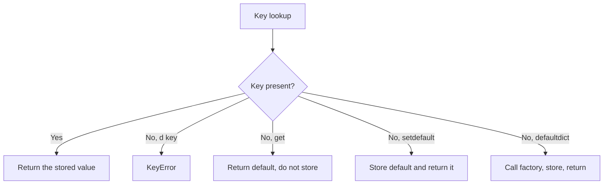

## Why this matters

A dictionary is the Python hash map. Counting frequencies, grouping anagrams, caching a computation, and representing a JSON object are all dicts. Interviews are often "can you do this in one pass with a map?" Backend handlers spend their lives translating rows into dicts and back. The bugs are specific: using a mutable key, confusing `get` returning `None` with a stored `None`, assuming order did not exist in old Python and now depending on it, and calling `setdefault` with a fresh list that you think is cheap when the key already exists.

Since Python 3.7, insertion order is part of the language for `dict`. That changed how you write deterministic JSON and how you explain "ordered dict" in interviews. You still reach for `OrderedDict` only when you need order-sensitive operations beyond insertion, such as moving a key to the end on access. That is an LRU story, and `functools.lru_cache` or `collections.OrderedDict` can own it. A plain dict is the default map.

## Intuition

A dict stores keys that are hashable, each pointing at a value. Lookup hashes the key, finds the bucket, and compares equality. Insertion of a new key appends it to the insertion-order sequence. Updating an existing key changes the value and does not move the key to the end. Deleting a key removes it from the order. Inserting it again puts it at the end.

The value can be anything, including another dict or a list. The key cannot be a list or a dict. The key's hash and equality must stay stable.

## Core concept in depth

### Lookup, insertion, and missing keys

`d[key]` returns the value or raises `KeyError`. `d.get(key)` returns `None` when the key is missing, or a default you pass. `d.get(key, [])` does not store the default. The next lookup misses again. That is what you want for a read. It is the wrong tool when you meant "create a list for this key and keep it."

`key in d` is average O(1) and tests keys, not values. `d[key] = value` inserts or replaces. `del d[key]` raises if the key is missing. `d.pop(key, default)` removes and returns, and can avoid the exception. `d.popitem()` removes the last inserted key and its value, which is how a plain dict acts like a stack of insertion order. It raises on an empty dict.

### setdefault versus the obvious bug

`d.setdefault(key, []).append(item)` inserts the default only when the key is missing, then returns the stored list, and you append to that same list. This is the grouping idiom. The trap: the default expression is evaluated **before** the call, every time. `setdefault(key, [])` builds a throwaway list even when the key exists, and then throws it away. For a tight loop over millions of rows that mostly hit existing keys, build the list inside a `try`/`except KeyError` or use `if key not in d: d[key] = []`. For ordinary request-sized data, `setdefault` is fine and readable. Know the evaluation rule so you never write `setdefault(key, expensive())`.

`defaultdict(list)` from `collections` moves the factory into the dict. Missing keys create a list on first access, including on a bare read `d[key]`. That is convenient and also a way to fill a dict with empty lists by accident while "just checking." Use `defaultdict` when missing means "start a group." Use a normal dict when a missing key is an error you want to see.

### Iteration and order

`for k in d` walks keys in insertion order. `d.values()` and `d.items()` follow the same order. Do not mutate the dict while you iterate it: adding or deleting keys raises `RuntimeError` in CPython. Build a list of keys to delete first, or build a new dict. Updating the value of a key that already exists, without adding or removing keys, is allowed during iteration.

`reversed(d)` walks keys from last inserted to first. Equality of dicts compares keys and values and ignores order. Two dicts built in different orders compare equal if they hold the same pairs. JSON serializers that preserve dict order will still emit different text. If a signature or a snapshot test hashes the JSON, order matters even though Python equality does not.

### Merging

Unpacking two mappings into a new dict, and `a | b` (3.9+), build a new dict. Later keys win. `a |= b` updates `a` in place. For nested dicts, `|` is shallow: nested dicts are not merged key by key, the whole nested value is replaced. Deep merge is a function you write on purpose, with a policy for conflicts. Do not pretend `|` is a deep merge.

### Keys and identity

Keys are compared with `==` and hashed with `hash`. `True` and `1` collide. A tuple key matches another tuple with equal items. A custom object needs `__hash__` and `__eq__` together, or it uses identity equality by default, which means two separately constructed objects do not match as keys even if their fields match. That default is correct for entities and wrong for value objects. Frozen dataclasses implement value equality and hashing. You will get there in the OOP module. Until then, use tuples as keys when the key is data.

### Counting and grouping

Frequency counting is one pass: for each item, `counts[item] = counts.get(item, 0) + 1`. `collections.Counter` does this and adds helpers like `most_common`. Grouping is the `setdefault` list append. Both are O(n) average. If you only need the mode, a counter is enough. If you need the groups themselves, store lists.

`get` with `0` is safe because you are not storing a missing marker that collides with a real zero... you are supplying the numeric default for "no counts yet," and zero is the right number. This is different from the `or` default bug. Here missing and zero mean the same thing at the start of a count.

## Diagram / flowchart



### Dry-run: group letters, and a get that does not stick

Items `a, b, a`. Group with `setdefault` and a list.

| Step | Key | Dict after the append |
| --- | --- | --- |
| 1 | a | a maps to a list containing a |
| 2 | b | b maps to a list containing b |
| 3 | a | a's list is a, a. The same list object as step 1 |

Now a mistaken cache: `value = d.get(key, compute())`. Even when `key` is present, `compute()` runs because arguments are evaluated before the call. And when `key` is missing, the computed value is returned but not stored, so the next call computes again. The fix is an explicit membership test, then store.

## Code

```python
from collections import Counter, defaultdict


def counts(items: list[str]) -> dict[str, int]:
    out: dict[str, int] = {}
    for item in items:
        out[item] = out.get(item, 0) + 1
    return out


def group_anagrams(words: list[str]) -> list[list[str]]:
    groups: dict[tuple[str, ...], list[str]] = defaultdict(list)
    for word in words:
        key = tuple(sorted(word))
        groups[key].append(word)
    return list(groups.values())


def first_unique(items: list[str]) -> str | None:
    freq = Counter(items)
    for item in items:
        if freq[item] == 1:
            return item
    return None


if __name__ == "__main__":
    print(counts(["a", "b", "a"]))
    print(group_anagrams(["eat", "tea", "tan"]))
    print(first_unique(["a", "b", "a", "c", "b"]))
```

`group_anagrams` uses a tuple of sorted characters as the key because a list cannot be a key. Insertion order of the dict is the order of first time we saw each pattern, which keeps group order stable. `first_unique` relies on that same stability in the original list, not on the counter's order: it scans `items` again so the earliest unique wins even if you built the counter from a different sequence.

## Complexity analysis

| Operation | Average time | Notes |
| --- | --- | --- |
| Get, set, delete, `in` | O(1) | Worst case linear under hash collision |
| Build counts for n items | O(n) | |
| Anagram key by sorting a word of length k | O(k log k) per word | Often the dominant cost, not the dict |
| Iterate the dict | O(n) in insertion order | |
| Shallow merge of two dicts | O(n + m) | Nested dicts are replaced, not merged |
| `setdefault` with a list literal | O(1) plus allocating a list every call | Wasted allocation on hits |

Name the key cost. "The dict is constant time, and sorting each word is k log k" is a complete answer. "The dict is O(1)" alone hides the key construction.

## Tricks, tips and patterns

- `get` does not store. `setdefault` and `defaultdict` do.
- Defaults to `setdefault` and `get` are evaluated before the call. Do not put an expensive call there.
- Keys must be hashable. Sort-and-tuple a word to key an anagram. Use a tuple for a coordinate.
- Do not add or remove keys while iterating. You may update values for existing keys.
- Merge with `|` when you want a new dict and later keys should win. Deep merge is a different function.
- `Counter.most_common(k)` is the readable top-k for modest n. For a huge stream, a heap of size k is the memory-aware tool.
- Rely on insertion order. Do not rely on equality caring about order. It does not.
- `True` and `1` are the same key. Do not mix them.

## Common mistakes and edge cases

- `d.get(key, [])` and then appending to the result, expecting the dict to keep the append. It does not, when the key was missing, because you appended to a throwaway list.
- `d.get(key, expensive())` running `expensive` on every lookup.
- Using a list as a key.
- Iterating and deleting, which raises `RuntimeError`.
- Assuming `popitem` removes the smallest key. It removes the last inserted.
- A shallow merge that drops nested keys you meant to keep.
- `defaultdict` creating entries on a read you thought was pure, then emitting those empties in a response.
- Depending on dict order in code that still has to run on a Python where order was not guaranteed. 3.7+ is the floor for this course. Say the version if you are asked.
- Mutable key objects. Same corruption as a mutated set element.

## Interview notes

The pattern library you should be able to write from memory: frequency map, index map ("have I seen this complement?"), grouping map with a tuple key, and a two-pass first-unique. State average linear time and the hashability of the key.

Follow-ups:

- **Is dict ordered?** Yes, insertion order, since 3.7. Equality ignores order.
- **get versus setdefault?** `get` does not insert. `setdefault` inserts the default only when missing, but it always evaluates the default expression.
- **Why tuple(sorted(word))?** Lists are unhashable. The sorted tuple is a canonical anagram key.
- **Can you mutate during iteration?** Not the set of keys. Yes, the values for keys already present.

Mention `KeyError` versus a default in API design. A missing user id should often be an error, not `None` that becomes a 500 later. `get` is for the case where absence is a defined state.

## Practice problems

1. **Counts** (easy) — frequency map of strings. [Practice: python-ex-counts]
2. **Group Anagrams** (medium) — group words by sorted-letter signature, stable by first seen. [Practice: python-ex-group-anagrams]
3. **First Unique** (medium) — earliest item that appears once. [Practice: python-ex-first-unique]
4. **Two Sum** (medium) — indexes of two numbers that add to a target, one pass with an index map. [Practice: python-ex-two-sum]
5. **Shallow Merge** (easy) — merge two flat dicts, second wins on conflict. [Practice: python-ex-merge-dicts]
6. **Group Indexes** (medium) — map each value to the list of indexes where it appears. [Practice: python-ex-group-indexes]

## Summary / cheat sheet

- A dict is an ordered hash map. Lookup, insert, and delete are average O(1). Order is insertion order since Python 3.7.
- `d[key]` raises `KeyError`. `get` returns a default and does not store it. `setdefault` stores the default only on a miss, and always evaluates it.
- `defaultdict` builds the value on first access, including reads.
- Keys must be hashable and stable. `1` and `True` collide. Use tuples for composite and anagram keys.
- Do not add or remove keys while iterating. Updating an existing value is allowed.
- `|` merges shallowly. Later keys win. Nested dicts are replaced whole.
- Equality ignores order. Serializers may not. Counters and grouping are the two interview shapes to memorize.

## Further reading

- [Dictionaries](https://docs.python.org/3/tutorial/datastructures.html#dictionaries)
- [Mapping types](https://docs.python.org/3/library/stdtypes.html#mapping-types-dict)
- [collections.Counter](https://docs.python.org/3/library/collections.html#collections.Counter)
- [PEP 584 — Dictionary union operators](https://peps.python.org/pep-0584/)
- [Time complexity](https://wiki.python.org/moin/TimeComplexity)
