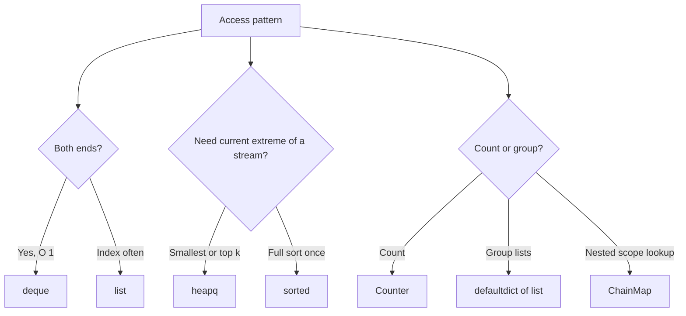

## Why this matters

The standard library already contains the structures people reimplement badly in interviews. A queue built on `list.pop(0)` is quadratic. A top-k built by sorting the whole stream is fine until the stream is larger than memory and you only needed ten items. A frequency map written by hand is readable, and `Counter` is more readable and harder to get wrong. Knowing which object to import is a 15–20 LPA signal because it shows you have written Python, not translated Java line by line.

This lesson is a decision guide with the complexity attached, not a tour of every method.

## Intuition

`deque` is a row you can cheaply grow or shrink at either end. The middle is not its talent. `heapq` is a list you promise to keep in heap order, so the smallest item is always at index 0, and pushing or popping is logarithmic. It is not a sorted list. `Counter` is a dict that counts. `defaultdict` is a dict that knows how to start a missing value. `namedtuple` is a tuple with names. None of these are magic. Each one removes a specific footgun.

## Core concept in depth

### deque

`collections.deque` supports `append`, `appendleft`, `pop`, and `popleft` in O(1) time. Indexing in the middle is O(n). A deque is the right queue and the right stack if you might need the other end later. A list is still the right stack if you only `append` and `pop` at the end, and it is the right choice when you need random access.

`maxlen` makes a bounded deque. When it is full, an append on one end discards from the other end. That is a sliding window of the last n events without you writing the eviction. It is also a quiet data loss if you did not mean to bound it. Set `maxlen` only when eviction is the spec.

`rotate(k)` moves items from one end to the other. It is O(k). For a sliding window maximum you usually want indexes in the deque, not the values alone: the deque stays decreasing, you pop indexes that fell out of the window from the left, and you pop smaller candidates from the right before appending the new index. That algorithm is O(n) and is the interview use of deque beyond "it's a queue." If you only need a queue, say `popleft` and stop. Do not invent a monotonic deque for a problem that is a simple BFS.

`deque` is thread-safe for appends and pops at the ends. A check-then-act across two operations is not atomic. For a real worker queue, `queue.Queue` adds blocking and a join protocol. Use `deque` for single-threaded algorithms and for the window. Use `queue.Queue` for threads.

### heapq

`heapq` functions operate on a normal list. `heappush(heap, item)` and `heappop(heap)` maintain the smallest item at index 0. There is no max-heap type. Push negated numbers for a max-heap of ints, and remember to negate again when you pop. For records, push tuples. Comparison is lexicographic, so `(priority, seq, task)` breaks ties by `seq` and avoids comparing tasks that might be unorderable.

`heapq` does not support a decrease-key operation. Dijkstra implementations in Python push a new pair and ignore stale pairs when they are popped, rather than updating an entry in place. Say that if you write shortest path. `nlargest(k, iterable, key=...)` and `nsmallest` are the right helpers for a finite sequence. They are O(n log k) internally when k is smaller than n. Sorting is simpler and fast enough when n is the size of a request. Use the heap when k is tiny and n is huge, or when items arrive over time and you cannot store them all sorted.

A heap is not sorted if you iterate it. Only index 0 is the extreme. To sort, pop everything, which is O(n log n), the same class as `sorted`. Do not print a heap and call it the sorted order.

### Counter

`Counter(items)` counts hashable items. `most_common(k)` returns the k highest counts, breaking ties by first-encountered order in current CPython... do not rely on tie order unless you have checked the version. If the spec says "ties keep the earliest item," scan yourself. `counter[item] += 1` works even for a missing item, because missing reads return 0. That is different from a normal dict. `elements()` expands counts back into items and skips counts at or below zero.

Subtracting counters can leave zero or negative counts. `+` and `-` between counters drop non-positive results in the result's construction for some operators. Read the docs before you use a counter as an inventory that must represent debt. For interview frequency problems, `most_common` and a manual scan are enough.

### defaultdict and ChainMap

`defaultdict(list)` groups. `defaultdict(int)` counts, and a normal `Counter` is usually clearer for counts. The factory runs on missing access, including reads.

`ChainMap(child, parent)` looks up keys in the child first, then the parent, without copying. Writes go to the first mapping. It is the right model for nested scopes: local overrides on top of defaults. It is not a deep merge. Mutations to the parent are visible through the chain. That is what you want for a scope and what you do not want if you needed a snapshot.

### namedtuple, again, as a collections citizen

You met named tuples as records. In this module the point is smaller: when a heap item or a graph edge has three fields, a named tuple or a plain tuple both work. A plain tuple is less to explain on a whiteboard. A named tuple is kinder in application code. Do not build a class with methods just to hold `priority` and `node` for a heap.

## Diagram / flowchart



### Dry-run: min-heap push and pop

Push 5, then 1, then 4. The list is heap-ordered, not sorted. Index 0 is the minimum.

| Operation | Minimum at index 0 | What you must not claim |
| --- | --- | --- |
| push 5 | 5 | The list is sorted |
| push 1 | 1 | 5 disappeared; it is still in the heap |
| push 4 | 1 | 4 is somewhere not necessarily at the end in sorted position |
| pop | 4 becomes the min after 1 leaves | The pop returned 1 |

A max-heap of scores 5, 1, 4 is the same algorithm on -5, -1, -4. The first pop of the negated heap is -5, which you negate back to 5. Forgetting the second negation returns a negative score to the caller.

Deque window of `maxlen=3`: append 1, 2, 3, 4.

| Append | Contents from the left |
| --- | --- |
| 1 | 1 |
| 2 | 1, 2 |
| 3 | 1, 2, 3 |
| 4 | 2, 3, 4 |

`1` was discarded. If those were unaudited events, `maxlen` just deleted history. Use it for "last 3," not for "all."

## Code

```python
import heapq
from collections import Counter, deque, defaultdict


def last_n(events: list[str], n: int) -> list[str]:
    window: deque[str] = deque(maxlen=n)
    for event in events:
        window.append(event)
    return list(window)


def top_k_frequent(nums: list[int], k: int) -> list[int]:
    if k <= 0:
        return []
    freq = Counter(nums)
    # Heap of (count, value), smallest count evicted, size at most k.
    heap: list[tuple[int, int]] = []
    for value, count in freq.items():
        heapq.heappush(heap, (count, value))
        if len(heap) > k:
            heapq.heappop(heap)
    return [value for _, value in heap]


def group(words: list[str]) -> dict[int, list[str]]:
    groups: dict[int, list[str]] = defaultdict(list)
    for word in words:
        groups[len(word)].append(word)
    return dict(groups)


if __name__ == "__main__":
    print(last_n(["a", "b", "c", "d"], 2))
    print(sorted(top_k_frequent([1, 1, 1, 2, 2, 3], 2)))
    print(group(["aa", "b", "cc"]))
```

`top_k_frequent` keeps a heap of size k. The result order is heap order, not frequency order, so the demo sorts for display. If the interviewer wants any k items with the highest frequencies, order does not matter. If they want sorted order, sort the heap at the end, which is O(k log k). `group` converts the defaultdict back to a dict before returning so callers do not accidentally create keys by reading.

## Complexity analysis

| Tool | Operation | Cost |
| --- | --- | --- |
| deque | append or pop either end | O(1) |
| deque | index in the middle | O(n) |
| list | pop(0) | O(n), which is why queues should not be lists |
| heapq | push or pop | O(log n) |
| heapq | look at minimum (`heap[0]`) | O(1) |
| nsmallest of k from n | | O(n log k) |
| Counter of n items | | O(n) average |
| most_common(k) | | O(n log k) typical |
| Bounded deque of the last n events | | O(1) memory in n, not in the stream length |

Top-k with a full sort is O(n log n). The heap of size k wins when k is much smaller than n. Say that trade out loud. Do not heap-sort twenty items from a list of thirty unless you are practicing the API.

## Tricks, tips and patterns

- Queue: `deque` and `popleft`. Stack: list `append` and `pop`, unless you already hold a deque.
- Bounded history: `deque(maxlen=n)` and accept eviction.
- Max-heap of numbers: push negatives. Tie-break heap items with a counter so payloads are never compared.
- Dijkstra on a heap: push new pairs, skip stale ones, do not search the heap to update a node.
- Return `dict(groups)` if a `defaultdict` would surprise the caller.
- `Counter` for frequencies. A manual dict when you must show the mechanic in an interview that bans imports. Ask, or just use `Counter` and be ready to expand it.
- Monotonic deque only for sliding-window extremes. Name the invariant: indexes in the deque are in-window and values are decreasing.

## Common mistakes and edge cases

- `list.pop(0)` in a BFS. Use `popleft`.
- Iterating a heap and calling it sorted.
- A max-heap that forgets to negate on the way out.
- Heap tuples whose last element is a dict or a custom object that cannot be ordered, so a priority tie raises `TypeError`. Put a unique integer before the payload.
- `defaultdict` leaking into a response because a read created a key.
- `maxlen` discarding data you needed for a retry.
- `Counter` subtraction leaving negatives and a later `elements()` skipping them, so inventory vanished.
- Assuming deque indexing is O(1). It is not. Do not use a deque as a general array.
- `rotate` on a deque when two slices would be clearer for a one-time rotation of a list. Lists rotate fine with slicing if you can allocate.

## Interview notes

Say the structure before the code. "This is a queue, so deque." "This is top k over a long list, so a heap of size k." "This is a frequency, so Counter." Then give the complexity. Interviewers are often checking the choice more than the syntax of `heappush`.

Follow-ups:

- **Why not sort for top k?** Sorting is simpler and O(n log n). The heap is better when k is small or the input is a stream.
- **Is the heap sorted?** Only the root is the extreme.
- **Is deque thread-safe?** Individual end operations are. Compound actions need a lock or `queue.Queue`.
- **OrderedDict versus dict?** A dict remembers insertion order. OrderedDict adds move-to-end semantics used by some LRU designs. Prefer `lru_cache` over hand-rolling LRU until you are asked to implement one.

If you implement sliding-window maximum, say the deque stores indexes, not just values, so you can evict indexes that left the window.

## Practice problems

1. **Last N** (easy) — keep the last n events with a bounded deque. [Practice: python-ex-last-n]
2. **Top K Frequent** (medium) — k most frequent numbers using a heap of size k. [Practice: python-ex-top-k-frequent]
3. **Kth Largest** (medium) — kth largest via a min-heap of size k. [Practice: python-ex-kth-largest]
4. **Group By Length** (easy) — defaultdict of lists, returned as a plain dict. [Practice: python-ex-group-length]
5. **Queue Sim** (easy) — simulate enqueue and dequeue, rejecting dequeue on empty. [Practice: python-ex-queue-sim]
6. **Merge Sorted** (medium) — merge k sorted lists with a heap of current heads. [Practice: python-ex-merge-k]

## Summary / cheat sheet

- `deque` gives O(1) append and pop at both ends. Middle index is O(n). `maxlen` evicts.
- Do not implement a queue with `list.pop(0)`.
- `heapq` is a min-heap on a list. Root is the minimum. Iterate is not sorted order. Negate numbers for a max-heap. Tie-break tuples with an integer.
- Top-k is a heap of size k, O(n log k), better than a full sort when k is small.
- `Counter` counts. `defaultdict` factories values on miss. Return a plain dict if that magic should not escape.
- `ChainMap` is layered lookup without a copy. Writes hit the first map.
- Monotonic deques and Dijkstra's stale-pop pattern are the two algorithms worth pairing with these tools.

## Further reading

- [collections.deque](https://docs.python.org/3/library/collections.html#collections.deque)
- [heapq](https://docs.python.org/3/library/heapq.html)
- [collections.Counter](https://docs.python.org/3/library/collections.html#collections.Counter)
- [collections.defaultdict](https://docs.python.org/3/library/collections.html#collections.defaultdict)
- [queue.Queue](https://docs.python.org/3/library/queue.html)
