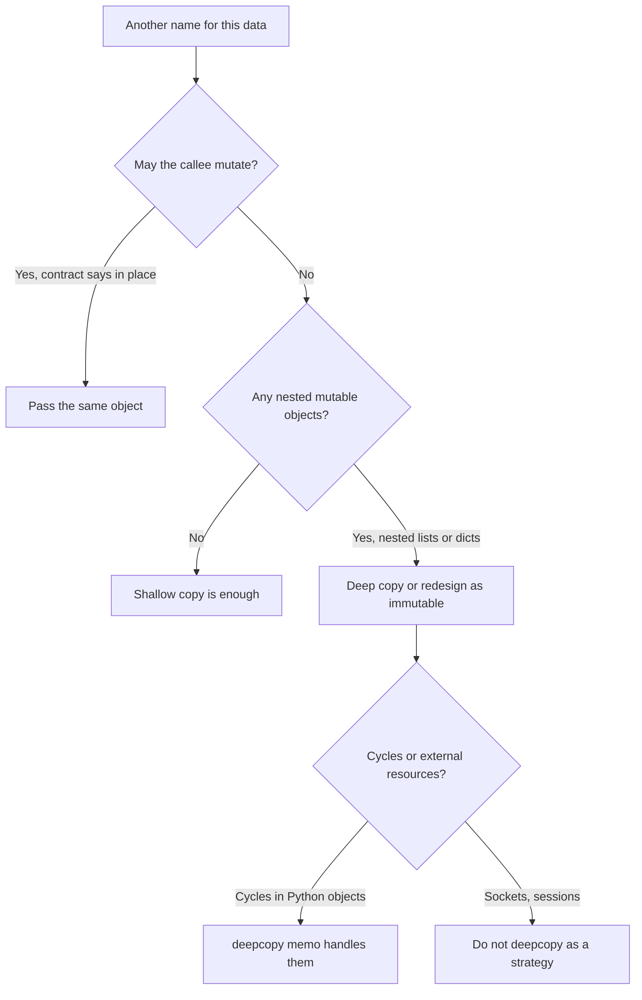

## Why this matters

Shared mutable state is the bug behind "the second request saw the first request's list," "the cache key changed," and "I passed a config dict and the helper added keys that leaked back to the caller." Interviews test it with a short aliasing snippet. Production tests it with a default argument, a class-level list, or a shallow copy of a nested settings object. You already know names bind to objects. This lesson is the decision procedure for copying, and the places Python copies without asking.

## Intuition

Identity asks "is this the same object?" Equality asks "do these objects look the same?" A copy creates a new object that looks the same at the moment of copying. A shallow copy creates a new outer container and copies the references inside it. The inner objects are shared. A deep copy walks the graph and creates new objects all the way down, stopping at things that are already safe to share, such as ints and strings, and at cycles it has already copied.

If nothing inside can change, shallow and deep are the same for practical purposes. If a nested list can change, they are not.

## Core concept in depth

### Alias, shallow, deep

`b = a` is not a copy. `b.append` shows up in `a` when `a` is a list.

`b = a.copy()`, `b = a[:]`, `b = list(a)`, and `copy.copy(a)` are shallow for a list. The new list has the same length and the same element identities. Replacing `b[0]` with a different object does not change `a[0]`. Calling `b[0].append(...)` changes the inner list that `a[0]` also points at.

`copy.deepcopy(a)` builds a new outer list and new inner lists. A later append to an inner list on `b` leaves `a` alone. Deep copy uses a memo so cycles do not recurse forever: a list that contains itself copies once and the copy contains the copy.

Deep copy does not magically snapshot file handles, sockets, or locks into a useful twin. It copies the Python object graph. External resources are still external. Do not deepcopy a database session and expect a second session.

### What operations copy

| Operation | New outer object? | Inner objects shared? |
| --- | --- | --- |
| `b = a` | No | Yes, it is the same object |
| `a[:]` or `a.copy()` on a list | Yes | Yes |
| `tuple(a_list)` | Yes, a tuple | Yes |
| `set(a_list)` | Yes | Yes, and duplicates dropped |
| `dict(a_dict)` or `a_dict.copy()` | Yes | Values are shared |
| Concatenation `a + b` for lists | Yes | Elements shared |
| Slice assignment from another list | Mutates the target | The assigned elements are the same objects |
| `deepcopy` | Yes | New graph, cycles preserved |

Slicing a string or a tuple returns a new string or tuple. The contents were immutable, so sharing versus copying the characters is not visible. You still pay O(k) for a slice of length k.

### Function arguments are aliases

Passing a list to a function does not copy it. The parameter is another name for the same object. If the function appends, the caller sees it. Document in-place functions with a name like `sort_in_place` or by returning `None` the way `list.sort` does. If the function must not touch the caller's data, copy at the start, or copy only the part you will mutate.

Returning an internal list gives the caller a handle to your guts. A cache that returns its internal list lets a caller append and corrupt the cache. Return a copy, or return a tuple. This is the encapsulation rule, practiced here before the OOP module gives it a class to live in.

### Copies that are still shallow in disguise

A dict comprehension that maps keys to the same value objects is shallow. A nested settings merge with `|` replaces a nested dict pointer; it does not copy siblings you hoped to keep, and it does not deep-copy the dict you replaced. A constructor `Config(data)` that stores `self.data = data` aliases the caller's dict. Store `dict(data)` at least, and deepcopy if values are nested and mutable.

`*` repetition shares references: `[[]] * n` is n aliases of one list. You have seen this. It belongs in this lesson because it is a copy story, not a syntax story. The comprehension `[[] for _ in range(n)]` builds n lists.

### Equality after copying

A shallow copy of a list of ints compares equal and is not identical: `a == b` and `a is not b`. Use `==` in tests for values. Use `is` when you are asserting that a cache returned the same object, which is sometimes the bug you are trying to catch. Do not assert `is` on two equal strings or two equal ints. Interning will make the assertion flaky.

### When not to copy

Copying a million-row list "to be safe" is an allocation and a latency spike. Copy when ownership is unclear. Do not copy when the function's contract is in-place and the caller has finished with the previous contents. Prefer immutable values (tuples, frozensets, frozen records) so sharing is safe and the copy is unnecessary. Immutability is a design that makes aliasing boring. Copying is a patch when the data must stay mutable.

## Diagram / flowchart



### Dry-run: shallow versus deep on a nested list

Start with `a` holding a list of two lists: `[1]` and `[2]`.

| Step | Shallow `b = a.copy()` | Deep `c = deepcopy(a)` |
| --- | --- | --- |
| `b[0].append(9)` | `a[0]` becomes 1, 9 because the inner list is shared | `a` unchanged if you had appended on `c` instead |
| `b[0] = [7]` | Rebinds `b`'s slot only. `a[0]` stays the old inner list | Same idea: rebinding the outer slot never affects the other outer list |
| `a is b` | False | False for `c` |
| `a[0] is b[0]` before any edit | True | False for `c` |

The third row is the test that tells you which copy you made. Identity of the inner object is the whole difference.

## Code

```python
import copy


def safe_append(owner: list[list[int]], row: list[int]) -> list[list[int]]:
    """Return a new outer list that includes an independent row."""
    cloned = copy.deepcopy(owner)
    cloned.append(copy.deepcopy(row))
    return cloned


def freeze_tags(tags: list[str]) -> tuple[str, ...]:
    return tuple(tag.strip().lower() for tag in tags if tag.strip())


if __name__ == "__main__":
    original = [[1], [2]]
    shallow = original.copy()
    shallow[0].append(9)
    print("shallow shares inner", original)

    original = [[1], [2]]
    deep = copy.deepcopy(original)
    deep[0].append(9)
    print("deep keeps original", original, deep)
    print(safe_append([[1]], [2]))
    print(freeze_tags([" Py ", "py", " "]))
```

`freeze_tags` avoids the copy problem by building an immutable tuple of strings. Later code can share that tuple freely. `safe_append` is the expensive version you use when the structure is nested and truly mutable and the caller must keep the old one. Do not sprinkle `deepcopy` on strings and ints for comfort. It works and it hides the fact that you do not know what is mutable.

## Complexity analysis

| Copy | Time and extra memory |
| --- | --- |
| Alias | O(1), no extra memory |
| Shallow copy of n pointers | Θ(n) |
| Deep copy of a graph with n objects and e edges | Θ(n + e), plus the cost of each object's copy |
| Deep copy of a wide nested document per request | Often the hidden latency in a handler that "just wanted to be safe" |
| Building a new tuple of k strings | Θ(k), and then sharing is free |

The right complexity win is to not need the copy. A function that only reads should not deepcopy its input. A function that must publish a snapshot of nested state pays the deep copy once, at the boundary, not on every read.

## Tricks, tips and patterns

- If the data is a list of immutable items, `items[:]` is a real structural copy.
- If the data nests lists or dicts, decide between deepcopy and a redesign. Redesign if you own the type.
- Return tuples or copies from caches and from objects that should not be mutated by callers.
- Copy inside the function when the contract is "I will not mutate you," so the caller cannot forget.
- Use `is` to debug sharing. Use `==` to test values.
- `deepcopy`'s memo handles cycles. You do not need a custom walker unless you must skip a field.
- Prefer `dataclass(frozen=True)` or tuples for new records so this lesson stops applying.

## Common mistakes and edge cases

- Believing a tuple copy or a tuple cast deep-freezes nested lists.
- `b = a` described as a copy in a code review. It is a second name.
- Shallow-copying a config dict and mutating a nested dict, then seeing the mutation in the defaults shared by every request.
- `deepcopy` of an object graph that includes a lock or a connection, then using the copy as if it were independent infrastructure.
- Tests that assert `is` on equal numbers and flake under interning, or fail when CPython does not intern.
- Forgetting that `list += other` mutates, so a function that receives a list and uses `+=` edits the caller's list. `lst = lst + other` rebinds only the local name and leaves the caller alone, at the cost of a copy.
- Class-level mutable attributes shared by every instance. That is aliasing with a longer lifetime. Initialize mutable fields in `__init__`, not on the class.

## Interview notes

Draw two names and one box, then a shallow copy as a new outer box with arrows into the same inner boxes, then a deep copy as new boxes all the way down. Explain one bug: a default argument list, a nested settings dict, or a cache returning its internal list.

Follow-ups:

- **Does passing a list copy it?** No.
- **When is shallow enough?** When elements are immutable, or when sharing the elements is the point.
- **How do cycles copy?** `deepcopy` memos objects it has already seen.
- **How do you avoid the issue?** Immutable data, or a contract that says who owns mutation.

Connect this to the next modules: class attributes versus instance attributes, and defensive copies in properties. The concept does not change when a `self` is involved.

## Practice problems

1. **Shallow Share** (easy) — show that appending to an inner list is visible through a shallow copy, by returning both outers. [Practice: python-ex-shallow-share]
2. **Deep Isolate** (medium) — deepcopy a nested list and append only on the copy. [Practice: python-ex-deep-isolate]
3. **Freeze Tags** (easy) — normalize tags into a tuple so callers cannot append. [Practice: python-ex-freeze-tags]
4. **Safe Append** (medium) — return a new nested structure with an extra row, leaving the input identical. [Practice: python-ex-safe-nested-append]
5. **No Alias Return** (medium) — a tiny cache object API simulated with functions: store a list and return a copy on read. [Practice: python-ex-cache-copy]

## Summary / cheat sheet

- Assignment aliases. Shallow copy makes a new container of the same references. Deep copy clones the nested graph and handles cycles.
- Function arguments are aliases. In-place mutation is visible to the caller. Returning an internal list lets the caller mutate you.
- A tuple does not deep-freeze its contents. `[[]] * n` aliases one inner list.
- Shallow copy is enough for a list of ints or strings. Nested dicts and lists need deepcopy or an immutable redesign.
- `+=` on a list mutates the caller's object if the name is a parameter. Rebinding with `+` does not.
- Do not deepcopy sockets and sessions. Do not copy per read when the contract is read-only.
- Test values with `==` and sharing bugs with `is` on the containers, not on interned ints.

## Further reading

- [copy — shallow and deep copy](https://docs.python.org/3/library/copy.html)
- [Python FAQ on passing and mutability](https://docs.python.org/3/faq/programming.html#why-did-changing-list-y-also-change-list-x)
- [Data model — objects, values, and types](https://docs.python.org/3/reference/datamodel.html#objects-values-and-types)
