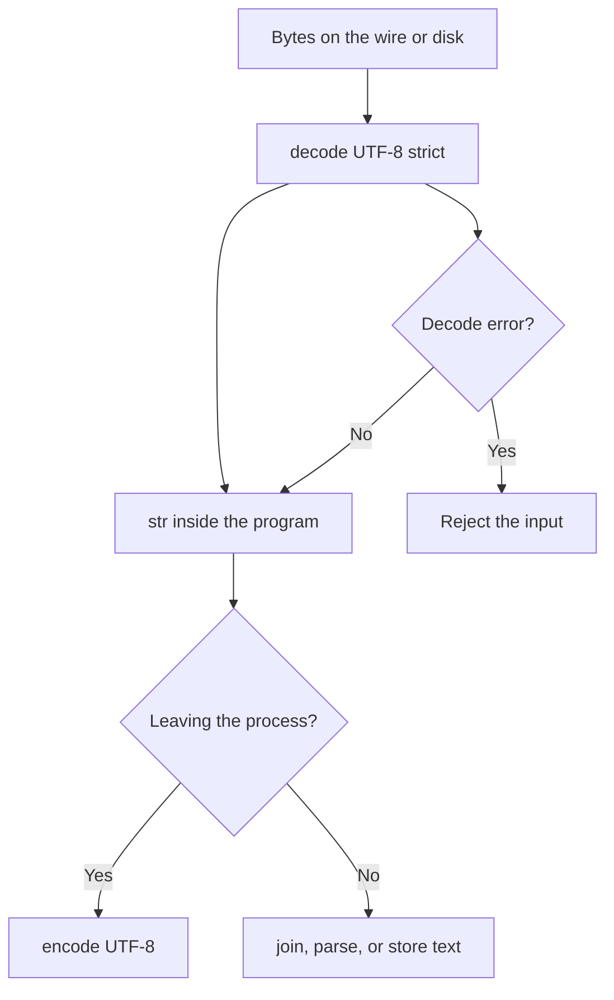

## Why this matters

Text bugs in backends are encoding bugs and allocation bugs. A filename that is not UTF-8, a JSON body decoded twice, a password compared with the wrong normal form, or a loop that builds a response with `+=` on a multi-megabyte string. Interviews ask you to reverse words, detect anagrams, and parse a simple format. They also ask why `len` of a string is not the number of bytes on the wire. If you answer "characters" without saying "Unicode code points," you will get a follow-up about emoji that you should already expect.

`str` is immutable and is a sequence of Unicode code points. `bytes` is immutable and is a sequence of integers in 0..255. `bytearray` is the mutable octets. Mixing them without an encode or decode is a `TypeError` in Python 3, which is a gift. The bug that remains is choosing the wrong encoding, or decoding with a handler that silently replaces errors and corrupts data.

## Intuition

Think of `str` as the text a human reads and `bytes` as the suitcase you put that text in to cross a socket or a disk. The suitcase format is the encoding: UTF-8 is the default you should demand at every boundary. Opening the suitcase is `decode`. Packing it is `encode`. You cannot ask a suitcase for `.upper()` and you cannot ask text for its raw octets until you name an encoding.

Building a long string by gluing one piece at a time copies the growing result each time. `join` measures, allocates once, and copies each piece into place.

## Core concept in depth

### Code points, not bytes, not graphemes

`len("héllo")` counts code points. `é` can be one code point or an `e` plus a combining accent, and those two strings look the same and compare unequal. `len` is not "number of grapheme clusters a user thinks of as characters," and it is not "number of UTF-8 bytes." An emoji can be several code points joined by a zero-width joiner, so slicing "one character" off the front can split a family emoji in half.

For interview parsing of ASCII protocols, code points and bytes line up for the ASCII range, and you can slice freely. For user-visible text, do not slice on a display-column boundary without a library that understands graphemes. For wire size, encode to UTF-8 and take `len` of the bytes.

Normalization with `unicodedata.normalize("NFC", s)` puts composed characters into a canonical form before you compare or use them as dict keys. Do this at the boundary for identifiers and search keys. Do not sprinkle it on every equality in a hot loop without measuring, but do not skip it on usernames.

### Encoding and error handlers

`text.encode("utf-8")` returns bytes. `raw.decode("utf-8")` returns text. The default error handler is `strict`, which raises `UnicodeDecodeError` or `UnicodeEncodeError`. That is what you want for data. `errors="replace"` inserts a replacement character and hides corruption. `errors="ignore"` drops bytes and can change security decisions if a filter runs after a lossy decode. Use `surrogateescape` only when you are round-tripping operating-system paths that are not valid UTF-8, which is a pathlib concern more than an application concern.

Never decode with `latin-1` just because it never fails. It maps every byte to some character, so garbage becomes "valid" text and you persist it. Fail strict, log the context, and reject the request.

`str` and `bytes` do not compare equal. `"a" == b"a"` is false. Concatenating them raises `TypeError`. A function that sometimes returns str and sometimes bytes is a defect. Decide at the boundary and keep text inside the program.

### Immutability and building strings

Strings cannot be edited in place. `s += "x"` builds a new string. In a loop of n appends of small pieces, that is quadratic. `parts.append(piece)` then `"".join(parts)` is linear. f-strings and `str.format` are the right tools for a fixed template. They are not a reason to format inside a loop of a hundred thousand rows if the format itself is the allocation you could stream. Write pieces out, or join.

f-strings evaluate expressions at the point of the literal. They are readable and fast enough. They do not automatically call `html.escape`. If you put a username in an HTML f-string, you have an XSS bug. Escape at the template layer that knows the output format. SQL is the same lesson with parameters, not string concatenation. You will see that again with databases.

### Methods you should know precisely

`strip`, `lstrip`, and `rstrip` remove a set of characters from the ends, not a prefix string as a sequence you might think. `strip("ab")` removes any run of `a` and `b` from both ends. To remove a specific prefix, use `removeprefix` (3.9+), which removes it once if present and leaves the string alone otherwise.

`split()` with no arguments splits on runs of whitespace and drops empty pieces. `split(",")` does not strip spaces around commas and does not treat consecutive commas as nothing: `"a,,b".split(",")` has an empty middle. `splitlines()` splits on line boundaries and, by default, drops the line endings. Know the difference before you parse a file by hand. The `csv` module is still the right parser for CSV, because quotes and commas inside fields will defeat `split`.

`find` returns -1 when missing. `index` raises `ValueError`. `in` is the readable membership test for a substring and is fine for short strings. For many searches of a large text, algorithms matter, but interview problems on short strings can use `in`.

`casefold()` is the aggressive case folding you want for caseless comparison. `lower()` is not enough for all Unicode. For ASCII emails you may still `lower()` because the product said ASCII. Say which alphabet you support.

Slicing and reversing: `s[::-1]` reverses code points. It allocates. A two-pointer palindrome check can avoid the extra string. For interview palindromes, skipping non-alphanumeric and casefolding is usually the spec. Read it.

### Interning is not a contract

CPython may intern some strings so identical literals are the same object. `is` is still the wrong comparison. Use `==`. Secrets and tokens should be compared with `hmac.compare_digest` so the comparison does not return early on the first differing byte. That is a timing-leak concern, not a Unicode concern, and it is the right tool when the string is a credential.

## Diagram / flowchart



### Dry-run: join versus repeated concatenation

Build `"abcd"` from four letters.

| Approach | Copies of earlier letters | Total character copies |
| --- | --- | --- |
| `s = s + ch` four times | `a`, then `ab`, then `abc`, then `abcd` | 10, which is quadratic in n |
| append four pieces, then `join` | each letter copied once into the result | 4, linear |

The quadratic version is invisible on four letters and painful on four hundred thousand. The dry-run is why the rule exists.

Prefix dry-run: `removeprefix("https://")` on `https://example.com` yields `example.com`. On `http://example.com` it yields the original string, because the prefix is absent. `strip` is the wrong tool: it would delete a set of characters, not the URL scheme as a unit.

## Code

```python
import unicodedata


def normalize_name(value: str) -> str:
    folded = unicodedata.normalize("NFC", value).strip().casefold()
    return " ".join(folded.split())


def is_palindrome(value: str) -> bool:
    chars = [ch for ch in value.casefold() if ch.isalnum()]
    return chars == chars[::-1]


def to_utf8(value: str) -> bytes:
    return value.encode("utf-8")


def from_utf8(raw: bytes) -> str:
    return raw.decode("utf-8")


if __name__ == "__main__":
    print(normalize_name("  Ada   Lovelace "))
    print(is_palindrome("A man, a plan, a canal: Panama"))
    raw = to_utf8("héllo")
    print(len("héllo"), len(raw), from_utf8(raw))
```

`normalize_name` composes characters, trims ends, casefolds, and collapses internal whitespace by splitting and joining. That is a username-key pipeline, not a display pipeline. Display should not casefold. `is_palindrome` builds a list of kept code points. For a long string you can use two indexes instead. The lengths in the demo differ whenever a code point encodes to more than one UTF-8 byte. `é` is one code point and two bytes in UTF-8.

## Complexity analysis

| Operation | Cost |
| --- | --- |
| `len` of a str | O(1) |
| Index or slice of k code points | Slice is O(k) |
| `in` for a substring | O(n·m) naive worst case, fine for short patterns |
| `s += piece` in a loop | O(n²) character copies |
| `"".join(parts)` | O(total length) |
| `encode("utf-8")` | O(n) in the size of the text |
| `casefold` or NFC normalize | O(n), and it allocates a new string |

String operations allocate because strings are immutable. A parser that slices the rest of the string on every token copies a lot. An index into the original string avoids that. For interview parsers of short input, slicing is acceptable and clearer. For a multi-megabyte log line loop, keep indexes or write bytes.

## Tricks, tips and patterns

- Decode at the edge with UTF-8 and `strict`. Encode at the edge with UTF-8. Keep `str` in between.
- Build long strings with a list and `join`.
- Remove a known prefix with `removeprefix`, not `strip`.
- `split()` with no arguments collapses whitespace. `split(",")` does not.
- Compare secrets with `hmac.compare_digest`, not `==`.
- Normalize identifiers before you use them as keys. Do not casefold text you will show back to the user.
- f-strings for templates you control. Never for SQL or HTML with raw user data.
- `repr(s)` in logs shows escapes so a string with a hidden newline is visible. Log the repr when debugging parsers, not when logging secrets.

## Common mistakes and edge cases

- Calling `len` on text and treating it as a content-length header. Content-Length is bytes after encoding.
- `errors="ignore"` swallowing a bad byte in a security filter.
- Decoding twice: the framework already gave you `str`, and you call `.decode` and crash, or you encode then decode with a different codec.
- Quadratic concatenation in a loop that looked fine in a unit test of three items.
- `strip` used as "remove this prefix," which also eats characters in the middle of the set from the ends only, sometimes including characters you meant to keep if they sit at the end.
- Assuming reversing a string reverses user-perceived characters. It reverses code points.
- `"a" == b"a"` written as a check that "passes on my machine" in Python 2 examples. In Python 3 it is false.
- Using a string as a byte buffer and inserting binary with escapes. Use `bytes` or `bytearray`.

## Interview notes

State that Python 3 strings are Unicode code points and immutable. For a palindrome or anagram, say you will normalize case and, if the prompt says so, ignore non-alphanumerics. Give O(n) time. Mention the extra string if you reverse with a slice, and offer two pointers if they ask for O(1) extra memory... two pointers are O(1) extra besides the input, yes.

Follow-ups:

- **str versus bytes?** Text versus octets. Encode and decode name the codec.
- **Why join?** Concatenation in a loop copies the prefix repeatedly.
- **What does len count?** Code points, not graphemes, not UTF-8 bytes.
- **How do you compare tokens?** `hmac.compare_digest` for secrets. `==` after normalization for ordinary identifiers.

If they ask about UTF-16 or BOM, say you do not accept a surprise encoding. You document UTF-8. A BOM is a decode bug to reject or to strip explicitly at the boundary, not something to ignore in the middle of a file.

## Practice problems

1. **Normalize Name** (easy) — NFC, strip, casefold, collapse whitespace. [Practice: python-ex-normalize-name]
2. **Palindrome** (easy) — alphanumeric casefolded palindrome. [Practice: python-ex-palindrome]
3. **Join Words** (easy) — join non-empty stripped words with a single separator. [Practice: python-ex-join-words]
4. **Remove Prefix** (easy) — drop a prefix once if present. [Practice: python-ex-remove-prefix]
5. **Anagram** (medium) — whether two strings are anagrams after casefold, ignoring spaces. [Practice: python-ex-anagram]
6. **UTF-8 Size** (medium) — byte length of a string encoded as UTF-8, without changing the text. [Practice: python-ex-utf8-size]

## Summary / cheat sheet

- `str` is Unicode text. `bytes` is octets. Convert with `encode` and `decode`, UTF-8, strict, at the boundary.
- `len` counts code points. Wire size is `len(text.encode("utf-8"))`. Graphemes are a different problem.
- Strings are immutable. `join` is linear. Repeated `+=` is quadratic.
- `split()` collapses whitespace. `split(sep)` does not. `removeprefix` removes a string prefix. `strip` removes a set of characters.
- Normalize and casefold identifiers. Do not lossily decode. Do not compare secrets with `==`.
- Do not build SQL or HTML by concatenating raw user strings.
- `==` compares text. `is` is not a string comparison.

## Further reading

- [Unicode HOWTO](https://docs.python.org/3/howto/unicode.html)
- [str methods](https://docs.python.org/3/library/stdtypes.html#string-methods)
- [unicodedata](https://docs.python.org/3/library/unicodedata.html)
- [hmac.compare_digest](https://docs.python.org/3/library/hmac.html#hmac.compare_digest)
- [PEP 616 — removeprefix and removesuffix](https://peps.python.org/pep-0616/)
