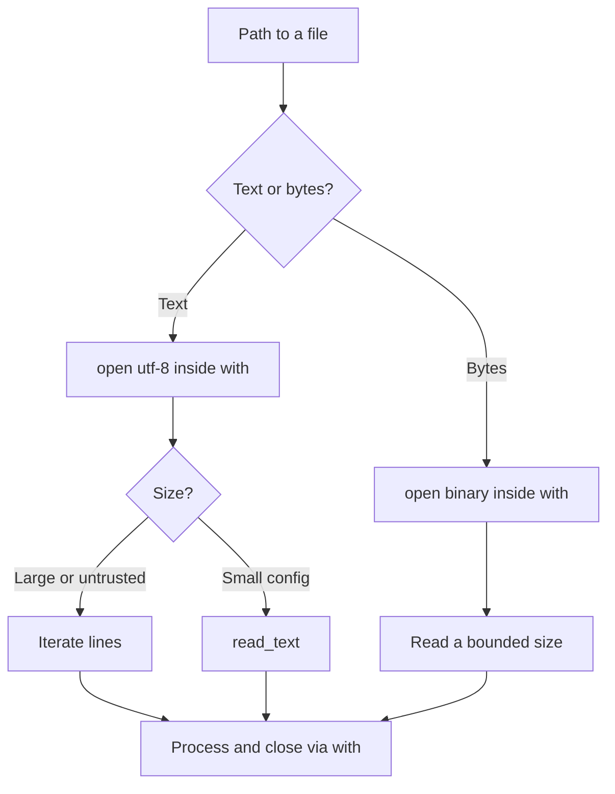

## Why this matters

Services read config, write exports, rotate logs, and load fixtures in tests. The failures that reach on-call are ordinary: a file handle leaked until the process hit the descriptor limit, a CSV written on Windows that another tool read with the wrong newline rules, a path built with string addition that broke on a separator, or a relative path that depended on the cron job's working directory. Interviews for backend roles ask you to process a file line by line without loading it all, and to explain `with`.

`pathlib.Path` is the standard way to talk about paths. `open` is the standard way to talk about file contents. They meet when you call `path.open`. Mixing `os.path`, string paths, and manual `close` is how small scripts become fragile.

## Intuition

A path is a structured name: drive, parts, suffix. It may or may not point at anything yet. A file object is an open resource with a position. You read or write at that position, then you close it so the operating system can reuse the descriptor and so buffered writes actually land on disk.

`with` ties the lifetime of the file object to a block. Entering the block opens. Leaving the block closes, including when the block raises. That is the whole protocol you need before the OOP module explains `__enter__` and `__exit__`.

Text mode translates bytes to `str` with an encoding and may translate newlines. Binary mode gives you `bytes` and does not translate. Pick one on purpose.

## Core concept in depth

### open modes and encoding

`open(path, "r", encoding="utf-8")` reads text. `"w"` truncates or creates and writes text. `"a"` appends. `"x"` creates and fails if the file exists, which is the mode you want for a lock file or an output you refuse to overwrite. Adding `b` (`"rb"`, `"wb"`) means binary, and you must not pass `encoding`. Adding `+` means updating, read and write, and it is easier to get the position wrong than to split the jobs. Prefer read, then write to a new file.

Always pass `encoding` for text. The default is the locale encoding, which is not UTF-8 on every Windows machine. A file written on one machine and read on another then decodes differently. `encoding="utf-8"` is the project default unless you are reading a format that names a different charset.

`newline=""` in the `csv` module's recommended pattern disables automatic newline translation so the csv layer can handle it. For ordinary line iteration, the default text mode turning `\r\n` into `\n` is what you want. Do not strip and also rstrip and also splitlines without knowing which layer already removed the newline. `for line in file` keeps the newline at the end of each line except possibly the last line if the file does not end with one. `line.rstrip("\n")` removes a trailing newline without destroying other trailing whitespace you might care about. `strip()` removes both ends and will eat indentation.

### Line by line, not read() by default

`path.read_text(encoding="utf-8")` loads the whole file. That is correct for a config of a few kilobytes. It is the wrong tool for a multi-gigabyte log. Iterate the file object. The iterator yields lines and the buffer stays bounded. You can still run out of memory if a single line is huge. That is a real log-poisoning concern. For untrusted input, consider a cap on line length.

`read(n)` in binary mode reads up to n bytes. `read()` with no size reads the rest. Binary is mandatory for images, zip files, and any format where a byte is not text. Decoding a PNG as UTF-8 will throw or, with a sloppy handler, corrupt it.

### pathlib

`Path("data") / "in.csv"` joins with the right separator. `path.parent`, `path.name`, `path.stem`, and `path.suffix` parse without you searching for slashes. `path.resolve()` makes an absolute path and collapses `..`. `path.exists()`, `is_file()`, and `is_dir()` ask the filesystem. `mkdir(parents=True, exist_ok=True)` creates a directory tree idempotently. `read_text`, `write_text`, `read_bytes`, and `write_bytes` cover the small-file case and close the handle for you.

`glob("*.csv")` and `rglob("*.py")` iterate matches. They are not recursive versus non-recursive by accident: `glob` is one directory, `rglob` walks. Do not implement walk by string-replacing `**` yourself.

Paths are not sandboxes. If a user supplies `../../etc/passwd` and you join it onto a base directory naively, you may escape the base. The safe pattern is to resolve the base, resolve the candidate, and check that the candidate is relative to the base (`candidate.is_relative_to(base)` in 3.9+). Reject the request otherwise. This is a path traversal bug, and it shows up in take-homes that "just open the filename the query string gave you."

### Working directory

Relative paths are relative to the process current directory, not to the file that contains the `open` call. A test runner and a cron job do not share your shell's cwd. Anchor data that ships with the code at `Path(__file__).resolve().parent`. Anchor user uploads at a configured absolute directory. Do not mix them.

### Replace, do not truncate in place, for important files

Writing `"w"` truncates immediately. A crash mid-write leaves an empty or partial file. For config and exports that must stay valid, write to a temporary file in the same directory and `os.replace` it over the destination. `replace` is atomic on the same filesystem. Readers then see the old file or the new file, not a half-written one. This is the habit that separates a script from a tool someone else runs unattended.

### Encodings in practice

Open UTF-8. If you must read a legacy export, name the codec (`cp1252`, `utf-16`) at that boundary and convert to UTF-8 in your own store. Do not let `locale.getpreferredencoding()` decide for a service. Log the path and the exception on `UnicodeDecodeError`, and fail the job with a non-zero exit code rather than writing a file full of replacement characters.

## Diagram / flowchart



### Dry-run: with closes on an exception

| Step | What happens to the descriptor |
| --- | --- |
| Enter `with path.open(...)` | Descriptor allocated, position at 0 |
| Read two lines successfully | Position advances, data in your variables |
| Third line's parser raises `ValueError` | Block is exiting because of the exception |
| `with` exit runs | `close()` is called even though you did not reach the last line |
| Exception propagates | Caller sees `ValueError`, and the descriptor is not leaked |

A `try`/`finally` with `close` does the same thing and is easier to get wrong if a return sits in the wrong place. Use `with`.

## Code

```python
from pathlib import Path


def read_ids(path: Path) -> list[str]:
    ids: list[str] = []
    with path.open("r", encoding="utf-8") as handle:
        for line in handle:
            text = line.strip()
            if text and not text.startswith("#"):
                ids.append(text)
    return ids


def write_atomic(path: Path, text: str) -> None:
    path.parent.mkdir(parents=True, exist_ok=True)
    tmp = path.with_suffix(path.suffix + ".tmp")
    tmp.write_text(text, encoding="utf-8")
    tmp.replace(path)


def is_inside(base: Path, candidate: Path) -> bool:
    base_resolved = base.resolve()
    cand = (base_resolved / candidate).resolve() if not candidate.is_absolute() else candidate.resolve()
    return cand.is_relative_to(base_resolved)


if __name__ == "__main__":
    root = Path(".").resolve()
    print(root.name)
    print(is_inside(root, Path("notes.txt")))
```

`read_ids` skips blanks and comments and does not load a special library. It still holds every id in memory, which is fine for an allow-list and wrong for a huge dump you could stream into a database. `write_atomic` uses `Path.replace`, which wraps the atomic rename. `is_inside` is the traversal check. A candidate that resolves outside `base` returns false. Use it before `open`.

## Complexity analysis

| Approach | Time | Memory |
| --- | --- | --- |
| Iterate lines and keep one aggregate | Θ(n) in file size | Θ(1) plus the aggregate |
| `read_text` | Θ(n) | Θ(n) |
| `write_text` of a big string | Θ(n) | You already paid to build the string |
| Atomic replace | The write plus a rename | A second file on disk until replace |
| `rglob` over a huge tree | Proportional to entries visited | The iterator itself is small; your result list may not be |

Disk and syscall overhead dominate CPU for simple line scans. The complexity you control is memory. Streaming is the requirement for large inputs. Buffering inside `open` is already there; you do not read one byte at a time from Python unless you are parsing a binary format.

## Tricks, tips and patterns

- Pass `encoding="utf-8"` on every text open. Do it even when the default happens to be UTF-8 today.
- Use `with` or `Path.read_text` / `write_text`, which close for you.
- Anchor packaged data to `Path(__file__).resolve().parent`.
- Write important files to a temp sibling and `replace`.
- Reject user paths that resolve outside the allowed base.
- Iterate lines for big files. Load small configs whole.
- `"x"` mode when overwrite must be a loud error.
- Binary mode for anything that is not text, with no encoding argument.

## Common mistakes and edge cases

- Forgetting `encoding` and shipping a file that only decodes on your laptop's locale.
- `read()` of a multi-gigabyte file in a web worker.
- Relative paths and a different cwd in production.
- String-concatenating paths with a hardcoded slash.
- Opening a user-supplied path without the `is_relative_to` check.
- Truncating a live config with `"w"` and crashing mid-write.
- Double-closing or using a handle outside the `with` block. The second read raises `ValueError` because the file is closed.
- Assuming `strip()` on a line only removes the newline. It removes all ends whitespace.
- Ignoring `UnicodeDecodeError` and continuing with a partial list, so a bad line silently drops the rest of the file if you `break`, or corrupts one record if you skip without counting.

## Interview notes

Explain `with` as "close even if the block raises." Explain text versus binary as encoding versus raw bytes. Explain streaming as iterating the file object. If the problem is "parse this file," say whether you load it or stream it and why, based on size.

Follow-ups:

- **What if the process is killed during write?** A direct `"w"` can leave a partial file. Write-and-replace avoids that for readers.
- **Where is a relative path resolved?** Against the current working directory.
- **How do you stop path traversal?** Resolve and require the path to stay under the base directory.
- **When do you not use pathlib?** Almost never in new code. You still pass `str(path)` to a rare API that demands a string. Most of the standard library accepts path-like objects.

Mention newline handling if the file is CSV. The next lesson owns the parser. Your job here is to open it correctly and close it.

## Practice problems

1. **Parse Ids** (easy) — from a list of lines, skip blanks and comments and strip the rest. [Practice: python-ex-parse-ids]
2. **Safe Join** (medium) — join a relative name onto a base and reject escapes. [Practice: python-ex-safe-join]
3. **Suffix Swap** (easy) — replace a path suffix without string splitting. [Practice: python-ex-suffix-swap]
4. **Atomic Plan** (medium) — given a destination name, return the temp name beside it and the final name. [Practice: python-ex-atomic-names]
5. **Line Strip** (easy) — remove only a trailing newline, preserving other spaces. [Practice: python-ex-rstrip-newline]

## Summary / cheat sheet

- Text mode needs an explicit UTF-8 encoding. Binary mode needs `"b"` and no encoding.
- `with` closes the file on success and on exceptions. Prefer it to a bare `close`.
- Stream large files by iterating lines. `read_text` is for small files.
- Build paths with `pathlib.Path` and `/`. Anchor code-adjacent files to `__file__`.
- User-supplied paths must resolve inside a base directory or be rejected.
- Write durable files via a temporary sibling and `replace`, so readers never see a half-written result.
- A line from a text file usually still contains its newline. Know whether you stripped it.

## Further reading

- [Reading and writing files](https://docs.python.org/3/tutorial/inputoutput.html#reading-and-writing-files)
- [pathlib](https://docs.python.org/3/library/pathlib.html)
- [open built-in](https://docs.python.org/3/library/functions.html#open)
- [os.replace](https://docs.python.org/3/library/os.html#os.replace)
