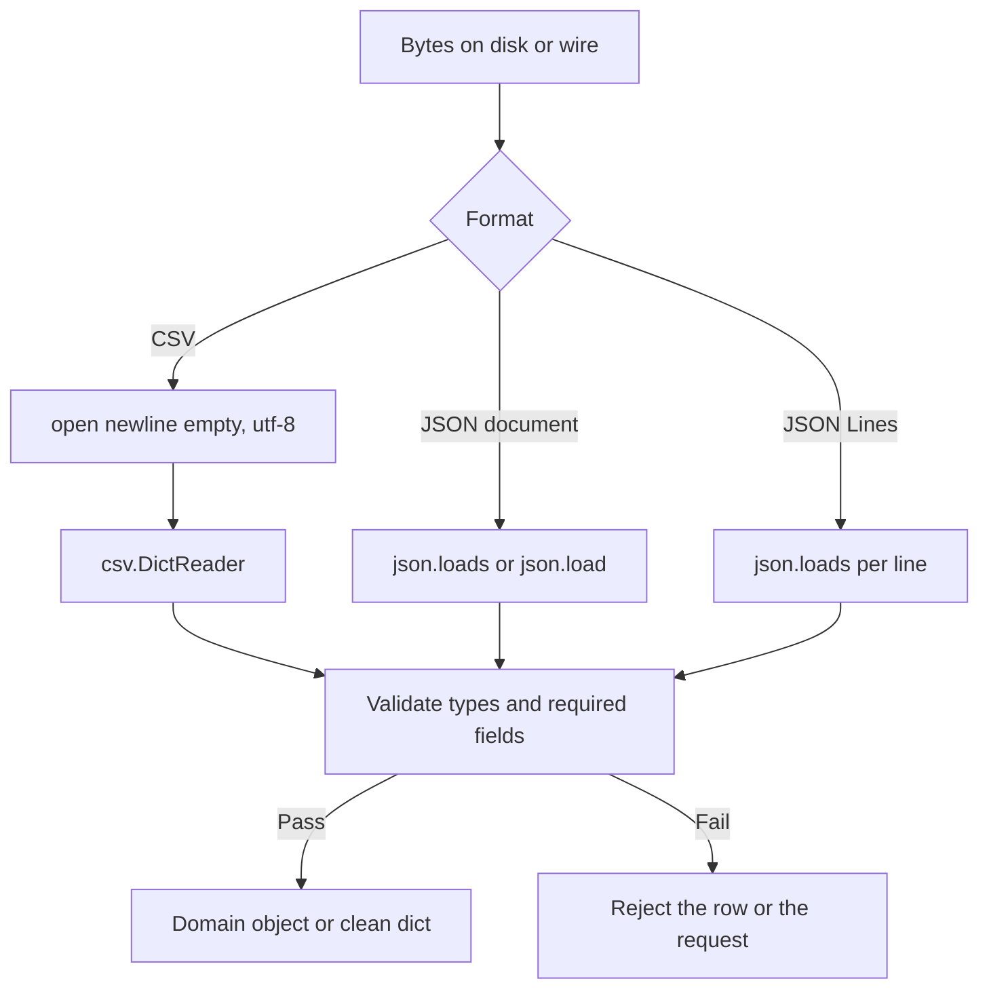

## Why this matters

CSV and JSON are the formats a backend actually exchanges with finance exports, webhooks, and frontends. The bugs are parser bugs. Splitting a CSV line on commas breaks as soon as a field is quoted and contains a comma. `eval` on a JSON-looking string executes attacker code. `json.loads` of a document that contains an integer bigger than you expected is fine in Python and then explodes when you insert it into a 32-bit column. Datetimes do not round-trip unless you decide a format.

Interview take-homes ask you to ingest a CSV and expose a few rows as JSON. The reviewer notices whether you used the standard parsers, whether you closed the file, and whether a bad row fails the job or disappears.

## Intuition

A parser's job is to turn bytes into a structure and to refuse inputs that are not that structure. `csv` understands quotes, embedded separators, and newlines inside quotes. `json` understands objects, arrays, strings, numbers, booleans, and null. Neither understands your domain. After parsing, you validate types and ranges. A row that parses and fails validation is a rejected row, not a half-applied update.

JSON's `null` becomes `None`. JSON's object becomes a dict. JSON's array becomes a list. JSON object keys are strings. A Python tuple dumped as JSON becomes a list, and it will not come back as a tuple unless you convert it. That loss is normal. Design the boundary instead of being surprised by it.

## Core concept in depth

### CSV

Use `csv.reader` and `csv.DictReader`. Open the file with `newline=""` and `encoding="utf-8"`. The `newline` argument matters so the csv module, not the text wrapper, interprets newlines inside quoted fields. `DictReader` uses the first row as keys. Those keys are strings exactly as they appear. `" Name"` with a space is a different key from `"Name"`. Strip headers if the export is sloppy, and do it deliberately.

`DictWriter` writes a header from `fieldnames` and then rows. Extra keys in a row raise unless you set `extrasaction`. Missing keys become empty fields. That default can silently blank a column. Prefer to see the `ValueError` in a job than to ship an empty amount.

Do not `line.split(",")`. Quoted commas, quotes themselves escaped by doubling, and newlines in fields are all legal CSV. A homemade splitter will pass your three-row fixture and fail on the first real export from a spreadsheet.

Dialects exist because CSV is not one format. Excel in some locales uses semicolons. `csv.Sniffer` can guess and can guess wrong. Prefer an explicit delimiter in the job's contract. Document it.

### JSON

`json.loads` parses a string. `json.load` parses a text file object. `json.dumps` and `json.dump` serialize. `ensure_ascii=False` lets UTF-8 text stay as characters instead of `\u` escapes, which you want for human-readable files and for APIs that declare UTF-8. `separators` can tighten production payloads. Pretty `indent` is for debugging, not for a hot path.

The default `dumps` accepts dicts, lists, strings, numbers, bools, and `None`. It rejects tuples only in the sense that it encodes them as lists. It rejects `set`, `bytes`, `datetime`, and custom objects with `TypeError`. Do not subclass `JSONEncoder` to call `str` on everything. You will hide a bug and persist garbage. Convert explicitly: datetimes to ISO 8601 strings, decimals to strings if you care about exact digits, bytes to a deliberate base64 field with a name that says so.

`object_hook` and `object_pairs_hook` let you transform dicts as they are built. They are the right extension point for "turn this dict into a small typed object" after you trust the shape. They are not a validator by themselves. A missing key still needs a check.

### Safety

`json.loads` does not execute code. `eval`, `ast.literal_eval` used casually on untrusted documents, and `yaml.load` without a safe loader do. This course's rule: untrusted JSON goes through `json.loads` only. Untrusted YAML, if you ever accept it, goes through `yaml.safe_load`. Never `eval` a request body. The interview answer is short because the safe tool is already in the standard library.

JSON is not a streaming format in the stdlib. `json.load` builds the whole document. A huge array can exhaust memory. For a large export, prefer JSON Lines: one JSON value per line, parsed with `json.loads` per line inside a file iterator. A failure then names a line number. A single huge array names nothing useful and dies in the parser.

### Validation after parsing

Parsing answers "is this JSON?" Validation answers "is this an order?" Check required keys, types, and ranges in one place. `isinstance(value, bool)` before `isinstance(value, int)` because bool is an int. Reject unknown fields if the contract is strict, or ignore them if you need forward compatibility. Say which. A silent ignore hides client bugs. A strict reject breaks old clients when you add a field the server sends and the client echoes. Pick per endpoint, do not mix.

Duplicate CSV headers and duplicate JSON keys: the csv module will hand you duplicate header names that make `DictReader` rows awkward, and JSON parsers typically keep the last duplicate key. Do not depend on duplicates. Reject them if you can detect them.

### Numbers and money, again

JSON numbers become `int` if they have no fraction and `float` if they do. A price of `10.20` becomes a binary float. If the field is money, parse the original text as `Decimal` from a string field instead of a JSON number, or accept integers in minor units. This is the same numeric-tower lesson at the boundary, which is where it actually bites.

## Diagram / flowchart



### Dry-run: a quoted CSV field

The line `ada,"hello, world",3` is three fields, not four.

| Parser | Fields |
| --- | --- |
| `split(",")` | `ada`, `"hello`, ` world"`, `3` — wrong, quote characters included, comma split the phrase |
| `csv.reader` | `ada`, `hello, world`, `3` — quotes consumed, comma kept inside the field |

JSON dry-run of an object with key `ok` set to `true` and key `n` set to `null`:

| JSON token | Python object |
| --- | --- |
| object | dict |
| true | `True` |
| null | `None` |
| string key ok | the str `ok` |

`dumps` of a tuple `(1, 2)` yields a JSON array. `loads` brings back a list. If your function requires a tuple, convert after validation. Do not hope.

## Code

```python
import csv
import json
from io import StringIO


def read_rows(text: str) -> list[dict[str, str]]:
    handle = StringIO(text)
    reader = csv.DictReader(handle)
    rows = []
    for row in reader:
        if None in row:
            raise ValueError("row has extra columns")
        rows.append({key: (value or "").strip() for key, value in row.items()})
    return rows


def parse_user(payload: str) -> dict:
    data = json.loads(payload)
    if not isinstance(data, dict):
        raise ValueError("user must be an object")
    name = data.get("name")
    age = data.get("age")
    if not isinstance(name, str) or not name.strip():
        raise ValueError("name must be a non-empty string")
    if isinstance(age, bool) or not isinstance(age, int) or age < 0:
        raise ValueError("age must be a non-negative int")
    return {"name": name.strip(), "age": age}


def dump_user(user: dict) -> str:
    return json.dumps(user, ensure_ascii=False, separators=(",", ":"))


if __name__ == "__main__":
    print(read_rows("name,note\nada,\"hello, world\"\n"))
    print(parse_user('{"name": "Ada", "age": 36}'))
    print(dump_user({"name": "Ada", "age": 36}))
```

`read_rows` uses `DictReader` on a string only so the example has no filesystem. In a program, pass the file object opened with `newline=""`. A `None` key appears when a row has more columns than the header. That check turns a ragged export into an error. `parse_user` rejects bool ages. `dump_user` emits UTF-8-friendly JSON without space padding. Add `indent=2` only in a debug path.

## Complexity analysis

| Approach | Time | Memory |
| --- | --- | --- |
| `csv.reader` streaming rows | Θ(n) in file size | One row plus the reader's buffer, unless you append every row |
| `split` on commas | Θ(n) and wrong | Same, and incorrect |
| `json.loads` of a document | Θ(n) | Θ(n) for the object tree |
| JSON Lines, one object retained | Θ(n) | Θ(size of the largest line) if you do not store them all |
| `dumps` of a dict | Θ(n) in the output size | The output string |

Validation is linear in the number of fields you inspect. The expensive mistake is building a list of every row when the next step could write each row to a database and drop it. Stream unless you need random access or a sort of the whole file.

## Tricks, tips and patterns

- CSV: `newline=""`, UTF-8, `DictReader`, explicit delimiter. Never `split(",")`.
- JSON: `loads` and `dumps`. Never `eval`.
- Convert non-JSON types explicitly. Do not install a default that stringifies arbitrary objects.
- Money as integer minor units or as decimal strings, not as JSON floats.
- JSON Lines for large streams. One bad line gets a line number.
- Validate after parsing. Check bool before int.
- `ensure_ascii=False` for UTF-8 APIs and files. Still encode the file as UTF-8.
- Reject ragged CSV rows and duplicate headers when the contract is a table with a fixed schema.

## Common mistakes and edge cases

- `split(",")` on a quoted comma.
- Opening CSV in text mode without `newline=""` and mis-handling quoted newlines.
- `eval` or `yaml.load` on a request body.
- A JSON float used as money.
- `dumps` throwing on a `datetime` deep inside a dict you thought was "just data."
- Keeping every row in a list for a file that does not fit in memory.
- Header spaces becoming key mismatches that look like missing columns.
- Bool accepted as an age or a count.
- Duplicate JSON keys silently keeping the last value, so a client bug looks like a server bug.
- `object_hook` that assumes every dict is the same type, including nested objects that are not.

## Interview notes

Say you will use `csv` and `json`, then validate required fields and types, then stream if the file is large. Mention `eval` only to refuse it. Mention that JSON numbers are not exact decimals.

Follow-ups:

- **How do you stream JSON?** Not with one giant array. JSON Lines, or a streaming parser library if you must accept one array. The stdlib loads the whole document.
- **How do quoted commas work?** The csv module tracks quote state. A split does not.
- **What becomes of a tuple?** A JSON array, then a list on the way back.
- **How do you handle a bad row?** Fail the job if the contract is all-or-nothing. Collect errors with line numbers if the contract allows a partial report. Do not skip silently.

If they ask about pydantic, say it is the typed validation layer on top of this parsing, covered in the typing module. You still need to know what `json.loads` returns, because pydantic is not an excuse to skip the data model.

## Practice problems

1. **Parse Users** (medium) — parse a JSON object with name and age, rejecting bools and bad types. [Practice: python-ex-parse-user]
2. **CSV Fields** (medium) — parse a CSV string with DictReader semantics for a quoted comma. You may use the csv module in your solution. [Practice: python-ex-csv-quoted]
3. **JSON Lines** (medium) — parse several lines, skip blanks, and collect errors as line numbers without using eval. [Practice: python-ex-json-lines]
4. **Reject Extra** (easy) — given a dict and an allowed key set, return the unknown keys. [Practice: python-ex-unknown-keys]
5. **Money String** (medium) — accept a decimal string and reject a float input for a money field. [Practice: python-ex-money-string]

## Summary / cheat sheet

- Use `csv.DictReader` and `DictWriter`. Open with `newline=""` and UTF-8. Do not split on commas.
- Use `json.loads` and `json.dumps`. Do not `eval` untrusted text.
- JSON objects become dicts, arrays become lists, null becomes `None`, and tuples serialize as arrays.
- Convert datetime, Decimal, bytes, and sets explicitly. A default of `str` hides bugs.
- Validate types after parsing. Test bool before int. Decide whether unknown fields fail or are ignored.
- Stream large CSV and JSON Lines. Do not `json.load` a giant array into a web worker for fun.
- Money should not be a JSON float. Use minor units or decimal strings.

## Further reading

- [csv — CSV File Reading and Writing](https://docs.python.org/3/library/csv.html)
- [json — JSON encoder and decoder](https://docs.python.org/3/library/json.html)
- [JSON Lines](https://jsonlines.org/)
- [RFC 8259 — The JavaScript Object Notation](https://www.rfc-editor.org/rfc/rfc8259)
