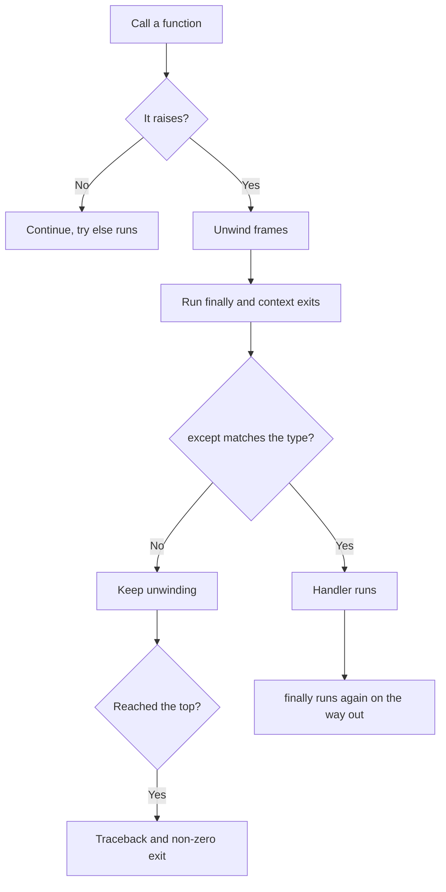

## Why this matters

A backend that returns 200 after a database error is worse than one that crashes the request. Exceptions are how Python libraries report failure, and how your code should report failures you cannot handle locally. Interviews ask what `finally` guarantees, why a bare `except` is dangerous, and what EAFP means. Reviewers ask why your `try` wraps two hundred lines and then logs `Exception` and continues, which deletes the stack trace's usefulness and hides bugs.

This lesson is the mechanism. The next one is how you design exception types. Logging comes after, because a caught exception you do not log, or a log you emit instead of raising, is an operational bug.

## Intuition

An exception is an object that unwinds the call stack until something catches that type. Unwinding runs `finally` blocks and context manager exits along the way, so files close and locks release. If nothing catches it, the process prints a traceback and, for an uncaught exception on the main thread, exits non-zero. That is a feature for programmers and a poor API for end users, so you catch at the boundary, translate into an HTTP error or a clean stderr line, and let unexpected types keep their traceback.

EAFP means "easier to ask forgiveness than permission." You attempt the operation and handle the exception if it fails. LBYL means "look before you leap": you check, then act. Between the check and the act the world can change, and the check can be a lie (`os.path.exists` then `open` still races). For dictionaries, files, and parses, try the operation.

## Core concept in depth

### raise, try, except, else, finally

`raise Exc("message")` creates the exception and starts unwinding. `raise` with no arguments inside an `except` re-raises the current exception and preserves the traceback. `raise Other() from exc` chains a new exception and keeps the original as the cause, which is how you translate a library error without hiding it.

`except ValueError` catches that type and its subclasses. `except (ValueError, KeyError)` catches either. Order matters: a subclass handler must sit above a base handler, or the base handler wins and the specific one never runs. `except Exception` catches application errors and still lets `KeyboardInterrupt` and `SystemExit` through, because those inherit from `BaseException`, not `Exception`. A bare `except:` catches `BaseException` too, including keyboard interrupt, and is almost always wrong.

`else` on a `try` runs when the `try` body did not raise. Use it for code that should not be covered by the `except`. `finally` runs on the way out no matter what: success, handled exception, or escaping exception. It is for cleanup. If `finally` raises, it replaces the exception that was in flight, which is a good way to lose a traceback. Cleanup should not raise if you can help it. Context managers exist so you do not write `finally` by hand for files and locks.

Do not return from `finally` if an exception is in flight and you wanted it to propagate. A `return` in `finally` swallows the exception. That bug looks like a function that "succeeds" after a failure.

### How small a try should be

Wrap the line that you expect to fail, not the whole function. A large `try` catches errors from the code you meant to run only on success, including typos. The pattern is: try the risky call, except the specific error, else do the success-only follow-up. If you cannot name the exception type, you are not ready to catch it. Let it crash until you know.

Catching `Exception` at a top-level request handler is legitimate: log the traceback, return 500, do not kill the worker. Catching `Exception` around a business rule to "keep going" is how corrupt data gets committed. The boundary is the difference.

### EAFP examples that pay rent

`d[key]` inside `try` and `except KeyError` is appropriate when a missing key is an expected case and you did not want `get` because missing and a stored `None` differ... actually `get` with a sentinel is cleaner for dicts. EAFP shines when the operation itself is the check: `int(text)` and catch `ValueError`, `open(path)` and catch `FileNotFoundError`, `queue.get_nowait()` and catch `queue.Empty`. The permission-style check would duplicate the parser.

LBYL is still right when the check is cheap, local, and not racy: an empty-list guard before a loop, a type check that gives a better error than a deep failure, a boolean you already hold. Do not stat a file and then open it and pretend the stat made the open safe.

### Tracebacks are the product

Read from the bottom. The last frame is where it raised. Frames above are callers. `raise ... from exc` shows a cause chain. Logging `str(exc)` and discarding the traceback throws away the frames. If you log, log with `exception` so the traceback is attached. That is the next lesson's tool; the requirement starts here: never catch and ignore.

`Exception.__context__` and `__cause__` are the links. You rarely set them by hand. `from` sets the cause. An exception during handling sets the context. `raise New() from None` suppresses the context when the original exception would only confuse an API user, and you should be conservative with that. Hiding a bug's cause to make a message pretty is a bad trade.

### What not to use exceptions for

Do not use exceptions for ordinary loop termination if a condition reads clearly. `StopIteration` is the iterator protocol, and catching it yourself inside a generator is a special hazard. Do not use a custom exception as a multi-level `break` unless the alternative flag is worse; a return is usually clearer. Exceptions are for failures and for rare control transfers, and they are not free: building a traceback costs more than a return value. They are still cheap compared with a network call. Do not avoid them on a request path out of performance fear. Do avoid them as the success path of a tight inner loop over millions of items if a condition would do.

## Diagram / flowchart



### Dry-run: else versus a line inside try

Goal: parse an int, and only if that works, append it. A bug in `append` should not be reported as a bad int.

| Code shape | `"12"` | `"no"` | append raises |
| --- | --- | --- | --- |
| Both lines inside `try`, `except ValueError` | appends | handler | handler runs and mislabels a bug as bad input if append could raise ValueError, or swallows it |
| `int` in `try`, append in `else` | appends | handler | append's exception propagates, because `else` is not covered by `except` |

The third column is why `else` exists. The handler covers only the conversion.

`finally` dry-run: open, write, raise, finally closes, exception continues. If finally also raises, the write error is lost and you debug the cleanup. Keep cleanup boring.

## Code

```python
def parse_positive(text: str) -> int:
    try:
        value = int(text)
    except ValueError as exc:
        raise ValueError(f"not an integer: {text!r}") from exc
    if isinstance(value, bool) or value <= 0:
        raise ValueError("must be a positive integer")
    return value


def first_present(mapping: dict, key: str, default: str) -> str:
    try:
        value = mapping[key]
    except KeyError:
        return default
    if value is None:
        return default
    return str(value)


if __name__ == "__main__":
    print(parse_positive("5"))
    print(first_present({"a": None}, "a", "fallback"))
    print(first_present({}, "a", "fallback"))
```

`parse_positive` translates the message and chains the original `ValueError` with `from`. Callers can catch `ValueError` once. `first_present` uses EAFP for the missing key and still treats a stored `None` as the default. `get` cannot express that without a sentinel. Both patterns are in the same file so you choose per case instead of declaring one style holy.

Note that `int(True)` would not happen through `int(text)` for a string input. The bool check matters when the function is later generalized to accept ints. `int("08")` works. `int("")` raises `ValueError` and becomes your chained error.

## Complexity analysis

| Path | Cost |
| --- | --- |
| No exception | A predictable branch, cheap |
| Raise and catch nearby | Allocates an exception and a traceback. Fine on a request, noisy in a tight loop |
| Bare `except` that ignores | Unbounded product cost: lost interrupts, lost bugs |
| Large `try` | No extra CPU, large debugging cost |
| `raise ... from exc` | Same as a raise, plus a cause link that saves debugging time |

Do not catch exceptions inside a parser of millions of rows to handle ordinary "skip this token" if a condition is local and clear. Do catch `ValueError` around one `int` call per row. The per-row exception for truly bad input is acceptable. The per-row exception for the success path is not.

## Tricks, tips and patterns

- Name the exception type. Put subclass handlers first.
- Use `else` for the success-only continuation. Use `finally` or a `with` for cleanup.
- Re-raise with a bare `raise` when you log and do not handle. Use `raise New(...) from exc` when you translate.
- Prefer EAFP for parse, lookup-with-sentinel complexity, and I/O. Prefer a condition when you already have the answer in a local variable.
- Catch `Exception` only at a process or request boundary, and log the traceback there.
- Never bare `except:`. Never `except Exception: pass`.
- Do not return from `finally`.
- Let `KeyboardInterrupt` and `SystemExit` propagate.

## Common mistakes and edge cases

- Bare `except` swallowing `KeyboardInterrupt`, so the process will not die on Ctrl-C.
- `except Exception` around a huge block, logging `str(exc)`, continuing. The bug is gone and the data is wrong.
- Handler order with the base class first, so the specific handler is dead code.
- `raise New()` without `from`, losing the cause, or `from None` used to hide a bug.
- `return` inside `finally` eating the real exception.
- LBYL `exists` then `open`, which races, and still needs the `try`.
- Using exceptions for ordinary control flow in a hot loop and then blaming Python for being slow.
- Catching `StopIteration` to end a loop. Use a `for` loop.
- `except ValueError` that also catches a `ValueError` you raised on purpose later in the same block. Shrink the `try`.

## Interview notes

Define EAFP with one sentence and one example: try `int`, catch `ValueError`. Then explain `finally` as cleanup that runs on success and on failure. Then refuse a bare `except` and say you would catch `Exception` only at the edge.

Follow-ups:

- **What does else on try do?** It runs only when the `try` body finishes without raising. If the body raises, `else` does not run, whether or not a handler catches the error. It is not `finally`.
- **How do you preserve a traceback when translating?** `raise NewError("msg") from exc`.
- **BaseException versus Exception?** `SystemExit` and `KeyboardInterrupt` sit on `BaseException`. Catching `Exception` does not stop them.
- **Are exceptions slow?** Slower than a branch. Irrelevant next to I/O. Wrong as the success path of a tight loop.

Correct the `else` sentence in your head before the interview: `else` runs only when the `try` body completes without raising.

## Practice problems

1. **Parse Positive** (easy) — int parsing that rejects non-positive values and non-integers. [Practice: python-ex-parse-positive]
2. **First Present** (medium) — dict lookup that distinguishes missing and `None` from a real string. [Practice: python-ex-first-present-dict]
3. **Handler Order** (medium) — given a class tree and a raised type, say which handler runs. [Practice: python-ex-handler-order]
4. **Translate Error** (medium) — wrap a failure tag into a domain error without dropping the original tag. [Practice: python-ex-chain-error]
5. **Safe Div** (easy) — divide and raise `ValueError` on zero, never return a sentinel unless asked. [Practice: python-ex-safe-div]

## Summary / cheat sheet

- Exceptions unwind the stack until a matching `except`. `finally` and `with` still run.
- Catch specific types, subclasses first. Bare `except` is wrong. `except Exception` belongs at the boundary.
- `else` is the success path outside the handler. `finally` is cleanup. Do not return from `finally`.
- Re-raise with `raise`. Translate with `raise New(...) from exc`.
- EAFP: try the operation. LBYL when the check is local and not a race you then ignore.
- Small `try` blocks. Do not swallow tracebacks. Do not use exceptions as a fancy loop `break` by default.
- `KeyboardInterrupt` and `SystemExit` are not `Exception` subclasses.

## Further reading

- [Errors and exceptions tutorial](https://docs.python.org/3/tutorial/errors.html)
- [The try statement](https://docs.python.org/3/reference/compound_stmts.html#the-try-statement)
- [Built-in exceptions](https://docs.python.org/3/library/exceptions.html)
- [EAFP glossary](https://docs.python.org/3/glossary.html#term-eafp)
