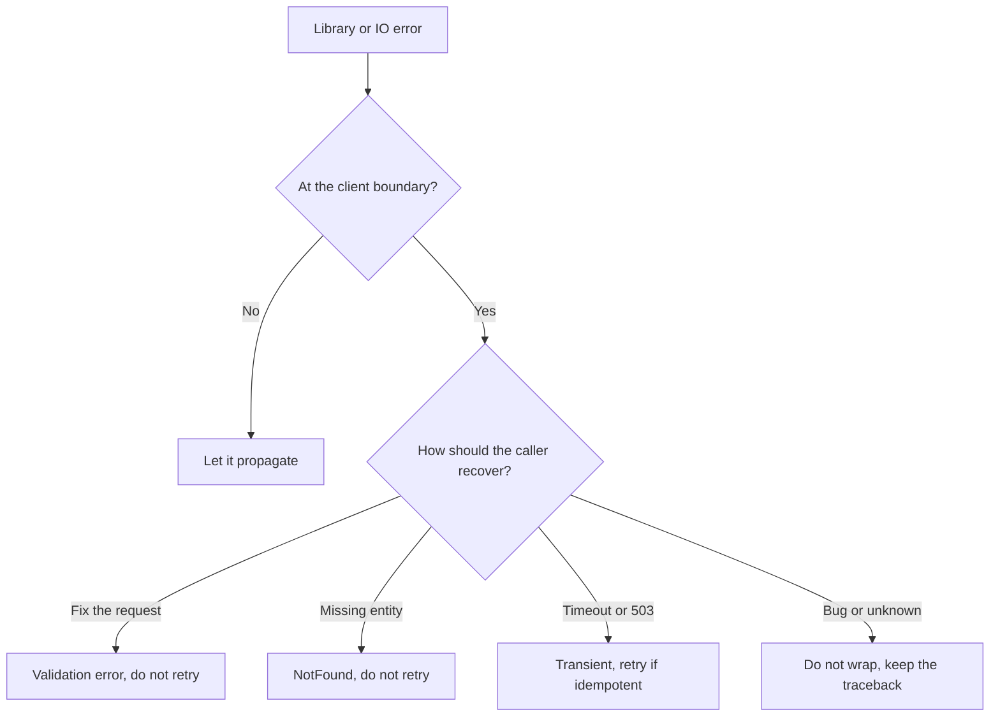

## Why this matters

Callers cannot write a good `except` if your library raises bare `Exception` or a stringly typed `ValueError` for five different failures. They also cannot write a good `except` if you invent twenty exception classes for one module. The design problem is a hierarchy that matches how callers recover: retry, tell the user, or crash. Interviews ask you to model errors for a payments client or a parser. The expected answer is a base type plus a few specific types, chained from the underlying error, with data on the instance rather than parsed back out of the message.

## Intuition

An exception type is a contract about recovery, not a unique snowflake for every `if`. Group the cases a caller would handle the same way. Put the details in attributes: which id was missing, which status came back, how many attempts you made. The message is for humans. The attributes are for code. If the only way to branch is to search the message for a substring, the API is already broken.

A base class lets a caller catch "anything this library raises" at a boundary. Specific subclasses let a caller catch "not found" and turn it into a 404 without also swallowing "the network died."

## Core concept in depth

### A hierarchy that matches recovery

```python
class BillingError(Exception):
    """Base for all billing-client failures."""

class BillingNotFound(BillingError):
    def __init__(self, invoice_id: str) -> None:
        self.invoice_id = invoice_id
        super().__init__(f"invoice not found: {invoice_id}")

class BillingTransient(BillingError):
    def __init__(self, invoice_id: str, status: int) -> None:
        self.invoice_id = invoice_id
        self.status = status
        super().__init__(f"transient status {status} for {invoice_id}")
```

`BillingNotFound` is not transient. A retry will not create the invoice. `BillingTransient` might be worth a retry if the operation is safe to repeat. A timeout from `requests` or `httpx` gets translated into `BillingTransient` at the edge of the client, with `from exc` so the socket error remains attached. The rest of the application imports your types, not the HTTP library's types. That is the boundary. If you leak `requests.Timeout` through ten layers, every layer depends on requests, and a library swap becomes a rewrite of every `except`.

### What belongs on the instance

Identifiers, status codes, and the small piece of input that failed. Not the full request body, not a password, not a card number. `__str__` should be one line a log can show. Do not require callers to parse it. Add attributes.

Inherit from `Exception`, not from `BaseException`. `BaseException` is for system exits and interrupts. A domain error that inherits from `BaseException` will not be caught by `except Exception` at the web boundary, and the worker may die. That is almost never what you want for "invoice missing."

Do not inherit from `ValueError` and `KeyError` at once trying to be helpful. Multiple inheritance of exceptions creates catch-order surprises. Pick one parent. If callers need to treat your error as a `ValueError` for historical reasons, inherit from `ValueError` and accept that `except ValueError` will catch it. Prefer your own base if you own the API.

### Translating at the boundary

Inside the client, catch the library error and raise your type. Do not catch `Exception` and wrap everything, including `TypeError` from your own bug, as `BillingTransient`. Catch the errors the library documents: timeout, connection error, HTTP status. Let programming bugs propagate.

```python
try:
    response = get_invoice(invoice_id)
except TimeoutError as exc:
    raise BillingTransient(invoice_id, status=0) from exc
```

If the status is 404, raise `BillingNotFound`. If it is 429 or 503, raise `BillingTransient`. If it is 400, raise a validation error that is not retried. Map the status in one function so the policy is testable without a socket.

### Messages, chaining, and empty catches

Raise with a message that includes the id and the kind of failure. Chain with `from`. Do not catch your own base type in the same function that raised it unless you are adding context and re-raising. An empty `except BillingError: pass` deletes the signal the hierarchy was for.

Programmers sometimes define `class AppError(Exception): pass` and raise it everywhere with a code string. That collapses the hierarchy into a second type system inside strings. Use subclasses for the recoveries you actually branch on, and a code attribute only if an external protocol needs a stable string. The subclass is still the thing you catch.

### Testing

Raise in a test with `pytest.raises` or `assertRaises` and check the type and the attribute, not the full sentence. A copy edit of the message should not break the test. If you assert the message, assert a stable substring or, better, the attribute. The testing module shows the syntax. The design rule belongs here: attributes are the API, sentences are not.

## Diagram / flowchart



### Dry-run: one HTTP status table

| Status or error | Type you raise | Caller action |
| --- | --- | --- |
| 404 | `BillingNotFound` | Return 404 to the user, do not retry |
| 400 | validation error | Return 400, fix the client |
| 503 or timeout | `BillingTransient` | Retry with backoff if the call is idempotent |
| 200 with a broken body | data error or a bug | Do not call it transient unless you know the server is wrong and a retry returns a new body |
| `TypeError` in your parser | nothing, it propagates | Fix the code |

The 200 row is the judgment call. A malformed success body is not "try again" unless you have evidence the server is flaky. Wrapping it as transient retries a deterministic parser bug.

## Code

```python
class BillingError(Exception):
    pass


class BillingNotFound(BillingError):
    def __init__(self, invoice_id: str) -> None:
        self.invoice_id = invoice_id
        super().__init__(f"invoice not found: {invoice_id}")


class BillingTransient(BillingError):
    def __init__(self, invoice_id: str, status: int) -> None:
        self.invoice_id = invoice_id
        self.status = status
        super().__init__(f"transient status {status} for {invoice_id}")


def classify_status(invoice_id: str, status: int) -> None:
    if status == 404:
        raise BillingNotFound(invoice_id)
    if status in {408, 429, 500, 502, 503, 504}:
        raise BillingTransient(invoice_id, status)
    if status >= 400:
        raise BillingError(f"unexpected status {status} for {invoice_id}")


if __name__ == "__main__":
    try:
        classify_status("inv_1", 503)
    except BillingTransient as exc:
        print(exc.invoice_id, exc.status)
```

`classify_status` is pure and testable. The HTTP call stays elsewhere and only funnels the status in. Note the set of transient codes is a policy. 500 sometimes means "your request is deterministically broken." If the operation is not idempotent, the caller still must not blind-retry, even if you labeled the error transient. The type says "this might be worth retrying." The caller decides based on idempotency.

## Complexity analysis

| Choice | Cost |
| --- | --- |
| One base and a few subclasses | O(1) design work, linear debugging time saved |
| A unique class per line of code | Harder to catch, no extra runtime benefit |
| String codes inside one class | Callers parse strings, tests depend on wording |
| Wrapping every `Exception` | Bugs become transient failures and get retried |
| Chaining with `from` | Negligible CPU, preserves the cause chain |

Exception design does not change the cost of the happy path. It changes the cost of the incident. A hierarchy you can catch is cheaper than a log line you grep.

## Tricks, tips and patterns

- One base type per library or bounded context. Subclass per recovery strategy, not per function.
- Put identifiers and status codes on `self`. Call `super().__init__` with a one-line message.
- Translate third-party errors at the boundary with `raise Ours(...) from exc`.
- Catch only the library errors you mean to translate. Let `TypeError` and `AssertionError` escape.
- Inherit from `Exception`. Do not inherit from `BaseException` for domain errors.
- Test attributes, not the full sentence.
- Name transient errors honestly, and still require the caller to know whether the operation is idempotent.

## Common mistakes and edge cases

- Raising `Exception("not found")` so callers cannot catch it without catching everything.
- A class per error code that nobody catches individually, plus no base class, so the boundary cannot catch the group either.
- Parsing `str(exc)` in the caller to decide a retry.
- Storing secrets or full payloads on the exception, which then land in logs and error trackers.
- Wrapping `KeyboardInterrupt` because you caught `BaseException` by mistake.
- Multiple inheritance of `ValueError` and `LookupError` so one `except` behaves differently than the author guessed.
- Losing the cause by omitting `from`.
- Catching the base type in a retry loop that also catches "not found" and retries a missing invoice forever.

## Interview notes

Sketch three boxes: base, not found, transient. Say what the caller does with each. Say you translate HTTP errors inside the client and chain the original. Say you do not retry non-idempotent operations just because the type says transient.

Follow-ups:

- **Why not one exception with a code string?** Because `except` matches types, and string matching is brittle. A code attribute is fine in addition to a subclass when a protocol needs it.
- **What do you put on the exception?** Ids and status, not secrets. The message is for humans.
- **Where do you catch the requests exception?** At the edge of your client, nowhere else.
- **Why a base class?** So a top-level handler can turn unknown billing failures into a 502 without catching `Exception` and also swallowing bugs from unrelated code... it still should not swallow bugs. The base class catches billing failures only.

Phrase the last point cleanly: the handler catches `BillingError` around the billing call, not around the entire request including your own serializer.

## Practice problems

1. **Classify Status** (medium) — map status codes to not-found, transient, or generic billing failure. [Practice: python-ex-classify-status]
2. **Retry Policy** (medium) — given an error kind and an idempotency flag, say whether to retry. [Practice: python-ex-retry-policy]
3. **Safe Message** (easy) — build an error message that includes an id and excludes a supplied secret. [Practice: python-ex-safe-message]
4. **Cause Chain** (medium) — represent a translated error that still remembers the underlying tag. [Practice: python-ex-cause-chain]

## Summary / cheat sheet

- A base exception plus a few subclasses, grouped by how callers recover.
- Attributes hold ids and codes. The message is one human line. Do not make callers parse it.
- Translate third-party errors at the boundary with `raise Ours(...) from exc`.
- Do not wrap programming bugs as domain errors. Do not catch `BaseException`.
- Transient means "a retry might help," not "always retry." Idempotency still decides.
- Test types and attributes. Keep secrets off the exception object.
- One hierarchy per boundary. Leak neither HTTP library types nor a single stringly `Exception`.

## Further reading

- [User-defined exceptions](https://docs.python.org/3/tutorial/errors.html#user-defined-exceptions)
- [Exception chaining](https://docs.python.org/3/tutorial/errors.html#exception-chaining)
- [Built-in exception hierarchy](https://docs.python.org/3/library/exceptions.html#exception-hierarchy)
- [PEP 3134 — Exception Chaining](https://peps.python.org/pep-3134/)
