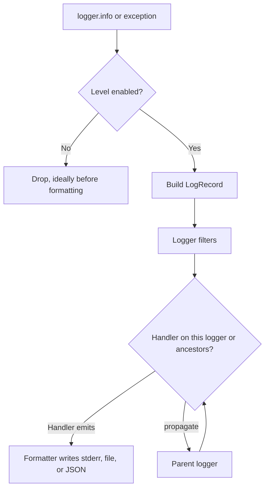

## Why this matters

Print statements do not have levels, do not ship well to aggregators, and end up in the access log mixed with real output. The `logging` module is the standard tool: named loggers, levels, handlers, and a formatter. Interviews ask why you would log a warning versus an error, and why a library must not call `basicConfig` and seize the root logger. On call, the question is whether the line you emitted has a request id, the exception traceback, and no password.

This is not a tour of every handler class. It is the configuration and the call-site habits that make logs useful.

## Intuition

A logger is a named channel, usually the module name via `logging.getLogger(__name__)`. A log record is an event with a level, a message, and optional extra fields. Handlers decide where records go: stderr, a file, a socket. Filters and levels decide what is dropped. Formatters decide how the record becomes text. You configure this once at process start. Libraries do not configure it. They only name a logger and emit records. The application decides the threshold and the destination.

Levels are a severity contract, not a mood. Debug is for developers tracing a single request. Info is a business or lifecycle event you are happy to keep. Warning is a surprise you recovered from or a quota you are nearing. Error is a failed operation for this request. Critical is a process-wide failure. If everything is error, nothing is.

## Core concept in depth

### Get a logger and emit

```python
import logging

logger = logging.getLogger(__name__)

def charge(invoice_id: str) -> None:
    logger.info("charging invoice %s", invoice_id)
```

The first argument is a format string in printf style, not an f-string. Pass values as further arguments. The logger interpolates them only if the record is emitted. An f-string interpolates immediately, even when the level is disabled, and it can waste work or throw while building a message you were going to drop. Use `%s` placeholders. Do not use `%r` on a giant object at info level.

`logger.exception("payment failed for %s", invoice_id)` inside an `except` block logs at error and attaches the traceback. `logger.error(..., exc_info=True)` does the same when you are not using the convenience method. Logging `str(exc)` without `exc_info` is the bug from the exceptions lesson, now with a specific fix.

### Configuration belongs in the application

`logging.basicConfig(level=logging.INFO)` is acceptable in a script's `if __name__ == "__main__"` block, and only if no handler exists yet. Calling it from an import is rude: import order then decides whether your level sticks. A service should configure dictConfig or fileConfig at startup, with a handler on the root logger or on your package logger, and a formatter that includes time, level, logger name, and message.

Libraries must not call `basicConfig`, must not add handlers, and must not set the root level. They create loggers and emit. If a library attaches a handler, the application gets duplicate lines and cannot turn them off without knowing your private handler. Document the logger name (`billing.client`) so operators can set its level.

`logger = logging.getLogger(__name__)` yields `package.module`, which is a child of `package`. Levels and handlers propagate to ancestors by default. Set the level on the package logger in tests when you want silence, or on the root logger in production. `propagate = False` stops a record from also reaching the root. Use it when a logger has its own handler and you would otherwise double-log. Do not set it out of habit or your records vanish because nobody attached a handler to that logger.

### What you log, and what you never log

Log identifiers, decisions, timings, and exception types. Do not log passwords, tokens, card numbers, full authorization headers, or raw session cookies. A request line with a query string often contains a token. Redact before you log the URL. Structured fields are better than a sentence you cannot query: if your formatter or a JSON formatter supports an `extra` mapping such as invoice_id to the id, use a stable key. The stdlib `extra` dict must not collide with reserved `LogRecord` attribute names such as `name`, `message`, `levelname`, or `filename`. Those collisions raise `KeyError` at the worst moment. Pick keys like `invoice_id`.

Do not build a log record so large that it is a second copy of the database row. Log the id and a hash or a size. Debug logs can include more, behind a level that is off in production.

### Levels as an on-call contract

| Level | Meaning | Page a human? |
| --- | --- | --- |
| DEBUG | Step-level detail | No |
| INFO | Expected lifecycle: started, charged, shut down | No |
| WARNING | Degraded but handled: retrying, falling back | Usually no, watch the rate |
| ERROR | This operation failed | Alert on rate, not on one line |
| CRITICAL | Process cannot continue | Yes |

One error is not a page. A sudden rate of errors is a page. That policy lives in the alerting system, and it only works if error means something stable. Do not log a client 404 as an error. The client asked for a missing invoice. That is info or warning at most. Log a 503 storm from a dependency as error on the final failure, and as warning on the retries, or you will train everyone to ignore error.

### Threads, async, and tests

Logging locks handlers so lines do not tear in half as often as a naked print. It is safe to call from threads. It is not a license to log huge objects under a lock on the hot path. In async code, logging is synchronous stdlib I/O. A debug log of a giant payload can block the event loop. Keep messages small.

In tests, prefer `caplog` in pytest or assert on a logger you control, rather than parsing stderr. Do not leave `basicConfig` in a test module at import. It leaks handlers into other tests.

### Correlation

A request id in every line is what makes five services debuggable. The stdlib tool is a `LoggerAdapter` or a `Filter` that pulls the id from a context variable. You do not need a third-party library to understand the goal: every record for this request shares one id, and the id is not a global you forget to clear. Context vars, covered with concurrency, are the modern way. A middleware sets the id at the start of the request and the filter copies it onto the record.

## Diagram / flowchart



### Dry-run: a retry then a final failure

| Attempt | What happened | Level | Why |
| --- | --- | --- | --- |
| 1 | Timeout, will retry | WARNING | Recovered path, not a page |
| 2 | Timeout, will retry | WARNING | Same |
| 3 | Timeout, giving up | ERROR with traceback | The operation failed |
| User 404 | Invoice missing | INFO or WARNING | Not an error in our service |
| Bug `TypeError` | Unexpected | ERROR with traceback at the boundary | A real defect |

If attempt 1 is logged at error, the alert fires on every blip. If attempt 3 is logged at info, the failure is invisible. The table is the contract.

## Code

```python
import logging

logger = logging.getLogger("codecraft.billing")


def configure() -> None:
    logging.basicConfig(
        level=logging.INFO,
        format="%(asctime)s %(levelname)s %(name)s %(message)s",
    )


def charge(invoice_id: str, secret: str) -> None:
    logger.info("charging invoice %s", invoice_id)
    try:
        if not invoice_id:
            raise ValueError("missing invoice id")
        # secret is used and never logged
        _ = len(secret)
    except ValueError:
        logger.exception("charge failed for %s", invoice_id)
        raise


if __name__ == "__main__":
    configure()
    try:
        charge("", "super-secret")
    except ValueError:
        pass
```

`configure` is the application's job and lives under `__main__` in this demo. A library that imported `charge` would not call `configure`. The log line contains the invoice id and not the secret. `logger.exception` runs inside the handler, so the traceback includes `charge`. The bare `raise` after logging keeps the exception moving. Logging is not handling.

## Complexity analysis

| Habit | Cost |
| --- | --- |
| Disabled debug level with `%s` args | The record is skipped. Arguments are still evaluated by Python before the call, but the message is not formatted |
| f-string in the log call | Always built, even when debug is off |
| `exception()` | Formats a traceback. Do it on real failures, not on the success path |
| Logging a giant dict at info | I/O and storage cost on every request |
| Duplicate handlers | Double the volume, double the bill, half the clarity |

The argument-evaluation note matters: `logger.debug("stats %s", expensive())` still calls `expensive()` before `debug` can decline. Guard with `if logger.isEnabledFor(logging.DEBUG)` when the argument is costly. Do not guard every log. Guard the ones a profiler or a careful reading shows are expensive.

## Tricks, tips and patterns

- `getLogger(__name__)` in every module. Configure once in the application entry point.
- Use `%s` arguments, not f-strings, so formatting waits for an enabled level.
- `logger.exception` inside `except`, then re-raise unless this layer truly handles the error.
- Libraries do not add handlers and do not call `basicConfig`.
- Do not log secrets, tokens, or full query strings. Log ids.
- 404s and validation failures are not error-level by default. Final dependency failure is.
- Avoid `extra` keys that collide with `LogRecord` attributes. Prefix them.
- `isEnabledFor` around expensive debug arguments only.

## Common mistakes and edge cases

- `print` in a service and wondering why the aggregator never saw a level.
- `basicConfig` at import time in a library. The application cannot configure cleanly, or lines duplicate.
- f-strings that interpolate a password into a debug message which someone later turns on in production.
- `logger.error(str(exc))` with no traceback.
- Logging and swallowing, so the request returns 200 and the only signal is a line nobody alerts on.
- Passing `extra` with the key `name` set to a user name, which raises because `name` is reserved on the log record.
- Setting `propagate = False` and adding no handler, so the logger is a black hole.
- A warning on every retry plus an error, with the alert bound to warning, paging the whole company for a single timeout that then succeeds.
- Assuming logging is asynchronous. It is not. A network handler that blocks will stall the request.

## Interview notes

Say: named loggers, configuration in the app, libraries only emit, levels mean severity, `exception` captures the traceback, secrets stay out. Offer the retry table if they ask how you would log a flaky dependency.

Follow-ups:

- **Why not print?** No level, no logger name, mixes with stdout data, harder to route.
- **Why `%s` instead of an f-string?** Lazy formatting when the level is disabled, and a consistent style. Remember arguments still evaluate.
- **How do you log an exception?** `logger.exception` in the `except` block, or `exc_info=True`.
- **Who calls basicConfig?** The application, once. Not the library.

Mention a request id if you have used middleware. It is the difference between a log file and an investigation.

## Practice problems

1. **Redact** (easy) — given a mapping of fields, drop secret keys before logging. [Practice: python-ex-redact]
2. **Level Choice** (medium) — map an outcome word to a log level name using the contract above. [Practice: python-ex-log-level]
3. **Format Lazy** (easy) — decide whether a message should be built for a disabled debug logger. [Practice: python-ex-lazy-log]
4. **Retry Lines** (medium) — given attempt results, return the level for each attempt including the final failure. [Practice: python-ex-retry-lines]

## Summary / cheat sheet

- `logging.getLogger(__name__)` in modules. Configure handlers and levels once in the application.
- Libraries emit records and do not attach handlers or call `basicConfig`.
- Levels: debug detail, info lifecycle, warning degraded, error failed operation, critical process failure.
- Use `%s` parameters. Use `logger.exception` to keep the traceback. Re-raise if you did not handle the error.
- Do not log secrets. Do not use reserved names in `extra`.
- Client errors are not your error level. A retry is a warning. The final failure is an error.
- `isEnabledFor` before an expensive debug argument. Logging itself is synchronous.

## Further reading

- [Logging HOWTO](https://docs.python.org/3/howto/logging.html)
- [Logging cookbook](https://docs.python.org/3/howto/logging-cookbook.html)
- [logging module](https://docs.python.org/3/library/logging.html)
- [LogRecord attributes](https://docs.python.org/3/library/logging.html#logrecord-attributes)
