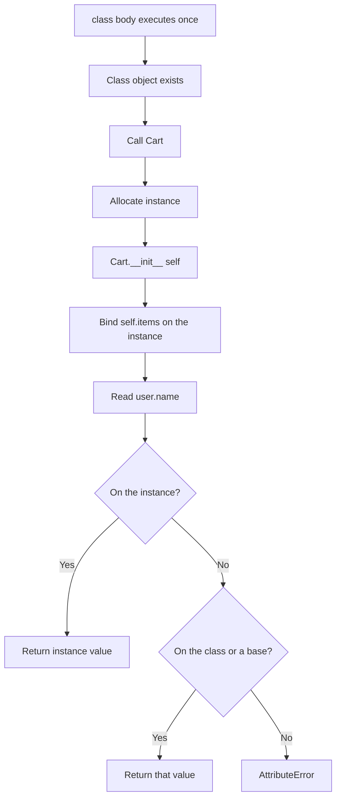

## Why this matters

Most Python backend code is objects with behavior: a request, a repository, a client, a domain entity. Interviews still ask you to design a small class, and they watch whether mutable state lives on the class or on the instance. The bug is famous and still ships: a list defined on the class body is shared by every instance, so one user's cart shows another user's items. The mechanism is attribute lookup, not "OOP is confusing."

This lesson builds the object model the rest of the module uses: what `class` creates, what `__init__` does, how attribute lookup walks instance then class, and where `self` comes from.

## Intuition

A class is an object too. Its body runs once, at definition, and the names you assign there live on the class. Functions defined in the body are function objects stored on the class. When you call `User("Ada")`, Python creates a blank instance and calls `User.__init__` with that instance as `self`. Assignments to `self.something` store keys on that instance only.

Lookup of `user.name` checks the instance first, then the class, then base classes. A method is a function found on the class. The descriptor protocol binds it to the instance so `self` arrives automatically. You do not pass `self` at the call site. You do receive it as the first parameter. Forgetting `self` in the definition is a `TypeError` at the call, not at the `class` statement.

## Core concept in depth

### The class statement runs

The class body is an executable namespace. Assignments, imports, and even loops run once when the class is defined, not once per instance. That is why a default list on the class is created once:

```python
class Cart:
    items = []  # one list, shared

    def add(self, item: str) -> None:
        self.items.append(item)
```

`self.items` finds no instance attribute named `items`, so lookup continues to the class, finds the shared list, and appends. Every cart grows the same list. The fix is to create the list in `__init__`:

```python
class Cart:
    def __init__(self) -> None:
        self.items = []

    def add(self, item: str) -> None:
        self.items.append(item)
```

Now each instance has its own list. Class attributes are still the right place for constants and for data you truly want shared, such as a species name or a registry you designed on purpose. Shared mutable caches on the class are process-wide state. Tests must reset them or they leak.

### `__init__` is not a constructor in the C++ sense

`__new__` allocates the instance. You rarely override it, except when you subclass an immutable type or implement a carefully justified singleton. `__init__` initializes an instance that already exists. It must return `None`. Returning a value raises `TypeError`. If `__init__` raises, the caller does not receive the instance, but `__new__` did run. Do not do heavy work that can fail halfway and leave a global side effect you cannot undo. Open resources in `__init__` only if the object owns them and you close them in a method or a context manager.

`__init__` is an ordinary method with a required first parameter. Overriding it in a subclass does not automatically call the base. You call `super().__init__(...)` yourself. Forgetting that leaves the base uninitialized. The MRO lesson explains `super` in multiple inheritance. With a single base, `super().__init__()` is the habit.

### Attribute lookup and assignment

Reading `obj.attr` searches the instance `__dict__`, then the class, then bases. Assigning `obj.attr = value` writes the instance `__dict__` almost always, and it does not change the class attribute. That shadow is a second famous bug: `self.name = name` creates an instance attribute that hides a class attribute of the same name for that instance only. Other instances still see the class attribute. Deleting the instance attribute with `del self.name` reveals the class attribute again.

`obj.__dict__` is the instance mapping for a normal class. Classes that define `__slots__` have no `__dict__` unless they ask for one. Slots are a memory optimization and a way to forbid unexpected attributes. They are not a security boundary. They complicate inheritance. Use them when you have measured millions of tiny objects, not as a default style.

### Identity and equality, preview

Two instances compare unequal by default, even with the same fields, because the default equality is identity. `==` is `is` until you define `__eq__`. If you define `__eq__` and the objects are mutable, do not also pretend they are dict keys. Hash and equality must agree, and a mutable hash is a corrupted dict. The dunder lesson covers the implementation. The design rule starts now: entities with an id compare by id. Value objects compare by fields and are immutable.

### What to put in a class

A class earns its existence when several functions share state and invariants. A single function with two parameters does not need a class. A "utility class" with only static methods is a module. Python already has modules. Group functions in a module until you have state, an invariant, or a reason to pass the behavior around as an object.

Keep `__init__` boring: store validated fields. Do not call the network inside `__init__` if a method named `fetch` would make the failure obvious and the object easier to construct in a test. You can pass dependencies in: `Service(client)` receives a fake client in tests. That is constructor injection, and it is the pattern you will reuse under SOLID and testing.

## Diagram / flowchart



### Dry-run: shared class list versus per-instance list

Two carts, class-level `items`.

| Step | `Cart.items` identity | `a.items` is `b.items` |
| --- | --- | --- |
| After both inits, buggy version | one list | True |
| `a.add("book")` | that list now contains book | True, so `b` shows book |
| Fixed version, after both inits | no list on the class | False, two lists |
| `a.add("book")` | | `b.items` is still empty |

Shadow dry-run: class `limit = 10`. Instance sets `self.limit = 3`. That instance reads 3. A new instance reads 10. `del` on the instance limit reveals 10 again. You did not change the class by assigning through `self`.

## Code

```python
class Cart:
    def __init__(self, owner: str) -> None:
        if not owner.strip():
            raise ValueError("owner is required")
        self.owner = owner
        self.items: list[str] = []

    def add(self, item: str) -> None:
        self.items.append(item)

    def total_items(self) -> int:
        return len(self.items)


if __name__ == "__main__":
    a = Cart("Ada")
    b = Cart("Grace")
    a.add("book")
    print(a.owner, a.items, b.items)
    print(a.total_items(), a.items is b.items)
```

Predict empty for Grace and a single book for Ada, and `is` is false. If you move `items = []` to the class body and delete the line in `__init__`, the `is` check becomes true and Grace sees the book. Run both versions once in a REPL so the lookup rule is in your hands, not only on the page.

## Complexity analysis

| Operation | Cost |
| --- | --- |
| Attribute read that hits the instance dict | O(1) average |
| Attribute read that walks a short MRO | O(depth), and depth is tiny |
| Creating an instance | Allocation plus `__init__`. Do not hide a query in there and call it O(1) |
| Class body | Once per process import, not per instance |
| `__slots__` versus `__dict__` | Slots save memory per instance. The CPU win is secondary and must be measured |

Attribute access is not your hotspot next to the database. The shared class list is a correctness bug with unbounded product cost, not a complexity win.

## Tricks, tips and patterns

- Create mutable fields in `__init__`, never as class attributes, unless sharing is the spec and tests reset the state.
- Validate inputs in `__init__` and store the cleaned value. Fail before the object exists from the caller's point of view.
- Call `super().__init__` when you subclass and the base has initialization.
- Pass dependencies in. Do not construct a real HTTP client inside `__init__` if tests need a fake.
- Use a module of functions when there is no per-object state.
- Constants on the class are fine: `MAX_ITEMS = 50`.
- If assignment should not silently shadow, the property lesson shows how to control writes. Do not reach for `__slots__` just to prevent typos unless you want that trade.

## Common mistakes and edge cases

- Mutable class attribute shared by every instance.
- Forgetting `self` on a method, or passing `self` manually at the call and getting one argument too many.
- Returning a value from `__init__`.
- Forgetting `super().__init__` so the base never stores `self.id`.
- Assigning `self.limit` and believing you updated the class default for everyone.
- Doing I/O in `__init__` and then being unable to construct the object in a unit test.
- Defining `__eq__` on a mutable object and putting it in a set.
- A class body that queries a database at import time. The body runs on import. Keep it pure.

## Interview notes

Draw the instance dict and the class dict. Show lookup. Show why the cart list must be created in `__init__`. Mention that methods live on the class and `self` is the instance you called the method on.

Follow-ups:

- **Is `__init__` the constructor?** `__new__` allocates. `__init__` initializes. You override `__init__` almost always.
- **Where does self come from?** The call `obj.method(x)` passes `obj` as the first argument. The descriptor does that.
- **Class versus instance attribute?** Class is shared and defined once. Assignment through `self` writes the instance and shadows.
- **When would you not use a class?** Stateless helpers belong in a module.

If they ask about `@dataclass`, say it generates `__init__` and friends and is the next tool once the fields are the design. You still need this lookup model or a dataclass with a mutable default factory will confuse you the same way.

## Practice problems

1. **Cart Isolation** (easy) — two carts must not share items. Implement add and list. [Practice: python-ex-cart-isolation]
2. **Require Owner** (easy) — reject a blank owner in the initializer. [Practice: python-ex-require-owner]
3. **Shadow Limit** (medium) — given a class default and an instance override, return both reads. [Practice: python-ex-shadow-limit]
4. **Inject Client** (medium) — a service calls `client.get(id)` passed in, and does not build the client itself. [Practice: python-ex-inject-client]

## Summary / cheat sheet

- The class body runs once. Mutable values created there are shared by every instance that does not shadow them.
- `__init__` initializes an existing instance and must return `None`. Create per-instance containers there.
- Attribute read walks instance, then class, then bases. Attribute write usually stores on the instance and shadows the class.
- `self` is the instance the method was called on. You declare it; the caller of the method does not pass it.
- Call `super().__init__` from a subclass. Pass collaborators into `__init__` instead of constructing them internally when tests must substitute them.
- Prefer a module of functions when there is no instance state.
- Default equality is identity. Do not hash mutable instances.

## Further reading

- [A first look at classes](https://docs.python.org/3/tutorial/classes.html)
- [Class objects and instance objects](https://docs.python.org/3/tutorial/classes.html#class-objects)
- [__init__ and __new__](https://docs.python.org/3/reference/datamodel.html#object.__new__)
- [Classes and instances in the language reference](https://docs.python.org/3/reference/datamodel.html#classes)
