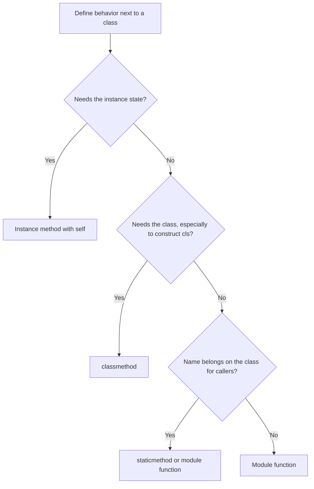

## Why this matters

Python methods are functions stored on the class, wrapped in descriptors that decide what the first argument is. Interviews ask you to write `from_row` as a classmethod and then ask why it is not a staticmethod. The answer is that a classmethod receives the class, so a subclass inherits a constructor that builds the subclass, not the base. A staticmethod receives nothing and breaks that promise. Getting this wrong looks small and leaks into every subclass you add later.

You also need the call mechanics: `obj.method` is a bound method, `Class.method` is a function you must pass the instance to, and forgetting which one you hold causes `TypeError` arguments that mention `self`.

## Intuition

An instance method's first parameter is the instance. A classmethod's first parameter is the class, whether you called it on the class or on an instance. A staticmethod is a function parked on the class for namespacing. It does not get the instance and it does not get the class. If the body never uses either, static is honest. If it calls `cls(...)` to build one of "whatever class this was called on," it must be a classmethod.

Descriptors do the binding when you look the function up. You rarely write a descriptor by hand. You do need to know that `@classmethod` and `@staticmethod` are descriptors, which is why the order of decorators matters when you stack them.

## Core concept in depth

### Instance methods and bound methods

```python
class User:
    def __init__(self, name: str) -> None:
        self.name = name

    def greet(self) -> str:
        return f"hello {self.name}"
```

`User.greet` is a function. `User("Ada").greet` is a bound method. Calling the bound method supplies the instance. Calling `User.greet(user)` is the same call written out. Storing `callback = user.greet` stores the bound method and keeps the user alive. That is a closure-like lifetime: the callback pins the instance. Do not stash bound methods in a global registry and expect the instance to be collected.

If you override a method and want the base behavior too, call `super().greet()` from the instance method. `super` returns a proxy that continues the MRO. Do not call `self.greet()` for that. It recurses.

### classmethod and alternative constructors

`datetime.strptime` and `dict.fromkeys` are the pattern: a classmethod that parses input and returns an instance. Implement `from_json` or `from_row` the same way.

```python
class User:
    def __init__(self, name: str) -> None:
        self.name = name

    @classmethod
    def from_row(cls, row: dict) -> "User":
        name = row.get("name")
        if not isinstance(name, str) or not name.strip():
            raise ValueError("row needs a name")
        return cls(name.strip())
```

`cls` is `User` when you call `User.from_row`, and it is `Admin` when `Admin` inherits `from_row` and does not override it and you call `Admin.from_row`. The returned object is an `Admin`. If you had written `return User(name)` inside the classmethod, subclasses would be sliced back to `User`. That bug is why people reach for classmethod. If you wrote a staticmethod that calls `User(...)`, you freeze the base type.

You can call a classmethod on an instance. `user.from_row(row)` still passes the class, not the instance. It does not clone `user`. Do not use a classmethod as a copy constructor unless the body really only needs the class.

Classmethods are also how you touch class-level state honestly: a registry of subclasses, a counter of instances created. Prefer an explicit registry object over a class-level dict once more than one kind of state appears. A class-level dict is process-global and tests must clear it.

### staticmethod

A staticmethod does not receive `self` or `cls`. Use it for a function that is conceptually related to the class and does not create instances and does not read class state. A checksum or a pure validation helper can live there. A module-level function is usually clearer. Staticmethods shine when you want the name `User.normalize` discoverable next to the class and inheritance should not change which function runs... it can still be overridden by a subclass that defines its own staticmethod, but the base staticmethod will not automatically construct the subclass.

Do not "fix" a forgotten `self` by adding `@staticmethod`. The method probably needed the instance. The decorator silences the `TypeError` and the body then fails on `self` or, worse, ignores instance state and returns a constant.

### Decorator order

`@classmethod` and `@staticmethod` should wrap the raw function. If you stack another decorator, apply `classmethod` last, meaning it is the top line, so it wraps the outside and the descriptor is what gets stored on the class. If your logging decorator sits outside `classmethod`, lookup may not bind `cls` and the first argument is wrong. Test a subclass call when you stack decorators on a classmethod. The symptom is a mysterious argument shift.

### When the function should leave the class

If you pass the behavior as a strategy, a bare function or a callable object is easier to test than a method that only makes sense with `self`. If two classes need the same pure helper, put it in a module and call it from both. A staticmethod duplicated on both classes will drift. The class is not a junk drawer.

## Diagram / flowchart



### Dry-run: from_row on a subclass

`Admin` extends `User` and does not override `from_row`. `User.from_row` returns `cls(name)`.

| Call | `cls` inside from_row | Type of result |
| --- | --- | --- |
| `User.from_row(row)` | `User` | `User` |
| `Admin.from_row(row)` | `Admin` | `Admin` |
| Same body written as `return User(name)` | ignored | `User` even for the Admin call |
| staticmethod that calls `User(name)` | no cls | `User` |

The third and fourth rows are the slicing bug. The first two rows are why the parameter exists.

## Code

```python
class User:
    def __init__(self, name: str) -> None:
        self.name = name

    def greet(self) -> str:
        return f"hello {self.name}"

    @classmethod
    def from_row(cls, row: dict) -> "User":
        name = row.get("name")
        if not isinstance(name, str) or not name.strip():
            raise ValueError("row needs a name")
        return cls(name.strip())

    @staticmethod
    def is_blank(value: str) -> bool:
        return not value.strip()


class Admin(User):
    def greet(self) -> str:
        return f"admin {self.name}"


if __name__ == "__main__":
    admin = Admin.from_row({"name": "Ada"})
    print(type(admin).__name__, admin.greet())
    print(User.is_blank("  "), User("A").is_blank("x"))
```

`Admin.from_row` builds an `Admin` because `from_row` is a classmethod. `greet` is an instance method overridden on `Admin`, so the greeting says admin. `is_blank` works on the class and on an instance and never reads `self`. If the check later needs a per-tenant rule stored on the instance, it stops being static.

## Complexity analysis

| Mechanism | Cost |
| --- | --- |
| Bound method creation on lookup | Small object per lookup of an instance method. Not your hotspot |
| classmethod or staticmethod lookup | A descriptor hit, then a normal call |
| Wrong staticmethod that hardcodes the base class | No CPU issue, wrong type forever |
| Class-level registry updated on every init | Contention and test leakage, not algorithmic complexity |

Choose the method type for correctness of `self` and `cls`. Do not choose it for speed.

## Tricks, tips and patterns

- Alternative constructors are classmethods and they call `cls(...)`, not the hardcoded class name.
- Staticmethods are rare. Prefer a module function unless the name clearly belongs on the type.
- Never add `@staticmethod` just to silence a missing `self`.
- A bound method keeps the instance alive. Do not leak them into long-lived registries by accident.
- Stack `@classmethod` above other decorators and test the subclass path.
- Class-level mutable registries need a clear reset in tests.
- Call `super().method()` to extend behavior. Do not recurse through `self.method()`.

## Common mistakes and edge cases

- `return User(...)` inside a classmethod, so subclasses construct the base.
- A staticmethod that people later subclass, expecting polymorphic construction. It will not.
- Forgetting that `instance.class_method()` does not pass the instance as `self`.
- Decorator order that wraps the classmethod and breaks binding.
- A utility class of staticmethods that should have been a module.
- Overriding `__init__` and also providing `from_row` that skips validation by setting attributes directly. Route constructors through one `__init__`.
- Using a classmethod to clone an instance while ignoring that instance's extra fields. A copy needs an instance method or `copy.copy` with a defined policy.

## Interview notes

Write `from_row` as a classmethod on the board and say the word `cls`. Then add a subclass and show the type of the result. Mention staticmethod as the tool you did not use because construction needs the class.

Follow-ups:

- **What is a bound method?** An instance method plus the instance, so the caller does not pass `self`.
- **classmethod versus staticmethod?** Classmethod receives the class and supports polymorphic construction. Staticmethod receives neither.
- **Can you call a classmethod on an instance?** Yes. You still receive the class, not the instance state.
- **Why not a module function?** Fine for pure helpers. Less fine for constructors that must follow subclassing.

If they ask about `@property`, say it is a descriptor that turns a method into attribute access, covered with encapsulation. It is not a fourth "method type" in the same menu, but it is the next descriptor you will use daily.

## Practice problems

1. **From Row** (medium) — classmethod constructor that validates a name and respects subclasses. [Practice: python-ex-from-row]
2. **Blank Check** (easy) — a pure string check that does not need an instance. [Practice: python-ex-is-blank]
3. **Polymorphic Build** (medium) — given a class name path of calls, return which class `cls(...)` constructs. [Practice: python-ex-cls-build]
4. **Bound Leak** (medium) — explain with a small simulation which objects stay reachable when a method is stored. [Practice: python-ex-bound-hold]

## Summary / cheat sheet

- Instance methods receive `self`. Lookup on an instance returns a bound method.
- Classmethods receive `cls`. Use them for alternate constructors and call `cls(...)` so subclasses work.
- Staticmethods receive neither. Use them rarely. A module function is often clearer.
- Hardcoding the class name inside a constructor slices subclasses back to the base.
- `@classmethod` should be the outer decorator when stacked, and you should test a subclass.
- Bound methods keep instances alive. Class-level mutable registries are global state.
- Do not use `@staticmethod` to paper over a missing `self`.

## Further reading

- [classmethod](https://docs.python.org/3/library/functions.html#classmethod)
- [staticmethod](https://docs.python.org/3/library/functions.html#staticmethod)
- [Instance methods in the tutorial](https://docs.python.org/3/tutorial/classes.html#method-objects)
- [Descriptor HowTo guide](https://docs.python.org/3/howto/descriptor.html)
