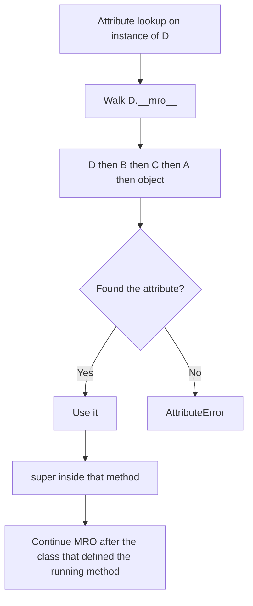

## Why this matters

`super()` is not "call my parent." It continues the method resolution order from the current class. In single inheritance the difference is invisible and the call reaches the base. In a diamond, two bases both call `super`, and the MRO is what guarantees each class runs once. Interviews ask you to predict the MRO of a small diamond and to spot a `Base.__init__` call that skips a sibling class. That bug drops an initializer and the object is half built.

You also need the judgment: inheritance is for a true subtype that can stand in for the base. If you are inheriting to reuse five lines, you will fight the MRO later. Composition is the following lesson's relief valve. This lesson makes the mechanism precise so you stop guessing.

## Intuition

Every class has an ordered list of classes Python searches for an attribute: the method resolution order. It starts with the class itself, then its bases, in an order C3 linearization computes so children stay in front of parents and the order of base lists is respected. `super()` without arguments starts the search just after the class that defined the method currently running. That is why the same `super().save()` can land in different places depending on the instance's actual class.

Cooperative multiple inheritance means every override calls `super` and accepts `**kwargs` it does not understand, passing them on. Selfish multiple inheritance calls a named base and strands the other branch.

## Core concept in depth

### Single inheritance

```python
class Employee:
    def __init__(self, name: str) -> None:
        self.name = name

class Manager(Employee):
    def __init__(self, name: str, team: str) -> None:
        super().__init__(name)
        self.team = team
```

`Manager` is an `Employee`. `isinstance(Manager("a", "core"), Employee)` is true. Lookup of `name` finds the instance attribute set by the base `__init__`. If `Manager` forgets `super().__init__`, `self.name` does not exist and a later use raises `AttributeError`. Call super first, then set subclass state, unless the base initializer calls a method you overrode and you need subclass state already set. That hook pattern is fragile. Prefer not to call overridable methods from `__init__`. If you must, document that subclasses cannot rely on their own fields yet.

Overriding a method replaces it for instances of the subclass. The base method remains on the base class. `Employee.work(manager_instance)` runs the base implementation with that instance, which is useful in tests and dangerous if the base method assumes only base fields.

### The MRO and C3, without the folklore

`Class.__mro__` is a tuple. For `class D(B, C)` the MRO is D, then a merge of the MROs of B and C and the list of bases, with the rule that a class cannot appear before any of its children and the left-to-right base order is kept when there is a choice. You do not compute C3 by hand for large graphs. You read `__mro__` and you design hierarchies that stay shallow.

A diamond:

```python
class A:
    def ping(self) -> list[str]:
        return ["A"]

class B(A):
    def ping(self) -> list[str]:
        return ["B", *super().ping()]

class C(A):
    def ping(self) -> list[str]:
        return ["C", *super().ping()]

class D(B, C):
    def ping(self) -> list[str]:
        return ["D", *super().ping()]
```

`D.__mro__` is D, B, C, A, object. `D().ping()` yields D, B, C, A. Each `super` moved to the next class in D's MRO, not to "the syntactic parent." `B.ping`'s super landed on `C`, not on `A`, because the instance's MRO says C comes after B. If B had called `A.ping(self)` directly, C would never run. That is the bug `super` exists to prevent.

If two bases are inconsistent, for example each wants to be before the other in a way C3 cannot satisfy, class creation raises `TypeError`. That error is a design error. Do not reorder randomly until it imports. Rethink whether these classes should share a hierarchy.

### Cooperative arguments

In a diamond, `__init__` signatures must cooperate. The usual pattern is each class taking its own parameters as keywords and passing `**kwargs` to super, with the root accepting nothing extra.

```python
class A:
    def __init__(self, **kwargs) -> None:
        super().__init__(**kwargs)

class B(A):
    def __init__(self, b: int = 0, **kwargs) -> None:
        super().__init__(**kwargs)
        self.b = b
```

If one class takes `name` positionally and another calls `super().__init__()` with no arguments, the diamond explodes at runtime. Keyword-only collaborative init is uglier and it works. Single inheritance does not need this ceremony. Do not add `**kwargs` everywhere "for later multiple inheritance" you do not have. Add it when you actually have a diamond.

### isinstance, issubclass, and what inheritance promises

`isinstance(obj, Employee)` is true for instances of subclasses. `issubclass(Manager, Employee)` is true. These checks are for boundaries: reconstructing an object, a registry, a test. Inside the domain, prefer to call a method and let the override run. A chain of `isinstance` is a type switch that breaks every time you add a class. That failure mode is the polymorphism lesson.

Inheritance promises substitutability. If `Manager` cannot be used where `Employee` is used because it raises on `work`, it should not be a subclass. A bird that cannot `fly` should not inherit a `fly` method that callers require. Narrow the base or use composition.

### object and slots and the end of the MRO

Every new-style class ends its MRO at `object`. `super()` in a method that `object` does not define will raise `AttributeError` if it actually reaches `object`. Your root implementation should not call super for a method `object` lacks, unless you are in a cooperative diamond where a sibling might define it. For `__init__`, `object.__init__` exists and accepts no arguments. Extra `kwargs` that nobody consumed raise `TypeError` from `object.__init__`, which is a useful signal that a parameter name was misspelled and no class claimed it.

## Diagram / flowchart



### Dry-run: D().ping()

MRO: D, B, C, A, object.

| Call in progress | super resolves to | List built on the way back |
| --- | --- | --- |
| D.ping | B.ping | will prepend D |
| B.ping | C.ping, not A | will prepend B |
| C.ping | A.ping | will prepend C |
| A.ping | no super, returns A | A |
| unwind | | C, A then B, C, A then D, B, C, A |

Result: D, B, C, A. If B calls `A.ping(self)` instead of super, the result is D, B, A and C is missing. Write that failure next to the success so the difference is the point of the example.

## Code

```python
class A:
    def ping(self) -> list[str]:
        return ["A"]


class B(A):
    def ping(self) -> list[str]:
        return ["B", *super().ping()]


class C(A):
    def ping(self) -> list[str]:
        return ["C", *super().ping()]


class D(B, C):
    def ping(self) -> list[str]:
        return ["D", *super().ping()]


def mro_names(cls: type) -> list[str]:
    return [c.__name__ for c in cls.__mro__ if c is not object]


if __name__ == "__main__":
    print(mro_names(D))
    print(D().ping())
```

Read `__mro__` before you predict `ping`. If the print order surprises you, you predicted "parent" instead of "next in the instance MRO." Change `class D(C, B)` and predict again before you run it. The order of bases is part of the language, not a comment.

## Complexity analysis

| Topic | Cost |
| --- | --- |
| Attribute lookup along a short MRO | Proportional to MRO length, which should stay under a handful |
| `super()` | O(1) to find the next class, then a normal call |
| Deep inheritance used as reuse | No runtime win, high change cost |
| Inconsistent MRO | `TypeError` at class definition, a design failure |

Do not cache methods for speed unless a profiler points at lookup, which it will not in a service that talks to a database. Flatten a hierarchy because you cannot explain the MRO, not because lookup is slow.

## Tricks, tips and patterns

- Prefer one base. Read `__mro__` the moment you have two.
- Always call `super().__init__` unless you have a documented reason and no sibling depends on you.
- In true multiple inheritance, every participant calls `super` and passes unknown keyword arguments onward.
- Do not call overridable methods from `__init__` if you can avoid it.
- Check `isinstance` at boundaries. Call methods in the core.
- If C3 raises `TypeError`, redesign. Do not force a hierarchy that wants two orders.
- Name the substitutability promise in review: can this subclass replace the base without the caller knowing?

## Common mistakes and edge cases

- Calling `Parent.method(self)` in a diamond and skipping a sibling.
- Forgetting `super().__init__` and meeting `AttributeError` much later.
- Cooperative `**kwargs` on one branch and a rigid positional `__init__` on the other.
- A subclass that strengthens preconditions or weakens results so it is not a subtype. Callers break.
- Assuming `super()` means the class named in the `class` line. It means the next MRO entry for the actual instance.
- Overriding `__init__` and not accepting a parameter the base needs, so a further subclass cannot pass it through.
- Multiple inheritance used to mix in five unrelated helpers. A mixin that only adds methods and calls super can be legitimate. Five mixins nobody can order is a design smell.

## Interview notes

Predict an MRO out loud before running it: the class, then the bases left to right, merging so each parent appears after its child, ending at `object`. For the diamond D(B, C), say D, B, C, A. Then explain one `super` hop from B to C.

Follow-ups:

- **Is super the parent?** It is the next class in the instance MRO after the class that defined the running method.
- **Why not call the base by name?** It skips siblings in multiple inheritance and is brittle if the base is renamed. In single inheritance it works and is still less flexible.
- **When is multiple inheritance justified?** Rarely. Cooperative mixins, or a framework that already designed the MRO. Not for code reuse.
- **What does isinstance do with subclasses?** It returns true for instances of subclasses. It is a boundary tool, not your main dispatch.

Mention composition as the alternative you reach for when the relationship is "has a" rather than "is a." The next lessons make that concrete.

## Practice problems

1. **MRO Names** (medium) — return the MRO names for a tiny diamond, excluding `object`. [Practice: python-ex-mro-names]
2. **Ping Order** (medium) — cooperative ping that records class names via super. [Practice: python-ex-ping-order]
3. **Init Chain** (easy) — subclass initializer that sets a team and keeps the base name. [Practice: python-ex-init-chain]
4. **Skipped Sibling** (medium) — detect whether a direct base call dropped a class from the chain. [Practice: python-ex-skipped-sibling]

## Summary / cheat sheet

- Attribute lookup follows `Class.__mro__`, computed by C3. Read it instead of guessing.
- `super()` continues that MRO. It does not mean "the textually named parent" once an instance of a further subclass is involved.
- In a diamond, every participant must call `super` or a sibling never runs.
- Single inheritance should call `super().__init__` and then set its own fields. Do not call overridable methods from `__init__` lightly.
- Cooperative multiple inheritance passes unknown keywords up the chain. Inconsistent base orders raise `TypeError` at class creation.
- Inheritance is a substitutability promise. `isinstance` is for boundaries. Prefer shallow hierarchies.
- Direct `Parent.method(self)` calls are how you skip a class. Use them only when that is the explicit goal.

## Further reading

- [Inheritance](https://docs.python.org/3/tutorial/classes.html#inheritance)
- [Customizing class creation and the MRO](https://docs.python.org/3/reference/datamodel.html#method-resolution-order)
- [super](https://docs.python.org/3/library/functions.html#super)
- [The Python 2.3 MRO article by Michele Simionato](https://www.python.org/download/releases/2.3/mro/)
