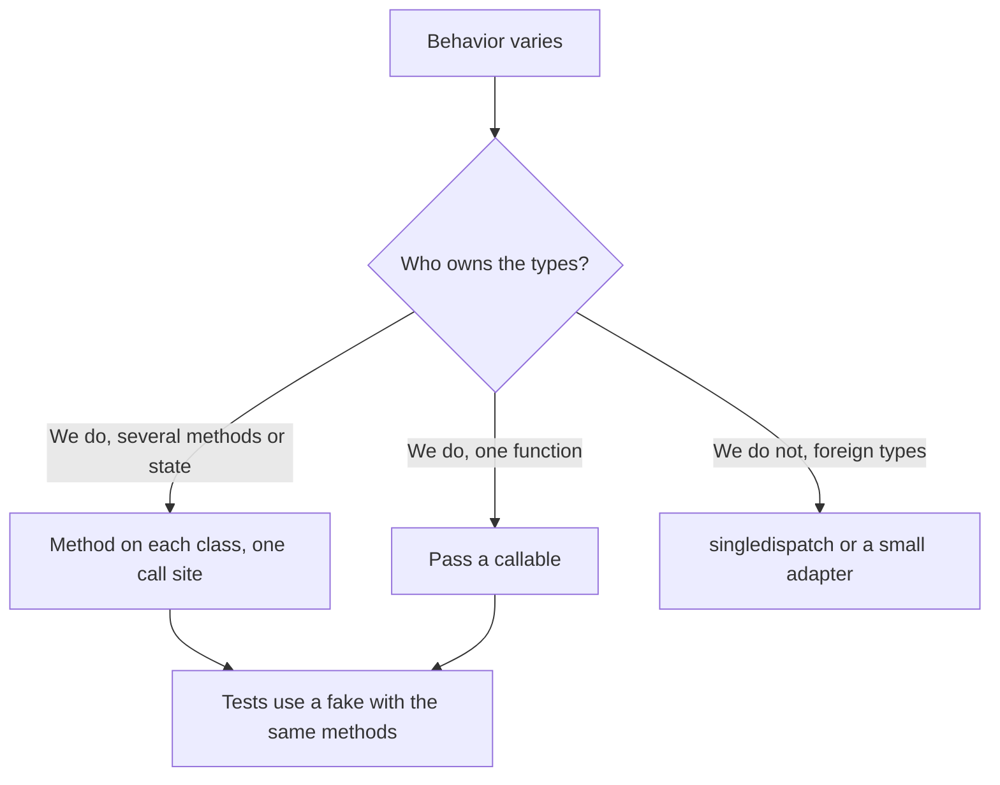

## Why this matters

Polymorphism is why you write `logger.info` without caring which handler will emit the line, and why a test can pass a fake repository that has the same `get` method as the real one. The opposite is a function full of `isinstance` branches that must be edited for every new type. Interviews describe a notifier that can email or SMS, or a shape with an area, and they want one call site. The 15–20 LPA bar is knowing when duck typing is enough and when a formal base class or a protocol earns its keep.

Python is late-bound. The method that runs is the one found on the instance's class at call time, not a slot sealed when the caller was compiled. That is dynamic dispatch. You already saw it when `Admin.greet` ran for an `Admin` stored in a variable annotated as `User`.

## Intuition

If it walks like a file and has `read`, your function can read it. The object's class does not need to inherit from a file type you declared. That is duck typing, and it is the default polymorphism in Python. It fails at the call with `AttributeError` if the method is missing, which is a loud failure if your tests pass a fake that actually implements the method.

Inheritance polymorphism is the special case where the types share a base and `isinstance` can group them. Both styles share the call site: one method name, many implementations. The design question is whether you need the shared base for humans and type checkers, or whether the method name is the whole contract.

## Core concept in depth

### One call site

```python
class Email:
    def send(self, message: str) -> str:
        return f"email:{message}"

class Sms:
    def send(self, message: str) -> str:
        return f"sms:{message}"

def notify(channel, message: str) -> str:
    return channel.send(message)
```

`notify` does not mention `Email` or `Sms`. A new `Slack` with `send` works without editing `notify`. A test double with `send` works too. This is the pattern to reach for before a type switch.

A type switch looks like this and ages badly:

```python
def notify_bad(channel, message: str) -> str:
    if isinstance(channel, Email):
        return channel.send(message)
    if isinstance(channel, Sms):
        return channel.send(message)
    raise TypeError("unknown channel")
```

Both branches call the same method. The `isinstance` checks add nothing except a requirement to edit this function for every new channel. Delete them. Keep a single `TypeError` only at a boundary that must reject unknown plugins loaded from configuration, and even then a registry of names to callables is usually clearer than a chain of types.

### Duck typing and its failure mode

The contract is the methods you call and the meanings you assume. If `send` on one class sends and on another class only validates, the program is wrong even though the method exists. Duck typing does not check semantics. Names and tests do. Name methods for the effect. Test each implementation against the same examples where you can.

`AttributeError` late in a request is the cost of a missing method. A protocol or an abstract base class moves that failure earlier for type checkers and for explicit registration. You will build those in the next lessons. You do not need them for two internal classes and a fake. You do want them for a plugin API other teams implement.

### Callable objects and functions

Sometimes the varying behavior is a single function, not a family of methods. Pass the function. `def notify(send, message): return send(message)` is polymorphism with no class at all. A class with `__call__` is a function that also stores state, such as a retry budget or a template. Use a class when there is state or several related methods. Use a function when there is one shot of behavior. Strategy objects that only wrap one function are ceremony.

### Overriding without surprising callers

An override should honor the base contract: same required arguments, compatible return meaning, no stricter precondition. A subclass `send` that refuses empty strings while the base allows them will break a caller that was correct for the base. That is a Liskov violation, named again in the SOLID lesson. The practical test is: could a caller written against the base run unchanged if it received the subclass?

Raising a more specific exception is usually fine. Raising a new exception the caller does not know about, for a case the base treated as normal, is not. Returning a richer object that still supports the operations the caller uses is the duck-typed version of a compatible return.

### Do not overuse inheritance to get dispatch

If the types do not form an "is a" story, do not force a base class so you can feel polymorphic. Two functions and a parameter are enough. If you need to select an implementation by a string name from config, use a dict from name to class or function and call the result. That registry is data-driven polymorphism. An `if name == "email"` chain is the type switch in string form.

`functools.singledispatch` is function overloading on the type of the first argument. It is useful when you must add behavior for types you do not own, such as formatting `datetime` and `Decimal` in a serializer. It is a worse fit than methods when you own the types, because the behavior then lives far from the class. Prefer methods on your classes. Use single dispatch for open-ended foreign types.

## Diagram / flowchart



### Dry-run: adding Slack

| Design | Change to add Slack |
| --- | --- |
| `notify` calls `channel.send` | Write `Slack.send`. Do not edit `notify`. |
| `isinstance` chain | Write `Slack` and edit the chain. Miss a call site and Slack hits the `TypeError` branch. |
| String `if name == "email"` | Edit the chain and the config parser. Easy to forget one. |
| Registry dict from name to class | Register `Slack` in one map. The call site stays `registry[name]().send(...)`. |

The registry row is the production shape of the first row when the choice arrives as data. The call is still one method name.

## Code

```python
from dataclasses import dataclass


@dataclass
class Email:
    def send(self, message: str) -> str:
        return f"email:{message}"


@dataclass
class Sms:
    def send(self, message: str) -> str:
        return f"sms:{message}"


def notify(channel, message: str) -> str:
    return channel.send(message)


def notify_with(send, message: str) -> str:
    return send(message)


if __name__ == "__main__":
    print(notify(Email(), "hi"), notify(Sms(), "hi"))
    print(notify_with(lambda text: f"log:{text}", "hi"))
```

`Email` and `Sms` share no base class. `notify` still works. The lambda shows the callable form. A reviewer who demands a base class for two methods in one file is adding a name without a constraint. A reviewer who demands a protocol because this is a public plugin boundary is right. Context decides. The call site stays the same either way.

## Complexity analysis

| Approach | Change cost when a variant appears | Runtime |
| --- | --- | --- |
| Duck-typed method call | Add a class, do not edit callers | One attribute lookup and call |
| `isinstance` ladder | Edit every ladder | A chain of checks, still tiny next to I/O |
| Registry dict | One registration | Average O(1) lookup by name |
| Deep inheritance only to share one method | High coupling | No meaningful speedup |

Dispatch is not a performance problem. The cost is editing the wrong central switch. Polymorphism moves the change to the new type, which is where the knowledge lives.

## Tricks, tips and patterns

- One method name, one call site. Delete `isinstance` branches that all call the same method.
- Pass a function when there is no state. Pass an object when there is state or a cluster of methods.
- A dict registry maps configuration strings to constructors. Do not grow an `if` chain of names.
- Fakes in tests are duck typing. Give them the methods the caller actually uses, not a huge unused interface.
- Honor the base contract when you override. Do not tighten preconditions.
- `singledispatch` is for types you do not own. Methods are for types you do.
- Name the contract in the method name. `send` that only validates is a lie.

## Common mistakes and edge cases

- An `isinstance` chain that calls the same method in every branch.
- A base class with a dozen methods because one caller needed one of them. Callers and fakes then depend on noise.
- An override that raises on input the base accepted.
- Duck typing with a misspelled method that only fails in production because the test used the real class only.
- Using inheritance so two classes can share a helper function. Call a module function instead.
- A registry that maps names to instances created at import, so every tenant shares one SMS client with someone's credentials. Map names to classes or factories, and construct per use or per request.
- Catching `AttributeError` around a duck-typed call and hiding a bug inside `send`. Let it raise, or check the boundary once.

## Interview notes

Implement the notifier with two classes and a function that calls `send`. Say you would not write `isinstance`. If they ask how a string from config selects the channel, add a dict. If they ask about type checkers, mention `Protocol` as a structural type that documents `send` without forcing a base class. That is the next lesson's tool. Do not pretend duck typing is checked by CPython at import.

Follow-ups:

- **What is duck typing?** The contract is the methods you call, not a declared base. Missing methods raise `AttributeError` at the call.
- **What is dynamic dispatch?** The implementation is chosen from the instance's class when the call happens.
- **When do you want a base class anyway?** Shared invariants, a place for `isinstance` at a boundary, or a default implementation subclasses reuse. Not merely to make a call legal. The call was already legal.
- **Liskov, in one sentence?** A subclass must be usable wherever the base was usable, without the caller changing.

Give the Slack row from the dry-run if they ask "how does this extend?"

## Practice problems

1. **Notify** (easy) — send through any object that implements `send`. [Practice: python-ex-notify]
2. **Registry** (medium) — map channel names to constructors and invoke `send`. [Practice: python-ex-channel-registry]
3. **No Type Switch** (medium) — rewrite a described isinstance ladder as one call, and list the deleted checks. [Practice: python-ex-collapse-switch]
4. **Callable Strategy** (easy) — apply a caller-supplied function to a message. [Practice: python-ex-callable-strategy]

## Summary / cheat sheet

- Polymorphism in Python is a shared method name resolved on the instance at call time.
- Duck typing does not require a common base. The failure mode is `AttributeError` and, worse, a method that exists but means the wrong thing.
- Delete `isinstance` chains that call the same method. Use a registry when the choice is a string.
- Pass a callable when there is no state. Use a class when there is state or several methods.
- Overrides must keep the caller's contract. Do not tighten what you accept.
- `singledispatch` extends behavior for foreign types. Your own types should carry their methods.
- Fakes in tests are just another implementation of the same methods.

## Further reading

- [Duck typing glossary](https://docs.python.org/3/glossary.html#term-duck-typing)
- [isinstance](https://docs.python.org/3/library/functions.html#isinstance)
- [functools.singledispatch](https://docs.python.org/3/library/functools.html#functools.singledispatch)
- [PEP 3119 — Abstract Base Classes](https://peps.python.org/pep-3119/)
