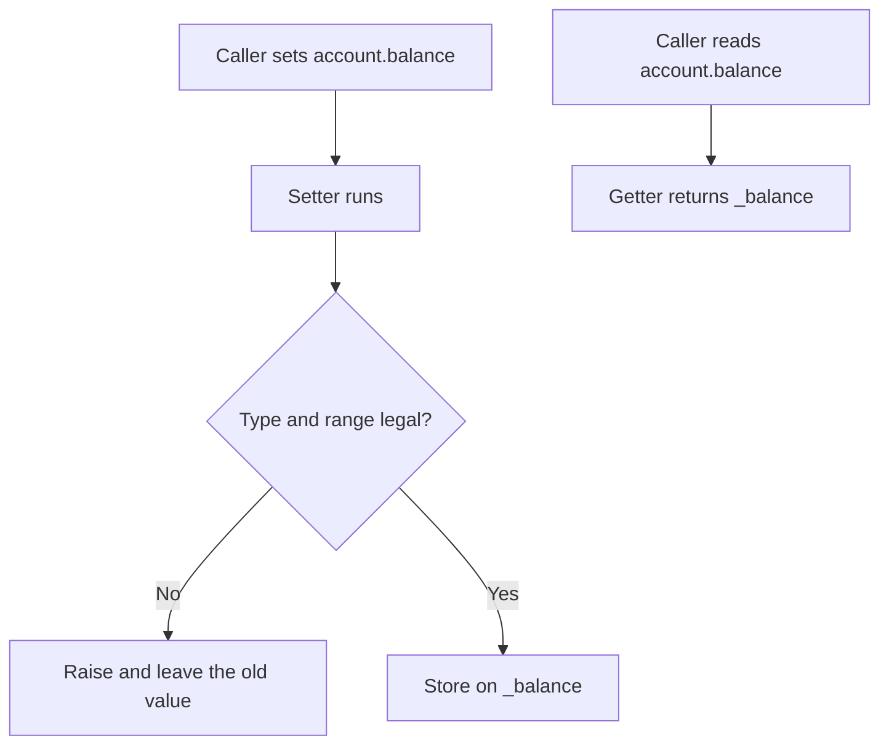

## Why this matters

Python does not enforce private fields. A caller can still reach `obj._balance`. Encapsulation is a contract and a design that makes the legal path the easy path: validate in one place, expose a read, refuse a raw write, and keep the invariant obvious. Interviews ask you to protect a balance from going negative and to explain `@property`. They also ask what a double underscore does, and the wrong answer is "it makes the attribute private." It rewrites the name so a subclass does not accidentally override it. That is a narrower tool than privacy.

Properties matter because they let you start with a public attribute and later run code on read or write without changing callers from `obj.price` to `obj.get_price()`. That migration is the practical reason properties exist.

## Intuition

A single leading underscore says "this is internal. If you use it, you own the breakage when I rename it." It is not a security control. Anyone with the object can read it. A double leading underscore triggers name mangling: the compiler stores the attribute as `_ClassName__attr` so a subclass attribute `__attr` is a different name. You use that when you are a framework author avoiding clashes, not when you want to hide a password from your colleagues. A password hidden only by mangling is still on the object and will still be logged if someone dumps `__dict__`.

A property is a method that looks like an attribute. The getter runs on read. The setter runs on write. Validation lives in the setter, so every assignment passes through the invariant.

## Core concept in depth

### Conventions, not walls

`_name` is internal. `name` is public. `__name__` with both leading and trailing underscores is a dunder reserved for Python and for methods the language calls. Do not invent `__my_helper__` for a private helper. You will collide with future language hooks and you will confuse readers who think the method is special.

Public attributes are acceptable when any value of that type is valid and writes are just writes. A coordinate's `x` as a plain attribute is fine. A bank account's balance is not, if negative is illegal. Then the write must be a method or a setter.

Do not build Java-style `get_x` and `set_x` for every field. Python callers expect attributes. Add a property when you need logic. Until then, a plain attribute is less code and an honest API.

### Properties

```python
class Account:
    def __init__(self, balance: int) -> None:
        self.balance = balance

    @property
    def balance(self) -> int:
        return self._balance

    @balance.setter
    def balance(self, value: int) -> None:
        if isinstance(value, bool) or not isinstance(value, int):
            raise TypeError("balance must be int paise")
        if value < 0:
            raise ValueError("balance cannot be negative")
        self._balance = value
```

`__init__` assigns `self.balance = balance`, which calls the setter. That is why the invariant holds even for the constructor. If the setter did not exist and you assigned `self._balance` in `__init__` while other code used the setter, you would have two doors and one of them would skip validation. One door.

A property without a setter is read-only. Assignment raises `AttributeError`. A deleter is `@balance.deleter` and is rare. Read-only properties are how you expose a computed value such as `total` that should not be stored separately and then drift out of date.

Properties that hide a slow query are a trap. `account.owner_name` that hits the database on every read surprises a caller in a loop. A method name `load_owner_name` tells the truth. Use properties for cheap invariants and derived values that are obviously in memory.

### Name mangling

Inside class `Account`, `__pin` is stored as `_Account__pin`. A subclass `AuditAccount` that also assigns `self.__pin` stores `_AuditAccount__pin`. The names do not clash. Outside the class, the mangled name is what you must type, which discourages casual use and does not stop anyone who can read the class. Mangling does not apply to names that also end with double underscores, and it only rewrites identifiers that appear lexically inside the class body. A dynamically built string of the attribute name is not mangled. Do not use mangling as an integrity mechanism.

### Invariants and telling the caller

Raise `ValueError` or `TypeError` from the setter. Do not clamp silently unless the spec says "clamp." Silent clamping hides a bug in the caller and stores a different amount than the user typed. Return a new object from a method `with_balance` when the account is a value object and you do not want mutation at all. Properties are for mutable objects with rules. Frozen dataclasses and tuples are for values that should not change. Pick one style per type.

### What encapsulation is not

It is not putting every function in a class. It is not a getter for every attribute. It is not security against a hostile caller in the same process. The hostile caller can patch your method, read `__dict__`, and assign `_balance`. Real boundaries are processes, queries, and authorization checks. Encapsulation keeps honest code on the path that preserves the invariant, and it gives reviewers one place to look.

## Diagram / flowchart



### Dry-run: constructor and a bad write

| Assignment | Setter runs? | Stored balance |
| --- | --- | --- |
| `Account(100)` | Yes, via `self.balance = 100` | 100 |
| `account.balance = 40` | Yes | 40 |
| `account.balance = -1` | Yes, then raises | stays 40, because the store happens after the check |
| `account._balance = -1` | No | -1, the invariant is bypassed |

The last row is the underscore contract. A teammate who writes it owns the bug. A codebase that does it in ten places does not have an invariant. Review the bypass. Do not pretend mangling would have made the team virtuous.

If the setter assigned first and checked second, a raise would leave a negative balance. Check, then store.

## Code

```python
class Account:
    def __init__(self, balance: int) -> None:
        self.balance = balance

    @property
    def balance(self) -> int:
        return self._balance

    @balance.setter
    def balance(self, value: int) -> None:
        if isinstance(value, bool) or not isinstance(value, int) or value < 0:
            raise ValueError("balance must be a non-negative int")
        self._balance = value

    def deposit(self, amount: int) -> None:
        if isinstance(amount, bool) or not isinstance(amount, int) or amount <= 0:
            raise ValueError("deposit must be a positive int")
        self.balance += amount


if __name__ == "__main__":
    account = Account(100)
    account.deposit(25)
    print(account.balance)
```

`deposit` goes through the property by using `self.balance += amount`, which reads, adds, and writes back through the setter. A direct `self._balance += amount` would skip a future setter rule. Use the public name inside the class when the public name is the invariant. Use the private name only inside the setter itself, to avoid recursion: the setter must write `self._balance`, not `self.balance`, or it calls itself until the stack dies.

## Complexity analysis

| Path | Cost |
| --- | --- |
| Plain attribute read | One dict lookup |
| Property read or write | A method call plus the check. Noise next to I/O |
| Property that queries a database | A query per access, often accidental N+1 |
| Name mangling | Compile-time rename, no runtime privacy budget |

The expensive property is the one that does I/O or locks. Validation of an int is free. Do not avoid properties for speed. Avoid them for surprise.

## Tricks, tips and patterns

- Plain attributes until a write needs a rule. Then a property, and route `__init__` through the setter.
- Store on `_name` inside the setter only. Using the public name recurses.
- Check, then assign, so a failure leaves the previous value.
- Single underscore means internal. Double underscore means "mangle to avoid subclass clashes," not "secret."
- Do not invent dunder names for helpers.
- Computed values that are pure and cheap can be properties. Anything that loads or computes heavily is a method.
- Prefer `deposit` and `withdraw` methods when the operation is a business act, not only a validation of a raw number. The property still guards the raw assignment.

## Common mistakes and edge cases

- Setter writes `self.balance = ...` and recurses until `RecursionError`.
- `__init__` writes `self._balance` while other methods use the setter, so the constructor skips validation.
- A property that hits the network on attribute access inside a template loop.
- Believing `__balance` is private. It is `_Account__balance` and still visible.
- Naming a helper `__save__` and colliding with the dunder convention.
- Getters and setters for every field because a style guide from another language demanded them.
- Silent clamping of illegal values.
- A read-only property that callers need to set in tests. Give a constructor argument or a test helper instead of reaching into `_balance` in every test... an occasional test assign to `_balance` is a smell, a constructor is the fix.

## Interview notes

Implement `Account` with a property that rejects a negative balance, and show that `__init__` uses the setter. Explain one underscore versus two. Say Python encapsulation is a convention plus a single write path, not a security boundary.

Follow-ups:

- **Why can I still set `_balance`?** Because nothing stops you. The underscore is the warning.
- **What does `__pin` become?** `_ClassName__pin`, different per class, to avoid clashes. Not encryption.
- **Why not get_balance?** Callers expect attributes. Add a property when logic appears so existing attribute access keeps working.
- **How do you avoid setter recursion?** Write the underlying `_balance` inside the setter, nowhere else if you can help it.

Mention that a frozen dataclass is the alternative when the object should not change at all. Properties are for objects that change under rules.

## Practice problems

1. **Nonnegative Balance** (medium) — property that rejects negatives and bools, including in the constructor. [Practice: python-ex-account-balance]
2. **Deposit** (easy) — deposit a positive int through the property. [Practice: python-ex-deposit]
3. **Read Only Total** (easy) — a property that sums item prices and rejects assignment. [Practice: python-ex-readonly-total]
4. **Mangle Names** (medium) — given a class name and a dunder attribute, return the mangled name. [Practice: python-ex-mangle-name]

## Summary / cheat sheet

- Encapsulation is one path that preserves the invariant, not a wall around attributes.
- `_name` is internal by convention. `__name` mangles to `_Class__name` to avoid subclass clashes. It is not private.
- Do not invent your own `__dunder__` helpers.
- `@property` runs code on read. A setter runs code on write. `__init__` should assign the public name so the setter validates construction.
- Inside the setter, store on the underscored attribute or the setter recurses.
- Check before you store. Do not hide I/O inside a property. Do not write Java getters for plain data.
- Business changes belong in methods like `deposit`. The property is the last line of defense on assignment.

## Further reading

- [property](https://docs.python.org/3/library/functions.html#property)
- [Private variables in the tutorial](https://docs.python.org/3/tutorial/classes.html#private-variables)
- [Descriptor HowTo guide](https://docs.python.org/3/howto/descriptor.html)
- [PEP 8 — designing for inheritance and underscores](https://peps.python.org/pep-0008/#designing-for-inheritance)
