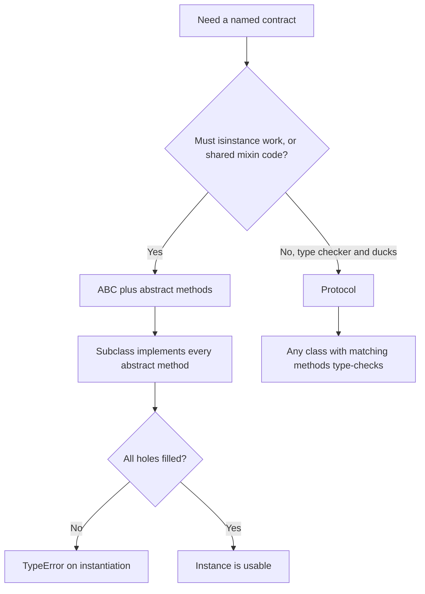

## Why this matters

Duck typing fails late, at the missing method call. A public plugin API wants the failure earlier and a name for the contract. Abstract base classes give you that at runtime: a class that inherits the ABC and forgets a method cannot be instantiated. `typing.Protocol` gives you the same documentation for type checkers without forcing inheritance. Interviews ask the difference. The short version is nominal versus structural. The long version is when `isinstance` must work, when a third-party class cannot be edited, and when you should not invent an ABC for two internal functions.

Both tools describe a contract. Neither replaces tests. A class can implement `send` and still send to the wrong place.

## Intuition

An ABC is a base class with holes. `@abstractmethod` marks a hole. Instantiating a subclass that still has a hole raises `TypeError` before you get an object. Filling the hole means overriding the method. The subclass is a nominal subtype: it appears in the MRO because it inherited.

A Protocol is a structural subtype. If a class has the methods the protocol lists, a type checker treats it as compatible even when it never inherited the protocol. At runtime, a protocol class does not automatically make `isinstance` true unless you mark it `@runtime_checkable`, and even then the check is shallow: it looks for attribute names, not signatures. Structural typing matches how Python already works. Nominal ABCs match how explicit plugins and `isinstance` branches want to work.

## Core concept in depth

### Defining an ABC

```python
from abc import ABC, abstractmethod

class Channel(ABC):
    @abstractmethod
    def send(self, message: str) -> str:
        """Deliver message and return a provider id."""

class Email(Channel):
    def send(self, message: str) -> str:
        return f"email:{message}"
```

`Channel()` raises `TypeError`. `Email()` works. A subclass that implements `send` by calling `super().send()` without its own body is still abstract if it does not override. You can give the abstract method a body that subclasses call via `super` for shared scaffolding, but they must still override it or they stay abstract. That pattern is easy to misuse. Prefer a concrete helper method with a normal name and keep the abstract method as the required hook.

ABCs can declare abstract properties with `@property` and `@abstractmethod` stacked. The subclass must provide the property. Forgetting it fails at instantiation, which is what you want for a required id field that is not an `__init__` parameter of the base.

### isinstance and virtual subclasses

`isinstance(Email(), Channel)` is true because of inheritance. `Channel.register(SomeForeignClass)` claims that `SomeForeignClass` is a virtual subclass. `isinstance` then returns true even though `SomeForeignClass` does not inherit `Channel`. Registration does not check that the methods exist. You can register a class that will crash when called. Use `register` when a third-party class already has the behavior and you cannot edit its bases. Do not use it to lie.

The standard library's `collections.abc` is full of this idea. `Iterable`, `Mapping`, `Sequence`, and `MutableMapping` document contracts and sometimes provide mixin methods. Inheriting `MutableMapping` and implementing a small set of methods gives you the rest. That is one of the best reasons to use an ABC: a mixin of concrete methods built on a few abstract ones. If you have no shared concrete behavior and no need for `isinstance`, a protocol is less machinery.

### Protocols

```python
from typing import Protocol

class SendChannel(Protocol):
    def send(self, message: str) -> str:
        ...
```

`Email` need not inherit `SendChannel`. A function annotated as taking `SendChannel` accepts `Email` under a type checker because the method matches. At runtime the annotation is not enforced. You can still pass a bad object and fail on the call. That is normal. The protocol's job is to make the contract visible and to let mypy complain when a caller passes an object that has no `send`.

`@runtime_checkable` allows `isinstance(obj, SendChannel)`, which checks that the attribute exists. It does not call the method and does not verify parameters. A runtime check that only looks up a name will accept an integer attribute named `send`. Do not use runtime protocol checks as a security gate. Prefer them rarely, mostly in tests or in a plugin loader that wants a clearer error than `AttributeError` later.

Protocols can be generic. `Repository[T]` with `get(self, id: str) -> T` documents a family. You will see generics again in the typing module. The OOP point is that the protocol stays structural.

### What not to abstract

Do not create an ABC with one implementation and no second in sight. The abstraction has no evidence. Do not create a protocol that lists twenty methods because the concrete class has twenty methods. Callers then depend on the whole surface. List the methods this caller uses. A small protocol is a focused contract. A large one is a copy of the class.

Do not use an ABC to prevent construction of a useful concrete base that has real default behavior. A normal class with a default `send` that subclasses may override is ordinary inheritance. Abstract means "this base is not a thing by itself."

### Plugins

A plugin loader that imports a module and looks for a subclass of `Channel` is nominal and explicit. A loader that looks for any object with `send` is structural and easier to satisfy by accident. For third-party plugins, nominal registration is easier to debug: the plugin calls `registry.add(MyChannel)` or inherits the ABC. You see the list of registered classes. Structural discovery of every subclass in a process is magic and breaks when two libraries both define `send`.

## Diagram / flowchart



### Dry-run: instantiate, register, and a shallow runtime check

| Attempt | Result |
| --- | --- |
| `Channel()` | `TypeError`, abstract `send` |
| `Email()` with `send` defined | Instance |
| `class Half(Channel): pass` then `Half()` | `TypeError` |
| `Channel.register(Foreign)` where Foreign has `send` | `isinstance(Foreign(), Channel)` true, methods were not verified by register |
| `isinstance(42, runtime_checkable SendChannel)` | False, int has no `send` |
| An object with `send = 1` and a runtime-checkable protocol | `isinstance` may be true and the call still fails |

The last row is why runtime protocol checks are not validation. They are a hint.

## Code

```python
from abc import ABC, abstractmethod


class Channel(ABC):
    @abstractmethod
    def send(self, message: str) -> str:
        raise NotImplementedError


class Email(Channel):
    def send(self, message: str) -> str:
        return f"email:{message}"


def broadcast(channels: list[Channel], message: str) -> list[str]:
    return [channel.send(message) for channel in channels]


if __name__ == "__main__":
    print(broadcast([Email()], "hi"))
    try:
        Channel()
    except TypeError as exc:
        print(type(exc).__name__)
```

`broadcast` is annotated with the ABC. A duck-typed object that does not inherit `Channel` still works at runtime if it has `send`, and a type checker will complain. That gap is exactly the nominal versus structural choice. If you want the duck to type-check, annotate `broadcast` with a Protocol instead of the ABC. If you want registration and `isinstance`, keep the ABC.

## Complexity analysis

| Tool | Runtime cost | Design cost |
| --- | --- | --- |
| Method call through an ABC instance | Same as any method call | The hierarchy |
| Instantiating an incomplete subclass | Fails immediately | Saves a production `AttributeError` |
| Protocol | Zero at runtime unless you isinstance it | Type-checker guidance |
| `@runtime_checkable` isinstance | Attribute lookups | Shallow, easy to over-trust |
| Huge protocol copying a class | Zero | Couples every caller to every method |

ABCs do not slow dispatch in any way you should optimize. They change when failures appear and whether inheritance is required.

## Tricks, tips and patterns

- Use an ABC when you have a mixin of real methods or you need `isinstance` and explicit subclasses.
- Use a Protocol when any object with the methods should type-check, including fakes that should not inherit production bases.
- Keep the abstract surface small. Concrete helpers stay ordinary methods.
- `register` only for types you cannot subclass, and test that the methods really work.
- Do not treat `@runtime_checkable` as validation of signatures or of security.
- Prefer `collections.abc` types in annotations when you mean "any sequence" or "any mapping," not a concrete `list` or `dict`, if you truly accept others.
- One implementation is not an abstraction. Wait for the second caller or the plugin boundary.

## Common mistakes and edge cases

- An ABC nobody inherits, plus a protocol that says the same thing, plus duck typing in the tests. Pick one contract.
- Forgetting to implement a method and being surprised the error happens at `Subclass()`, not at `class Subclass`.
- `register` on a class that does not actually have the methods.
- A runtime-checkable protocol used to trust user-supplied objects.
- Abstract base `__init__` that subclasses forget to call, so the ABC instantiated fine and the object is still broken. Abstract methods do not replace `super().__init__`.
- Implementing the method with the wrong arity. Instantiation succeeds. The call fails. Tests have to catch that. ABCs do not check signatures at runtime.
- Inheriting `MutableMapping` and implementing the abstract methods with inconsistent behavior, so the mixin helpers lie.

## Interview notes

Contrast the two in one sentence: ABCs are inherited and enforced when you construct, protocols are structural and enforced by the type checker. Give one example of each. Mention `collections.abc.Sequence` as an ABC you already depend on when you write generic code. Mention that a test fake can satisfy a protocol without inheriting the production class, which keeps tests from running real `__init__` side effects.

Follow-ups:

- **Can you instantiate an abstract class?** No. `TypeError` until every abstract method and property is overridden.
- **Does a protocol require inheritance?** Not for type checkers. Runtime `isinstance` needs `@runtime_checkable` and still only checks names.
- **When do you skip both?** Two internal classes and a function that calls a method. Duck typing is the whole design.
- **What is register?** A virtual subclass claim for `isinstance`, without adding the ABC to the MRO and without checking methods.

If they ask about mypy, say protocols are how you type duck typing, and ABCs are how you type explicit extension. The typing module goes deeper on checkers. The choice of contract is an OOP choice.

## Practice problems

1. **Abstract Channel** (medium) — an ABC with `send`, one concrete class, and a broadcast helper. [Practice: python-ex-abstract-channel]
2. **Missing Method** (easy) — decide whether a subclass with a hole can be constructed. [Practice: python-ex-abstract-hole]
3. **Protocol Shape** (medium) — given a list of classes and the methods they define, say which satisfy a structural send contract. [Practice: python-ex-structural-send]
4. **Register Risk** (medium) — explain why register does not prove the methods exist, with a yes or no on a provided class. [Practice: python-ex-register-risk]

## Summary / cheat sheet

- An ABC with `@abstractmethod` cannot be instantiated until subclasses override the abstract methods. That failure is a `TypeError` at construction.
- ABCs are nominal. `isinstance` follows inheritance, plus virtual subclasses added with `register`. `register` does not verify behavior.
- A Protocol is structural. Type checkers accept any matching object. Runtime checks are optional, shallow, and not a validator.
- Use an ABC for mixins and explicit plugins. Use a Protocol for fakes and duck typing you want mypy to see.
- Keep contracts small. Do not abstract a single implementation.
- Abstract methods do not check signatures at runtime and do not call `super().__init__` for you.
- `collections.abc` is the standard library's version of this idea. Prefer those types when they match.

## Further reading

- [abc — Abstract Base Classes](https://docs.python.org/3/library/abc.html)
- [collections.abc](https://docs.python.org/3/library/collections.abc.html)
- [typing.Protocol](https://docs.python.org/3/library/typing.html#typing.Protocol)
- [PEP 3119 — Abstract Base Classes](https://peps.python.org/pep-3119/)
- [PEP 544 — Protocols](https://peps.python.org/pep-0544/)
