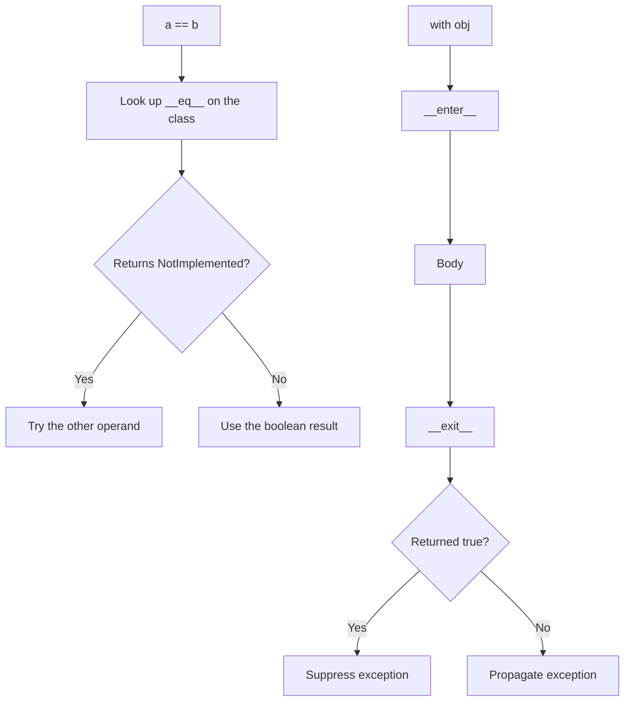

## Why this matters

`len(obj)`, `obj[key]`, `for x in obj`, `with obj`, and `a == b` are not keywords that reach inside your class. They look up special methods on the class and call them. Interviews ask you to make a value object comparable and hashable, to explain why defining `__eq__` without `__hash__` makes the object unhashable, and to write a context manager. Production bugs include an `__eq__` that is accidentally quadratic, a `__repr__` that dumps a secret, and a `__getattr__` that hides typos.

The data model is large. This lesson covers the methods you will implement on purpose and the ones you should not touch until you have a reason.

## Intuition

Special methods are hooks with fixed names, looked up on the class, not fetched as instance attributes in the normal way for the operator itself. Python translates `a == b` into a call that honors `__eq__`. You implement the hook. You do not call it directly in ordinary code. You write `len(items)` and `a == b`, and the interpreter finds the hook.

A good hook matches a built-in protocol exactly. `__eq__` returns a bool or `NotImplemented`. `__repr__` returns a string a developer can trust in a log. `__enter__` and `__exit__` bracket a resource. If you cannot say which protocol you are joining, do not add a dunder. Add a normal method.

## Core concept in depth

### repr and str

`__repr__` is for developers. It should be unambiguous and, when you can, look like a constructor call: `User(name='Ada')`. `__str__` is for end users. If you only define `__repr__`, `str(obj)` falls back to it. If you only define `__str__`, `repr` stays the default angle-bracket form, which is what logs will show when a formatter uses `repr`. Define `__repr__` first. Include the fields that identify the object. Do not include secrets, tokens, or huge payloads. A repr that triggers a database query is a logging incident waiting for a list of objects.

`__format__` customizes f-string format specs. You rarely need it. Do not overload `__repr__` to change f-string behavior.

### Equality and hashing

Default equality is identity. Value objects should define `__eq__` from their fields. When `__eq__` is defined and `__hash__` is not, Python sets `__hash__` to `None` and the object cannot be placed in a set or used as a dict key. That default is safe. Mutable objects that compare by value must stay unhashable, because a set cannot survive a key that changes its hash.

Immutable value objects should define both:

```python
class Point:
    def __init__(self, x: int, y: int) -> None:
        self.x = x
        self.y = y

    def __eq__(self, other: object) -> bool:
        if not isinstance(other, Point):
            return NotImplemented
        return self.x == other.x and self.y == other.y

    def __hash__(self) -> int:
        return hash((self.x, self.y))
```

Return `NotImplemented` when you do not know how to compare, so Python can try the other operand's `__eq__`. Returning `False` blocks that. `hash` must use the same fields as equality. A point equal to another point must have the same hash. The reverse is not required: hash collisions are legal. If someone assigns `point.x = 9` after inserting the point in a set, the set is corrupted. Freeze the fields, with a property that has no setter, a tuple, or a frozen dataclass. The dataclass lesson will generate these methods. You still need to know what they promise.

Do not implement `__eq__` as `self.__dict__ == other.__dict__` if the dict contains unhashable or unordered nested structures you did not mean to compare, or if it contains a secret field. Name the fields.

### Ordering

`functools.total_ordering` can fill in ordering methods from `__eq__` and one of `__lt__`, `__le__`, `__gt__`, or `__ge__`. The generated methods are convenient and not the fastest. Define ordering only when the type has a real order. Points in a plane often do not. Money amounts do. Inconsistent ordering and equality confuse `sorted` and heapq. If `a == b` is false, the two should not compare as neither less nor greater in a way that breaks sort's assumptions... equality should agree with ordering: if both `a < b` and `b < a` are false and you claim a total order, then `a == b`. Test that.

### Containers and iteration

`__len__` supports `len`. `__getitem__` supports indexing. A class with `__getitem__` that accepts integers starting at 0 can be iterated by the fallback iterator until `IndexError`. Defining `__iter__` is clearer for a real collection. `__contains__` supports `in`. If you do not define it, Python may fall back to iteration, which is correct and slow. `__bool__` controls truthiness. If it is missing and `__len__` exists, nonzero length is true. An empty custom box is then falsy, which may or may not be what you want. Define `__bool__` when emptiness is not the same as "should be treated as false."

`__getattr__` runs only when normal lookup fails. `__getattribute__` runs on every lookup and is easy to recurse into infinitely. Do not override `__getattribute__` to log attribute access. Use `__getattr__` only for a true dynamic proxy, and never swallow typos of real fields. A proxy that returns `None` for every missing name hides bugs.

### Context managers

`__enter__` runs at the start of `with`. The value it returns is bound in `as`. `__exit__(self, exc_type, exc, tb)` runs on the way out. Return a true value from `__exit__` only when you have handled the exception and want it suppressed. Returning `None` or false lets the exception propagate. Use this for files you own, locks, and transactions. Do not suppress exceptions by returning `True` because a test is noisy. `contextlib.contextmanager` is the function form when you do not need a class. The OOP form belongs on objects that already exist and own the resource.

### Methods to avoid at first

`__del__` is a finalizer. It is not a destructor you can rely on for closing files. Cycles and shutdown order make it late or absent. Use `with` and explicit `close`. `__slots__` changes layout. You met it earlier. Do not add operator methods like `__add__` unless the operation is obvious to a reader who sees `a + b`. A business object that adds by merging dictionaries is a puzzle. Give it a method `merged`.

## Diagram / flowchart



### Dry-run: hash and equality must agree

| Step | Legal? | Why |
| --- | --- | --- |
| Two points with the same x and y compare equal | Required | Value equality |
| Their hashes differ | Illegal | The set looks in one bucket and the equal key is in another |
| `__eq__` defined, `__hash__` left unset | Legal and unhashable | Python sets hash to None so you cannot corrupt a set |
| Point inserted in a set, then `x` mutated | Illegal in practice | The bucket is now wrong even if you defined hash |

Context manager dry-run: `__enter__` returns self, the body raises `ValueError`, `__exit__` logs and returns false, the `ValueError` continues. If `__exit__` returns `True`, the caller thinks the block succeeded. That is a bug unless you truly handled the error.

## Code

```python
class Point:
    def __init__(self, x: int, y: int) -> None:
        self._x = x
        self._y = y

    @property
    def x(self) -> int:
        return self._x

    @property
    def y(self) -> int:
        return self._y

    def __repr__(self) -> str:
        return f"Point(x={self.x}, y={self.y})"

    def __eq__(self, other: object) -> bool:
        if not isinstance(other, Point):
            return NotImplemented
        return self.x == other.x and self.y == other.y

    def __hash__(self) -> int:
        return hash((self.x, self.y))


class Room:
    def __init__(self, name: str) -> None:
        self.name = name
        self.entered = 0

    def __enter__(self) -> "Room":
        self.entered += 1
        return self

    def __exit__(self, exc_type, exc, tb) -> bool:
        return False


if __name__ == "__main__":
    p = Point(1, 2)
    print({p, Point(1, 2)})
    with Room("lab") as room:
        print(room.name, room.entered)
```

The set collapses the two equal points into one entry. If `__hash__` were missing, building the set would raise `TypeError`. `Room.__exit__` returns false so exceptions propagate. Returning the room from `__enter__` is what `as room` captures. Returning `None` from `__enter__` is a common bug that makes `as room` bind `None`.

## Complexity analysis

| Hook | Cost you must admit |
| --- | --- |
| `__eq__` on a large nested structure | As expensive as walking that structure. Fine for small value objects, bad as a hot-path key compare |
| `__hash__` | Should be O(1) or O(fields), and stable |
| `__repr__` that queries a service | Unbounded and unsafe in logs |
| Fallback `in` via iteration | O(n) |
| `__getattr__` on every typo | Hides `AttributeError`, costs a Python call |

Operators are not free just because they look like syntax. A set of points hashes each point once on insert and compares on collision. Keep the fields few and immutable.

## Tricks, tips and patterns

- Write `__repr__` that names the class and the identifying fields, without secrets.
- Return `NotImplemented` from `__eq__` for foreign types.
- If the object is mutable, define `__eq__` only when you also leave it unhashable. If it is immutable, define `__hash__` from the same fields.
- Prefer `len`, `==`, and `with` in callers. Do not call `__len__` yourself.
- `__exit__` should return true only to swallow an exception you fully handled.
- Use `contextlib.contextmanager` for a one-off `with` block that is not the object's main identity.
- Reach for a dataclass to generate repr, eq, and hash when the class is a field bundle. Write dunders by hand when the class is not.

## Common mistakes and edge cases

- `__eq__` without a matching `__hash__` on an immutable value, then surprise that it cannot go in a set. Or the reverse: hashing a mutable object.
- Returning `False` instead of `NotImplemented`, so the other operand never gets a chance.
- `__repr__` including a password or a giant body.
- `__enter__` returning `None` and the `as` target being useless.
- `__exit__` returning `True` by default because the method fell off the end... it returns `None`, which is fine and does not suppress. The bug is an explicit `return True` left in after debugging.
- `__getattr__` that catches every missing attribute, including a misspelled method, and returns `None`.
- Implementing `__del__` to close a socket and finding it closes too late or during interpreter shutdown when other globals are already `None`.
- Comparing to a subclass and rejecting it with a strict `type(other) is Point`, which breaks substitutability. `isinstance` is the usual choice unless subclass equality would be a lie.

## Interview notes

Implement `Point` with repr, eq, and hash, and say the fields are immutable so the hash is stable. Mention `NotImplemented`. Then write a tiny context manager and say `__exit__` returns false so errors propagate.

Follow-ups:

- **Why did defining eq make the class unhashable?** Python refuses a default identity hash that would disagree with value equality.
- **What does with call?** `__enter__` on the way in, `__exit__` on the way out, even when the body raises.
- **repr versus str?** Developer unambiguous form versus user-facing text. Define repr.
- **When do you skip dunders?** When a normal method name would be clearer than an operator.

If they ask for `__getitem__`, say slices and indexes arrive as the key, and you raise `IndexError` or `KeyError` to match the protocol you claim. Do not return `None` for a missing index if you claim to be a sequence.

## Practice problems

1. **Point Eq** (medium) — value equality and hash for an immutable point, usable in a set. [Practice: python-ex-point-eq]
2. **Repr Safe** (easy) — build a repr that includes name and excludes a secret field. [Practice: python-ex-repr-safe]
3. **Room With** (medium) — a context manager that counts enters and does not swallow exceptions. [Practice: python-ex-room-with]
4. **Not Implemented** (medium) — equality that refuses foreign types by returning the right sentinel behavior, simulated as a string result. [Practice: python-ex-eq-foreign]

## Summary / cheat sheet

- Operators and built-ins call special methods on the class. Implement the protocol, and call the built-in from normal code.
- `__repr__` is for developers and logs. No secrets, no I/O. `__str__` is optional user text.
- `__eq__` plus a stable `__hash__` from the same fields for immutable values. Mutable value-equality objects stay unhashable.
- Return `NotImplemented` when comparison does not apply to the other type.
- `__enter__` returns the `as` value. `__exit__` returns true only to suppress an exception.
- `__getattr__` is a last-chance hook. It is a poor place to hide missing attributes.
- Do not use `__del__` to close resources. Use `with` and `close`.
- Dataclasses can generate several of these methods. Hand-written dunders are for classes that are not plain field bundles.

## Further reading

- [Data model special methods](https://docs.python.org/3/reference/datamodel.html#special-method-names)
- [object.__hash__](https://docs.python.org/3/reference/datamodel.html#object.__hash__)
- [contextlib](https://docs.python.org/3/library/contextlib.html)
- [functools.total_ordering](https://docs.python.org/3/library/functools.html#functools.total_ordering)
