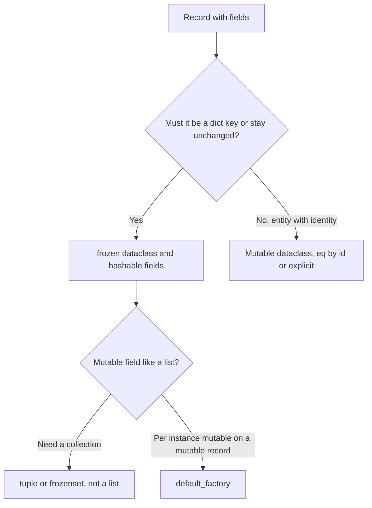

## Why this matters

A large share of backend classes are records: an id, a few fields, equality by value, a readable repr. Writing `__init__`, `__repr__`, and `__eq__` by hand is boilerplate and a place to forget a field. `dataclasses` generates that code. Interviews expect `field(default_factory=list)` instead of a shared default list, and they expect `frozen=True` when the object is a dict key or a configuration snapshot. The feature is small. The design choice, mutable entity versus frozen value, is the part that matters.

Dataclasses are still classes. Inheritance, methods, and properties work. They are not a schema validator. A type annotation on a field does not check the runtime type unless you add code or a library such as pydantic, which is a later module.

## Intuition

The decorator reads the class annotations and writes methods for you. Fields are the annotated names. The generated `__init__` takes those fields in order, with defaults after required fields, the same rule as any function. `frozen=True` makes assignment after init raise and generates a hash. `eq=True`, the default, compares the fields. You opt into ordering with `order=True` only when field order is a meaningful sort.

`default_factory` is how each instance gets its own list. A bare `names: list[str] = []` is rejected by the dataclass decorator in current Python, because that bug is so common. If you bypass the decorator and do it anyway with `field(default_factory=...)` misused, you can still share a mutable. The factory is called once per instance, in `__init__`.

## Core concept in depth

### A basic record

```python
from dataclasses import dataclass, field

@dataclass
class User:
    id: int
    name: str
    tags: list[str] = field(default_factory=list)

    def renamed(self, name: str) -> "User":
        return User(self.id, name, list(self.tags))
```

`User(1, "Ada")` stores an id, a name, and a fresh list. Two users with the same fields compare equal. The repr shows the fields. `renamed` returns a new user rather than mutating, which is a value-object style even though this dataclass is mutable. You can also assign `user.name = "Grace"` because it is not frozen. Pick one style. Mixing "please treat this as a value" with public mutation confuses callers.

`field(default_factory=list)` is required for a per-instance list or dict. `field(default=0)` is fine for an immutable default. Do not write a factory that returns one prebuilt dict of defaults if you then mutate that dict and also expected a deep isolation from a nested structure you later append into a shared inner list. The factory runs per instance, so the outer dict is new. Nested mutables created inside the factory are new too if the lambda builds them. A factory that returns a global list is the shared-state bug again. The factory must build a new object.

### Frozen values and replace

`@dataclass(frozen=True)` generates `__hash__` and rejects assignment. Frozen objects can be set members and dict keys if every field is hashable. A frozen dataclass that contains a list is not hashable, because the list is not. Use a tuple for tags on a frozen user. `frozen` is not a deep freeze. The tuple is frozen. A field that holds a list still allows `user.tags.append(...)` unless the field's type is itself immutable. The dataclass blocks `user.tags = other`, not mutation of the object `tags` already points at.

`dataclasses.replace(user, name="Grace")` returns a new instance with the override. It works for frozen and mutable dataclasses. It is shallow: the new instance shares the unreplaced fields' objects. For a tuple of strings that is fine. For a nested mutable you meant to copy, pass an explicit new object.

### Ordering, slots, and kw_only

`order=True` adds comparison methods based on the field tuple, in declaration order. The first field dominates. That is a bad sort key if the first field is an id and you thought you were sorting by name. Do not enable `order` because it sounds complete. Enable it when the field order is the order you want, or write a `key` function at the sort call and leave the dataclass unordered.

`slots=True` (3.10+) stores fields in slots instead of a per-instance `__dict__`, which saves memory when you have many small records and blocks accidental attributes. It interacts with multiple inheritance carefully. Use it for large collections of simple records you have measured, not as a default on every entity.

`kw_only=True` forces keyword arguments in `__init__`, which prevents a caller from swapping two string fields by position. That is a good default for records with several fields of the same type. Positional construction is fine for a point with `x` and `y` in a stable order.

### Inheritance

Dataclass inheritance concatenates fields: base fields first, then subclass fields. A subclass with a defaulted field followed by a base with a required field can make an illegal `__init__` because defaults must come last. Fix it with `kw_only` on the subclass fields or by giving the base defaults. Read the generated signature when you subclass a dataclass. Do not assume it matches the subclass body order in the way you pictured.

A frozen subclass of a frozen base stays frozen. Mixing frozen and non-frozen in one hierarchy raises `TypeError` or behaves in a way you should not design around. Keep the family frozen or mutable as a whole.

### What dataclasses do not do

They do not validate. `User(id="nope", name=1)` succeeds at runtime if you never check types. Add `__post_init__` to validate or normalize. It runs at the end of the generated init. For frozen classes, assign with `object.__setattr__` inside `__post_init__` if you must fix up a field, because normal assignment is frozen. Prefer to validate and raise rather than to silently rewrite.

They do not persist, do not parse JSON, and do not generate a schema. Pydantic and cattrs are the libraries for "validate this dict into a typed object." A dataclass is the right in-process record. It is the wrong untrusted boundary by itself.

### Compared with NamedTuple

`NamedTuple` is a tuple. It is frozen, ordered by fields, unpackable, and slightly less flexible. Dataclasses are mutable unless frozen, inherit more naturally, and support default factories without becoming a tuple. Prefer a frozen dataclass for new value objects when you want methods and defaults. Prefer `NamedTuple` when you want unpacking and a guaranteed sequence. Do not convert between them for style points.

## Diagram / flowchart



### Dry-run: factory versus a shared list

| Definition | First user appends `"a"` | Second user's tags |
| --- | --- | --- |
| `field(default_factory=list)` | first user has a | empty list, different object |
| A factory that returns one module-level list | first user has a | the same list, also has a |
| Frozen user with a tuple of tags | cannot append | unchanged, and hashable if the rest is |

`replace` dry-run: `replace(user, name="Grace")` copies the id and shares the tags tuple. The new name is Grace. The old user is unchanged when frozen. When mutable, the old user is also unchanged because replace builds a new instance. It does not assign onto the old one. Callers who ignore the return value think the rename failed. Same bug as `sort` and `_replace`.

## Code

```python
from dataclasses import dataclass, field, replace


@dataclass(frozen=True, kw_only=True)
class Money:
    currency: str
    minor: int

    def __post_init__(self) -> None:
        if len(self.currency) != 3 or not self.currency.isalpha():
            raise ValueError("currency must be a 3-letter code")
        if isinstance(self.minor, bool) or not isinstance(self.minor, int):
            raise ValueError("minor units must be int")

    def added(self, other: "Money") -> "Money":
        if other.currency != self.currency:
            raise ValueError("currency mismatch")
        return replace(self, minor=self.minor + other.minor)


@dataclass
class Team:
    name: str
    members: list[str] = field(default_factory=list)


if __name__ == "__main__":
    bill = Money(currency="INR", minor=100)
    print(bill.added(Money(currency="INR", minor=50)))
    a = Team("core")
    b = Team("core")
    a.members.append("Ada")
    print(a.members, b.members, a == b)
```

`Money` is frozen, keyword-only, and validated in `__post_init__`. `added` returns a new money. `Team` is mutable on purpose, and the two teams do not share `members`. After the append they are not equal, because equality includes the list contents. If equality should mean "same team name" even when members differ, write your own `__eq__` or set `eq=False` and compare names in a method. The default is field-wise equality, which is wrong for entities whose identity is an id while other fields change. For an entity, either compare only the id in a hand-written `__eq__` and leave the object unhashable, or do not pretend two versions of the same user with different names are unequal in a set of ids. Entities and values follow different equality rules. A dataclass will not choose for you.

## Complexity analysis

| Feature | Cost |
| --- | --- |
| Generated `__init__` and `__eq__` | Proportional to the number of fields, which is small |
| `__eq__` on a dataclass holding a huge list | Walks the list. Do not use it as a casual assertion on giant graphs |
| Frozen hash | Computed from fields. Must stay cheap and stable |
| `replace` | New instance, shallow copy of field references |
| `slots=True` | Less memory per instance when you have very many |

The decorator runs once at class definition. There is nothing to optimize on a request that builds a handful of records. There is something to avoid: using a mutable dataclass as a dict key by forcing a hash that reads a list.

## Tricks, tips and patterns

- `default_factory` for every mutable field. Never a shared list.
- `frozen=True` for values. Use tuples inside them if you need a sequence.
- `replace` to "update." Use the return value.
- `kw_only=True` when several fields share a type and position would be ambiguous.
- `__post_init__` validates. It does not replace a boundary parser.
- Entities that change should not use the default equality if identity is an id. Decide explicitly.
- `order=True` only when declaration order is the sort you want.
- Prefer a dataclass over a hand-rolled `__init__` when the class is a field bundle plus a few methods.

## Common mistakes and edge cases

- A mutable default that the decorator fortunately rejects, then a factory that closes over one list anyway.
- Frozen dataclass with a list field, then `append`, then a set that breaks.
- Ignoring the return value of `replace`.
- `order=True` sorting by id because id is the first field.
- Assuming annotations are runtime checks. They are not.
- `__post_init__` assigning onto a frozen instance without `object.__setattr__` and raising `FrozenInstanceError`.
- Subclass field order producing an `__init__` where a required argument follows a default.
- Using a dataclass as a mutable global config that every request mutates.

## Interview notes

Write a frozen `Money` or `Point` with `replace` for updates, and a mutable `Team` with `default_factory=list`. Say why the factory exists. Say frozen does not deep-freeze a list field. Mention that pydantic is what you add when the input is untrusted JSON. A dataclass is the domain object after you already trust the types, or the place `__post_init__` raises.

Follow-ups:

- **Why not NamedTuple?** Dataclasses handle mutable fields, factories, and inheritance more naturally. Named tuples unpack and are always tuple-like.
- **Are they validated?** Not by default. `__post_init__` or another library.
- **Can they be dict keys?** Only if frozen or explicitly hashable, and every field is hashable.
- **eq for entities?** Default equality is all fields. An entity often wants identity by id, which you should write yourself and then keep unhashable if the record still mutates.

## Practice problems

1. **Team Members** (easy) — two teams from a dataclass must not share a members list. [Practice: python-ex-team-members]
2. **Money Add** (medium) — frozen money with currency check and replace. [Practice: python-ex-money-add]
3. **Replace Name** (easy) — return a new record with one field changed, leaving the old one. [Practice: python-ex-replace-name]
4. **Hash Point** (medium) — a frozen point used as a dict key. [Practice: python-ex-frozen-point]

## Summary / cheat sheet

- `@dataclass` generates init, repr, and field-wise equality. It does not validate types at runtime.
- Mutable defaults belong in `field(default_factory=...)`. The factory must return a new object each call.
- `frozen=True` blocks rebinding fields and adds a hash. It does not stop mutation of a list stored in a field. Store tuples.
- `replace` returns a new instance and shares unreplaced field objects. Use the return value.
- `order=True` sorts by field declaration order. Turn it on only when that is the order you mean.
- `__post_init__` is the validation hook. Keyword-only init prevents swapped arguments.
- Values freeze and hash. Entities that mutate should not pretend all-field equality is identity.
- Dataclasses are in-process records. Parsing untrusted payloads is a later, explicit validation step.

## Further reading

- [dataclasses](https://docs.python.org/3/library/dataclasses.html)
- [PEP 557 — Data Classes](https://peps.python.org/pep-0557/)
- [dataclasses.replace](https://docs.python.org/3/library/dataclasses.html#dataclasses.replace)
- [typing.NamedTuple](https://docs.python.org/3/library/typing.html#typing.NamedTuple)
