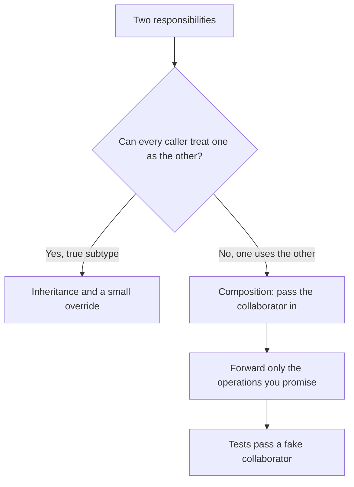

## Why this matters

Inheritance couples two types for the lifetime of the hierarchy. A subclass sees protected conventions, `__init__` order, and every method it did not mean to expose. Composition couples a type to a small interface it calls. You can swap the collaborator in a test, wrap it, or replace it when the vendor changes. Interviews that ask "design a car with an engine" are checking whether you say "a car has an engine" instead of "a car is an engine." Backend design uses the same sentence: a service has a repository, a repository has a connection, a notifier has a transport.

Composition is not a moral rule that bans inheritance. It is the default when you want reuse without pretending one type is another.

## Intuition

Inheritance answers "is this a kind of that?" A `Manager` is an `Employee` if every caller that expects an employee can take a manager. Composition answers "does this have one of those?" A `Checkout` has a `PaymentClient`. Checkout is not a payment client. It should not inherit `charge` and also inherit a pile of HTTP helpers. It should call `self.payments.charge(...)`.

Delegation is the forwarding of a method to the collaborator. Forward the methods that are part of your public contract. Do not forward everything with `__getattr__` unless you are writing a real proxy and you will test the failure modes. Blind forwarding publishes the collaborator's whole surface as yours.

## Core concept in depth

### The shape

```python
class PaymentClient:
    def charge(self, minor: int) -> str:
        return f"charged:{minor}"

class Checkout:
    def __init__(self, payments: PaymentClient) -> None:
        self.payments = payments

    def place(self, minor: int) -> str:
        if minor <= 0:
            raise ValueError("amount must be positive")
        return self.payments.charge(minor)
```

`Checkout` owns the policy "amounts are positive." `PaymentClient` owns the charge. A test constructs `Checkout` with a fake whose `charge` records the amount and does not touch the network. You did not subclass `Checkout` to change the transport. You passed a different collaborator. That is the testability argument, and it is the same pattern as constructor injection from the first OOP lesson.

If `Checkout` inherited `PaymentClient`, a test would struggle to prevent the real HTTP call without also replacing methods on the subclass, and `Checkout` would pick up every new payment method whether the checkout flow should expose it or not.

### When inheritance is still right

Use inheritance when you have a true subtype and you want shared behavior that subclasses specialize by overriding a small hook. A base `Exporter` with `export` calling an abstract `render` is a template method. Subclasses fill `render`. The relationship is "CSV exporter is an exporter." Use composition when the varying part is a separate responsibility you might swap independently: the clock, the mailer, the repository, the feature flag reader.

Mixin inheritance can be composition's awkward cousin. A mixin that adds one method and calls `super` is sometimes fine. A hierarchy you cannot draw is not. If you cannot explain the MRO in a sentence, convert the mixin into a collaborator.

### Lifetimes and ownership

Say who owns the collaborator. If `Checkout` creates the client inside `__init__`, callers cannot substitute it and `Checkout` must close it. If the caller passes the client in, the caller owns the lifetime and `Checkout` must not close it behind the caller's back. Document that. A service that closes a shared session it does not own will break the next request.

Do not store a collaborator on the class. An instance field is per object. A class field is a global client with global credentials and global test leakage.

### Wrappers versus subclasses

Logging, retries, and metrics are classic wrapper territory. A `RetryingPaymentClient` has an inner client and calls it in a loop. Callers see `charge` and do not know about retries. That wrapper is the object form of a decorator, and it composes: `Retrying(Logging(HttpClient()))`. Inheritance of `HttpClient` to override `charge` and call `super` also works for one layer and gets worse for three. Wrappers stack without an MRO.

The decorator pattern later in this module is this idea with a sharper name. You can write the wrapper now without the pattern vocabulary. The vocabulary helps you recognize it in a diagram.

### What not to compose

Do not inject forty collaborators into one service. That object is doing too much, and the constructor is a confession. Split the service. Do not create an interface for every class with one caller inside the same module. Pass the concrete collaborator until a second implementation exists. The goal is replaceability where it pays, not a mirror of every class.

## Diagram / flowchart



### Dry-run: swapping the client

| Checkout built with | `place(100)` calls | Network? |
| --- | --- | --- |
| HTTP client | that client's `charge` | Yes |
| Fake that records calls | the fake's `charge` | No |
| Subclass that forgets to override the real method | inherited HTTP charge | Yes, the test hits production |

The third row is how inheritance-based "fakes" fail. Composition makes the fake the only object in the slot. There is no inherited real method left to forget.

## Code

```python
class PaymentClient:
    def charge(self, minor: int) -> str:
        return f"charged:{minor}"


class RecordingClient:
    def __init__(self) -> None:
        self.calls: list[int] = []

    def charge(self, minor: int) -> str:
        self.calls.append(minor)
        return "ok"


class Checkout:
    def __init__(self, payments) -> None:
        self.payments = payments

    def place(self, minor: int) -> str:
        if isinstance(minor, bool) or not isinstance(minor, int) or minor <= 0:
            raise ValueError("amount must be a positive int")
        return self.payments.charge(minor)


if __name__ == "__main__":
    fake = RecordingClient()
    print(Checkout(fake).place(100))
    print(fake.calls)
```

`Checkout` type-hints can use a protocol with `charge` once you want a checker. The runtime already works by duck typing. `RecordingClient` does not inherit `PaymentClient`. That is intentional. The test double should not run `PaymentClient.__init__` if that constructor ever opens a socket.

## Complexity analysis

| Choice | Cost |
| --- | --- |
| Extra object and a forwarding call | One Python call. Irrelevant next to a payment API |
| Deep inheritance to reuse a client | No runtime savings, high change cost |
| Constructor with many collaborators | A design cost, a sign the class is too large |
| Wrapper stack of three | Three calls, still noise next to I/O, and each wrapper is testable alone |

Composition does not make the payment faster. It makes the failure mode of a test obvious and the change to retries local.

## Tricks, tips and patterns

- Ask "is a" or "has a" before you type `class Checkout(PaymentClient)`.
- Pass collaborators into `__init__`. Do not construct hard-wired infrastructure inside the domain object.
- Forward a small set of methods. Do not `__getattr__` the entire collaborator unless you are a proxy.
- Own the lifetime explicitly. The creator closes the resource.
- Stack wrappers for retry and logging instead of stacking subclasses.
- Keep inheritance for template methods and true subtypes.
- When the constructor grows long, split the class, do not switch back to inheritance to hide parameters.

## Common mistakes and edge cases

- Inheriting a client to "reuse" it, then exposing `close` and `debug_dump` on the checkout API.
- Creating the real client inside `__init__` and being unable to test without a network.
- A class-level client shared by every checkout, including tests.
- Forwarding by `__getattr__` and also defining a method of the same name, so lookup order surprises you. Instance and class attributes win before `__getattr__`.
- A wrapper that forgets to return the inner result.
- Injecting an object you then mutate as if you owned it, so another service sees the mutation.
- An "interface" class for every single collaborator in a tiny script. Wait until a second implementation or a test fake needs the name.

## Interview notes

For a design prompt, say the sentence out loud: "Order has a payment client and a inventory reservation. It is not a subclass of either." Sketch constructor injection and a fake. Mention inheritance only for a real subtype, and mention the MRO cost if they push multiple inheritance.

Follow-ups:

- **Why is this easier to test?** The fake is the collaborator. You do not override a method and hope the base constructor is harmless.
- **When do you still inherit?** True substitutability, or a template method with a small hook.
- **What is delegation?** A method on the outer object that calls the collaborator and applies policy around the call.
- **How is this the decorator pattern?** A wrapper that implements the same method and holds the inner object. You can stack them.

If the prompt is "reuse this utility," prefer a function in a module over either inheritance or a wrapper class. Composition of objects is for state and swappable behavior, not for a pure helper.

## Practice problems

1. **Checkout Place** (medium) — charge through an injected client and reject non-positive amounts. [Practice: python-ex-checkout-place]
2. **Recording Fake** (easy) — a client double that records amounts and returns ok. [Practice: python-ex-recording-client]
3. **Wrapper Return** (medium) — a logging wrapper that forwards charge and records the minor units without dropping the inner result. [Practice: python-ex-logging-wrapper]
4. **Has A** (easy) — given relationship sentences, label each is-a or has-a. [Practice: python-ex-has-a]

## Summary / cheat sheet

- Composition means the object has a collaborator and calls it. Inheritance means the object is a subtype.
- Pass the collaborator in. Tests pass a fake. Do not construct a global client inside the domain object.
- Forward only the operations you want to promise. Return the inner result.
- Wrappers stack for retry, logging, and metrics without an MRO.
- The creator of a resource closes it. A borrower does not.
- Inheritance remains right for a true "is a" and for a small template-method hook.
- A long constructor is a signal to split the object, not to collapse everything into one base class.

## Further reading

- [Classes tutorial — inheritance and composition are both in the object model](https://docs.python.org/3/tutorial/classes.html)
- [Design patterns — composition is discussed with the Gang of Four patterns](https://en.wikipedia.org/wiki/Composition_over_inheritance)
- [abc and protocols for the collaborator's contract](https://docs.python.org/3/library/abc.html)
- [PEP 544 — Protocols](https://peps.python.org/pep-0544/)
