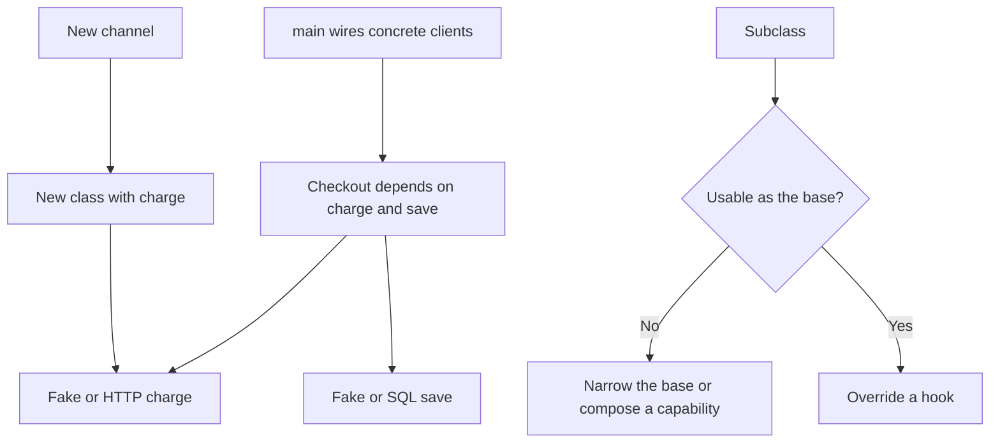

## Why this matters

SOLID is five constraints that keep a service changeable. Interviewers at this level do not want the acronym recited. They want you to look at a class that parses CSV, charges a card, and sends email, and split it. They want you to say why a subclass that refuses work the base accepted is a bug. They want dependency inversion in the form you can code tonight: pass a repository into the service instead of constructing a database client on line one.

Python's version is lighter than Java's. You rarely declare a formal interface for every class. You still honor the constraints. A module of functions can be a better "single responsibility" than a class. A protocol can be the dependency you invert toward. The principles are about change, not about how many base classes you can invent.

## Intuition

Each principle answers one pain.

- **S**ingle responsibility: this type has one reason to change. A tax rule change should not force an edit in the SMTP code.
- **O**pen/closed: you add a behavior by adding a class or a function, not by editing a central switch that already works.
- **L**iskov substitution: a subclass can stand in for the base. Callers do not learn special cases.
- **I**nterface segregation: callers depend on the methods they use, not on a 30-method "manager."
- **D**ependency inversion: high-level policy depends on a small contract, not on a concrete SQL driver. The driver is plugged in at the edge.

If you remember the pains, you can reconstruct the names.

## Core concept in depth

### Single responsibility

A reason to change is a kind of stakeholder or a kind of rule, not a line count. `Invoice` that computes a total and also opens an SMTP socket has two reasons: pricing rules and mail infrastructure. Split `price` from `Mailer`. The invoice function stays pure and testable. The mailer is tested with a fake SMTP boundary, or not unit-tested and covered by a contract test.

A class that only holds data is one responsibility. Do not split every field into a class. A function that validates and returns a total is one responsibility. Do not wrap it in `TotalCalculatorManager`.

### Open/closed

The notifier from the polymorphism lesson is open/closed in the useful sense: a new channel is a new class with `send`, and `notify` stays closed to edits. A chain of `if kind == "email"` is closed to extension and open to bugs. Open/closed does not mean "never edit the function." It means the axis of variation you already know about should be a new type, not a new branch. The first time, a branch is fine. The third channel is a registry.

### Liskov substitution

If `Bird.fly` is part of the contract, a `Penguin` that raises on `fly` cannot be a `Bird` in that model. Callers written against `Bird` crash. Fix the model: birds do not all fly, and `FlyingBird` is a narrower type, or flying is a separate capability object. Preconditions cannot get stricter in a subtype. Postconditions cannot get weaker. A method that promised a non-empty id cannot return an empty id in a subclass. This is the same rule as overriding in the polymorphism lesson, with a name interviewers recognize.

### Interface segregation

A protocol or base class with `read`, `write`, `flush`, `seek`, `truncate`, and `lock` forces a fake to implement all of them when the caller only reads. Split `Reader` from `Writer`. In Python the "interface" might be the set of methods you actually call. Segregation means you do not type-hint the concrete god class. You hint the small protocol. Callers then accept a fake with one method.

Do not create a protocol per method in advance. Segregate when a second implementation is in pain, or when the fat base is already hurting.

### Dependency inversion

High-level `Checkout.place` should not import a concrete `PsycopgOrderRepo` and construct it. It should receive an object with `save(order)`. The composition root, the `main` function or the framework container, constructs the real repository and passes it in. Tests pass a fake. That is the inversion: the policy does not depend on the detail. Both depend on the contract. The detail depends on the contract too, by implementing it.

In Python the contract is often implicit. A protocol makes it explicit for the checker. A concrete type hint to the real repository undoes the inversion even if you still pass it in, because the signature now names the detail. Hint the protocol or leave the parameter untyped in a small script. Do not hint the SQL class.

The composition root is allowed to know the concrete classes. Something must. That something should be the edge, not the domain function.

### How the five fit in one checkout

`place` computes policy (single responsibility for the use case, with pricing extracted if it grows). New payment providers register as new types (open/closed). A fake provider accepts the same inputs as the real one (Liskov, applied to the contract rather than to a deep hierarchy). `place` calls `charge` and `save`, not a 40-method platform object (segregation). `main` wires the real gateway (inversion). You can describe a design in those five checks without a diagram full of boxes named `IManager`.

## Diagram / flowchart



### Dry-run: a change request

Product asks for SMS receipts and for a pricing tweak.

| Design | Files you edit for SMS | Files you edit for pricing |
| --- | --- | --- |
| One class that prices, charges, and emails | That class, plus a new branch, risking the price code | The same class, risking the mail code |
| Checkout calls `notifier.send` and `pricing.total` | A new notifier class and a registry line | The pricing function only |

The second row is SOLID as a change-cost story. If you cannot name which row you are in, you do not have a design yet.

## Code

```python
class Checkout:
    def __init__(self, payments, orders) -> None:
        self.payments = payments
        self.orders = orders

    def place(self, order_id: str, minor: int) -> str:
        if minor <= 0:
            raise ValueError("amount must be positive")
        receipt = self.payments.charge(minor)
        self.orders.save(order_id, minor)
        return receipt


class MemoryOrders:
    def __init__(self) -> None:
        self.rows: list[tuple[str, int]] = []

    def save(self, order_id: str, minor: int) -> None:
        self.rows.append((order_id, minor))


class FakePay:
    def charge(self, minor: int) -> str:
        return f"ok:{minor}"


if __name__ == "__main__":
    orders = MemoryOrders()
    print(Checkout(FakePay(), orders).place("o1", 500))
    print(orders.rows)
```

`Checkout` names no database and no HTTP library. `MemoryOrders` and `FakePay` are the test doubles and, for a spike, a fine in-memory adapter. The composition root would pass a SQL repository with the same `save` shape. Pricing is still inside `place` as a single comparison. Extract it when a second rule appears. That restraint is part of single responsibility: do not invent types for a one-line rule.

## Complexity analysis

| Principle | What it costs | What it saves |
| --- | --- | --- |
| Split classes | More types to navigate | Isolated changes and smaller tests |
| Registry instead of a branch | One indirection | Edits that do not touch old channels |
| Refusing a bad subtype | A model change now | Production crashes in callers later |
| Small protocols | A few lines of typing | Fakes that do not implement 30 methods |
| Inversion | A constructor parameter | The ability to test policy without IO |

None of these change the big-O of `place`. They change the cost of the next requirement. Mention that explicitly if an interviewer treats SOLID as performance advice. It is not.

## Tricks, tips and patterns

- Name the reason to change. If you cannot, the class is fine. If you can name two unrelated reasons, split.
- Add a branch once. Replace it with a new type on the second or third variant.
- State substitutability as a test: the subclass passes the base's tests.
- Hint small protocols, not concrete database classes, in domain functions.
- Wire concrete types in `main` or the framework's startup, nowhere else.
- Prefer a function over a class when there is no state. SOLID applies to functions too.
- Do not create `ISomething` for a single implementation with no pain. Wait for the second implementation or the test double that hurts.

## Common mistakes and edge cases

- A `ServiceManager` that parses, validates, stores, emails, and logs, with a comment that says "single responsibility: the service."
- An abstract interface for every class, including ones with one caller and one implementation. The codebase becomes a mirror.
- A penguin that inherits `fly` and raises `NotImplementedError`. That is a Liskov bug, not a stub.
- Domain code importing the SQLAlchemy session class and constructing it. The domain now cannot boot without a database.
- "Open/closed" used to refuse a bugfix in an existing function. The principle is not a lock on the file.
- Interface segregation that produces fifty protocols and no readability.
- A subclass that type-checks and still strengthens a precondition the tests never ran.

## Interview notes

Do not list five definitions and stop. Take a small class they describe and apply two principles out loud. The highest-signal pair in a backend interview is single responsibility plus dependency inversion, with Liskov if they show you a subclass. Say where the composition root lives.

Follow-ups:

- **What is dependency inversion in Python?** The use case receives collaborators that match a small contract. `main` constructs the real ones. Tests pass fakes.
- **Is a protocol required?** No. It helps the checker and the reader. Duck typing is the runtime mechanism either way.
- **When is inheritance the wrong SOLID fix?** When you are inheriting to reuse code rather than to be a subtype. Compose.
- **What does open/closed not mean?** It does not mean the source file is immutable. It means new variants should not require editing every call site.

Offer the SMS-versus-pricing table if they ask for an example of change isolation.

## Practice problems

1. **Place Order** (medium) — checkout that charges and saves through collaborators, rejecting a non-positive amount. [Practice: python-ex-place-order]
2. **Split Reasons** (easy) — given a list of duties, partition them into pricing versus delivery. [Practice: python-ex-split-reasons]
3. **Subtype Check** (medium) — decide whether a subclass that rejects an input the base allows is substitutable. [Practice: python-ex-subtype-ok]
4. **Wire Root** (easy) — given concrete classes and a use case, return the order of construction from the outside in. [Practice: python-ex-wire-root]

## Summary / cheat sheet

- Single responsibility: one reason to change. Split pricing from mail. Do not split a one-line rule into a class.
- Open/closed: add a type for a new variant instead of growing a switch, once the variation is real.
- Liskov: a subtype honors the base contract. Do not raise on inputs the base accepted.
- Interface segregation: depend on the methods you call. Small protocols beat god classes.
- Dependency inversion: domain code receives contracts. `main` wires concrete databases and HTTP clients.
- Functions can satisfy these principles without a class hierarchy.
- SOLID is about the cost of the next change, not about runtime complexity.

## Further reading

- [SOLID description by Robert C. Martin, summarized on Wikipedia](https://en.wikipedia.org/wiki/SOLID)
- [typing.Protocol](https://docs.python.org/3/library/typing.html#typing.Protocol)
- [abc module](https://docs.python.org/3/library/abc.html)
- [The dependency injection pattern in the Python packaging and application sense is just wiring in main](https://docs.python.org/3/tutorial/classes.html)
