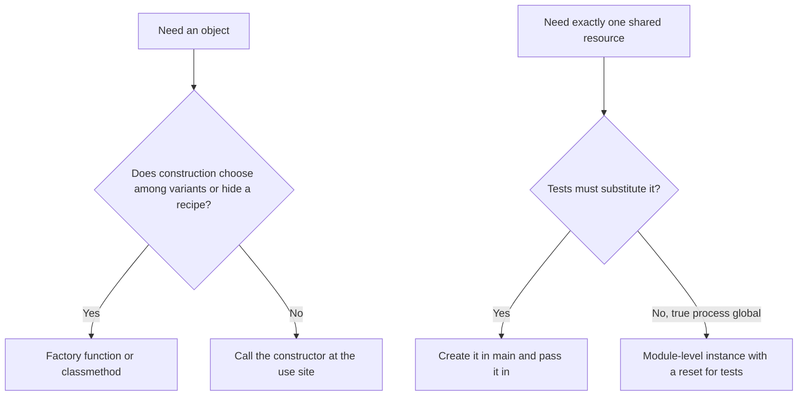

## Why this matters

A factory is a named place that knows how to build a valid object. Callers stop repeating validation and they stop importing every concrete class. A singleton is a promise that the process holds one shared instance. Interviews ask for both, and they ask the Python follow-up: why is a module-level object or a function with `@cache` usually a better singleton than overriding `__new__`? Candidates who recite a metaclass and cannot test it lose the room. Candidates who say "one factory function, and the database pool lives in `main`" sound like they have shipped a service.

Patterns are names for shapes you already have. If the shape is not in the code, do not add the pattern so the diagram looks professional.

## Intuition

Construction gathers decisions: which class, which defaults, which validation, which collaborator. A factory hides those decisions behind a name, `build_notifier("sms")` or `User.from_row(row)`. Callers depend on the name and the result, not on the construction recipe.

A singleton gathers shared state: one pool, one config, one metrics registry. The danger is hidden global state. Tests that forget to reset it fail in a different order. The honest Python singleton is an object created once in `main` and passed in. When you truly need a process-wide cache, put it in a module and give tests a function that clears it. Do not make the class refuse to create a second instance unless a second instance would corrupt a resource. Even then, prefer passing the one instance around.

## Core concept in depth

### Factory function and factory classmethod

The simplest factory is a function:

```python
def build_channel(kind: str):
    if kind == "email":
        return Email()
    if kind == "sms":
        return Sms()
    raise ValueError(f"unknown channel: {kind}")
```

This is the registry from the polymorphism lesson, written as a function. It is a factory. You do not need a `ChannelFactory` class with one method unless the factory itself holds configuration, such as API keys that differ per built object. If it holds configuration, an object with a method is reasonable: `factory.build(kind)`. If it does not, a function is the whole pattern.

A classmethod `User.from_row` is a factory on the type. Use it when the result is always that type or a subclass via `cls`. Use a free function when the result type varies.

An abstract factory is a family of builders behind one contract: a `StorageFactory` that can build a user repo and an order repo for either SQL or memory. You need it when those objects must match, so you do not mix a SQL user repo with a memory order repo by accident. You do not need it for one class.

Put the factory at the edge. Domain code can call a small factory for domain variants. Domain code should not call a factory that reads environment variables and opens sockets. That is `main`'s job, or the factory is only called from `main`.

### Registry-style factory

A dict from kind to constructor is easier to extend than a chain of comparisons, and it is still a factory. Register plugins by calling `register("sms", Sms)` at import of the plugin package, from a function `main` controls. Import-time registration is convenient and order-dependent. Prefer an explicit `register` call in startup when you can, so tests do not inherit whatever imports happened to run.

Validate the kind before you call the constructor. A typo should raise `ValueError` with the unknown name, not `KeyError` from deep inside a constructor that received `None`.

### Singleton, the versions you will see

**Module-level instance.** `metrics = Metrics()` at module scope is one object per process because the module is one object per process. This is the idiomatic singleton. Tests can replace attributes on it or you expose `reset()`. Document the global.

**Pass the instance.** Create one pool in `main` and pass it to every repository. There is one pool because you created one, not because the class forbids another. Tests create a different pool or a fake. This is the version you should prefer for databases, HTTP clients, and configuration.

**`__new__` singleton.** The class stores the instance on itself and returns it from `__new__`, skipping a second `__init__` if you are careful. People forget that `__init__` still runs on every call unless you guard it, so the second `Logger()` reconfigures the first instance. That bug is the interview trap. If you implement this, set a flag in `__new__` and make `__init__` return immediately when already initialized, or do all setup in `__new__`. Then write a test that constructs twice and shows the configuration did not double.

**Metaclass singleton.** It works and it is the wrong first tool. It surprises anyone reading the class, it interacts badly with inheritance, and it is harder to reset in tests. Mention it as "possible, not my default."

A singleton that holds a requests session or a DB pool must be safe for the concurrency model you use. A pool is designed to be shared. A mutable dict cache without a lock is not safe just because there is only one of it. One object shared by threads is shared mutable state. The singleton pattern does not add locking.

### When the pattern is a smell

A factory with one branch that returns one class is a function you inlined for no reason. Inline it until the second variant exists. A singleton config object that every function imports is a hidden parameter list. Passing config into the functions that need it is longer and clearer. Use the singleton when the alternative is threading a value through ten layers that do not care, and even then a context var or a single application object is often cleaner.

## Diagram / flowchart



### Dry-run: double construction of a naive singleton

| Call | `__new__` returns | `__init__` runs? | Level stored |
| --- | --- | --- | --- |
| `Logger("info")` | the one instance | yes | info |
| `Logger("debug")` if init is unguarded | the same instance | yes, again | debug, the first caller's level changed |
| `Logger("debug")` if init is guarded | the same instance | no | info, the second call does not reconfigure |

The unguarded row is the bug. A factory that always returns the module-level logger does not have this double-init problem because callers do not invoke the constructor again. That is another reason to prefer the module.

Factory dry-run: `build_channel("sms")` returns an SMS sender. `build_channel("fax")` raises `ValueError`. The caller does not import `Sms` or `Email`.

## Code

```python
class Email:
    def send(self, message: str) -> str:
        return f"email:{message}"


class Sms:
    def send(self, message: str) -> str:
        return f"sms:{message}"


_BUILDERS = {"email": Email, "sms": Sms}


def build_channel(kind: str):
    try:
        builder = _BUILDERS[kind]
    except KeyError as exc:
        raise ValueError(f"unknown channel: {kind}") from exc
    return builder()


class AppLogger:
    def __init__(self) -> None:
        self.lines: list[str] = []

    def log(self, line: str) -> None:
        self.lines.append(line)


logger = AppLogger()


if __name__ == "__main__":
    print(build_channel("sms").send("hi"))
    logger.log("started")
    print(logger is logger)
```

`build_channel` is the factory. Adding a channel is one dict entry and a class, not a new caller. `logger` is the module singleton. Tests that need a fresh logger should construct `AppLogger()` locally instead of using the global, which is the real lesson: the global is for the process, the class is still constructible. A class that cannot be constructed twice makes the test work harder for no benefit.

## Complexity analysis

| Pattern | Runtime | Design cost |
| --- | --- | --- |
| Factory dict lookup | Average O(1) | One place to update variants |
| Chain of if statements | O(variants) | Callers drift if you copy the chain |
| Module singleton | O(1) access | Hidden coupling and test resets |
| `__new__` singleton | O(1) | Double-init bugs and inheritance surprises |
| Passing one pool through constructors | O(1) | Explicit dependencies, easier tests |

Factories do not change the cost of `send`. They change who has to know the concrete class. Singletons do not make a resource cheaper to create if you were going to create it once anyway. They make the sharing invisible.

## Tricks, tips and patterns

- A function that returns the right class is a factory. A classmethod `from_row` is a factory. Do not add a factory class without state.
- Raise `ValueError` for an unknown kind at the factory, chained from `KeyError` if you use a dict.
- Register plugins explicitly at startup when import order would surprise you.
- Prefer one instance created in `main` and passed in. Use a module global when passing it is pure noise, and expose a way to reset state in tests.
- If you override `__new__` for a singleton, guard `__init__` so the second call does not reconfigure the first instance.
- Skip metaclasses until a framework forces the issue.
- A shared singleton is still shared mutable state. Add a lock or use a pool type that is safe, or do not share it across threads.

## Common mistakes and edge cases

- A `Factory` class with a single method and no fields. Use a function.
- A factory that opens a network connection while the caller thought it built a pure strategy.
- Import-time registration that depends on somebody remembering to import the plugin module.
- `__init__` resetting singleton state on every construction.
- A singleton database connection that is not a pool and is used from many threads without a contract.
- Tests that assert on the global logger and leak lines into the next test.
- Using a singleton to hide a parameter the function should have taken. The call looks easy and the dependency is invisible.
- An abstract factory with one product. Call the constructor.

## Interview notes

Implement `build_channel` as a dict. Say it is a simple factory. Then discuss singleton: "I would create the pool in main and pass it. If I must use a global, it is a module-level instance. I would not reach for a metaclass. If I override `__new__`, I must not let `__init__` run twice."

Follow-ups:

- **Factory versus constructor?** The constructor builds one type. The factory chooses a type or hides a multi-step recipe.
- **Why is a module already a singleton?** Python caches modules in `sys.modules`. The module object and its globals exist once per process.
- **How do you test a singleton?** Prefer not to need one. If it exists, reset its mutable fields in teardown or do not use the global in the test.
- **Is singleton the same as a pool?** A pool is one shared object by design and has an API for borrowing. A singleton is just "there is one." A pool is the legitimate case.

Mention that the next lesson's strategy pattern is often what a factory returns: the factory picks a strategy, the caller runs it.

## Practice problems

1. **Build Channel** (medium) — factory from a kind string to email or sms, with an error on unknown kinds. [Practice: python-ex-build-channel]
2. **From Row Factory** (easy) — construct a user only through a validating factory path. [Practice: python-ex-user-factory]
3. **Singleton Init** (medium) — given a sequence of constructor calls, return the level if init is guarded versus unguarded. [Practice: python-ex-singleton-init]
4. **Registry Add** (medium) — register a builder and reject a duplicate kind. [Practice: python-ex-registry-add]

## Summary / cheat sheet

- A factory is a function or classmethod that centralizes construction and variant choice. A factory class needs its own state or it should be a function.
- Unknown variants raise a clear `ValueError` at the factory.
- Prefer creating one shared resource in `main` and passing it in.
- A module-level instance is the idiomatic process-wide singleton, because the module is loaded once.
- `__new__` singletons must guard `__init__` or the second call reconfigures the first instance. Metaclasses are not the default.
- A singleton is shared mutable state. It is not automatically thread-safe and it makes tests order-dependent if you do not reset it.
- Do not introduce the pattern before a second variant or a real shared resource exists.

## Further reading

- [sys.modules and import caching](https://docs.python.org/3/reference/import.html#the-module-cache)
- [object.__new__](https://docs.python.org/3/reference/datamodel.html#object.__new__)
- [functools.cache as a way to compute one shared value](https://docs.python.org/3/library/functools.html#functools.cache)
- [The factory method pattern overview](https://en.wikipedia.org/wiki/Factory_method_pattern)
