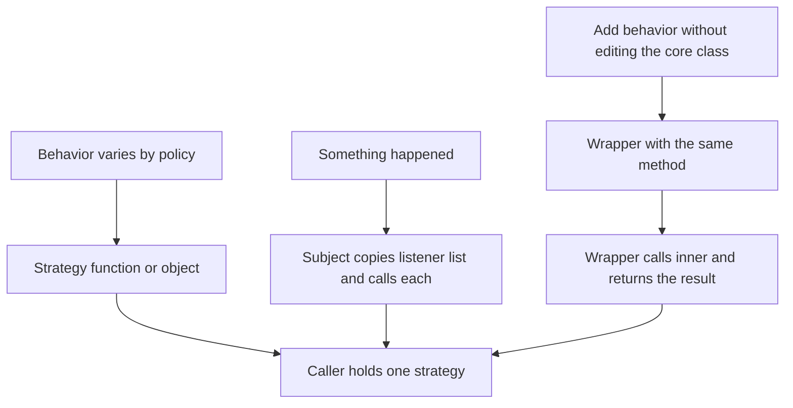

## Why this matters

These three patterns show up in backend code under other names. A strategy is the pricing rule or the retry policy you pass in. An observer is the list of hooks that run after an order is placed. A decorator in the pattern sense is a wrapper object that implements the same interface as the thing it wraps. Interviews ask you to implement one of them in a few dozen lines and then ask the Python-specific question: how is the decorator pattern different from `@decorator` on a function? If you conflate them, the rest of the answer is hard to trust.

You already have the mechanisms. This lesson names them and shows the failure modes: an observer that raises and aborts the others, a strategy that closes over mutable global state, and a wrapper that forgets to forward a method.

## Intuition

Strategy replaces a conditional with a callable. The caller holds one object or function and asks it to compute. Swapping behavior is swapping the object, not editing the caller.

Observer splits "something happened" from "who cares." The subject keeps a list of callables and invokes them after the state change. The subject does not import the emailer and the metrics client and the audit log. Those register themselves.

The decorator pattern wraps one object in another with the same methods. The wrapper does something before or after and calls the inner object. Stacking wrappers stacks behavior. This is composition. The `@` syntax is a different mechanism that wraps a function at definition time. You can implement the pattern with `@` when the thing being wrapped is a function. When the thing being wrapped is an object with several methods, you want a wrapper class, not a function decorator.

## Core concept in depth

### Strategy

```python
def percent_off(percent: int):
    def apply(minor: int) -> int:
        return minor - minor * percent // 100
    return apply

class Checkout:
    def __init__(self, price) -> None:
        self.price = price

    def total(self, minor: int) -> int:
        return self.price(minor)
```

`price` is the strategy. A test passes `lambda minor: minor`. Production passes `percent_off(10)` or a tax function. A class with an `apply` method is the same pattern when the strategy needs several methods or configuration that is awkward in a closure. Prefer the function until you need the class.

Do not build a strategy hierarchy for two formulas. Two functions are enough. Name them. The conditional that picks the strategy belongs at the edge, often in the factory from the previous lesson. The checkout does not contain `if coupon == "SAVE10"`.

A strategy must be explicit about purity. A pricing function that also sends an email is a second responsibility hiding in the strategy. A strategy that mutates its input list surprises the caller. Return a new number or a new object.

### Observer

```python
class OrderBook:
    def __init__(self) -> None:
        self._listeners: list = []
        self.orders: list[str] = []

    def subscribe(self, listener) -> None:
        self._listeners.append(listener)

    def place(self, order_id: str) -> None:
        self.orders.append(order_id)
        for listener in list(self._listeners):
            listener(order_id)
```

Copy the list before iterating so a listener can unsubscribe during the callback without skipping or raising. Define the error policy. If a listener raises, do you stop, or do you finish the others and raise a combined error? For payments, a failed audit log must not silently vanish, and a failed optional webhook must not roll back a charge you already committed. Those are different policies. Write the one you mean. The worst policy is a bare `except` that ignores listener failures.

Listeners are synchronous here. A slow listener blocks `place`. For work that can wait, the listener should enqueue a job, not send email inline. The observer pattern does not make the call asynchronous. You do.

Do not let listeners mutate the order in a way the subject does not expect, unless the contract says they can. A listener that appends to `orders` during notification re-enters the design. Prefer listeners that only read the id and do their own work.

### Decorator pattern

```python
class Email:
    def send(self, message: str) -> str:
        return f"email:{message}"

class Retry:
    def __init__(self, inner, times: int) -> None:
        self.inner = inner
        self.times = times

    def send(self, message: str) -> str:
        last = None
        for _ in range(self.times):
            try:
                return self.inner.send(message)
            except ConnectionError as exc:
                last = exc
        raise last
```

`Retry` is a decorator object. It has `send` because `Email` has `send`. Callers hold a `Retry` and do not know the inner type. `Retry(Logging(Email()), 3)` stacks. Each wrapper only knows its inner object.

This is not `@retry`. `@retry` replaces a function with a wrapper function at definition time. You can use `@retry` on `Email.send` and the effect is similar for that one method. The pattern still matters when you must wrap an object you did not define, or wrap only one instance, or add the wrapper based on configuration at runtime. You cannot put a decorator on one instance's method with `@` syntax at the call site. You wrap the instance.

Forward every method that is part of the contract. A wrapper that implements `send` and forgets `close` leaks the resource when callers close through the wrapper. Either forward `close` or do not pretend to be a full substitute. Returning the inner result is mandatory. Swallowing it turns the wrapper into a black hole.

A wrapper that holds the only reference to a pool and also gets stored on a singleton is a lifetime puzzle. The outermost wrapper is what `main` passes in. Inner objects are not also registered elsewhere.

### How a factory ties them together

`build_channel` returns `Retry(Email(), 3)` or `Sms()` depending on config. The factory selects strategies and wraps decorators. Callers receive one object with `send`. Observer hooks subscribe at startup: the mailer and the metrics recorder subscribe to the order book. Three patterns, one process, no inheritance diamond.

## Diagram / flowchart



### Dry-run: listeners and a retry wrapper

Order book with two listeners, the first of which unsubscribes itself during the call.

| Step | Listener list while calling | Who runs |
| --- | --- | --- |
| Snapshot taken before calls | original two | |
| First listener runs and unsubscribes | snapshot still has two, live list has one | first runs |
| Second listener runs from the snapshot | | second runs |
| A later place | live list has one | only the second |

If you iterated the live list and the first listener removed itself, the second might be skipped because the index shifted. The snapshot prevents that. If the first listener raises and you do not catch, the second never runs. Choose that only when the first listener is essential.

Retry dry-run: inner raises `ConnectionError` twice and then returns `"email:hi"`. `times=3` returns `"email:hi"`. `times=2` raises the last `ConnectionError`. A `ValueError` from a bug raises immediately if you only catch `ConnectionError`. Do not catch `Exception` in the wrapper.

## Code

```python
def percent_off(percent: int):
    def apply(minor: int) -> int:
        if minor < 0:
            raise ValueError("minor must be >= 0")
        return minor - minor * percent // 100
    return apply


class OrderBook:
    def __init__(self) -> None:
        self._listeners: list = []
        self.orders: list[str] = []

    def subscribe(self, listener) -> None:
        self._listeners.append(listener)

    def place(self, order_id: str) -> None:
        self.orders.append(order_id)
        for listener in tuple(self._listeners):
            listener(order_id)


class Retry:
    def __init__(self, inner, times: int) -> None:
        if times < 1:
            raise ValueError("times must be >= 1")
        self.inner = inner
        self.times = times

    def send(self, message: str) -> str:
        last: Exception | None = None
        for _ in range(self.times):
            try:
                return self.inner.send(message)
            except ConnectionError as exc:
                last = exc
        assert last is not None
        raise last


if __name__ == "__main__":
    seen: list[str] = []
    book = OrderBook()
    book.subscribe(seen.append)
    book.place("o1")
    print(percent_off(10)(1000), seen)
```

`percent_off(10)` is a strategy. `seen.append` is a listener. `Retry` is ready to wrap any object with `send`. The demo does not need a network to show the strategy and the observer. A unit test of `Retry` passes an inner object whose `send` fails twice and then succeeds.

## Complexity analysis

| Pattern | Cost |
| --- | --- |
| Strategy call | One call, same as inlining the formula |
| Notifying k listeners | O(k) plus whatever the listeners do. A listener that writes to disk dominates |
| Snapshot of the listener list | O(k) copy, which is the point |
| Retry wrapper | Up to `times` inner calls, only on the failure path if you return immediately on success |
| Deep wrapper stack | One extra call per wrapper, irrelevant beside I/O |

The performance bug is a synchronous observer that does slow work on the request thread, not the loop that calls three functions. Move slow work to a queue.

## Tricks, tips and patterns

- Strategies are functions until they need several methods or heavy configuration.
- Select the strategy at the edge. Do not `if` coupon codes inside the domain function once more than one rule exists.
- Iterate a snapshot of observers. Decide what happens when one raises, and test it.
- Listeners that do I/O should enqueue, not block, if the subject is on a request path.
- A decorator object implements the same methods and returns the inner result. It is not the `@` syntax, though `@` can wrap a single function.
- Stack wrappers at the composition root: retry around logging around the client, or the reverse, chosen on purpose.
- Catch only the errors you know how to retry.

## Common mistakes and edge cases

- A strategy object hierarchy with one method each, where functions would do.
- An observer that mutates the listener list during iteration without a snapshot, skipping a listener.
- Swallowing listener exceptions and reporting success when the audit hook failed.
- A slow listener on the request path.
- A wrapper that does not return the inner value.
- A wrapper that catches `Exception` and retries bugs and non-idempotent charges.
- Confusing `@functools.wraps` decorators with the decorator pattern and being unable to wrap one instance at runtime.
- Forgetting to forward `close` or other contract methods.
- Listeners registered twice because startup runs twice, so every event is handled twice.

## Interview notes

Implement the one they ask for, and name the other two in a sentence so they know you can tell them apart. For decorator, say "wrapper object, same methods, holds the inner object" and contrast it with `@deco` function wrapping. For observer, mention the snapshot and the error policy. For strategy, pass a function.

Follow-ups:

- **Strategy versus if statements?** The if moves to the edge that picks the strategy. The hot function stays stable.
- **Observer versus a direct call?** Direct calls couple the subject to every dependent. The list keeps the subject ignorant of who subscribed.
- **How do you stop one bad listener from blocking the rest?** Catch per listener, record the failure, and continue if the policy says they are independent. Do not do that for a listener that must succeed.
- **Decorator pattern versus @decorator?** `@` wraps a function at definition. The pattern wraps an object at runtime and forwards methods.

Mention idempotency if the wrapper retries. It is the difference between a safe email send and a double charge.

## Practice problems

1. **Percent Off** (easy) — a strategy that discounts minor units with integer math. [Practice: python-ex-percent-off]
2. **Order Listeners** (medium) — place an order and notify a snapshot of listeners. [Practice: python-ex-order-listeners]
3. **Retry Send** (medium) — wrap a sender and retry only connection failures. [Practice: python-ex-retry-send]
4. **Stack Wrappers** (medium) — given wrapper names outside-in, return the call order for a send. [Practice: python-ex-wrapper-order]

## Summary / cheat sheet

- Strategy: pass the algorithm as a function or a small object. Keep selection at the edge.
- Observer: a subject stores listeners, snapshots the list, and notifies them. Write down whether one failure aborts the rest.
- Decorator pattern: a wrapper with the same methods, holding an inner object, returning the inner result. Stack wrappers at the composition root.
- `@decorator` is function-wrapping syntax. It can implement the pattern for a single function. It is not how you wrap one existing instance.
- Retry wrappers catch narrow errors and only repeat idempotent work.
- Synchronous listeners are on the request path. Slow work belongs in a queue.
- Do not introduce a pattern class when a function or a direct call is still clear.

## Further reading

- [Strategy pattern](https://en.wikipedia.org/wiki/Strategy_pattern)
- [Observer pattern](https://en.wikipedia.org/wiki/Observer_pattern)
- [Decorator pattern](https://en.wikipedia.org/wiki/Decorator_pattern)
- [functools.wraps and function decorators](https://docs.python.org/3/library/functools.html#functools.wraps)
