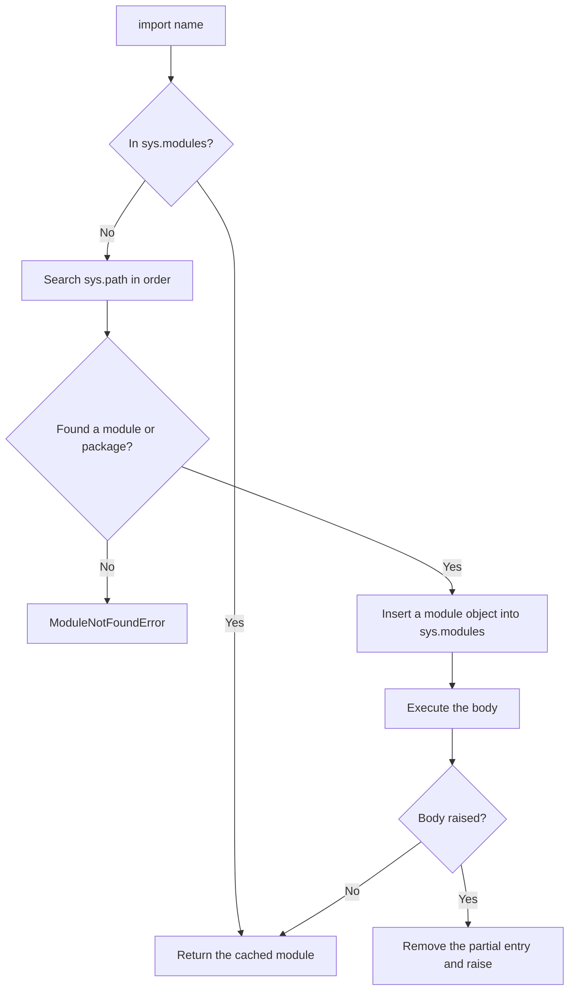

## Why this matters

"It works in my notebook and fails in CI" is often an import path problem. "The tests pass alone and fail together" is often a module-level side effect cached in `sys.modules`. Interviews ask what `import` actually does, why a circular import raises `ImportError` only sometimes, and what `python -m` changes. Backend projects live or die by a layout where `import app.orders` means the same thing in a test, a worker, and a container.

You already know a module body runs once. This lesson is the search path, the cache, and the ways people break both.

## Intuition

Import is a lookup in `sys.modules`. On a miss, Python searches `sys.path` for a matching file or package, creates a module object, puts it in the cache **before** the body finishes, then executes the body. The early cache insert is why a circular import can see a half-initialized module instead of recursing forever. The path is why the current directory, `PYTHONPATH`, and the venv's `site-packages` can shadow each other. The first match wins. A local file named `json.py` hides the standard library.

## Core concept in depth

### What an import returns

`import json` binds the name `json` in the current namespace to the module object. `import json as js` binds `js`. `from json import dumps` binds `dumps` to the function object that lived on the module at import time. If the module later rebinds `json.dumps`, your `dumps` name does not follow. You copied the reference. `from package import helper` runs the package's `__init__` and then looks up `helper`.

The module object's `__name__` is the dotted name, `__file__` is the path for a normal module, and `__dict__` is its global namespace. You saw `__name__ == "__main__"` for the entry script. That script is stored in `sys.modules` under `"__main__"`, which is why importing it again under its package name can load a second copy. Two copies mean two copies of every global. Avoid running a module as a script and also importing it. Use `python -m package.module` so the `__name__` is the package path and there is one copy.

### sys.path

`sys.path` is a list of locations searched in order. It typically starts with the script's directory, or the current directory for `python -m` and the REPL, then the standard library, then `site-packages`. `PYTHONPATH` inserts extra entries. A venv's `site-packages` is how installed packages become importable.

The first hit wins. `email.py` in your project directory hides the standard library `email` package if the script directory is first. Rename your file. Do not debug the standard library. Print `module.__file__` when the wrong code runs. Print `sys.path` when nothing is found.

Editable installs and `src` layouts exist so the project is imported from the same place in tests and in production, not from a leftover directory on the path. The packaging lesson shows the layout. The rule here is: do not depend on the current directory accidentally. Invoke tools with `python -m pytest` from a configured environment.

### The cache and reload

After a successful import, `sys.modules[name]` is the module. A second import returns it and does not rerun the body. That is why module-level clients and caches are process singletons. `importlib.reload` reruns the body in the same module object and is a footgun: other modules hold the old function objects. Tests that need a clean module should isolate state with a function, not reload. If you must clear a cache, call an explicit `clear()` the module defines.

A failed import can leave a partial entry. In modern Python a failed module is removed from `sys.modules`, so a retry can run again. Do not depend on a half-imported module's attributes. If import raises, fix the cause. Do not catch `ImportError` around a required dependency and continue with `None` unless the dependency is truly optional and every use checks.

### Circular imports

Package `a` imports `b` at top level, and `b` imports `a` at top level, and one of them uses a name the other has not assigned yet. You get `ImportError: cannot import name 'X' from partially initialized module`. The cycle is the design problem. Fixes, in order of preference:

1. Move the shared name to a third module that both can import.
2. Move one import inside the function that needs it, so it runs after both modules have finished initializing.
3. Import the module, not the name: `import a` and call `a.X` later, when `X` exists. This still fails if you use `a.X` at body level during the cycle.

Do not paper over the cycle with a wildcard import. Do not make every import lazy so the graph becomes invisible. A cycle means two modules own one story. Split the story.

### Absolute imports

`import package.module` is absolute. It starts from `sys.path`. Inside a package, prefer absolute imports for anything another team reads. Relative imports exist and are the next lesson. Absolute imports do not depend on the current package's position, so a file moved between packages breaks loudly at the import line, which is what you want.

`if TYPE_CHECKING:` imports are a typing-module topic. They exist to break cycles for type checkers without importing at runtime. Do not use them to hide a runtime cycle you still have. The names will be missing when the function runs.

## Diagram / flowchart



### Dry-run: shadowing and a cycle

| Situation | What you observe | First check |
| --- | --- | --- |
| Local `json.py` and `import json` | Your empty file, `dumps` missing | `json.__file__` points at the project |
| Two imports of `app.cache` | Body ran once, counter stays | `sys.modules["app.cache"]` is one object |
| `a` imports `b` imports `a.Thing` while `a` is still defining `Thing` | `ImportError` partial init | Move `Thing` or delay the import |
| Script run as `python app/worker.py` and also imported as `app.worker` | Two module objects, two globals | Run `python -m app.worker` |

The shadow row is the one that wastes an afternoon. The filename is legal Python and a terrible idea when it matches a standard library module. `email`, `json`, `types`, `test`, `logging`, and `string` are common collisions.

## Code

```python
import importlib
import sys


def describe(name: str) -> str:
    if name not in sys.modules:
        importlib.import_module(name)
    module = sys.modules[name]
    path = getattr(module, "__file__", "<built-in>")
    return f"{name} -> {path}"


def is_shadowed(name: str, project_root: str) -> bool:
    text = describe(name)
    return project_root in text and "site-packages" not in text and "lib" not in text.lower()


if __name__ == "__main__":
    print(describe("json"))
    print("cached", "json" in sys.modules)
```

`describe` imports on demand and returns the file. Point it at a name you think is the standard library. If the path is your repository, rename your file. The `is_shadowed` helper in the demo is deliberately rough. In a real check, compare the resolved path to the standard library directory from `sysconfig`, not a string guess. The lesson is to look at `__file__`, not to ship this predicate.

## Complexity analysis

| Event | Cost |
| --- | --- |
| Cached import | A dict lookup in `sys.modules` |
| First import of a small module | Compile plus execute the body once per process |
| First import of a heavy framework | Dominated by that package's own imports and any import-time work |
| Circular import that fails | Fails fast, no hidden loop |
| `PYTHONPATH` with a huge tree first on the path | Every import searches more locations before the standard library |

Import-time work is paid at process start and at test collection if collection imports the tree. A module that connects to a database on import makes every pytest worker connect. Keep bodies cheap.

## Tricks, tips and patterns

- Print `module.__file__` when the wrong implementation loads.
- Never name a file after a standard library module.
- Run packages with `python -m` so you do not create a second `__main__` copy.
- Break cycles by moving the shared object or by importing inside the function that needs it.
- Catch `ImportError` only for an optional dependency, and keep the optional path small.
- Do not call `importlib.reload` in application code.
- Configure `sys.path` by installing the project, not by appending directories in every script.

## Common mistakes and edge cases

- A local `logging.py` or `email.py` that shadows the standard library.
- Module-level network calls, so import order becomes connection order.
- `from module import name` and surprise when the module rebinds `name` later.
- Circular imports "fixed" by making every import lazy, so the cycle remains and the first call fails instead of startup.
- Catching `ModuleNotFoundError` and continuing, then failing with `NoneType` far away.
- Tests that import the script as `__main__` and as a package and see different globals.
- Depending on the current working directory for imports. The path entry is the script directory or the empty string, which means cwd, depending on how you launched Python. Do not make correctness depend on the shell's cwd.

## Interview notes

Walk the flowchart: cache, then path, insert into `sys.modules`, execute, remove on failure. Mention shadowing. Mention circular imports and one fix. Mention `python -m` as the way to get a single module object.

Follow-ups:

- **Why does the body run once?** `sys.modules` returns the same object. That is also why module globals are process-wide.
- **What is a circular import?** Two modules waiting on names the other has not assigned. Split the module or delay one import.
- **How do you find a shadow?** `__file__`.
- **What does from x import y bind?** The object `y` referred to at that moment, not a live lookup.

If they ask about namespace packages, say a namespace package can span directories and has no `__init__.py` in the PEP 420 sense. Regular application packages in this course use `__init__.py` so the layout is obvious. The next lesson covers that choice.

## Practice problems

1. **Resolve Cached** (easy) — return whether a module name is already in a simulated cache, and the path if so. [Practice: python-ex-import-cache]
2. **Unknown Kind** (easy) — detect a shadowed name when the resolved path sits inside the project and the name is a known stdlib module. [Practice: python-ex-shadow-name]
3. **Cycle Break** (medium) — choose a delayed import versus a third module for a described cycle. [Practice: python-ex-cycle-break]
4. **Bind Snapshot** (medium) — show that a from-import keeps the old function after the module rebinds the name. [Practice: python-ex-from-import-bind]

## Summary / cheat sheet

- Import checks `sys.modules`, then searches `sys.path`, then executes the body once.
- The module is cached early so cycles can observe a partial module. Prefer to break the cycle.
- The first path hit wins. A local file can shadow the standard library. Check `__file__`.
- `from module import name` snapshots the object. It does not track later rebinding.
- `python -m` avoids a second copy of the module under `__main__`.
- Keep import-time work free of I/O. Do not reload modules in production.
- Absolute imports start from `sys.path`. Install the project so tests and workers share one layout.

## Further reading

- [The import system](https://docs.python.org/3/reference/import.html)
- [sys.path](https://docs.python.org/3/library/sys.html#sys.path)
- [importlib](https://docs.python.org/3/library/importlib.html)
- [PEP 328 — Absolute and relative imports](https://peps.python.org/pep-0328/)
