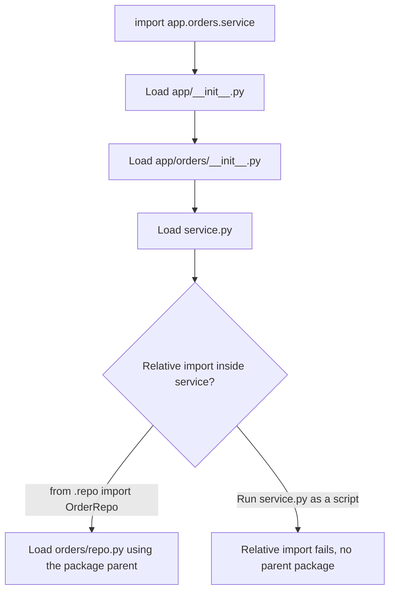

## Why this matters

A package is a directory Python treats as a module that can contain other modules. The layout is the architecture a new teammate sees first. A flat pile of scripts cannot be imported cleanly. A package whose `__init__` imports the world makes every submodule load the database driver. Interviews and take-homes both grade the layout: can I run `python -m pytest` and `python -m app` without `sys.path` hacks?

This lesson covers regular packages, what `__init__.py` should and should not do, relative imports, and `__all__`.

## Intuition

A package is a folder with an `__init__.py` that marks it as a regular package. Importing the package runs that file. Submodules do not run until something imports them, unless `__init__` imports them. Relative imports mean "start from this package," and they only work when the file is loaded as part of a package, not as a loose script. `__all__` is the list of names a star-import would take, and it is also a hint to readers about the public surface. Star-imports are still a bad idea in application code. The list is the documentation.

## Core concept in depth

### Regular packages

```text
app/
  __init__.py
  orders/
    __init__.py
    service.py
    repo.py
  main.py
```

`import app.orders.service` loads `app/__init__.py`, then `app/orders/__init__.py`, then `service.py`. Each of those is a module with its own globals. The package module's `__path__` tells Python where to look for submodules. You normally do not touch it.

Keep each `__init__.py` small or empty. Use it to document the package and, if you must, to expose two or three names. Do not import every submodule to "make imports pretty." That creates cycles, slows startup, and turns a surgical import into a full application boot. Callers can write `from app.orders.service import place`. That path is explicit and cheap.

### Relative imports

Inside `app/orders/service.py`, `from .repo import OrderRepo` imports `repo` from the same package. `from ..billing.client import pay` goes up to `app` and then into `billing`. The dots are package-relative. They fail with `ImportError: attempted relative import with no known parent package` when you run the file as a script, because `__package__` is empty. The fix is to run `python -m app.orders.service` from the project root, or to keep the entry point in a module that uses absolute imports and is launched with `-m`.

Prefer absolute imports at package boundaries (`from app.orders.repo import OrderRepo`) so a file can be read without counting dots. Prefer a single-dot relative import inside a tight package when you want the package to be rename-friendly. Do not climb more than one dot as a habit. `from ...` is a sign the layout is tangled.

### __all__

`__all__` is a list of public names. `from package import *` imports those names and no others. Linters and documentation generators also treat it as the public API. If you do not star-import, `__all__` is still worth defining on a package that re-exports a small facade. It is not a security boundary. Anyone can import `_helper` by name. The underscore is the convention. `__all__` is the curated list.

Do not maintain `__all__` by hand as a copy of every function in a large module if it drifts. Either export a tiny facade or let the module's public names be the ones without a leading underscore.

### Namespace packages, briefly

PEP 420 allows a package split across directories with no `__init__.py`. Tools and installers use that for plugin namespaces. Your application should use regular packages with `__init__.py` so a typo directory is not silently a namespace, and so you can see the package on purpose. If you omit `__init__.py` and imports still work, you may be looking at a namespace package and a path that is broader than you think. Add the file.

### What not to put in the package root

Configuration loading, argument parsing, and database engine creation do not belong in `app/__init__.py`. Importing `app` would do all of that. Put them in `app/main.py` or `app/cli.py` behind a function `main()` that runs under `__main__`. Library packages that open resources on import are hostile to tests.

A package named `test` or `app` can collide. `test` collides with the standard library. `app` is fine until two projects both use it and a path mix-up imports the wrong one. A unique top-level name, the project name, avoids that. The packaging lesson turns this layout into an installable distribution.

## Diagram / flowchart



### Dry-run: empty init versus eager init

| `__init__.py` behavior | `import app.orders.service` | Startup and cycles |
| --- | --- | --- |
| Empty file | Loads service and its explicit imports | Only what service needs |
| Imports repo, billing, and the ORM | Loads all of those too | Easy cycle, slow tests |
| Defines `__all__` and imports two facade functions | Those functions' modules load | Acceptable if the facade is truly small |

Facade row: if the two functions pull the ORM anyway, the facade did not save you. Trace one import with `python -v` when startup is slow. The verbose log shows the order modules load. You do not need to memorize it. You need to know it exists.

## Code

```python
def public_names(exports: list[str], private: list[str]) -> list[str]:
    """Return the names a package should put in __all__."""
    return [name for name in exports if not name.startswith("_") and name not in private]


def relative_allowed(run_as: str) -> bool:
    """Relative imports work when the module has a parent package."""
    return run_as == "module"


if __name__ == "__main__":
    print(public_names(["place", "_helper", "Order"], ["Order"]))
    print(relative_allowed("module"), relative_allowed("script"))
```

The runnable example encodes the two rules without a fake package on disk: do not export helpers, and do not expect relative imports when the file is a script. In a real tree, `from .repo import OrderRepo` is the import you write, and `python -m` is how you run it.

## Complexity analysis

| Layout choice | Cost |
| --- | --- |
| Deep package of small modules | More imports, each cheap if bodies are cheap |
| Eager `__init__` that imports the world | One import pays for the whole graph |
| Relative imports | No runtime difference versus absolute, once the package context exists |
| Namespace package scan | More directories consulted. Irrelevant next to a fat import body |

The cost that matters is what the body does, not the number of directories. A hundred empty packages are fine. One import that builds an engine is not.

## Tricks, tips and patterns

- Leave `__init__.py` empty until you have a real facade of a few names.
- Use one-dot relative imports inside a package, or absolute imports of your top-level name. Avoid long dot climbs.
- Run modules with `python -m package.module` so relative imports resolve.
- Define `__all__` on facades. Do not star-import in application modules.
- Add `__init__.py` for application packages. Do not rely on namespace discovery by accident.
- Keep `main()` out of `__init__.py`.
- Name the top-level package after the project, not `test` or `common`.

## Common mistakes and edge cases

- Relative import run as `python service.py`, so there is no parent package.
- `__init__.py` importing submodules that import the package again and cycle.
- Star-imports that pull a name you later remove, breaking a distant module that depended on the star.
- A missing `__init__.py` that still imports on your machine because a path entry made it a namespace, and fails in a zip or a different tool.
- Putting secrets or engine creation in the package body.
- Re-exporting so much that the facade is the whole application.
- Circular re-exports: `orders/__init__` imports `service`, `service` imports a name from `orders` that is not defined yet.

## Interview notes

Describe the tree and say `__init__.py` stays thin. Explain a relative import and why `-m` matters. Explain `__all__` as the public list, not a lock. Mention that import runs parent inits first.

Follow-ups:

- **What runs when I import a submodule?** The parent packages' `__init__` files, then the submodule.
- **Why did the relative import fail?** The file was executed as a script, so it had no package.
- **Should I import everything in init for convenience?** No. It slows startup and creates cycles. Callers can use the full path.
- **Namespace versus regular package?** Namespace packages can span directories without `__init__.py`. Application code should be a regular package.

Connect this to packaging: the directory you import must be the directory the installer puts on `sys.path`. A `src` layout does that on purpose. You will set it up in the packaging module.

## Practice problems

1. **Public All** (easy) — filter a name list down to a public `__all__`. [Practice: python-ex-public-all]
2. **Relative Ok** (easy) — decide whether a relative import is allowed for a given launch mode. [Practice: python-ex-relative-ok]
3. **Init Cost** (medium) — given an import graph, say which modules load for one submodule import. [Practice: python-ex-init-cost]
4. **Facade Cycle** (medium) — detect a cycle between a package init and a submodule. [Practice: python-ex-facade-cycle]

## Summary / cheat sheet

- A regular package is a directory with `__init__.py`. Importing a submodule runs parent inits first.
- Keep `__init__.py` empty or a tiny facade. Do not import the whole application there.
- Relative imports need a parent package. Launch with `python -m`.
- `__all__` documents the public names for star-imports and readers. It is not enforcement.
- Application packages should include `__init__.py`. Namespace packages are a different, deliberate tool.
- Do not create engines, parse argv, or read secrets at import time.
- Absolute imports of a unique top-level name are the readable default across package boundaries.

## Further reading

- [Packages](https://docs.python.org/3/tutorial/modules.html#packages)
- [Intra-package references](https://docs.python.org/3/tutorial/modules.html#intra-package-references)
- [PEP 420 — Implicit namespace packages](https://peps.python.org/pep-0420/)
- [__all__](https://docs.python.org/3/tutorial/modules.html#importing-from-a-package)
