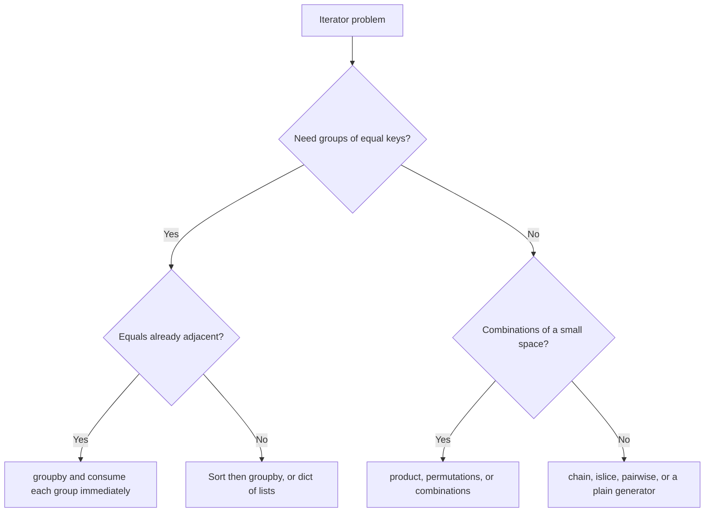

## Why this matters

`itertools` is the standard toolkit for iterator algebra. Interviews that say "all pairs," "sliding window," or "group a sorted stream" are shorter and less buggy with `product`, `pairwise`, and `groupby` than with nested index arithmetic. Production jobs that merge sorted logs or chunk an export use `chain` and `islice` so memory stays flat. The module is lazy. That is the feature and the trap: a `product` of large inputs looks cheap until you loop it, and `groupby` silently produces wrong groups if you forget to sort.

## Intuition

Every function here returns an iterator. Nothing runs until you pull values. Combinators like `product` and `permutations` walk a space without storing it. `groupby` walks a stream and emits a new group whenever the key changes from the previous item. It does not look ahead to gather equal keys from the whole file. If equals are not adjacent, they become separate groups. Sort first, or do not use `groupby`.

`islice` is how you take a finite prefix of an infinite iterator. Without it, `list(count())` never returns.

## Core concept in depth

### Chaining, slicing, and repeating

`chain(a, b)` yields every item of `a`, then every item of `b`, without building a new list. `chain.from_iterable(rows)` flattens one level of an iterator of iterators, which is the lazy form of a flatten. `islice(it, start, stop)` is slice semantics for iterators, including a stop so you can bound an infinite source. `repeat(x, n)` yields `x` n times. `cycle` repeats forever. Do not pass `cycle` to `list`.

`zip_longest` pads the shorter inputs with a fill value instead of stopping early. Use it when ragged rows are data. Use `zip(..., strict=True)` when ragged rows are a bug. They answer different specs.

### Windows

`pairwise(it)` yields overlapping pairs. It is the two-pointer setup for "compare each item with the next" without an index. For a window of size k, `tee` can split an iterator, you advance one copy by k, and you zip them. In practice, a `deque` with `maxlen` is often clearer for a sliding window over a sequence you can iterate once. `itertools` wins when you are already in a pipeline of iterators and you want pairs. Know `pairwise`. Do not build a puzzle of `tee` in application code if a deque reads better. `tee` buffers values when the copies are consumed at different speeds, so it can cost memory you thought you saved.

### groupby

`groupby(sorted_items, key)` yields pairs of `(key, group_iterator)`. The group iterator is lazy and it is invalid as soon as you advance the outer `groupby` to the next key. You must consume or copy the group before the next iteration:

```python
from itertools import groupby

def groups(words: list[str]) -> list[tuple[int, list[str]]]:
    ordered = sorted(words, key=len)
    out = []
    for length, bucket in groupby(ordered, key=len):
        out.append((length, list(bucket)))
    return out
```

Forgetting `list(bucket)` and storing the iterator itself gives you empty or wrong groups later, because the iterator has already moved. Forgetting `sorted` groups only adjacent equals. Both bugs are the interview follow-ups.

If you need random access to every group and the data fits, a dict of lists is simpler and does not require a sort. `groupby` is for a stream that is already ordered, or for a sort you were going to do anyway. It is O(n) after the sort, and the sort is O(n log n).

### product, permutations, combinations

`product(a, b)` is the cartesian product. It is nested loops, lazy. The number of outputs is the product of the lengths. Three lists of size 100 are a million tuples. Do not `list()` that because a loop looked nicer. `permutations(items, r)` is order-sensitive selections without reuse. `combinations(items, r)` ignores order and does not reuse. `combinations_with_replacement` allows reuse. Interview problems that say "unique pairs i < j" want `combinations`. Problems that say "arrangements" want `permutations`. Problems that say "every option of every parameter" want `product`.

These are exponential or factorial in the worst parameters. They are the right tool for a small search space and the wrong tool for a million-user cartesian join. If you reach for them, state the output size before you run.

### Infinite iterators and takewhile

`count(start, step)` counts forever. `repeat` without a count repeats forever. `dropwhile` and `takewhile` cut a stream by a predicate, and they do not resume a dropped region. `takewhile` stops at the first failure and does not skip ahead to later successes. For "all items until a blank," that is correct. For "filter," use a generator expression. The names are the spec. Read them as English before you use them.

## Diagram / flowchart



### Dry-run: groupby without and with a sort

Words `["bb", "a", "ccc", "b"]`, key `len`.

| Input order | Adjacent lengths | Groups you get |
| --- | --- | --- |
| Unsorted | 2, 1, 3, 1 | Four groups, two separate length-1 groups |
| Sorted by length | 1, 1, 2, 3 | Three groups: a and b together, then bb, then ccc |

The group iterator dry-run: if you append the iterator object and then loop the outer `groupby` again, the previous iterator is exhausted. `list(bucket)` inside the loop freezes that group.

`pairwise` on `1, 2, 3` yields `(1, 2)` and `(2, 3)`. There is no pair for a one-element input. Handle the short sequence on purpose.

## Code

```python
from itertools import combinations, groupby, islice, pairwise


def adjacent_increases(nums: list[int]) -> int:
    return sum(1 for a, b in pairwise(nums) if b > a)


def groups_by_length(words: list[str]) -> list[tuple[int, list[str]]]:
    ordered = sorted(words, key=len)
    return [(length, list(bucket)) for length, bucket in groupby(ordered, key=len)]


def first_pairs(items: list[str], limit: int) -> list[tuple[str, str]]:
    return list(islice(combinations(items, 2), limit))


if __name__ == "__main__":
    print(adjacent_increases([1, 3, 2, 5]))
    print(groups_by_length(["bb", "a", "ccc", "b"]))
    print(first_pairs(["a", "b", "c", "d"], 3))
```

`adjacent_increases` is the pairwise pattern. `groups_by_length` sorts, then materializes each bucket before the next group. `first_pairs` uses `islice` so a larger combination space would not have to be fully realized to take three pairs. `combinations` itself is lazy. `list` on the islice is the boundary where we choose to store a small result.

## Complexity analysis

| Tool | Time if fully consumed | Memory |
| --- | --- | --- |
| `chain`, `islice`, `pairwise` | Θ(n) | Θ(1) extra besides what you store |
| `groupby` after a sort | Θ(n log n) for the sort, Θ(n) for the walk | The sort needs the data in memory unless you use an external sort |
| `product` of sizes n and m | Θ(n·m) outputs | Θ(1) extra if you do not store them |
| `permutations` of n items | Θ(n!) | Do not materialize |
| `tee` with uneven consumption | Θ(n) | Buffers the gap between the copies |

State the output size for any combinatoric call. "Lazy" does not mean "small" once you iterate.

## Tricks, tips and patterns

- Sort before `groupby`, and `list` each group before the next iteration.
- Use a dict of lists when you need all groups without a sort and the data fits.
- `pairwise` replaces the index loop that compares neighbors.
- `islice` bounds infinite or huge iterators. Never `list` an infinite iterator.
- `combinations` for unordered pairs, `permutations` for ordered ones, `product` for independent choices.
- `chain.from_iterable` flattens one level lazily.
- Prefer `zip(..., strict=True)` over `zip_longest` when equal length is the contract.
- If `tee` is getting clever, switch to a `deque` window.

## Common mistakes and edge cases

- `groupby` on unsorted data, producing split groups.
- Storing the group iterator and using it after the loop moves on.
- `list(product(...))` of large inputs, then an out-of-memory kill.
- `takewhile` expected to filter the whole sequence. It stops at the first false.
- `cycle` or `count` consumed without `islice`.
- `pairwise` on a short input, and code that assumes at least one pair.
- Mutating the list you are grouping while the iterators are live.
- Using `permutations` where `combinations` belongs, doubling pairs `(a, b)` and `(b, a)`.

## Interview notes

Name the function before you write indexes. "Neighbors, so pairwise." "Unordered pairs, so combinations." "Already sorted runs, so groupby, and I will copy each group." Mention laziness and the output size. Mention the sort requirement for `groupby` before the interviewer does.

Follow-ups:

- **Why did groupby split my keys?** They were not adjacent. Sort by the same key first, or use a dict.
- **Why was the group empty?** You advanced `groupby` before consuming the inner iterator.
- **product versus permutations?** Product is a nested loop over separate iterables and can reuse values across iterables. Permutations are orderings of one pool without reuse.
- **How do you take ten items from an infinite count?** `islice(count(), 10)`.

If they ask for a sliding window of size k with a condition, a deque is a fair answer. `itertools` is not the only tool, and saying so is a strength.

## Practice problems

1. **Adjacent Increases** (easy) — count positions where the next value is greater, using pairs. [Practice: python-ex-adjacent-increases]
2. **Group Length** (medium) — group words by length after sorting, materializing each group. [Practice: python-ex-group-length-iter]
3. **First Combinations** (medium) — first k unordered pairs without building all pairs when k is small. [Practice: python-ex-first-combinations]
4. **Flatten Chain** (easy) — flatten one level of a list of lists lazily and return a list only at the end. [Practice: python-ex-chain-flatten]
5. **Take Until** (medium) — take items while a predicate holds, not a full filter. [Practice: python-ex-takewhile]

## Summary / cheat sheet

- `itertools` returns lazy iterators. The cost appears when you consume them. Never materialize an infinite or factorial space.
- `groupby` groups adjacent equal keys only. Sort first if you need global groups, and consume each group immediately.
- `pairwise` is the neighbor loop. `combinations` is unordered selection. `permutations` is ordered. `product` is the cartesian product.
- `islice` is the safe way to take a prefix. `chain` concatenates without a new list.
- A dict of lists is simpler than `groupby` when you are not streaming sorted data.
- `tee` can buffer. A `deque` window is often clearer.
- `takewhile` stops. It does not filter.

## Further reading

- [itertools](https://docs.python.org/3/library/itertools.html)
- [itertools recipes](https://docs.python.org/3/library/itertools.html#itertools-recipes)
- [groupby](https://docs.python.org/3/library/itertools.html#itertools.groupby)
- [pairwise](https://docs.python.org/3/library/itertools.html#itertools.pairwise)
