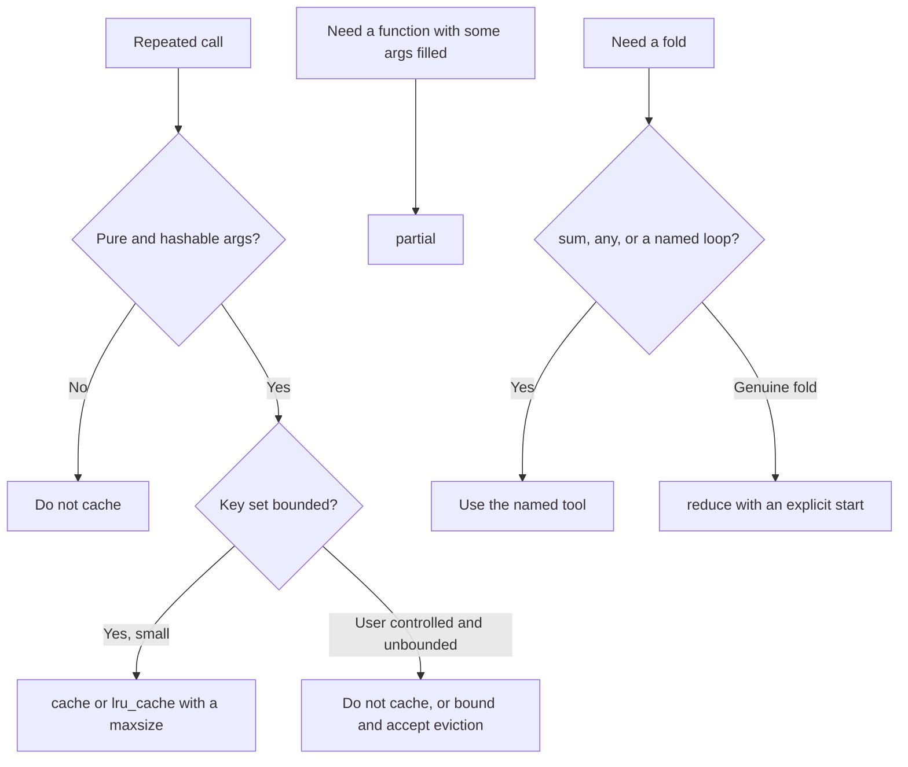

## Why this matters

`functools` holds the tools you were going to write badly: an unbounded or bounded cache, a function with some arguments already filled, a left fold, and the metadata copy for decorators. Interviews ask you to memoize Fibonacci and then ask what happens if the cached function is not pure, or if the arguments are lists. Production uses `lru_cache` on parsers and config loaders and then leaks memory because nobody set `maxsize` and the key space is user input. This lesson is when to cache, how to bind arguments, and when `reduce` is the wrong aesthetic.

You already used `wraps` in the decorator lesson. It lives here, and it stays mandatory.

## Intuition

`cache` and `lru_cache` remember return values for argument tuples. The function must be pure: same arguments, same result, no hidden mutation. Arguments must be hashable because they become dict keys. A list argument raises `TypeError`. A method caches `self` in the key, which can keep every instance alive.

`partial(func, *args, **kwargs)` returns a new callable with some arguments filled in. It is clearer than a lambda that only binds the first parameters, and it keeps the name of the original function visible enough to debug.

`reduce(op, items, start)` walks left to right, folding a running total. A `for` loop that updates a name is usually easier to read. `reduce` earns its place for a true fold that is already a named operation, or when you are writing a generic accumulator. Sums and products already have `sum` and `math.prod`.

## Core concept in depth

### cache and lru_cache

`@functools.cache` is an unbounded memo. `@functools.lru_cache(maxsize=128)` drops the least recently used entries when the bound is hit. `maxsize=None` is another way to say unbounded. Use a bound when keys come from the outside world. Use unbounded only when the key set is small and known: a recursive function on `n` from 0 to a few thousand, a parser of a fixed grammar.

```python
import functools

@functools.lru_cache(maxsize=256)
def parse_token(text: str) -> tuple[str, int]:
    text = text.strip()
    return (text, len(text))
```

The cache stores the arguments and the result. It does not know if you mutated a result list. If the function returns a list and a caller appends to it, the next caller sees the mutation. Return tuples, or document that callers must not mutate, or copy on the way out. The safest cached functions return immutable values.

`cache_clear` and `cache_info` exist. Tests should clear a cache that depends on fixtures, or avoid a global cached function and pass a fresh object. `cache_info` shows hits, misses, and the current size. When you claim a cache helped, look at the hit count. A cache with a 0 percent hit rate is an allocation of the arguments for nothing.

Do not cache a function that reads the clock, a database, or a global that changes. You will serve stale data and call it a performance win. Cache a pure computation. Cache a lookup that you invalidate on write, and have an explicit invalidation story. "The process restarts nightly" is a story only if it is true.

Methods: `@lru_cache` on an instance method keys on `self`. Each instance gets entries, and the cache holds the instance. That can leak. Prefer a function that takes the fields it needs, or a cache on the instance that you control, or `functools.cached_property` for a value computed once per instance. `cached_property` runs the method once and stores the result as a normal attribute. It does not invalidate. Do not use it for a value that depends on mutable fields you will change later, unless you delete the attribute to reset it.

### partial

`partial(int, base=16)` is a callable that parses hex strings. `partial(str.split, sep=",")` binds the separator. The result is a `partial` object. Extra arguments you pass later go to the right of the bound positional arguments. Keyword overrides can replace bound keywords. Read a failure as "what was already bound?" before you add more wrappers.

`partialmethod` is the descriptor version for methods, so `self` is handled correctly. You rarely need it. A small instance method that calls another function is easier to read than a puzzle of partials.

A lambda is still right when the call rearranges arguments or computes one. `partial` is right when you are only filling arguments. Do not nest three partials. Write a function with a name.

### reduce

`reduce(lambda acc, x: acc + x, items, 0)` is `sum(items)`. Prefer `sum`. A legitimate `reduce` folds a structure where the accumulator is a small object and the operation has a name. Even then, a loop with a named accumulator is what most Python teams want in application code. Use `reduce` in interviews only if you can explain the start value. Without a start value, `reduce` of an empty iterable raises `TypeError`. With a start value, the empty iterable returns the start. That difference is the bug.

`operator.add` and `operator.itemgetter` replace tiny lambdas inside `reduce`, `map`, and `sorted`. `itemgetter(1)` is the key function for "sort by the second field" and it is faster and clearer than a lambda that only indexes. You met it in the lambda lesson. This is where it lives in the standard library story, next to `functools`.

### singledispatch, a reminder

`functools.singledispatch` registers functions by the type of the first argument. Use it to extend behavior for types you do not own. Do not use it to recreate methods you could have put on your own classes. The OOP lesson made that call. The implementation detail is a registry, and the default function runs when no type matches. Register the most specific types you care about. Dispatch is on the direct class and its method resolution, not on an arbitrary predicate.

### wraps, again

Every hand-written decorator in this course uses `@functools.wraps(fn)` on the wrapper. It copies `__name__`, `__doc__`, and `__wrapped__`. `update_wrapper` is the function `wraps` calls. If you forget it, the cache tools and the test names and the logs all say `wrapper`. There is no performance excuse.

## Diagram / flowchart



### Dry-run: Fibonacci cache versus a mutated list

`fib(10)` with a cache calls the body for 0 through 10 once if implemented top-down with two recursive calls, because each `n` hits after the first compute. Uncached naive recursion explodes. The cache turns an exponential tree into a linear number of bodies, with O(n) stored pairs. A loop with two variables is still better for Fibonacci. The cache is the right story for a recursion over a tree of states you cannot easily bottom-out.

Mutating a cached list:

| Call | Returns | If the caller appends 1 |
| --- | --- | --- |
| First `load("a")` | a new list stored in the cache | the cached list now contains 1 |
| Second `load("a")` | the same list | already contains 1, before the second caller does anything |

Return a tuple, or copy before returning, if you cache a collection. The dry-run is the entire warning.

`partial(int, base=16)` on `"10"` returns 16. On `"zz"` it raises `ValueError` from `int`. The partial does not catch errors. It only binds arguments.

## Code

```python
import functools


@functools.lru_cache(maxsize=128)
def fib(n: int) -> int:
    if n < 0:
        raise ValueError("n must be >= 0")
    if n < 2:
        return n
    return fib(n - 1) + fib(n - 2)


def hex_to_int(text: str) -> int:
    return int(text, 16)


parse_hex = functools.partial(int, base=16)


def product(nums: list[int]) -> int:
    total = 1
    for num in nums:
        total *= num
    return total


if __name__ == "__main__":
    print(fib(10), fib.cache_info().hits)
    print(parse_hex("10"), product([2, 3, 4]))
```

`fib` is cached and pure. `cache_info` after one call shows hits from the overlapping subproblems. `parse_hex` is `partial`. `product` is a loop on purpose, with a start of 1, including the empty product. A `reduce` version needs the same start or an empty list raises. The loop makes the start obvious.

## Complexity analysis

| Approach | Time | Memory |
| --- | --- | --- |
| Naive recursive fib | Exponential calls | O(n) stack, and it will hit the recursion limit |
| Cached recursive fib | O(n) bodies | O(n) entries plus O(n) stack on the first descent |
| Loop fib | O(n) | O(1) extra |
| `lru_cache` lookup | Average O(1) | Bounded by `maxsize` entries, each holding the arguments |
| Unbounded cache of user strings | O(1) per hit | Unbounded, a leak |
| `partial` call | One extra call layer | The bound arguments |

Do not cache what a loop can compute in constant space unless the recursion is the clearer algorithm and the key set is small. Do not cache I/O.

## Tricks, tips and patterns

- Cache pure functions with hashable arguments. Return immutable results.
- Set `maxsize` when keys are not from a tiny domain. Call `cache_clear` in tests when the cache is global.
- Check `cache_info` before you celebrate. Hits should move.
- Use `cached_property` for an expensive immutable attribute computed once per instance. Delete the attribute to recompute.
- `partial` fills arguments. A lambda rearranges them. A `def` names anything longer.
- `reduce` needs a start value if the iterable might be empty. Prefer `sum` and loops in application code.
- `itemgetter` and `attrgetter` beat indexing lambdas in sorts.
- `wraps` on every wrapper. Always.

## Common mistakes and edge cases

- Caching a function that returns a list and mutating that list.
- Caching a method and pinning every instance in the cache.
- Unbounded cache keyed by request URLs or user ids, growing for the life of the process.
- Caching a function that reads a global setting, then changing the setting and seeing the old result.
- `reduce` without an initializer on an empty list.
- `partial` bound positionally in the wrong order, so later arguments shift.
- Forgetting `wraps` and then caching or routing on `__name__`.
- `lru_cache` on a recursive function that is still O(n) deep and hits `RecursionError` before the cache helps. The first chain to the base case is still a deep call stack. Convert to a loop if `n` can be large.

## Interview notes

Memoize a recursive function, say the arguments must be hashable and the function pure, and give the complexity after caching. Mention a loop if it is strictly better. Mention `maxsize` if the interviewer says the input is user data. Mention `partial` as the alternative to a binding lambda.

Follow-ups:

- **Why is the list argument rejected?** The cache key must be hashable.
- **What does cache do to a method?** `self` is part of the key, so instances stay alive.
- **reduce versus a loop?** Same fold. The loop is usually clearer. Empty input needs a start value either way.
- **How do you invalidate?** `cache_clear`, or do not cache, or delete a `cached_property`. There is no magic dependency tracking.

If they ask about `singledispatch`, give the one-sentence version: a registry on the type of the first argument, for types you do not own.

## Practice problems

1. **Cached Fib** (medium) — Fibonacci with linear-time caching or a loop, rejecting negatives. [Practice: python-ex-cached-fib]
2. **Parse Hex** (easy) — parse a hex string via a bound base, and fail on garbage. [Practice: python-ex-parse-hex]
3. **Safe Product** (easy) — product of ints, with 1 for an empty list. [Practice: python-ex-safe-product]
4. **Cache Key** (medium) — decide whether a call is cacheable given the argument types and a purity flag. [Practice: python-ex-cache-key]
5. **Item Getter Sort** (easy) — sort rows by a column index without a handwritten index error. [Practice: python-ex-itemgetter-sort]

## Summary / cheat sheet

- `cache` and `lru_cache` memoize pure functions of hashable arguments. Bound the size when the key space is open.
- Do not mutate cached results. Do not cache methods carelessly. Do not cache I/O without an invalidation story.
- The first deep recursion can still blow the stack. A loop avoids that.
- `partial` binds arguments. Prefer it to a lambda that only fills parameters.
- `reduce` folds left to right. Pass a start value. Prefer `sum`, `any`, or a named loop when they fit.
- `itemgetter` is the sorting key for a field. `singledispatch` registers behavior for foreign types.
- `wraps` stays on every decorator so names and `__wrapped__` survive.

## Further reading

- [functools](https://docs.python.org/3/library/functools.html)
- [functools.lru_cache](https://docs.python.org/3/library/functools.html#functools.lru_cache)
- [functools.partial](https://docs.python.org/3/library/functools.html#functools.partial)
- [operator](https://docs.python.org/3/library/operator.html)
- [functools.singledispatch](https://docs.python.org/3/library/functools.html#functools.singledispatch)
