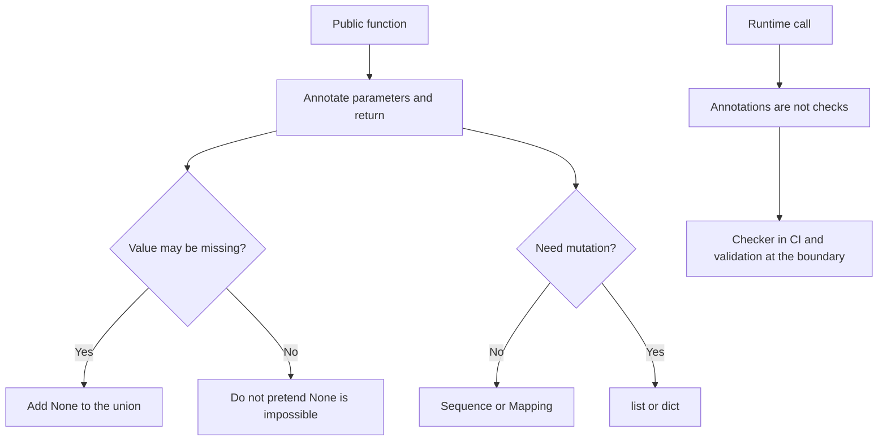

## Why this matters

Type hints are a second contract next to the function name. A reviewer can see that `find` returns `User | None` and that a missing user is a normal result, not an exception. A type checker can see that you treated `None` as a `User`. The interpreter does not. Interviews ask you to annotate a function and then ask what happens at runtime if the caller passes a string. The answer is: the annotation is metadata, the call runs, and the bug appears later unless a checker or a validator stopped it.

Hints also force a cleaner API. If the type is painful to write, the function is probably doing too much or returning a vague dict. This lesson is the annotation language. The next lessons run a checker and validate untrusted data.

## Intuition

An annotation is stored on the function and ignored by the eval loop. `int` in `def f(n: int) -> int` does not call `int(n)` and does not reject `"3"`. Tools such as mypy and pyright read the annotations. Libraries such as pydantic and dataclasses can choose to use them. You write hints for those tools and for humans. You still validate at the boundary where bytes become objects, because the type checker does not run in production unless you put it in CI and you do not skip it.

`None` is a type in hints. `str | None` means the value may be missing. Forgetting the `| None` is how a checker-clean function still crashes: the hint lied.

## Core concept in depth

### Names you should write

Built-in collections are generic. `list[str]`, `dict[str, int]`, and `tuple[int, int]` say what is inside. `tuple[int, ...]` is a tuple of ints of unknown length. A bare `list` means a list of unknown items, which is too weak for a public function. `dict` without parameters hides the key and value types that callers must get right.

`|` unions two types. `int | str` means either. `int | None` is the optional pattern. Prefer `X | None` over `Optional[X]`. They mean the same thing in current Python. Do not use a union to avoid a decision. If a function returns either a user or an error string, that is a messy contract. Raise, or return a result type with two explicit shapes.

`Any` disables checking for that value. Use it at a boundary you do not control yet, and do not let it spread. A function typed as `Any` in and `Any` out is documentation theater. `object` means "some object, and you may not do much with it." It is stricter than `Any`, which is the point. Prefer `object` when you truly accept anything and will only store it.

### Callables, sequences, and mappings

Hint the operation, not the concrete container, when you accept any sequence: `Sequence[int]` accepts a list or a tuple and tells the caller you will not append. `Mapping[str, int]` accepts a dict and tells the caller you will not write. `Iterable[int]` means you will iterate once. These come from `collections.abc`. Hinting `list` when you do not need a list forces callers to convert tuples for no reason.

`Callable[[int, str], bool]` is a function of two arguments returning bool. Use it for strategies. A protocol with a method is clearer when there are several behaviors. You met protocols in the OOP module. A callable hint is the small case.

### Generics and TypeVar

A function that returns the same type it was given is generic:

```python
from collections.abc import Sequence

def first(items: Sequence[int]) -> int:
    if not items:
        raise ValueError("empty")
    return items[0]
```

That version only accepts ints. The generic version uses a type variable so `first` of a sequence of strings returns a string:

```python
from typing import TypeVar

T = TypeVar("T")

def first(items: Sequence[T]) -> T:
    if not items:
        raise ValueError("empty")
    return items[0]
```

In Python 3.12 you can write `def first[T](items: Sequence[T]) -> T` without a separate `TypeVar`. Use the form your project's version supports, and be consistent. The idea is the same: one type, threaded through the signature, so the checker can follow it.

Do not reach for generics to look advanced. One type variable that preserves identity is the useful case. Three type variables nobody can read are a design problem.

### TypedDict, literals, and constants

`TypedDict` describes a dict with known keys, which is the hint for a JSON object you have not turned into a dataclass yet. It does not validate at runtime. `Literal["email", "sms"]` is a hint that a string must be one of those values. `Final` marks a name that should not be reassigned. These are checker features. A test that passes an unexpected string still runs.

### Postponed annotations and forward references

Annotations can mention a class that is defined later, or a class you import only for the checker. Strings were the old way to quote forward references. `from __future__ import annotations` postpones evaluation so the hints are stored as strings and you can mention a class before it exists. That import changes runtime behavior of libraries that inspect `__annotations__` and expect real objects. If a library needs live types, do not postpone blindly, or resolve them. For ordinary application hints, postponed annotations are convenient. Know that pydantic and similar tools have their own expectations, covered in the pydantic lesson.

### What not to hint

Do not hint every local variable. Hint public functions, tricky locals, and empty containers that would otherwise be inferred as a list of nothing: `rows: list[str] = []`. Do not lie to silence a checker. A `# type: ignore` needs a reason and a code, and it should be rare. Silencing the checker is how the contract rots.

## Diagram / flowchart



### Dry-run: a hint that lies

`def find(user_id: str) -> User` that returns `None` when the id is missing.

| Caller code | Checker if the hint is User | Runtime |
| --- | --- | --- |
| `find(i).name` | Accepts it | `AttributeError` when the user is missing |
| Same call with return `User or None` | Error on `.name` without a None check | You add the check and the crash goes away |

The hint did not cause the crash. The missing annotation of `None` hid the crash from the checker. The second row is the whole point of the syntax.

A call `find(3)` when the parameter is `str` still runs. The checker would flag the call site if it can see it. A dynamic `getattr` path might hide the call. The boundary validator is what catches a JSON number that was supposed to be a string. Hints do not.

## Code

```python
from collections.abc import Sequence


def find_name(rows: Sequence[tuple[str, str]], user_id: str) -> str | None:
    for uid, name in rows:
        if uid == user_id:
            return name
    return None


def require_name(rows: Sequence[tuple[str, str]], user_id: str) -> str:
    name = find_name(rows, user_id)
    if name is None:
        raise KeyError(user_id)
    return name


if __name__ == "__main__":
    data = [("1", "Ada"), ("2", "Grace")]
    print(find_name(data, "2"), require_name(data, "1"))
```

`find_name` tells the truth about `None`. `require_name` narrows it. A checker treats `name` as `str` after the branch. That narrowing is why the union is worth writing. `Sequence` of tuples accepts a list or a tuple of pairs. The function never appends.

## Complexity analysis

| Choice | Runtime cost | Review cost |
| --- | --- | --- |
| Accurate hints | None in the eval loop | The checker spends time in CI, which is the point |
| `Any` everywhere | None | The checker cannot help |
| Hints that lie about None | None | False confidence, production `AttributeError` |
| Over-generic signatures | None | Readers spend more time than the checker saves |

Hints are not a performance tool. `list` versus `Sequence` does not change the generated bytecode of a normal function. Pick the type that matches the contract.

## Tricks, tips and patterns

- Annotate parameters and returns on public functions. Annotate empty containers.
- Use `X | None` when `None` is a real result. Narrow it before you use it.
- Prefer `Sequence` and `Mapping` for inputs you only read. Use `list` and `dict` when you will mutate or when you built them.
- Use one type variable to preserve "returns the same type." Stop there unless you are writing a library.
- Prefer `object` to `Any` when you mean "I will not inspect this."
- Do not use hints as validation. Validate untrusted input separately.
- Keep `# type: ignore` rare, specific, and commented.

## Common mistakes and edge cases

- Believing annotations are checked on every call. They are not.
- Returning `None` from a function hinted as a concrete object.
- `list` hints that force callers to copy tuples.
- A union of five types because the function is unsure what it does.
- Mutable defaults still mutable. Hints do not fix `def f(items: list[int] = [])`.
- `TypeVar` used once and then ignored, so the checker cannot connect input and output.
- Forward references that a runtime validator cannot resolve because annotations were postponed and never evaluated.
- Hinting `dict` for a mapping with required keys and then getting no help when a key is missing. `TypedDict` or a dataclass is the sharper contract.

## Interview notes

Annotate a small function with `None` in the return if it can miss, and say clearly that Python will not enforce it at runtime. Mention a checker in CI and a validator at the JSON boundary. Mention `Sequence` versus `list` if they ask how you accept both tuples and lists.

Follow-ups:

- **Are hints enforced?** Not by CPython. By mypy, pyright, or a library that opts in.
- **What is Optional?** `X | None`. Same meaning.
- **Why Sequence?** You promise not to mutate, and you accept more than list.
- **What is Any?** A hole in the checker. Quarantine it.

If they ask about generics in 3.12, mention the `def f[T](...)` syntax and say the project should pick one style.

## Practice problems

1. **Find Name** (easy) — return a name or None from pairs, and do not raise for a miss. [Practice: python-ex-find-name]
2. **Require Name** (easy) — raise KeyError when find returns None. [Practice: python-ex-require-name]
3. **First Item** (medium) — return the first element of a non-empty sequence, rejecting empty input. [Practice: python-ex-first-item]
4. **Read Only** (medium) — sum a sequence of ints without mutating the input. [Practice: python-ex-sum-sequence]

## Summary / cheat sheet

- Annotations are metadata. The interpreter does not enforce them. Checkers and validators do.
- Write `list[str]`, `dict[str, int]`, and `tuple[int, ...]` rather than bare containers.
- `X | None` means missing is possible. Narrow before attribute access.
- `Sequence` and `Mapping` describe read-only inputs. `Callable` describes a strategy function.
- A single type variable preserves input type in the output. `Any` turns checking off. `object` does not.
- `TypedDict` and `Literal` sharpen dicts and enums of strings. They still do not validate production traffic by themselves.
- Do not lie to the checker. Do not hint every local. Do not expect hints to replace boundary validation.

## Further reading

- [typing](https://docs.python.org/3/library/typing.html)
- [Support for type hints](https://docs.python.org/3/library/typing.html#module-typing)
- [PEP 484 — Type Hints](https://peps.python.org/pep-0484/)
- [PEP 604 — Union syntax with |](https://peps.python.org/pep-0604/)
- [collections.abc](https://docs.python.org/3/library/collections.abc.html)
