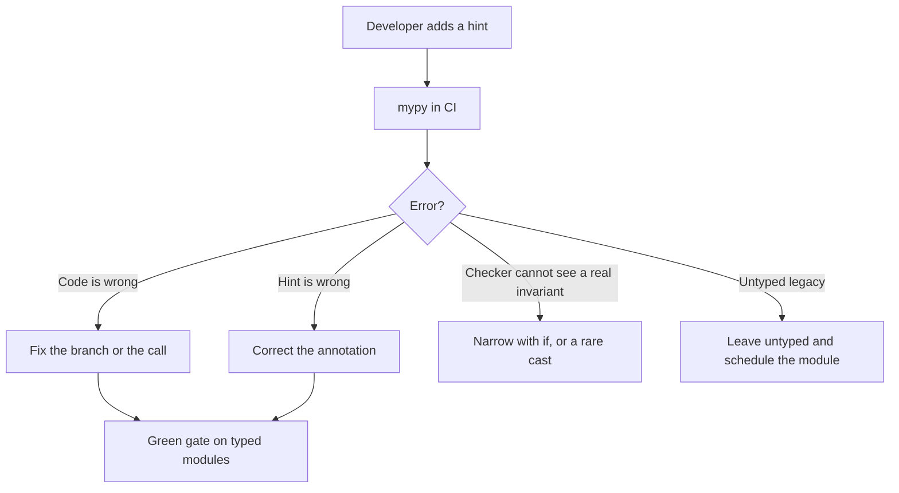

## Why this matters

Hints that nobody checks are comments that drift. mypy is the usual checker for this course: it reads your annotations and reports impossible calls, missing `None` checks, and wrong return types before the tests run. Interviews ask how you would add types to a legacy service without boiling the ocean, and what you do when mypy is red. The professional answer is gradual adoption, a CI gate on the modules you have typed, and almost no `type: ignore`.

pyright and other checkers exist. The workflow is the same. Learn one tool well enough to configure it and to explain a false positive without disabling the file.

## Intuition

mypy walks the imports you point it at, assumes annotated functions tell the truth, and infers types inside function bodies. If you pass an `int` where a `str` is required, it errors. If a function has no annotations, mypy often treats it as untyped and checks less, which is how gradual typing stays possible. You tighten the net module by module. You do not flip a switch on a hundred thousand lines and then add a blanket ignore to get green.

The checker is a build tool. It does not ship in the request path. A green mypy does not mean the JSON from a client is valid. It means your code is consistent with the types you claimed.

## Core concept in depth

### Running it

Install mypy in the dev environment and run `python -m mypy src` or the package you own. Pin the version. In CI, the command fails the job when mypy exits non-zero. Running it only on a laptop means the next branch regresses.

Start with the modules you are editing. `python -m mypy app/orders` is a legal way to begin. Once a package is clean, add it to the default path so it stays clean. A config file `mypy.ini` or the `[tool.mypy]` table in `pyproject.toml` holds the options. Check the config into the repo. A checker with no shared config is a checker with twelve personal setups.

### Gradual options that matter

`disallow_untyped_defs` on a package forces every function to be annotated. Turn it on for new packages. Leave it off globally until the old code is ready, or turn it on per module. `check_untyped_defs` still type-checks the body of an untyped function using inferred types, which finds bugs without forcing every signature today.

`warn_return_any` and `no_implicit_optional` catch the lies this course cares about. `strict` is the bundle of strict flags. New code should live under strict. Old code should move toward it. Do not turn `strict` on for the whole legacy tree on Friday and call the project typed.

Third-party libraries may lack hints. `ignore_missing_imports` for a named module is a temporary exception you document. Better, install the stub package if one exists, such as a `types-*` distribution. A missing import ignored forever hides real typos in that import.

### Fixes, in order

When mypy complains, fix the code or the hint. The usual real bugs are a missing `None` check, a wrong container type, and a value that might be an unexpected variant. Change the hint if the hint was wrong. Change the code if the code was wrong. Do not reach for `cast` unless you know a fact the checker cannot see, and then keep the cast next to the proof. `cast` is a way to lie with confidence. It does not check at runtime.

`assert x is not None` narrows the type and raises if you were wrong. That is a fair narrowing when the previous line established the invariant and you want a crash otherwise. An assert the optimizer or a runtime flag would strip is a bad place to hide a check if you run Python with assertions disabled. Prefer an explicit `if` for production invariants.

`# type: ignore[attr-defined]` must name the error code and, in a team setting, sit above a one-line reason. A bare ignore rots. Reviewers should reject a file-level ignore that exists to make the job green.

### Common patterns the checker rewards

Narrow `str | None` before attribute access. Use `Sequence` so a tuple flows in. Replace a dict of mixed values with a dataclass or a `TypedDict` when the keys are known. Give empty lists a type. Annotate a public function that mypy inferred too loosely because it returned `None` on one path and a string on another. That inference is mypy telling you the union is real. Write it in the signature so callers see it.

### What mypy will not do

It will not catch a wrong type that crosses an `Any` boundary. It will not know what a JSON object contains until you validate and return a typed object. It will not run. It will not stop a colleague from calling a function through a string name. It will not understand every dynamic decorator unless the decorator is typed carefully. When the checker cannot see through a decorator, fix the decorator with `wraps` and a proper `Callable` hint, or add a small typed wrapper. Do not ignore the whole module.

Tests should be checked too, or at least not excluded forever. Untyped tests pass the wrong type into the function and the production annotation never gets a workout. Checking tests is how you notice a hint that is fantasy.

## Diagram / flowchart



### Dry-run: adopting mypy on a small service

| Week | Scope | Gate |
| --- | --- | --- |
| 1 | New package `app.billing` under strict | CI fails on that package only |
| 2 | Annotate `place_order` and its helpers, turn on check_untyped_defs for `app.orders` | New bugs in edited functions fail CI |
| 3 | Add return types, fix None handling | Callers get real errors instead of surprises |
| Later | Enable disallow_untyped_defs on orders | The package stays annotated |

Skipping to "ignore missing imports globally and strict everywhere" in week 1 produces a sea of errors and a sea of ignores. The table is the adoption plan you should describe in an interview.

## Code

```python
def label_for(score: int | None) -> str:
    if score is None:
        return "missing"
    if score >= 90:
        return "high"
    return "ok"


def average(nums: list[int]) -> float:
    if not nums:
        raise ValueError("nums must be non-empty")
    return sum(nums) / len(nums)


if __name__ == "__main__":
    print(label_for(None), label_for(95), average([2, 4]))
```

`label_for` is the narrowing mypy rewards. Without the `None` branch, `score >= 90` is an error under a strict checker because `None` has no comparison that mypy will accept as safe. `average` refuses an empty list so the return type stays `float` rather than `float | None`. Both are design choices you encode so the checker can enforce them. Run mypy on this file when you want the machine to agree. The course runtime does not require mypy to execute the examples.

## Complexity analysis

| Practice | Time cost | Value |
| --- | --- | --- |
| mypy on a small package | Seconds locally, a CI minute | Catches None and type bugs before review |
| Strict on the whole legacy repo on day one | Days of noise | Mostly ignores, little safety |
| cast and bare ignore | Seconds to silence | Negative value over time |
| Checking tests | A bit more CI | Hints get exercised |

mypy is not in the request path, so it does not change latency. It changes how fast you find a class of defects. It does not replace pytest. A function can be well typed and still compute the wrong total.

## Tricks, tips and patterns

- Pin mypy. Put options in `pyproject.toml`. Run it in CI on the packages you claim are typed.
- Turn on strict for new code. Adopt old code one package at a time.
- Fix the code or the hint before you ignore. Name the error code if you must ignore.
- Narrow with `if` branches. Use `assert` only when a crash is the right failure.
- Install stub packages for libraries you use heavily.
- Check tests so annotations cannot drift from real calls.
- Keep `Any` at the edge and convert to a typed object as soon as you can.

## Common mistakes and edge cases

- A CI that does not run mypy, so hints are optional fiction.
- Global `ignore_missing_imports` that hides typos.
- File-level `type: ignore` to get a green badge.
- `cast` on a JSON dict so the rest of the function type-checks while production still receives a list.
- Enabling strict and then annotating everything as `Any` to satisfy `disallow_untyped_defs`.
- Assuming mypy validates runtime data.
- Excluding tests forever.
- Two checkers configured differently, so one developer is green and CI is red. One config, one tool, unless you have a reason to run both.

## Interview notes

Say you run mypy in CI, strict on new modules, gradual on old ones. Walk through a `None` error and the fix. Say you do not blanket-ignore. Say types do not replace tests or boundary validation.

Follow-ups:

- **What does gradual mean?** Untyped code can coexist with typed code. You tighten module by module.
- **What is cast?** An assertion to the checker with no runtime check. Use it rarely.
- **mypy versus pydantic?** mypy checks your source. Pydantic validates data at runtime. You want both at different layers.
- **What if a library has no stubs?** Ignore that module by name or install stubs. Do not ignore your code.

Mention `cache_info` style evidence if they ask how you know the checker is worth it: it finds the `None` bugs and the wrong-argument bugs that tests missed because the fixture was too kind.

## Practice problems

1. **Label Score** (easy) — handle a missing score without comparing None. [Practice: python-ex-label-score]
2. **Average** (easy) — average a non-empty list and reject empty input. [Practice: python-ex-average-typed]
3. **Narrow** (medium) — given a value that may be None, return a string only after a check. [Practice: python-ex-narrow-none]
4. **Ignore Policy** (medium) — choose fix, narrow, or reject for a list of checker escapes. [Practice: python-ex-ignore-policy]

## Summary / cheat sheet

- mypy checks annotations. It does not run in production and does not validate JSON.
- Put it in CI with a shared config. Strict for new packages. Gradual for legacy.
- Fix real mismatches. Narrow with conditionals. Keep `cast` and `type: ignore` rare and specific.
- `Any` and global import ignores punch holes. Quarantine them.
- Annotate the `None` case so callers are forced to handle it.
- Check tests. Install stubs for third-party libraries when they exist.
- Types, tests, and runtime validation are three different nets.

## Further reading

- [mypy documentation](https://mypy.readthedocs.io/en/stable/)
- [mypy configuration](https://mypy.readthedocs.io/en/stable/config_file.html)
- [Common issues and gradual typing](https://mypy.readthedocs.io/en/stable/existing_code.html)
- [PEP 484 — Type Hints](https://peps.python.org/pep-0484/)
