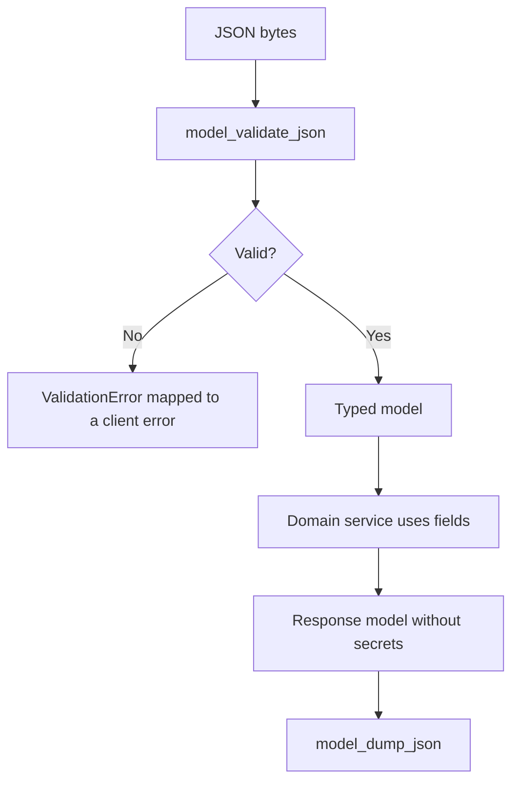

## Why this matters

The dangerous types in a service come from outside: a request body, a webhook, a CSV row, a queue message. mypy never sees them. `json.loads` turns them into dicts, lists, numbers, and `None`, and it will happily give you a string where you needed an int. Pydantic is the usual Python library that turns that dict into a model or raises a structured error. FastAPI uses it for request bodies. Interviews ask where validation lives and what you do with an extra field or a wrong type. The answer is: at the edge, with an explicit error, before domain code runs.

Pydantic is not a substitute for invariants inside the domain, and it is not a type checker. It is a parser with types.

## Intuition

You declare a model with annotated fields. You call `Model.model_validate(data)` or `model_validate_json`. Pydantic coerces where the policy says coercion is safe, rejects what it cannot, and returns an instance. Domain functions accept the model or a plain dataclass built from it. They do not accept a bare dict from the wire. When validation fails, you return a 422 or a job error with the field path. You do not half-apply the update.

Coercion is the sharp edge. A model that turns the string `"10"` into the int `10` is convenient and sometimes wrong. A model that turns the boolean `True` into the int `1` will recreate the bool-is-an-int bug at the boundary. Configure strictness on purpose.

## Core concept in depth

### A model at the edge

```python
from pydantic import BaseModel, ConfigDict, Field

class CreateUser(BaseModel):
    model_config = ConfigDict(extra="forbid", strict=True)

    name: str = Field(min_length=1, max_length=80)
    age: int = Field(ge=0, le=130)
```

`extra="forbid"` rejects unknown fields so a typo does not vanish. `extra="ignore"` is the choice when you must accept forward-compatible clients that send new keys. Pick one per endpoint and test it. The default in current Pydantic v2 is to ignore extra fields. Ignoring is a product decision, not a gift. `strict=True` reduces coercion: the JSON number `10` can still be an int, but a string `"10"` will not quietly become an int. Lax mode is convenient for query strings, where everything arrives as text. Do not use lax mode for a JSON API out of habit.

`Field` constraints express range and length. They run as validation, not as hints. A failed constraint raises `ValidationError` with a list of errors that include a location path. Map that to a client error. Do not catch `ValidationError` and return an empty user.

### Building and dumping

`CreateUser.model_validate(payload)` accepts a dict. `model_validate_json` accepts a string and parses JSON itself, which avoids a double parse bug if you also call `json.loads`. `model_dump()` returns a dict. `model_dump_json()` returns text. Use an explicit mode when you need JSON-compatible values. A datetime field needs an encoder policy you understand, usually ISO 8601, not the default that surprises a consumer.

Prefer a separate response model from the create model. The response can include an id and omit secrets. Reusing one model for input and output is how a password hash leaks back to the client because it was "just another field."

### From model to domain

Pydantic models are mutable by default unless you set `frozen=True`. A frozen model is a good edge object. Some teams validate with Pydantic and then construct a dataclass for the domain so the domain does not depend on the library. That split is worth it when the domain is large and you want to keep pydantic at the edges. For a small service, using the model as the data object is fine if you do not sprinkle network calls inside validators.

Validators are for cross-field rules: end time after start time, currency present when the amount is set. Keep them pure and local. A validator that queries a database hides I/O in a parse and makes tests slow. Do the existence check in the service after the model is valid.

### Version and config reality

Pydantic v2 is the current line. The v1 API used different method names (`parse_obj`, `dict`). Do not mix tutorials. Pin the major version. `ConfigDict` is the v2 configuration style. If an interview whiteboard uses v1 names, talk about the behavior: validate a dict, reject bad types, dump a dict, and say you would match the project's major version.

`model_config` is class-level configuration, not a per-request dict you mutate. Changing it on the class at runtime is global. Do not do that in a test without isolation.

### What still belongs to you

Money should be minor units or a decimal type you configure, not a float field that accepts `10.2` and stores a binary float. Emails and phone numbers need formats you mean, not a `str` that any punctuation satisfies. Enums should be explicit, not open strings, when the set is closed. Pydantic will enforce the enum if you declare it. It will not invent the business rule.

A model that accepts `Any` or an untyped dict field is a hole at the boundary, which is the worst place for a hole. Type the nested object. A list of users is `list[CreateUser]`, not a list of dicts you parse later by hand.

## Diagram / flowchart



### Dry-run: strict user payload

Model: name is a non-empty string, age is an int from 0 to 130, extra fields forbidden, strict mode.

| Payload | Result |
| --- | --- |
| name Ada, age 36 | Model instance |
| name blank, age 36 | Validation error on name length |
| name Ada, age the string 36 | Validation error in strict mode |
| name Ada, age true | Validation error, bool is not an int you want |
| name Ada, age 36, plus an extra role key | Validation error when extra is forbid |
| name Ada, age 36, extra role, when extra is ignore | Model without role, and the typo disappeared |

The last row is why forbid is the safer default for an internal API. The ignore row is correct only when you have promised clients they may send unknown keys.

## Code

```python
from pydantic import BaseModel, ConfigDict, Field, ValidationError


class CreateUser(BaseModel):
    model_config = ConfigDict(extra="forbid", strict=True)

    name: str = Field(min_length=1, max_length=80)
    age: int = Field(ge=0, le=130)


def parse_user(payload: dict) -> CreateUser:
    return CreateUser.model_validate(payload)


if __name__ == "__main__":
    user = parse_user({"name": "Ada", "age": 36})
    print(user.model_dump())
    try:
        parse_user({"name": "Ada", "age": True})
    except ValidationError as exc:
        print(exc.error_count())
```

This example imports pydantic. The course environment may not have it installed in every sandbox. The model is still the contract to learn. `age: True` must fail. If a lax configuration accepts it, the configuration is wrong for this field. `error_count` gives you a number of problems to show in a test without matching the full error text. Assert on the field location in real tests, not on a paragraph.

## Complexity analysis

| Step | Cost |
| --- | --- |
| Validate a small JSON object | Linear in the number of fields, tiny next to a database write |
| Validate a giant untyped blob with a loose model | You still parsed it all into memory in `json` |
| Strict versus lax | No meaningful speed difference compared with getting the data wrong |
| Doing I/O inside a validator | A query per object, often N+1, and hard to test |

Validation is not the hotspot. Skipping it is the incident. Do not "optimize" by trusting a dict from the internet.

## Tricks, tips and patterns

- Validate at the edge. Pass models or domain objects inward, not raw dicts.
- `extra="forbid"` unless you have a compatibility promise.
- `strict=True` for JSON bodies. Be explicit where you allow coercion, such as query strings.
- Separate input models from output models so secrets do not echo.
- Cross-field rules go in validators. Database existence checks stay in the service.
- Pin Pydantic v2 and do not copy v1 snippets.
- Use `Field` bounds for ranges you can state. Keep money off plain floats.
- Map `ValidationError` to a client error with field paths. Do not catch it and continue.

## Common mistakes and edge cases

- A model with lax coercion that turns bool into int or a numeric string into a charge amount.
- `extra="ignore"` swallowing a misspelled field the client thought was required.
- One model for create and response, leaking a password hash or an internal flag.
- A validator that queries SQL.
- Trusting mypy-annotated dicts from `json.loads` with no runtime model.
- Mixing v1 method names with a v2 install.
- A nested dict typed as `dict` so the inner object is unchecked.
- Mutating a shared model instance that you cached and then returning it to another request. Models are mutable unless frozen. Do not cache them as global request state.

## Interview notes

Say "validate at the boundary with a model, strict types, unknown fields forbidden, domain code sees the model." Mention 422 and field errors. Mention the bool-versus-int trap. Mention that this is runtime and mypy is static. Offer to split input and output models if the resource has secrets or server-generated ids.

Follow-ups:

- **Why not dataclasses alone?** Dataclasses do not validate a dict from the wire unless you add that work. Pydantic's job is the untrusted dict.
- **Where do you validate?** At the edge, once. Not in every helper.
- **What about extra fields?** Forbid by default for your own API. Ignore only for a published compatibility rule.
- **How do FastAPI models fit?** FastAPI builds the same kind of boundary for you. You still choose strictness, extra fields, and separate response models.

If they ask about performance, say validation of the payload is noise next to the database, and the expensive mistake is I/O inside validators.

## Practice problems

1. **Parse User** (medium) — accept a name and a non-negative age, reject bool ages and blank names. Implement the checks even if you simulate them without the library in the sandbox. [Practice: python-ex-parse-user-model]
2. **Forbid Extra** (easy) — reject a payload that contains a key outside the allowed set. [Practice: python-ex-forbid-extra]
3. **Split Models** (medium) — given input fields and secret fields, return the response field list with secrets removed. [Practice: python-ex-response-fields]
4. **Range Age** (easy) — accept ages from 0 through 130 inclusive and reject the rest. [Practice: python-ex-age-range]

## Summary / cheat sheet

- Pydantic validates runtime data into a model. mypy does not.
- Call `model_validate` or `model_validate_json` at the edge. Map `ValidationError` to a client error.
- Prefer strict mode and `extra="forbid"` for JSON APIs. Allow coercion only where the transport is text.
- Separate input and output models. Do not return secrets because they were on the input model.
- Constraints and cross-field validators stay pure. Database checks stay in the service.
- Do not use float for money. Do not leave nested objects untyped. Pin v2.
- Frozen models and per-request instances avoid shared mutable validation state.

## Further reading

- [Pydantic documentation](https://docs.pydantic.dev/latest/)
- [Pydantic models](https://docs.pydantic.dev/latest/concepts/models/)
- [Strict mode](https://docs.pydantic.dev/latest/concepts/strict_mode/)
- [FastAPI request body](https://fastapi.tiangolo.com/tutorial/body/)
