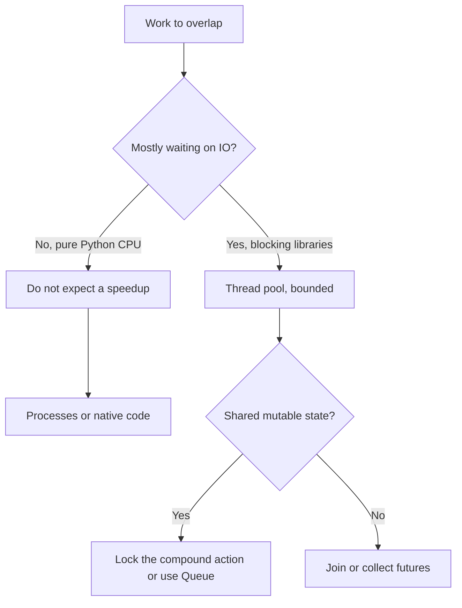

## Why this matters

A service that waits on databases and HTTP can overlap those waits with threads. A service that tries to speed up a pure-Python loop by spawning threads will not get the speedup, and it may corrupt a shared dict. Interviews ask what the GIL is, when threads help, and how you avoid a race. The answer is specific: the global interpreter lock lets one thread run Python bytecode at a time in a CPython process. Threads still help when the thread is blocked in C code that releases the lock, which is most blocking I/O. They do not help a tight Python loop. Shared lists and dicts need a lock around compound actions, because the GIL is not a lock you design your program around.

## Intuition

Picture one interpreter and several threads. Only one thread holds the GIL and executes bytecode. It releases the GIL periodically so others can run, and it releases the GIL during a blocking system call such as a socket read. While one thread waits on the network, another can run. While both threads only add Python integers, they take turns and the wall clock does not drop the way it would on a data-parallel C program.

A lock you create with `threading.Lock` is different. It protects a region of your code so two threads do not interleave a check and an update. The GIL does not make `if key not in cache: cache[key] = load()` atomic. Another thread can run between the check and the write.

## Core concept in depth

### What the GIL does and does not do

CPython's GIL is a mutex around bytecode execution. One thread runs Python bytecode. Extensions and the standard library release the GIL around blocking I/O and around some heavy C operations such as hashing large buffers or compressing. During that release, another thread's Python code can run. This is why a thread pool of HTTP fetches overlaps latency. It is why eight threads parsing JSON in pure Python, or looping in Python over numbers, often run no faster than one thread and sometimes run slower because of switching.

The GIL is not a guarantee about your data structures across multiple statements. Bytecode operations on built-in dicts are protected in the sense that the structure will not corrupt under the GIL the way a C map might, but the logical race remains. Two threads can both decide a key is missing and both write. The dict does not crash. The logic is wrong. Do not cite the GIL as a reason to skip locks.

Other interpreters differ. This course means CPython. Free-threaded builds are an evolving experiment. Do not design a service on "the GIL is going away" unless you have measured that specific runtime. Write locks as if the logical race exists, because it does.

### Starting threads

`threading.Thread(target=fn, args=(value,))` creates a thread. `start` runs it. `join` waits for it. If you do not join, the process can exit while the work is unfinished, depending on daemon flags. Non-daemon threads keep the process alive. Daemon threads are killed when the main thread ends, which is a bad place to commit a transaction. Prefer non-daemon workers you shut down explicitly.

A thread that raises does not raise in the caller. The exception dies in the thread unless you catch it and record it. `concurrent.futures.ThreadPoolExecutor` is the better API: submit callables, get futures, and retrieve exceptions with `result()`. Use a pool with a bound on workers. Unbounded thread creation under load is how you run out of memory.

```python
from concurrent.futures import ThreadPoolExecutor

def fetch_all(urls: list[str]) -> list[str]:
    with ThreadPoolExecutor(max_workers=8) as pool:
        return list(pool.map(fetch_one, urls))
```

`map` preserves order. Set `max_workers` from the I/O you are overlapping, not from the CPU count, when the work is waiting. Too many workers thrash the downstream service. A small pool plus a queue is a client. It is not a faster CPU.

### Locks and the check-then-act race

```python
import threading

class Cache:
    def __init__(self) -> None:
        self._data: dict[str, str] = {}
        self._lock = threading.Lock()

    def get_or_load(self, key: str, loader) -> str:
        with self._lock:
            if key in self._data:
                return self._data[key]
            value = loader(key)
            self._data[key] = value
            return value
```

The lock makes the check and the store one critical section. Holding the lock while `loader` does network I/O blocks every other cache user. That is correct and often too coarse. A better design loads outside the lock and then stores if the key is still missing, accepting a duplicate load, or uses a per-key lock. Say which race you accept. Do not hold a lock across a slow call by accident.

`Lock` is not reentrant. The same thread acquiring it twice deadlocks. `RLock` is reentrant and is the right tool when a locked method calls another locked method on the same object. Prefer a design that does not need reentrancy. Never spawn a thread while holding a lock the new thread must acquire. That is a classic deadlock.

`queue.Queue` is the thread-safe handoff. Producers `put`, consumers `get`. You do not need an extra lock around `put` and `get`. You still need a lock around any other structure those threads share. The queue does not protect your cache.

### What to reach for instead

CPU-bound pure Python belongs in another process or in native code, covered next. Async I/O belongs on an event loop when the stack is async end to end. Threads are the pragmatic choice to call blocking libraries from a sync codebase and overlap waits. Mixing a little `asyncio` with a little `threading` without a clear boundary is how you block the event loop. Pick one style per component.

## Diagram / flowchart



### Dry-run: two threads load one missing key

No lock:

| Time | Thread A | Thread B | Cache |
| --- | --- | --- | --- |
| 1 | sees miss | | empty |
| 2 | | sees miss | empty |
| 3 | stores value from loader | | one entry |
| 4 | | stores again, maybe a different value if the source changed | last write wins, two loads |

With the lock held across check and store, thread B waits, then sees the hit, and loads once. If the lock is released during `loader`, both can still load, which you may accept to avoid blocking the cache. The interview answer names that choice.

GIL dry-run: two threads increment a Python integer a million times each. The wall time is about one thread's time plus overhead, not half, because each increment is bytecode. Two threads reading sockets can overlap, because the read releases the GIL.

## Code

```python
import threading


class HitCounter:
    def __init__(self) -> None:
        self.hits = 0
        self._lock = threading.Lock()

    def increment(self) -> None:
        with self._lock:
            self.hits += 1


def run_increments(counter: HitCounter, times: int, threads: int) -> int:
    workers = [
        threading.Thread(target=lambda: [counter.increment() for _ in range(times)])
        for _ in range(threads)
    ]
    for worker in workers:
        worker.start()
    for worker in workers:
        worker.join()
    return counter.hits


if __name__ == "__main__":
    print(run_increments(HitCounter(), 1000, 4))
```

The expected print is 4000. Remove the lock and the count can drop, because `hits += 1` is a read and a write. You may not see the race in one run. That does not make it safe. The lock makes the increment a critical section. This demo is about correctness, not about speed. A million increments will not get faster with four threads under the GIL.

## Complexity analysis

| Approach | Wall time | Correctness |
| --- | --- | --- |
| One thread, n blocking calls of latency L | about n·L | Simple |
| k threads, same calls, pool of k | about ceil(n/k)·L plus overhead, until the server or the pool saturates | Good if state is protected |
| k threads, pure Python loop | about the same as one thread, sometimes worse | Races if you share state |
| Unbounded threads | Resource exhaustion | Not a strategy |

The overlap win is in latency, not in Python bytecode throughput. Say that sentence before you add workers.

## Tricks, tips and patterns

- Use a bounded `ThreadPoolExecutor` for blocking I/O. Retrieve exceptions with `future.result()`.
- Lock compound actions. Do not treat the GIL as your mutex.
- Do not hold a lock across network or disk if you can load outside and reconcile.
- Use `queue.Queue` to pass work and results between threads.
- Join non-daemon threads. Do not commit work on a daemon you may kill at shutdown.
- Document the lock order if you ever acquire two locks. Always acquire in that order.
- For CPU-bound Python, stop and move to processes or a vectorized library.

## Common mistakes and edge cases

- Expecting threads to speed up a Python `for` loop.
- A check-then-act cache without a lock.
- Holding the lock while calling an untrusted loader that calls back into the cache and deadlocks on a non-reentrant lock.
- Ignoring exceptions inside threads because nobody called `result()`.
- Creating a thread per request with no cap.
- Sharing a requests session or a database connection across threads without checking that the object is safe. Many connections are not.
- Assuming dict operations' lack of crashes means logical atomicity.

## Interview notes

Define the GIL in one sentence, then give the I/O case where threads help and the CPU case where they do not. Draw the check-then-act race and the lock. Mention `ThreadPoolExecutor` and joining. Mention that async is a different tool for large numbers of waiting sockets, not a faster GIL.

Follow-ups:

- **Does the GIL make my program thread-safe?** No. It prevents some low-level interpreter corruption. Your check-then-act is still a race.
- **What releases the GIL?** Blocking I/O and some C extensions. Pure bytecode does not stay released.
- **How do you get an exception out of a thread?** A future's `result()`, or a structure you lock and store into.
- **When do you switch to processes?** When the work is Python bytecode on the CPU and you have cores to spend.

If they ask about deadlocks, give the two-lock order rule and the "do not lock then wait for a thread that needs the lock" rule.

## Practice problems

1. **Locked Increment** (medium) — increment a shared counter safely and return the total. [Practice: python-ex-locked-increment]
2. **Check Then Act** (medium) — a cache get-or-set that does not double-store under a lock. [Practice: python-ex-cache-fill]
3. **Pool Bound** (easy) — choose a worker count given a cap and a job count. [Practice: python-ex-pool-bound]
4. **Race Window** (medium) — given an interleaving, say whether the key is loaded once or twice. [Practice: python-ex-race-window]

## Summary / cheat sheet

- The GIL lets one thread run Python bytecode at a time. Threads overlap waits that release the GIL, especially blocking I/O.
- Threads do not speed up pure-Python CPU loops. Use processes or native code for that.
- The GIL is not a logic lock. Protect check-then-act with `threading.Lock` or hand off through `queue.Queue`.
- Prefer a bounded `ThreadPoolExecutor`. Surface exceptions with `result()`. Join non-daemon threads.
- Do not hold locks across slow calls unless you mean to block everyone. Never invent a second lock order.
- A race can hide in a short demo. The lock is still required.
- Async and processes are different answers. Do not mix them without a boundary.

## Further reading

- [threading](https://docs.python.org/3/library/threading.html)
- [GIL and initiating threads, CPython glossary](https://docs.python.org/3/glossary.html#term-global-interpreter-lock)
- [concurrent.futures](https://docs.python.org/3/library/concurrent.futures.html)
- [queue](https://docs.python.org/3/library/queue.html)
