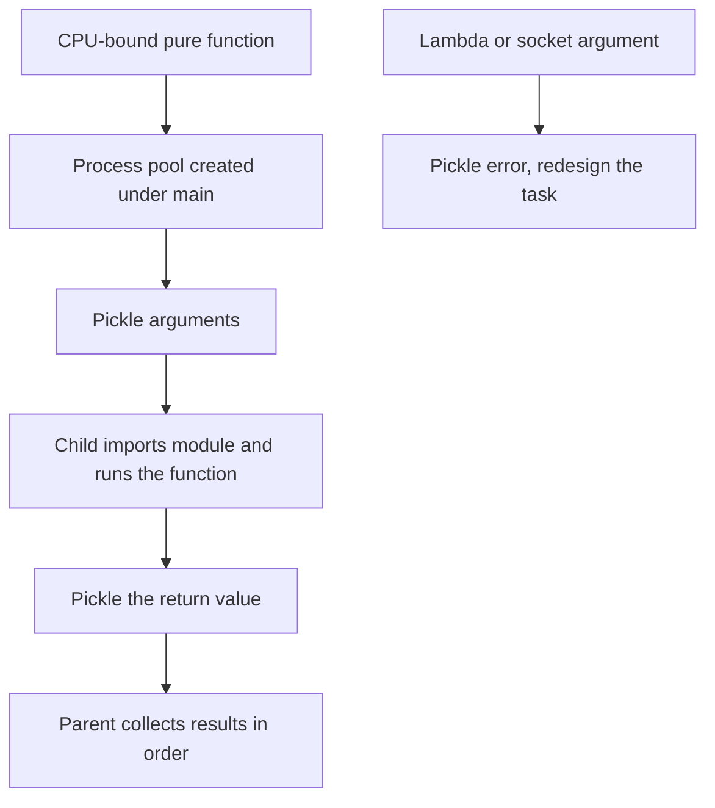

## Why this matters

When the work is Python bytecode on the CPU, another thread will not use another core. Another process has another interpreter and another GIL. That is the whole reason `multiprocessing` and `ProcessPoolExecutor` exist. Interviews ask how you would parallelize a CPU-heavy transform and what you pay for it. The price is startup, pickling arguments and results, and isolation: the child does not see the parent's live objects, file positions, or locks.

A process pool is also a crash boundary. A segfault in a native extension takes down that process, not necessarily the parent, if you planned for it. A thread shares the address space, so the same fault takes the whole service.

## Intuition

A process is a separate program image with its own memory. To give it work, you serialize the function arguments, send the bytes, let the child run, and serialize the return value back. Anything that cannot be pickled cannot be an argument. A lambda, a local function, a database connection, and a lock are typical failures. The child imports your module and runs the function by name. That is why the target function must be importable at module level, and why the guard `if __name__ == "__main__"` matters on Windows, where spawn imports the main module again.

Sharing a list "for speed" misses the point. If you needed shared mutable memory, you are back to races, plus the cost of processes. Prefer pure functions and return values.

## Core concept in depth

### ProcessPoolExecutor

```python
from concurrent.futures import ProcessPoolExecutor

def score(n: int) -> int:
    return sum(i * i for i in range(n))

def score_all(ns: list[int]) -> list[int]:
    with ProcessPoolExecutor() as pool:
        return list(pool.map(score, ns))
```

`map` chunks the iterable, pickles tasks, and unpickles results in order. The default worker count is related to the CPU count. More workers than cores for CPU-bound work mostly adds scheduling. Fewer workers than cores leaves cores idle. I/O-bound work does not belong here. You would be paying process startup to wait on sockets. Use threads or async for that.

Create the pool once and reuse it. Starting a process per item dominates small tasks. If each task is a few milliseconds of Python, the pickle and the process startup can erase the win. Batch items so each task does meaningful work: a chunk of a thousand rows, not one row.

### Spawn, fork, and the main guard

Windows uses spawn: a fresh interpreter imports your module. macOS defaults have moved toward spawn as well. Fork copies the parent memory and is faster and more surprising, because threads and locks in the parent are a bad thing to copy. Write code that is correct under spawn. That means the worker function is defined at module level, not inside another function, and the pool is created under `if __name__ == "__main__"` or inside a function that is not called on import. Without the guard, the child imports the module, executes the pool creation again, and you fork-bomb yourself on spawn platforms.

Do not start processes at import time. Do not start them from a thread that holds locks you do not understand. A web server that forks after creating threads is a classic deadlock recipe. Prefer spawn semantics in servers, or a pool created at startup before you serve, and then left alone.

### What crosses the boundary

Pickle can serialize many Python values: numbers, strings, lists, dicts, tuples, and top-level functions by reference to their module and name. It cannot serialize lambdas, local functions, or live sockets. A class instance pickles if its fields pickle and the class is importable. A huge object graph pickles slowly and copies memory. Pass ids and let the child load what it needs, or pass a compact array. Do not pass the ORM session.

Return compact results. A worker that returns the entire input plus a tiny annotation doubles traffic. Exceptions in the worker re-raise in the parent when you call `result()`, wrapped so you can see the child's traceback. A worker that exits the process shows up as a broken pool. Handle poison inputs in the worker and return an error value if you want the batch to continue, and do that deliberately.

### Shared state is the last resort

`multiprocessing.Queue` and `Manager` proxies exist for coordination. A queue of tasks to a long-lived set of workers is a reasonable pipeline. A manager dict that every worker updates on every item is often slower than a single process, because every operation is a proxy call. If you use shared memory, you are writing concurrent code with extra steps. Measure it. The default design is pure tasks and collected results.

`Value` and `Array` in shared memory avoid pickle for numeric buffers. They are the right tool for a large numeric workload you did not move to NumPy or to a database. They require discipline about locks. For this course, know they exist and prefer process pools of pure functions first.

### Isolation and side effects

Each process has its own imports, its own module globals, and its own copy of a cache filled at import. A `lru_cache` in the parent is empty in the child. A database pool in the parent is not usable in the child. Initialize per-process resources inside the worker, lazily, not by hoping the parent's objects arrived. Open files in the parent are a mess under fork and are not a strategy under spawn. Open them in the worker if the worker needs them, and close them.

## Diagram / flowchart



### Dry-run: task size

Suppose one row takes 0.05 ms of Python and pickling a task costs 0.5 ms.

| Batching | Useful compute per task | Overhead | Worth processes? |
| --- | --- | --- | --- |
| One row per task | 0.05 ms | 0.5 ms plus startup amortized | No, slower than a loop |
| 1000 rows per task | 50 ms | about 0.5 ms | Maybe, if you have cores |
| One process, plain loop | all rows | none | Best when the data is small |

The table is why "I used a process pool" is not a performance answer. Batch, or do not bother. Also compare against a better algorithm. Parallelizing a quadratic scan is a way to heat four cores.

Spawn dry-run: parent starts the pool, child starts, imports the module, runs only the worker because pool creation is under the main guard, returns a number. Without the guard, the import starts another pool. That is the bug the guard prevents.

## Code

```python
def score_chunk(nums: list[int]) -> int:
    return sum(n * n for n in nums)


def score_serial(chunks: list[list[int]]) -> int:
    return sum(score_chunk(chunk) for chunk in chunks)


if __name__ == "__main__":
    data = [[1, 2, 3], [4, 5]]
    print(score_serial(data))
```

The worker `score_chunk` is a top-level function so a process pool could import it. The demo runs serially so the example stays honest in a sandbox that may restrict process start. The production switch is `ProcessPoolExecutor().map(score_chunk, chunks)` under `__main__`, with chunks large enough to matter. Do not define `score_chunk` inside `main`. Spawn must import it by name.

## Complexity analysis

| Design | Time shape |
| --- | --- |
| Serial CPU loop | T |
| k workers on a CPU-bound pure function, good batching | about T/k plus pickle and startup, until k hits the core count |
| k workers on tiny tasks | T plus a large overhead, often slower |
| Shared manager dict updated n times | Often slower than serial because each update is IPC |
| I/O in a process pool | You pay process costs for waiting. Use threads or async |

Speedup is capped by cores, by the serial fraction of the job, and by how much data you copy. State those limits. "It will be eight times faster on eight cores" is true only for a perfectly parallel CPU-bound section with cheap boundaries.

## Tricks, tips and patterns

- Use processes for CPU-bound Python. Use threads or async for waiting.
- Keep worker functions importable at module level. Guard pool startup with `__main__`.
- Batch tiny items. Reuse the pool. Do not spawn per row.
- Pass pickle-friendly values. Do not pass connections, locks, or lambdas.
- Initialize per-process resources inside the worker.
- Return small results. Re-raise worker failures on `result()` and decide whether the batch stops.
- Measure against a serial baseline. A better algorithm beats four processes on a bad algorithm.

## Common mistakes and edge cases

- A process pool for HTTP fetches.
- A lambda as the mapped function, which fails to pickle.
- No `__main__` guard, so spawn recurses.
- One-row tasks that are slower than the loop they replaced.
- Assuming the child sees the parent's `lru_cache` or database pool.
- Forking a multithreaded server and deadlocking on a copied lock.
- A manager dict used as a casual global, erasing the speedup.
- Forgetting that `map` order is input order, and that a slow chunk delays the ordered result even if later chunks finished. `imap_unordered` exists when order does not matter.

## Interview notes

Say "separate interpreter, separate GIL, pickle across the boundary." Give the CPU versus I/O split. Mention batching and the main guard. Mention you would not share a connection object.

Follow-ups:

- **Why not threads?** The GIL serializes the bytecode you are trying to parallelize.
- **Why must the function be top-level?** Spawn imports the module and looks up the function by name. Nested functions are not importable that way, and pickle rejects lambdas.
- **What is the main guard for?** To stop the child from creating another pool when it imports the module.
- **How do you share a cache?** Prefer not to. Each process fills its own, or you use an external cache. A manager dict is rarely the win.

Mention memory: k processes can mean about k copies of the working set if you are not careful. A machine with eight cores and a large parent heap can run out of RAM when eight children each build a large structure.

## Practice problems

1. **Score Chunk** (easy) — sum of squares for a chunk, a pure function safe to ship to a worker. [Practice: python-ex-score-chunk]
2. **Batch Size** (medium) — split a list into chunks of a given size for pool tasks. [Practice: python-ex-batch-size]
3. **Pickle Gate** (medium) — decide whether a described argument can cross a process boundary. [Practice: python-ex-pickle-gate]
4. **Serial Baseline** (easy) — sum chunk scores in order without processes. [Practice: python-ex-score-serial]

## Summary / cheat sheet

- Processes have separate GILs, so they can use several cores for Python CPU work.
- Data crosses by pickle. Arguments and return values must pickle. Workers must be importable top-level functions.
- Guard process startup with `__main__` so spawn does not recurse.
- Batch small tasks and reuse a pool. Startup and pickle can erase the speedup.
- Do not pass sockets, sessions, locks, or lambdas. Initialize resources inside the worker.
- Shared manager objects are often slower than returning values. Prefer pure tasks.
- Threads and async still own I/O. Processes own CPU-bound bytecode.

## Further reading

- [multiprocessing](https://docs.python.org/3/library/multiprocessing.html)
- [ProcessPoolExecutor](https://docs.python.org/3/library/concurrent.futures.html#processpoolexecutor)
- [Programming guidelines, spawn and the main module](https://docs.python.org/3/library/multiprocessing.html#programming-guidelines)
- [pickle](https://docs.python.org/3/library/pickle.html)
