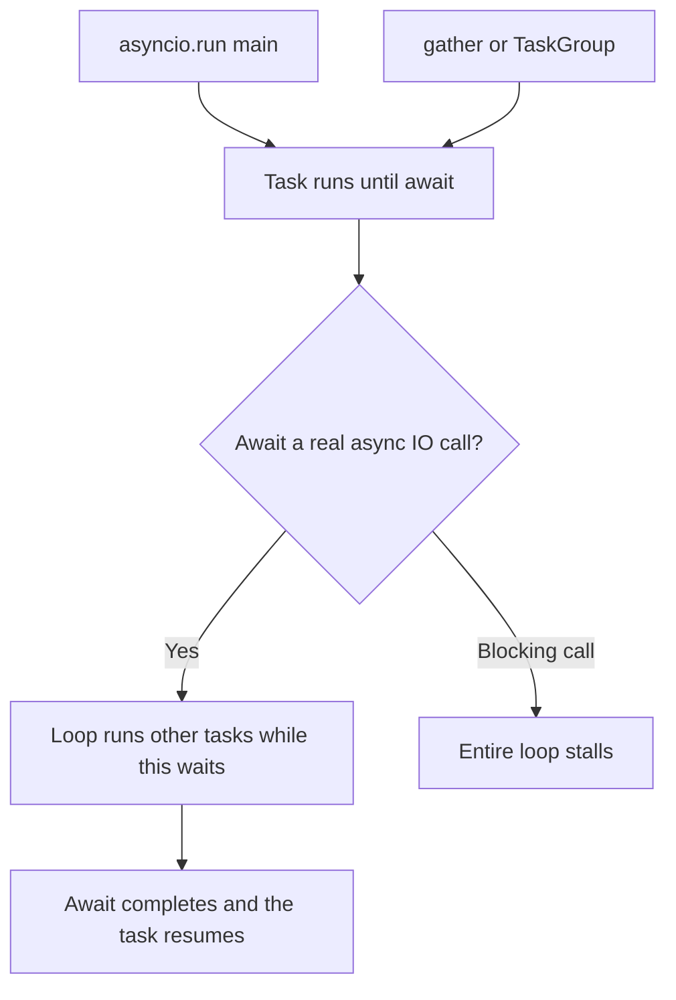

## Why this matters

Asyncio is how a single thread juggles a large number of sockets. A task runs until it awaits a read or a sleep, then the loop runs another task. Interviews ask you to fetch several URLs concurrently, to explain why `time.sleep` freezes every task, and to say how this differs from threads. The difference is cooperative scheduling. Nothing else runs until you `await`. A blocking call is a bug that stalls the whole loop, not a task the OS can preempt.

Async is the right tool when your libraries are async end to end. It is the wrong tool when the work is CPU-bound or when the database driver is synchronous and you sprinkle `async def` on top. A sync driver inside an async handler blocks every request on that worker.

## Intuition

The event loop is a queue of ready tasks. An `async def` function returns a coroutine object when called. It does not run until the loop awaits it. `await` means "I cannot continue until this completes, so run other tasks." `asyncio.gather` starts several awaits and waits for all of them. While one download waits on the network, another download progresses. There is still one thread. There is no parallel Python bytecode. There is concurrent waiting.

`time.sleep(5)` does not await. It holds the thread for five seconds. Every task waits. `await asyncio.sleep(5)` returns control to the loop. The difference is the entire design.

## Core concept in depth

### Coroutines, tasks, and the loop

Calling an async function does not run it. You get a coroutine. If you never await it, nothing happens, and Python warns that the coroutine was never awaited. `await` is legal inside async functions. You cannot `await` in a normal `def`. The bridge from sync code is `asyncio.run(main())`, which creates a loop, runs the coroutine, and closes the loop. One `asyncio.run` per process entry point. Do not call it from inside a running loop.

`asyncio.create_task(coro)` schedules the coroutine to run soon and returns a task. The task does not start until you await something and the loop gets control. A common bug is to create tasks and then return without awaiting them, so the function ends and the tasks are cancelled or abandoned. Keep references and await `gather`.

```python
import asyncio

async def fetch(name: str, delay: float) -> str:
    await asyncio.sleep(delay)
    return name

async def main() -> list[str]:
    return await asyncio.gather(fetch("a", 0.1), fetch("b", 0.1))
```

`gather` runs them concurrently. The total wait is about the slower one, not the sum, if the awaits really yield. `return_exceptions=True` stores exceptions in the result list instead of failing the group. Use that only when partial success is the spec. Otherwise let the error propagate and cancel siblings if you need to. `TaskGroup` in modern Python is the structured way to start tasks and cancel the group when one fails. Prefer it over a pile of naked `create_task` calls you might leak.

### Do not block the loop

Blocking calls include `time.sleep`, synchronous `requests.get`, a synchronous ORM query, and a big CPU loop. In an async function they stall every client. Fixes:

- Use an async HTTP client such as `httpx.AsyncClient` or `aiohttp`.
- Use an async database driver, or isolate the sync call in `asyncio.to_thread`, which runs it in a thread and awaits the result. That is a bridge, not a style. A thread pool of sync database calls has a finite size and can still pile up.
- Move CPU work out of the loop. A long pure-Python parse belongs in a process or a thread via `to_thread` if it is long enough to matter. Short parsing is fine.

`requests` inside `async def` is the bug interviewers listen for. The function is async in name only.

### Timeouts, cancellation, and shielding

`asyncio.wait_for(coro, timeout)` raises `TimeoutError` if the await exceeds the budget and cancels the inner task. Cancellation shows up at the next `await` as `CancelledError`. Clean up with `try`/`finally` or an async context manager. A task that catches `CancelledError` and then continues without re-raising can ignore shutdown. Re-raise cancellation unless you are genuinely handling it.

`asyncio.shield` protects an await from cancellation. Use it rarely, for a commit that must finish. Hiding cancellation everywhere makes the service impossible to shut down.

Async context managers use `async with`. Async iterators use `async for`. A normal `with` on an async resource does not await the close. Match the protocol to the object.

### Bounded concurrency

`gather` of ten thousand downloads opens ten thousand sockets. Bound the fan-out with a semaphore:

```python
sem = asyncio.Semaphore(20)

async def bounded_fetch(url: str) -> str:
    async with sem:
        return await fetch_url(url)
```

The semaphore is the client-side limit. Without it you will look fast in a test of five URLs and get banned or file-descriptor-starved in production. The same idea as a thread pool bound, expressed for tasks.

### Testing and structure

Tests can be async with `pytest-asyncio`, or they can call `asyncio.run` on a coroutine that exercises the function. Do not share one global loop across tests if you can avoid it. Do not leave tasks running at the end of a test. Structured task groups make that leak visible.

An application should pick async at the edges that are async: the web framework and the driver. Calling `asyncio.run` inside a request that is already on a loop raises an error that a loop is running. If you are inside FastAPI, you are already on the loop. `await` the coroutine. Do not start a second loop.

## Diagram / flowchart



### Dry-run: two sleeps

| Code | Wall time for two 1-second waits | Other tasks |
| --- | --- | --- |
| `await asyncio.gather(asyncio.sleep(1), asyncio.sleep(1))` | about 1 second | Can run at the awaits |
| `time.sleep(1)` twice inside one async function | about 2 seconds | Nothing else runs during the sleeps |
| `await asyncio.sleep(1)` twice in sequence in one coroutine | about 2 seconds | Other tasks can run during each sleep, but these two are not concurrent with each other |

The third row is the concurrency bug of forgetting `gather`. Awaiting in a loop is sequential. Gathering is concurrent. Both are valid. The spec says which one you want.

Cancellation dry-run: `wait_for` times out, the inner task receives cancellation at its next await, `finally` closes the client, `CancelledError` propagates unless `wait_for` translated it into `TimeoutError` for the caller. The caller sees a timeout. The socket should be closed. If `finally` awaits more work, that await must be cancellation-safe or shutdown hangs.

## Code

```python
import asyncio


async def fetch(name: str, delay: float) -> str:
    await asyncio.sleep(delay)
    return name


async def fetch_all(names: list[str], delay: float, limit: int) -> list[str]:
    sem = asyncio.Semaphore(limit)

    async def one(name: str) -> str:
        async with sem:
            return await fetch(name, delay)

    return await asyncio.gather(*(one(name) for name in names))


def run_demo() -> list[str]:
    return asyncio.run(fetch_all(["a", "b", "c"], 0.01, 2))


if __name__ == "__main__":
    print(run_demo())
```

`fetch_all` gathers bounded tasks. The semaphore allows two fetches to be in `fetch` at once even if more names exist. `asyncio.run` is only in the sync wrapper. If this function were called from an already-running loop, the wrapper would be wrong and the caller should `await fetch_all(...)` instead. That split is the production shape: async core, one `asyncio.run` at the process edge, or a framework that owns the loop.

## Complexity analysis

| Pattern | Waiting time | Risk |
| --- | --- | --- |
| Sequential awaits | Sum of latencies | Simple, slow |
| `gather` of n I/O tasks | About the max latency, plus server limits | Too many sockets if unbounded |
| Semaphore of k | About ceil(n/k) waves of latency | The right client default |
| Blocking call on the loop | The block plus everyone queued behind it | Looks like a total outage |
| CPU loop on the loop | Same stall | Use a process or `to_thread` only if it is worth the hop |

Async does not make Python bytecode parallel. A thousand tasks that each burn CPU still share one thread. The win is overlapping waits.

## Tricks, tips and patterns

- `await` real async I/O. Never `time.sleep` or `requests` inside async code.
- `gather` or a task group for concurrency. A loop of `await` is sequential.
- Bound fan-out with a semaphore.
- Keep a reference to every task and await it. Do not fire and forget.
- Use `wait_for` for budgets. Re-raise cancellation. Close resources in `finally` or `async with`.
- Call `asyncio.run` only at the entry point. Inside a running loop, just `await`.
- Use `to_thread` as a bridge for a stubborn sync library, with a bounded default, not as the architecture.

## Common mistakes and edge cases

- Calling an async function and forgetting to await the coroutine. It never runs.
- `requests.get` inside an async path, blocking the worker.
- `gather` of unbounded user-supplied URLs.
- Creating tasks and returning without awaiting them.
- Catching `CancelledError` and swallowing shutdown.
- Calling `asyncio.run` from a request that is already on a loop.
- Sharing one mutable list across tasks without thinking. Tasks interleave at awaits, so a check-then-act across an await is still a race. You may not have threads. You still have interleaving.
- A semaphore created per call when you meant a global limit, so each call allows `limit` more concurrency and the cap does not exist.

## Interview notes

Explain cooperative scheduling in one breath: one thread, tasks yield at `await`, blocking calls stall everyone. Then write `gather` of two awaits and contrast it with a sequential loop and with `time.sleep`. Mention a semaphore. Mention that CPU work and sync database drivers do not belong naked on the loop.

Follow-ups:

- **Async versus threads?** Async handles many waits on one thread if every wait is async. Threads run blocking libraries and have preemption, plus lock complexity. Processes use cores for CPU-bound Python.
- **Why did my endpoint stall?** A blocking call, or a CPU loop, or a lock held across an await by someone else on the same loop... the usual finding is `requests` or a sync query.
- **How do you limit concurrency?** A semaphore around the await, or a pool with a max size.
- **What does await on a coroutine you already awaited do?** A coroutine cannot be awaited twice. A task can be awaited by multiple waiters. Know which object you hold.

If they ask about FastAPI, say the framework awaits your path function, so you `await` async dependencies and you do not start a new loop.

## Practice problems

1. **Gather Names** (medium) — simulate concurrent fetches with a delay and return all names. The sandbox solution can be synchronous and return the same list; describe the gather in the editorial. Prefer a pure function that returns names in order. [Practice: python-ex-gather-names]
2. **Bound Waves** (medium) — given n jobs and a limit k, return how many waves of concurrent work you need. [Practice: python-ex-bound-waves]
3. **Sequential versus Gather** (easy) — given two durations, return sequential total and concurrent total. [Practice: python-ex-wait-times]
4. **Blocking Smell** (medium) — classify a described call as safe to await or unsafe on the loop. [Practice: python-ex-block-smell]

## Summary / cheat sheet

- `async def` builds a coroutine. It runs when the loop awaits it. `asyncio.run` is the sync entry. Do not nest it.
- `await` yields. `time.sleep`, `requests`, and sync database calls do not. They stall the loop.
- `gather` and task groups run awaits concurrently. A loop of `await` is sequential.
- Bound concurrency with a semaphore. Time out with `wait_for`. Clean up on cancellation.
- Tasks interleave at awaits. Check-then-act across an await is still a race.
- Async overlaps waiting. It does not use multiple cores for Python CPU work.
- Bridge a sync library with `to_thread` only at the edge, and keep that pool bounded.

## Further reading

- [asyncio](https://docs.python.org/3/library/asyncio.html)
- [Coroutines and tasks](https://docs.python.org/3/library/asyncio-task.html)
- [asyncio synchronization primitives](https://docs.python.org/3/library/asyncio-sync.html)
- [Develop with asyncio](https://docs.python.org/3/library/asyncio-dev.html)
