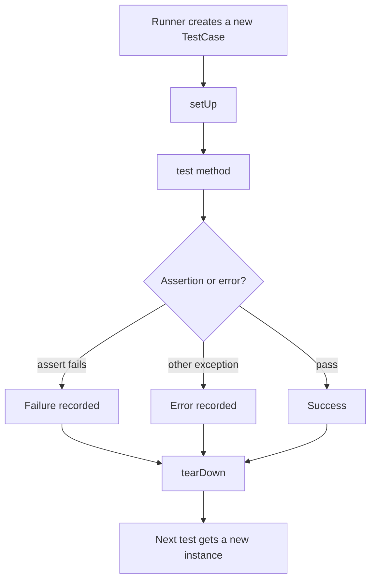

## Why this matters

A test is a small program that fails when behavior changes. `unittest` is the standard-library runner. You will see it in older codebases and in interviews that ban third-party tools. The habits transfer to pytest: one behavior per test, assertions on values not on prints, setup that does not leak into the next test, and a command that uses the project interpreter. A suite that passes because the tests assert nothing is worse than no suite. It tells you the code is fine.

## Intuition

A `TestCase` is a class whose methods named `test_*` are the tests. The runner creates a fresh instance per test method, calls `setUp`, runs the method, then `tearDown`. That fresh instance is why `self.rows` set in `setUp` does not carry appends into the next test. Class-level mutable objects still do. The isolation is the instance, not the process, and not a list you stored on the class.

Assertions raise `AssertionError` with a message. The runner counts failures and errors. A failure is an assertion. An error is any other exception. Both are red. A test that catches the exception and returns is a test that hides the bug.

## Core concept in depth

### A case that checks behavior

```python
import unittest

def clamp(value: int, low: int, high: int) -> int:
    return max(low, min(high, value))

class ClampTests(unittest.TestCase):
    def test_inside_range_is_unchanged(self) -> None:
        self.assertEqual(clamp(3, 0, 10), 3)

    def test_above_range_caps(self) -> None:
        self.assertEqual(clamp(20, 0, 10), 10)

    def test_rejects_bad_bounds(self) -> None:
        with self.assertRaises(ValueError):
            if 10 < 0:
                raise ValueError("low must be <= high")
            raise ValueError("low must be <= high")
```

Name tests for the behavior, not `test_1`. `assertEqual` shows both values when it fails. `assertTrue(a == b)` shows less. Use the specific assertion: `assertEqual`, `assertNotEqual`, `assertIn`, `assertIsNone`, `assertRaises`. `assertRaises` as a context manager catches the expected type. A test that forgets to call the function inside the block passes while catching nothing useful if you wrote it wrong... the block must invoke the code. If the code does not raise, the assertion fails. That is what you want.

Do not assert on the exact text of an exception if a comma change would break the suite. Assert the type, and assert an attribute if you designed the exception to carry an id.

### setUp and tearDown

`setUp` runs before each test. Use it for a fresh fake repository or a temporary directory. `tearDown` runs even when the test fails, which is where you close files if you did not use `with`. `setUpClass` runs once per class and is the wrong place for a mutable list tests append to. Prefer per-test setup. It is slower and it is isolated.

`skipTest` and `expectedFailure` exist. A skip that nobody reviews becomes a permanent hole. Skip only with a reason and a ticket. Do not skip the hard case because it is flaky. Fix the flake. A flaky test is a race or a clock or an order dependency. Those are product bugs in the test or in the code.

### What a unit test should not do

It should not need the network, the real database, or today's date unless the subject is the clock and you inject the clock. It should not depend on test order. `unittest` can randomize nothing for you if you stored state in a module global. Reset globals or stop using them.

It should not assert a call sequence when the behavior is a return value. Assert the return value. Interaction assertions belong when the side effect is the behavior, such as "the mailer was asked to send once." You will do that with mocks in a later lesson. If you can assert the sent message recorded on a fake object you wrote, do that. A fake you control is clearer than a mock framework for most domain tests.

### Running

`python -m unittest` discovers tests if they are importable and named in the usual way. `python -m unittest tests.test_clamp` runs one module. Use the project venv so imports match production. A test run that uses system Python and a missing dependency is not a green build. Exit code non-zero fails CI. Do not catch `SystemExit` and ignore it.

Discovery imports modules. Import-time failures are collection errors. Keep import side effects out of test modules too.

### Assertions and floating point

`assertEqual` on floats will hurt you. `assertAlmostEqual` takes a places or delta argument. For money, do not use floats in the code, and you will not need a tolerance in the test. Integer minor units compare exactly.

## Diagram / flowchart



### Dry-run: shared class list versus setUp

| Storage | Test A appends 1 | Test B reads the list |
| --- | --- | --- |
| `items = []` on the class | class list is 1 | sees 1, order-dependent |
| `self.items = []` in setUp | instance list is 1 | sees empty, isolated |

The runner's fresh instance does not clone class attributes. That is the same class-versus-instance bug, now failing the suite only when test B runs after test A.

`assertRaises` dry-run: the block calls `parse("")`, `ValueError` fires, the assertion passes. The block calls `parse("3")` and it returns, the assertion fails because nothing was raised. The block is empty, the assertion fails the same way. An empty block is a useless test, not a passing one, as long as you used `assertRaises`.

## Code

```python
import unittest


def clamp(value: int, low: int, high: int) -> int:
    if low > high:
        raise ValueError("low must be <= high")
    return max(low, min(high, value))


class ClampTests(unittest.TestCase):
    def test_caps_high(self) -> None:
        self.assertEqual(clamp(20, 0, 10), 10)

    def test_caps_low(self) -> None:
        self.assertEqual(clamp(-2, 0, 10), 0)

    def test_bad_bounds(self) -> None:
        with self.assertRaises(ValueError):
            clamp(1, 5, 4)


if __name__ == "__main__":
    unittest.main(verbosity=2, exit=False)
```

`exit=False` keeps an interactive session alive. CI should use the default exit behavior so a failure is a failed process. Three tests, three behaviors: high cap, low cap, illegal bounds. A fourth test for an interior point is cheap and worth it. Boundaries are where clamp breaks.

## Complexity analysis

| Habit | Cost |
| --- | --- |
| Fresh setUp per test | Time to rebuild fakes. Pay it. |
| Shared mutable fixture | Flakes and order dependence, unbounded debugging |
| Asserting exact exception prose | Breaks on copy edits |
| Hitting the network in a unit test | Slow, flaky, not a unit |
| No tests | The next edit has no net |

Test runtime should stay seconds for the unit layer. If it is minutes, you are integration-testing by accident. Split the suites so CI can run the fast layer on every push.

## Tricks, tips and patterns

- One behavior per test. Name the behavior.
- Use `assertEqual` and `assertRaises`, not `assertTrue` around a comparison.
- Build mutable fixtures in `setUp`, not on the class.
- Inject clocks, clients, and repositories. Do not call the real ones.
- Assert types and attributes on exceptions, not full sentences.
- Run `python -m unittest` with the project interpreter in CI.
- Keep import-time work out of tests and production modules.
- Add the boundary values: empty, one, just inside, just outside.

## Common mistakes and edge cases

- A class-level list that leaks between tests.
- An assertion on `str(exc)` that breaks when the message gains a period.
- Catching the exception inside the test and forgetting to fail.
- `assertRaises` around a block that never calls the function.
- Tests that depend on dict or set order when the contract does not.
- Using `assertIs` on equal values that are not interned.
- Skipping a failing test instead of fixing it.
- Running tests with a different Python than the service.

## Interview notes

Say you would write a `TestCase`, one assertion theme per method, fresh fixtures in `setUp`, and run it with `python -m unittest`. Mention you prefer pytest for new work and that the structure is the same. Mention isolation from the network.

Follow-ups:

- **Failure versus error?** Assertion versus any other exception. Both fail the suite.
- **Why a new instance per test?** So instance attributes do not leak. Class attributes still do.
- **How do you test a raised error?** `assertRaises`, and call the function inside the block.
- **What do you avoid?** Order dependence, real I/O, and asserting prose.

If they ask how this fits TDD, say the next lessons show a failing test first. `unittest` is capable of that workflow. The tool is not the discipline.

## Practice problems

1. **Clamp** (easy) — implement clamp with bound checks the tests can target. [Practice: python-ex-clamp]
2. **Assert Shape** (easy) — given an expected and actual value, say whether assertEqual passes. [Practice: python-ex-assert-equal]
3. **Fresh Fixture** (medium) — simulate two tests appending, with and without per-test reset. [Practice: python-ex-fresh-fixture]
4. **Raises** (easy) — a parser that raises ValueError on a blank string. [Practice: python-ex-parse-blank]

## Summary / cheat sheet

- `unittest.TestCase` methods named `test_*` are tests. The runner uses a new instance each time.
- Prefer specific assertions. `assertRaises` must wrap the call that raises.
- Put mutable setup in `setUp`. Do not store shared lists on the class or the module.
- Assert values and exception types, not fragile message text.
- Keep unit tests off the network and the real clock. Inject dependencies.
- `python -m unittest` with the project interpreter. Non-zero exit fails CI.
- A test that cannot fail is not a test. A skip that never returns is a hole.

## Further reading

- [unittest](https://docs.python.org/3/library/unittest.html)
- [unittest command line](https://docs.python.org/3/library/unittest.html#command-line-interface)
- [assert methods](https://docs.python.org/3/library/unittest.html#assert-methods)
