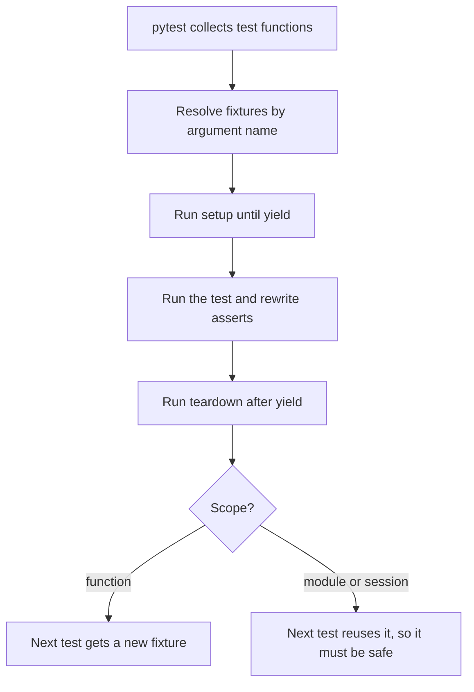

## Why this matters

pytest is the runner most Python teams use. It discovers functions named `test_*`, rewrites `assert` so failures show the values, and builds fixtures that inject setup instead of forcing a test class hierarchy. Interviews ask you to test a pure function and a small service. Take-homes are graded on whether `pytest` actually runs. The traps are fixture scope that leaks a database row, a `tmp_path` you do not use, and a suite that is one giant integration test with no fast layer.

## Intuition

A test is a function. `assert` is the check. A fixture is a function decorated with `@pytest.fixture` whose return value pytest passes into the test by argument name. The name match is the wiring. Scope says how long the fixture lives: once per test function by default, or per module, per session, if you ask. Wider scope is faster and easier to contaminate. Start at function scope. Widen only for an expensive immutable resource.

pytest runs files matching its patterns, imports them, and executes tests. The same import-side-effect rules apply. `conftest.py` holds fixtures shared across a directory. A fixture in `conftest.py` is powerful and invisible to a casual reader. Keep it small and named for the thing it builds.

## Core concept in depth

### Plain asserts

```python
def clamp(value: int, low: int, high: int) -> int:
    if low > high:
        raise ValueError("low must be <= high")
    return max(low, min(high, value))

def test_caps_high() -> None:
    assert clamp(20, 0, 10) == 10

def test_bad_bounds() -> None:
    import pytest
    with pytest.raises(ValueError):
        clamp(1, 5, 4)
```

You do not need `self.assertEqual`. The assertion rewriter shows the left and right side. Still write one behavior per test. A test with five asserts fails on the first and hides the rest. That is acceptable for one story and bad for five stories. Split them.

`pytest.raises` matches the type. `match` can check a regex of the message when the message is a contract. Prefer attributes over regex. `pytest.warns` exists for warnings you intend to emit. Do not leave filters that hide deprecations in the whole suite.

### Fixtures and yield

```python
import pytest

@pytest.fixture
def cart():
    data = {"items": []}
    yield data
    data["items"].clear()
```

Code before `yield` is setup. Code after `yield` is teardown, and it runs even when the test fails. A fixture that opens a file should close it after `yield`, or use `tmp_path`, which pytest cleans up. Request the fixture by naming the argument `cart`. If the name does not match, pytest thinks it is a missing fixture and errors at collection or setup. That error is better than a silent unused setup.

Function scope is the default. `scope="module"` builds one fixture for the module. Do that for a read-only table you load from disk, not for a list tests append to. Session-scoped database connections are a common way to leak rows between tests. Wrap each test in a transaction you roll back, or build a fresh schema. The fixture scope is not a transaction.

`tmp_path` gives a unique directory per test. Use it for file code. Do not write into the repository during tests. `monkeypatch` sets an environment variable or an attribute and undoes it after the test. Use it for a setting. Do not use it to patch so hard that you no longer call your code.

### Parametrize

`@pytest.mark.parametrize("value, expected", [(20, 10), (-1, 0), (3, 3)])` runs the test once per row. Each row is a case with its own failure. This is the right shape for boundary tables. Do not parametrize a test that does a different story in each row by branching on the parameter. If the arrange and assert diverge, write two tests.

### Marks and CI layers

`@pytest.mark.slow` or `@pytest.mark.integration` lets you exclude heavy tests from the inner loop: `pytest -m "not integration"`. The integration job runs them. A mark that nothing selects is clutter. Register marks in `pyproject.toml` so pytest does not warn. The fast suite should be the default a developer runs.

`pytest -q` is enough locally. `pytest --ff` runs last failures first. Coverage with `pytest --cov` tells you what the suite never executed. A coverage number without the failing-behavior tests is a vanity metric. Cover the branches you care about: errors, boundaries, and the empty input. Do not chase 100 percent with tests that assert nothing.

### Layout

Keep tests out of the application package or inside it, but be consistent. A `tests/` directory that imports the installed package avoids importing a random local folder. That requires the packaging lesson's installable layout. Relative imports in tests are a smell. Tests are clients of the public API. If you must import a private helper, consider that the helper should be public or the test should go through the public function.

## Diagram / flowchart



### Dry-run: parametrize boundaries for clamp

| value | low | high | expected |
| --- | --- | --- | --- |
| 20 | 0 | 10 | 10 |
| -1 | 0 | 10 | 0 |
| 3 | 0 | 10 | 3 |
| 10 | 0 | 10 | 10 |
| 0 | 0 | 10 | 0 |

One test function, five runs, five chances to fail with the row visible. The illegal `low > high` case stays a separate test because it raises instead of returning a number. Do not force that into the table with a sentinel.

Fixture leak dry-run: a module-scoped list. Test A appends. Test B expects empty and fails only when A ran first. Function scope makes B's list new. The fix is the scope, not a sort order.

## Code

```python
def clamp(value: int, low: int, high: int) -> int:
    if low > high:
        raise ValueError("low must be <= high")
    return max(low, min(high, value))


def cases() -> list[tuple[int, int]]:
    return [(20, 10), (-1, 0), (3, 3), (0, 0), (10, 10)]


def run_cases() -> list[int]:
    return [clamp(value, 0, 10) for value, _expected in cases()]


if __name__ == "__main__":
    print(run_cases())
```

The table and the runner show the cases without requiring pytest in the sandbox. In the repo, the test is a function with `@pytest.mark.parametrize` and `assert clamp(value, 0, 10) == expected`. Run it with `python -m pytest`. If pytest is missing in an environment, install it in the dev extra. Do not vendor a copy of the runner.

## Complexity analysis

| Choice | Suite time | Isolation |
| --- | --- | --- |
| Function-scoped fixtures | Higher setup cost | Strong |
| Session-scoped mutable DB | Low setup cost | Weak, flakes |
| Parametrized pure tests | Tiny | Strong |
| One integration test per behavior | Minutes, network | Tells you the system works, hides the unit that broke |
| Coverage-only tests with no assertions that matter | Cheap | Low value |

Keep a fast default. Put slow tests behind a mark. A ten-minute default suite will not be run.

## Tricks, tips and patterns

- `assert` plain comparisons. Let pytest show the values.
- Fixtures inject setup by name. `yield` splits setup and teardown.
- Default to function scope. Widen scope only for immutable or carefully reset resources.
- Parametrize boundary tables. Keep raising cases as their own tests.
- Use `tmp_path` and `monkeypatch` instead of writing into the repo or the real environment.
- Mark integration tests and exclude them from the default command.
- Test the public API. Treat a private import as a design question.
- Register marks and options in `pyproject.toml` so CI and laptops match.

## Common mistakes and edge cases

- A session fixture that accumulates users and makes tests order-dependent.
- Argument name typos that error as unknown fixtures, then "fixed" by deleting the fixture instead of correcting the name.
- Parametrize rows that each contain a different test in disguise.
- Asserting a mock was called when a return value would prove the behavior.
- Writing files next to the test module and forgetting to clean them up.
- A default suite that needs a database, so nobody runs it locally.
- `pytest.raises` with a match regex that is tighter than the contract.
- Forgetting that fixtures in `conftest.py` apply widely and can surprise a new folder of tests.

## Interview notes

Say you would use pytest, plain asserts, a function-scoped fixture for a fake repo, and parametrize for the boundary table. Mention `pytest.raises`. Mention a fast suite and a marked integration suite. Mention `tmp_path` if the subject is files.

Follow-ups:

- **Why pytest over unittest?** Less boilerplate, better assertion output, fixtures by injection. `unittest` still works and pytest can run those tests too.
- **What is a fixture?** Setup with a name and a scope, torn down after yield.
- **How do you avoid flakes?** No shared mutable fixtures, no real network, inject the clock, do not depend on order.
- **What does coverage not prove?** That the assertions check the right behavior. You can execute a line without asserting the outcome.

If they ask about TDD, the next lesson starts from a failing test. pytest is a fine runner for that loop.

## Practice problems

1. **Clamp Table** (easy) — return clamped values for a table of inputs. [Practice: python-ex-clamp-table]
2. **Raises Bounds** (easy) — reject inverted bounds. [Practice: python-ex-clamp-bounds]
3. **Fixture Scope** (medium) — say whether a second test sees the first test's append for a given scope. [Practice: python-ex-fixture-scope]
4. **Waves Mark** (easy) — split test names into fast and integration by a marker word. [Practice: python-ex-mark-split]

## Summary / cheat sheet

- pytest runs `test_*` functions. `assert` is enough. Failures show the values.
- Fixtures are injected by argument name. Code after `yield` is teardown.
- Function scope is the default. Wider scopes must not leak mutable state.
- Parametrize tables of the same behavior. Separate tests when the story changes.
- `tmp_path` and `monkeypatch` keep tests off the repo and the real environment.
- Mark slow and integration tests. Keep the default command fast and offline.
- Coverage is a map, not a proof. Assert outcomes.
- `conftest.py` is shared and easy to overuse. Keep fixtures named and small.

## Further reading

- [pytest documentation](https://docs.pytest.org/en/stable/)
- [pytest fixtures](https://docs.pytest.org/en/stable/how-to/fixtures.html)
- [parametrize](https://docs.pytest.org/en/stable/how-to/parametrize.html)
- [tmp_path](https://docs.pytest.org/en/stable/how-to/tmp_path.html)
