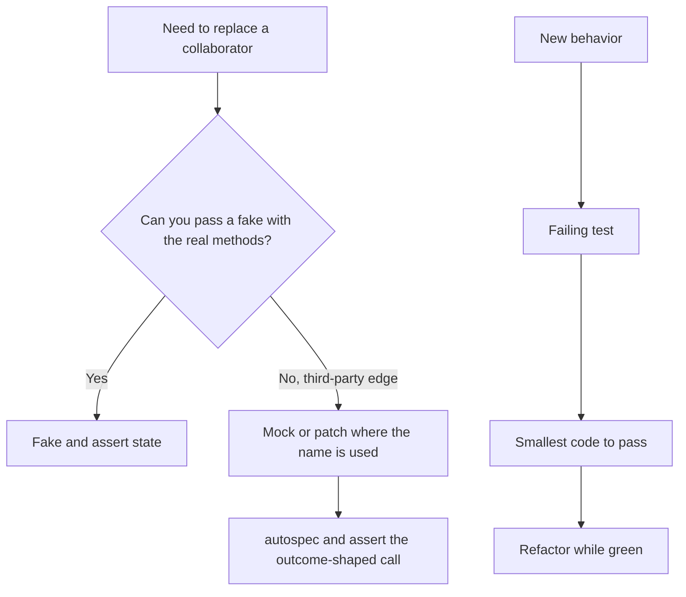

## Why this matters

The tests that survive refactors assert outcomes. The tests that break on every cleanup assert that a particular internal function was called with a particular list of mocks. Interviews still ask you to mock a client, and they ask you to do TDD on a small function. You need both: a disciplined loop of red, green, refactor, and a policy for stand-ins. The policy is simple. If you can pass a fake object with real methods, do that. If the boundary is a third-party client you do not own, a mock or a stub records the interaction. Do not mock the function you are testing. Do not mock the dict you are using. Mock at the edge.

## Intuition

A fake is a working miniature: an in-memory repository with `save` and `get`. A stub returns canned data. A mock expects calls and fails if they do not happen. Fakes test behavior through the real method on the fake. Mocks test that a call happened, which is one step removed. TDD is the order of work: write a test that fails for the right reason, write the smallest code that passes, then clean the code without changing the test's meaning. The test is the spec you can run.

## Core concept in depth

### Fakes first

```python
class MemoryOrders:
    def __init__(self) -> None:
        self.rows: dict[str, int] = {}

    def save(self, order_id: str, minor: int) -> None:
        self.rows[order_id] = minor

    def get(self, order_id: str) -> int | None:
        return self.rows.get(order_id)
```

`Checkout` receives `MemoryOrders` in the test and a SQL repository in production. Both have `save` and `get`. The test places an order and asserts the row. You did not patch `Checkout` internals. If you rename a private helper, the test still passes. That is the point.

Write the fake to honor the contract you care about. If `save` must reject a duplicate id, the fake should too, or you are testing a softer system than production. Share contract tests between the fake and the real repository if the real one is important enough. At least write the fake's behavior down.

### unittest.mock when you need it

`Mock` and `MagicMock` record calls. `mock.return_value` canned the result. `mock.side_effect` can return a sequence or raise. `assert_called_once_with(...)` fails if the call was missing or duplicated. Use this on a payment client you do not want to reimplement, and assert the amount and the idempotency key. Do not assert the exact list of every internal helper.

`patch` replaces an object on an import path for the duration of the block. Patch where the name is used, not where it is defined. If `orders.py` did `from billing import Client` and then calls `Client`, you patch `orders.Client`. Patching `billing.Client` does nothing to the name `orders` already bound. This is the same from-import snapshot as the import lesson. It is the number-one patch bug.

`spec=True` or `spec=Client` makes the mock reject unknown methods. A mock without a spec accepts every attribute and hides typos. `autospec` is stricter. Prefer it when you patch. A loose `MagicMock` that accepts `chage` instead of `charge` is a green test of a bug.

Do not patch builtins casually. Do not patch the system under test so thoroughly that the test calls the mock and not the code. If every collaborator is a mock and the function only forwards, the test is a mirror of the implementation.

### TDD loop

1. Write a test for the next behavior. Run it. It should fail because the behavior is missing, not because the test has a syntax error or a wrong import. Read the failure.
2. Write the smallest implementation that passes. Hardcoding a return value is legal for one example and illegal once the second example forbids it.
3. Refactor names and structure. The tests stay green. If you change the spec, change the test on purpose and watch it fail first.

For `clamp`, the first test might be the high cap. The implementation can be `min(high, value)` and the low-cap test will fail. Then you add the low bound. Then the inverted-bounds test forces the validation. Each test pulled one branch. That is TDD on a function that fits in a screen. For a service, the first test is the happy path through fakes, the second is the rejection, the third is the collaborator error. Do not write twenty tests before any code if you cannot run them. The loop is short.

TDD is not a religion about never thinking ahead. It is a ban on untested behavior and a preference for a failing signal before the fix. Bug fixes start with a test that reproduces the bug. If you cannot write that test, you do not understand the bug yet.

### What not to mock

Do not mock `list`, `dict`, or a pure function in the same module to "isolate" a three-line caller. Call the three lines. Do not mock the database by patching the session in every test if a fake repository is possible. Do not assert call order unless order is the contract. `assert_has_calls` couples you to incidental order.

Time is a collaborator. Pass a clock function. Do not patch `datetime.now` in every file if the code accepts `now` as an argument. Patching the clock is the fallback when you do not own the call.

## Diagram / flowchart



### Dry-run: a bugfix in TDD order

Bug: `clamp` returns the value unchanged when it is below `low`.

| Step | Test | Code | Result |
| --- | --- | --- | --- |
| 1 | assert clamp(-2, 0, 10) == 0 | old code returns -2 | fail, shows -2 != 0 |
| 2 | same | add the low bound | pass |
| 3 | high-cap test still present | refactor names | pass |

If step 1 passed, you did not reproduce the bug. If you "fix" the code before the test exists, you cannot prove the test would have caught it. Write the test against the old behavior first when you can. On a take-home, a single commit that adds the test and the fix is fine if you actually saw the failure locally.

Patch dry-run: `orders.py` contains `from billing import charge`. The test patches `billing.charge`. The code still calls the original. The test patches `orders.charge`. The code uses the mock. Patch the path that the module under test looks up.

## Code

```python
class MemoryOrders:
    def __init__(self) -> None:
        self.rows: dict[str, int] = {}

    def save(self, order_id: str, minor: int) -> None:
        if minor <= 0:
            raise ValueError("minor must be positive")
        self.rows[order_id] = minor


class Checkout:
    def __init__(self, orders: MemoryOrders) -> None:
        self.orders = orders

    def place(self, order_id: str, minor: int) -> None:
        self.orders.save(order_id, minor)


def test_place_saves() -> None:
    orders = MemoryOrders()
    Checkout(orders).place("o1", 500)
    assert orders.rows["o1"] == 500


if __name__ == "__main__":
    test_place_saves()
    print(MemoryOrders().rows)
```

`test_place_saves` is a fake-based test with no mock library. It fails if `place` forgets to save or saves the wrong amount. A mock version would assert `save` was called and might still pass if `save` were called and the amount never landed, depending on what you assert. Asserting the row is stronger. Use a mock when there is no row to see, such as "the HTTP client was given this idempotency key," and still assert the arguments that matter, not every header.

## Complexity analysis

| Style | Refactor cost | Bug-finding power |
| --- | --- | --- |
| Assert state on a fake | Low | High for behavior |
| Assert exact internal calls | High, breaks on cleanup | Medium, misses wrong results if the call shape stayed |
| No test, then a bugfix | None until production | Zero until the incident |
| TDD on a pure function | Low | High on the cases you added |
| Mocking the unit under test | Negative | The test cannot fail for the right reason |

The expensive test is the one that encodes the current line order. The cheap test to keep is the one that encodes the observable result.

## Tricks, tips and patterns

- Pass fakes through constructors. Assert the state they store.
- Patch the name in the module under test. Use autospec.
- Assert call arguments that are part of the contract, once.
- Start bugfixes with a failing test that shows the bad value.
- Hardcode a return only until the second example forces real logic.
- Inject the clock and the client. Patch as a fallback.
- Do not mock pure helpers in the same module.
- Keep one behavior per test so the red step points at one spec.

## Common mistakes and edge cases

- Patching the defining module instead of the using module.
- A `MagicMock` that accepts a typo and returns another mock, so the code under test gets a mock instead of a string and the assertion is also on a mock.
- Asserting `called` without checking arguments, so a charge of the wrong amount passes.
- Mocking so much that the test does not execute the branch you care about.
- A fake that is kinder than production, so duplicates pass in tests and fail in SQL.
- Writing the implementation before any test and calling it TDD.
- A test that passes on an empty `assert` or on `assert True` left from debugging.
- Order-sensitive `assert_has_calls` for calls that may legally reorder.

## Interview notes

For a design with a repository, say you would pass a fake and assert the saved row. If they insist on mock, patch where the name is used, autospec it, and assert the arguments once. For TDD, narrate red, green, refactor on a tiny function and mention the failure you expect to see before you write the code.

Follow-ups:

- **Fake versus mock?** A fake has working behavior. A mock records and asserts calls. Prefer the fake.
- **Why did patch miss?** You patched the defining module, but the caller already imported the name.
- **What is the first TDD step?** A test that fails for the missing behavior.
- **What should you not mock?** The unit itself, language builtins you are using directly, and pure functions you can call.

Mention contract tests if the fake and the SQL repository must agree. That sentence separates a memorized mock answer from a testing strategy.

## Practice problems

1. **Memory Save** (easy) — an in-memory store that rejects non-positive amounts. [Practice: python-ex-memory-save]
2. **Place Saves** (medium) — checkout saves through the store and a test can see the row. [Practice: python-ex-place-saves]
3. **Patch Path** (medium) — choose which dotted path a patch must replace given where the name was imported. [Practice: python-ex-patch-path]
4. **Red First** (easy) — given a buggy clamp result and an expected value, say the test fails and what it should show. [Practice: python-ex-red-first]

## Summary / cheat sheet

- Prefer fakes injected through constructors. Assert the resulting state.
- Use `unittest.mock` at third-party edges. Patch the name where it is used. Turn on autospec.
- Assert the arguments that matter, not every incidental call and not the order unless order is the contract.
- TDD: failing test, smallest passing code, refactor while green. Bugfixes start from a reproducing test.
- Do not mock the unit under test or the standard data structures it uses.
- A fake must not be a softer version of the real contract for the cases you claim to cover.
- A test that cannot fail does not belong in the suite.

## Further reading

- [unittest.mock](https://docs.python.org/3/library/unittest.mock.html)
- [pytest monkeypatch](https://docs.pytest.org/en/stable/how-to/monkeypatch.html)
- [Where to patch](https://docs.python.org/3/library/unittest.mock.html#where-to-patch)
- [Test-driven development overview](https://en.wikipedia.org/wiki/Test-driven_development)
