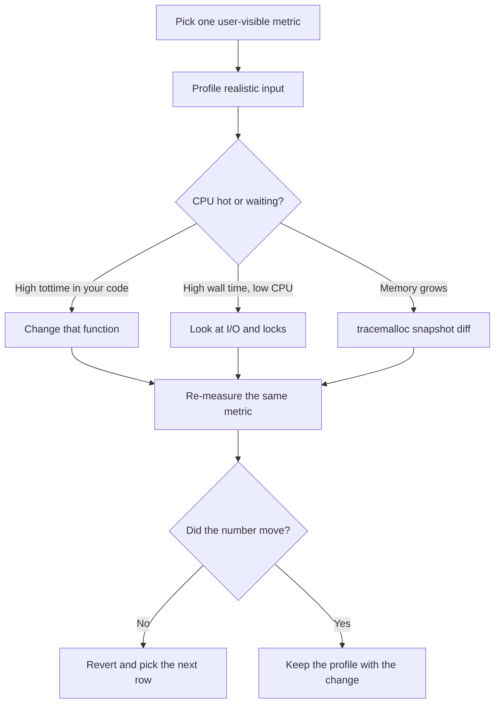

## Why this matters

Backend interviews and on-call both punish the engineer who rewrites a hot path from a hunch. A request that spends 90 percent of its time in a database round trip will not get faster because you rewrote a Python loop in a clever way. A loop that builds a million short strings by concatenation will, and a profiler will show that function at the top of the list. The skill is to measure CPU and memory, read the report, change one thing, and measure again. Guessing feels faster for five minutes and costs a day when the guess was wrong.

## Intuition

A profiler samples or instruments your process and attributes time to functions. `cProfile` is deterministic instrumentation in the standard library: it records how many times each function ran and how long those calls took, including and excluding children. `timeit` answers a narrower question: how long does this snippet take when you run it many times and disable some noise. `tracemalloc` answers a different question: which lines allocated the memory you are holding. Wall clock, CPU time, and peak memory are three numbers. A function can be slow because it waits on the network, in which case CPU time is small and wall time is large. A function can be fast per call and still dominate because it is called a million times. Read both the cumulative time and the call count.

## Core concept in depth

### cProfile and what the columns mean

Run a module under the profiler with `python -m cProfile -s cumtime script.py`. Sorting by cumulative time puts the functions that sit on the expensive path near the top, including the time spent in functions they call. Sorting by `tottime` puts the functions that burned time in their own body near the top, excluding callees. You need both views. A view sorted only by cumulative time always shows your `main` at the top, which tells you nothing. A view sorted only by internal time can hide a function that is cheap but calls an expensive library a hundred thousand times.

The columns you should be able to say out loud are `ncalls`, `tottime`, `cumtime`, and the file and line. `ncalls` of `1000/1` means the function was called a thousand times and one of those was a primitive, non-recursive entry. High `ncalls` with a small per-call time is still a problem if the product is large. Look for functions you wrote, then for library functions you call in a loop, such as a JSON decode of the same payload on every request, or a regex compile inside the loop instead of once at import.

`pstats.Stats` lets you strip directories, sort, and print a limited number of rows in a script. That is how you keep a profile reproducible in a ticket. Save the binary profile with `-o profile.out` and load it later. Do not paste a thousand-line dump into chat. Paste the top twenty rows and the command you used.

Profiling a short script that exits in 50 milliseconds is noisy. Give the profiler real work: a representative request, a loop of a few thousand calls, or a production sample. Profiling the test suite tells you about the tests. Profiling one endpoint with production-shaped data tells you about the endpoint.

### timeit and microbenchmarks

`python -m timeit -n 10000 -r 5 "stmt"` runs the statement. Setup code belongs in `-s` so it is not included in the measured loop. Compare two snippets only when they do the same work and when you have disabled hash randomization or accepted that dict order and allocation noise exist. A 5 percent difference on a microbenchmark is usually noise. A 10 times difference is a lead. Always re-run after you change the code, in the same process settings, with the same Python version. CPython 3.11 and 3.13 do not have the same constant factors. Quote the version with the number.

Microbenchmarks lie when the real cost is allocation of a large object, a cache miss, or a database. They are the right tool for "is `''.join` faster than repeated concatenation for this size" and the wrong tool for "is the API fast."

### tracemalloc

`tracemalloc.start()` then `tracemalloc.take_snapshot()` gives you traceback statistics for allocations. Compare two snapshots to see what grew. This is how you catch a cache dict that never deletes, a list of request bodies retained by a closure, or a log of every payload. Resident set size from the operating system includes allocator fragmentation and memory that Python has freed but not returned. `tracemalloc` tells you what Python still references. Use both when a process grows for hours. A leak is growth that tracks traffic and never comes down after the traffic stops. A cache with a bound is growth that stops at the bound. Those are different bugs.

### A measurement loop you can defend

1. Pick one user-visible number: p95 latency of one endpoint, or peak memory of one job, or records processed per second.
2. Capture a profile on a realistic input. Write down the top functions and their call counts.
3. Change one thing. Keep the algorithm change separate from a drive-by refactor so the second profile is comparable.
4. Re-measure the same number. If it did not move, revert. If it moved, keep the profile in the pull request.

Disable debug logging while you profile. A logger that formats a huge object on every iteration will be the hottest function, and it will not be the hottest function in production if production log level is INFO. Match the configuration you claim to be measuring.

### What not to trust

`time.time()` differences around a single call include scheduling noise. Use `time.perf_counter()` for short spans and `timeit` for snippets. Do not profile under a debugger. Do not profile a laptop that is also compiling and scanning, then treat the third digit as real. Do not optimize a function that is under 1 percent of cumulative time unless the call count shows it will grow with data size. Algorithmic cost still matters when the input grows, even if today's file is small. State the input size you measured.

## Diagram / flowchart



### Dry-run: reading a tiny profile

Imagine a job that normalizes 100,000 names. A cumulative sort shows `normalize` at the top, and an internal-time sort shows `re.compile` called 100,000 times from inside the loop. Moving the compile to module level drops `ncalls` for `re.compile` to 1. The job's wall time falls. A second profile shows `str.lower` as the new top of your code, which is the actual work. You stop. The first profile paid for itself. Compiling the regex on every name was the bug, and no interview puzzle about big-O would have been as specific as the call count.

| Function | ncalls before | ncalls after | What changed |
| --- | --- | --- | --- |
| re.compile | 100000 | 1 | compile once at import |
| normalize | 100000 | 100000 | still one call per name |
| str.lower | 100000 | 100000 | real work, leave it |

A memory dry-run: snapshot after 1,000 requests holds 1,000 response bodies because a middleware appended each body to a global list. Snapshot diff attributes the growth to that append line. Clearing the list, or not storing the body, flattens the next diff. Peak RSS may stay high until the process restarts because the allocator keeps pages. The tracemalloc comparison is still the evidence that the leak is gone.

## Code

```python
import cProfile
import pstats
import io


def normalize(names: list[str]) -> list[str]:
    return [name.strip().lower() for name in names]


def profile_normalize() -> str:
    data = [f"  Name{i}  " for i in range(20000)]
    buffer = io.StringIO()
    profiler = cProfile.Profile()
    profiler.enable()
    normalize(data)
    profiler.disable()
    stats = pstats.Stats(profiler, stream=buffer).sort_stats("cumulative")
    stats.print_stats(8)
    return buffer.getvalue().splitlines()[0]


if __name__ == "__main__":
    print(profile_normalize())
    print(len(normalize(["  Ada  ", "GRACE"])))
```

The first line of the stats report is the total call count. In a review you would print more rows and look for `normalize` and the string methods. The example keeps the data in memory so the profile is about the function, not about reading a file. When the real job is file-bound, profile the file version separately and do not pretend the in-memory number is the endpoint.

`timeit` for the same function belongs in a terminal, with setup that builds the list once. Inside a unit test, assert behavior, not a timing. A test that fails when the CI machine is busy is a flake. Keep timings in a benchmark script or a pull request comment.

## Complexity analysis

| Tool | What it measures | What it hides |
| --- | --- | --- |
| cProfile cumulative | Time including callees | Which line inside a large function |
| cProfile tottime | Time in the function body | A cheap caller of an expensive callee |
| timeit | Repeated snippet cost | I/O, caches, realistic size |
| tracemalloc | Python allocations still alive | Memory the allocator has not returned |
| Operating system RSS | Pages held by the process | Which Python object is responsible |
| A single print of time.time | One noisy sample | Almost everything |

Big-O still bounds the curve. A profile tells you the constant and the accidental quadratic you already shipped. Use the profile to choose where an algorithmic change is worth it. An O(n) fix in a function that is 0.2 percent of the request is invisible. An O(n) fix in the function that is 70 percent is the whole project.

## Tricks, tips and patterns

- Sort by cumulative time and by internal time. Read call counts.
- Save the profile file and the command in the ticket.
- Compile regexes, build templates, and load config once, then prove the call count dropped.
- Use `time.perf_counter` for spans and `timeit` for snippets. Name the Python version.
- Diff `tracemalloc` snapshots when a process grows with traffic.
- Match production log level and data shape. Debug logging can dominate a profile.
- Change one thing and re-measure. Revert if the metric does not move.
- Keep timing out of unit tests. Assert values there. Benchmark on purpose.

## Common mistakes and edge cases

- Optimizing the function you understand instead of the function at the top of the profile.
- Treating a 3 percent `timeit` win as a production win.
- Profiling a 20 millisecond script and ranking noise.
- Forgetting that wall time includes network waits that `tottime` will not blame on your CPU.
- Reading RSS growth as a leak when it is the allocator holding freed pages.
- Leaving a profiler enabled in production at full instrumentation. Sampling profilers exist for that. `cProfile` on every request has a cost.
- Comparing profiles taken on different Python versions or different input sizes.
- A global list that retains every request and only shows up after an hour, which a five-second profile will miss. Take a snapshot late.

## Interview notes

Say you would profile before rewriting. Name `cProfile`, the difference between cumulative and internal time, and `tracemalloc` for retained memory. Give the regex-in-a-loop story or the retained-response story so the answer is a procedure, not a tool list. Mention you would re-measure the same latency or throughput number.

Follow-ups:

- **Why is `main` always on top of a cumulative sort?** Because it includes everything it calls. Sort by internal time or look at the next rows.
- **When is a microbenchmark enough?** When the question is a local Python construct at a stated size, and the gap is large.
- **How do you spot an accidental quadratic?** Call count or time that grows faster than the input, then confirm with two input sizes.
- **What do you do if the time is all in the database driver?** Stop tuning Python. Look at the query, the indexes, and the number of round trips.

If they ask about the GIL here, connect it: a CPU profile that shows one core busy and other threads idle is a GIL or single-threaded CPU problem, which is the concurrency module, not a reason to micro-optimize string methods first.

## Practice problems

1. **Top Function** (easy) — given rows of name and internal time, return the hottest name. [Practice: python-ex-hottest-function]
2. **Call Drop** (medium) — given before and after call counts, say whether a hoist worked. [Practice: python-ex-call-drop]
3. **Two Sizes** (medium) — given timings at two input sizes, classify linear versus super-linear growth. [Practice: python-ex-growth-class]
4. **Snapshot Growth** (medium) — given allocation counts at two snapshots, return the lines that grew. [Practice: python-ex-snapshot-growth]

## Summary / cheat sheet

- Measure one user-visible number, then profile, then change one thing, then measure again.
- `cProfile` cumulative time includes callees. Internal time does not. Read `ncalls`.
- `timeit` is for snippets. Name the Python version. Ignore tiny gaps.
- `tracemalloc` snapshot diffs show what Python still holds. RSS includes allocator slack.
- Hoist work that runs once per call and should run once per process, and prove the call count.
- Do not put timing asserts in unit tests. Do not profile a toy input and ship the conclusion.
- If the profile is the database or the network, tune that, not the Python around it.

## Further reading

- [The Python Profilers](https://docs.python.org/3/library/profile.html)
- [timeit](https://docs.python.org/3/library/timeit.html)
- [tracemalloc](https://docs.python.org/3/library/tracemalloc.html)
- [time.perf_counter](https://docs.python.org/3/library/time.html#time.perf_counter)
