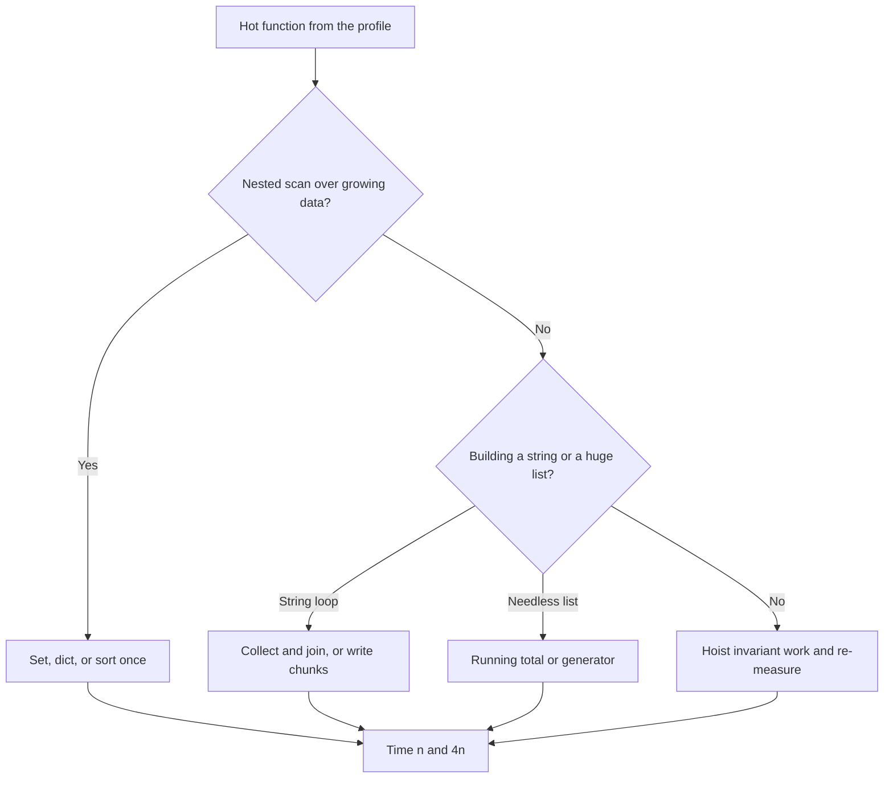

## Why this matters

Once a profile names the hot function, you still have to change it in a way CPython rewards. The interpreter executes bytecode. Every Python-level loop, attribute lookup, and temporary object has a cost that a C loop inside `str.join`, `list.sort`, or a dict lookup does not. Interviewers at backend roles ask you to remove an O(n²) scan, to stop concatenating strings in a loop, and to explain why a local variable is cheaper than a global. They also expect you to refuse cleverness that saves nothing. The patterns below are the ones that show up in profiles of real services, not a catalog of every bytecode trick.

## Intuition

CPython is fast when the work happens in a function implemented in C and slow when you reimplement that work as a Python loop over tiny objects. Building a result string by appending in a loop copies a growing buffer each time, so the copies add up to quadratic work. `''.join` allocates once and copies each piece once. A membership test on a list walks the list. The same test on a set is expected constant time. An attribute lookup walks the instance and the class. A local name is an array slot in the frame. None of this beats a better algorithm. It decides the constant factor after the algorithm is linear.

## Core concept in depth

### Algorithms first

If the hot function scans a list for every item of another list, the profile will get worse as data grows, and no join or local-variable trick will save it. Build a set or dict for the membership side. If you sort on every insertion to keep order, consider a heap for the top-k problem or sort once at the end. If you recompute a pure function on the same arguments, cache it when the arguments are hashable and the function is pure, which the functools lesson already covered. State the new complexity in the pull request: O(n²) scans became O(n) with a set, extra memory is the set. If you cannot state that, you do not know what you changed.

Two input sizes are the cheap proof. Time n and time 4n. Linear work grows about four times. Quadratic work grows about sixteen times. You do not need a profiler to see that gap, and a profiler still helps you find which loop it is.

### Strings and buffers

Repeated `text = text + piece` in a loop is the classic quadratic copy. Collect pieces in a list and join once. If you are writing to a file or a socket, write chunks instead of building one giant string, so peak memory stays bounded. Formatting a log line that nobody will emit is also a cost: guard expensive formatting behind the log level, or use a style that formats only when the record is handled. Do not build a debug string of a full payload on the success path.

Encoding belongs at the boundary. Hold Unicode strings inside the process and encode once when you write bytes. Encoding in a loop because you were unsure is a hidden copy.

### Lookups, locals, and hoisting

Loading a global name each iteration is a dict lookup on the module. Loading a local is a slot. The win is small until the loop is tight and the profile says so. The pattern that always pays is hoisting invariant work: compiling a regex, resolving an attribute, or binding a function, outside the loop.

```python
def scores(rows: list[tuple[str, int]]) -> int:
    total = 0
    for _name, points in rows:
        total += points
    return total
```

Binding `append = result.append` before a tight loop is a known micro-optimization. Use it when a profile says the loop is hot, not as a default style. Readability of a normal loop beats a micro-optimization that does not show up in the numbers.

Dict and set average lookups are O(1). Worst-case hash collision chains exist and are not your first suspect. List `in` is O(n). `deque` popleft is O(1). `list.pop(0)` is O(n). Those facts are performance facts, not only data-structure trivia.

### Allocations and copies

Every temporary tuple, dict, and slice allocates. A comprehension that builds a million dicts will show up in `tracemalloc` and in the allocator. If you only need a sum, do not build the list of transformed rows first. Generator expressions and loops keep the memory flat. If a caller needs a list, build the list once at the boundary, not in every helper.

Slices copy. `items[:]` to "be safe" on a hot path is a full copy. Pass the list and do not mutate it, or document the mutation. `copy.deepcopy` on a large graph is a surprise in profiles. Shallow copy is enough when the nested objects are not mutated.

`__slots__` on a class you allocate millions of removes the per-instance `__dict__`. It is a memory tool, not a magic speed switch, and it blocks arbitrary attributes. Use it for a small record type you create in bulk after a profile shows instance dicts dominating. A dataclass with `slots=True` is the modern spelling. Do not slots every class in the application.

### I/O batching

Python CPU patterns do not fix a chatty client. Inserting rows one statement per row, or fetching related objects in a loop, spends its time waiting. Batch the writes. Select the related ids in one query. Reuse HTTP connections with a session. Those changes move wall time more than any bytecode tweak, and the profile of a waiting process looks "idle" in internal CPU time. Look at call counts of `execute` or `send` to see the chatter.

### What to leave alone

Do not rewrite the service in another language because one endpoint is slow until you have a profile and an algorithm. Do not cache everything. A cache without a bound and without a correctness story is a leak and a stale-read bug. Do not disable the garbage collector as a habit. Do not trust a benchmark that runs once, on an empty machine, for a size you will never see.

## Diagram / flowchart



### Dry-run: concatenation versus join

Build the string `"abc"` repeated. Concatenation copies 1, then 2, then 3 characters of payload, and the copies sum to triangular numbers. Join walks the pieces once.

| n pieces of one character | Concat copies about | Join copies |
| --- | --- | --- |
| 3 | 1+2+3 = 6 | 3 |
| 4 | 10 | 4 |
| 1000 | about 500500 | 1000 |

The table is why the profile shows the loop even though each `+` looks cheap. Membership dry-run: 10,000 lookups in a list of 10,000 names is on the order of 100 million comparisons. The same lookups in a set are on the order of 10,000 hashes. The API result is identical. The curve is not.

Hoist dry-run: `re.compile` inside the loop shows `ncalls` equal to the row count. The same pattern moved above the loop shows `ncalls` of 1. Output strings stay equal. That is the check that you optimized without changing behavior: same results, different call count or different growth.

## Code

```python
def join_names(names: list[str]) -> str:
    return ",".join(names)


def concat_names(names: list[str]) -> str:
    text = ""
    for name in names:
        text += name
        text += ","
    return text[:-1] if text else ""


def members(left: list[str], right: list[str]) -> list[str]:
    wanted = set(right)
    return [name for name in left if name in wanted]


if __name__ == "__main__":
    sample = ["ada", "grace", "linus"]
    print(join_names(sample) == concat_names(sample))
    print(members(["ada", "ken", "grace"], ["grace", "ada"]))
```

`join_names` and `concat_names` agree on this input, including the commas between names. The trailing-comma trim in the concat version is exactly the sort of extra bug the quadratic version collects while also being slow. The set version of `members` keeps input order from `left` and drops names that are absent from `right`. A nested loop would return the same list and would not stay linear. Tests should lock the order and the filtering. Benchmarks should lock the growth. They are different checks.

## Complexity analysis

| Pattern | Time | Memory | When it shows up |
| --- | --- | --- | --- |
| text = text + piece in a loop | Θ(n²) characters copied | Peak result string, plus copies | Building reports, CSV, HTML by hand |
| ''.join of pieces | Θ(n) | One result | The replacement |
| list membership in a loop | Θ(n·m) | Low | Filtering, dedupe done badly |
| set membership | Expected Θ(n+m) | The set | The replacement |
| list.pop(0) in a loop | Θ(n²) | The list | A queue built on a list |
| deque.popleft | Θ(1) per pop | The deque | A real queue |
| One query per row | Round trips dominate | Low CPU | "Slow" endpoints that are idle |
| __slots__ or dataclass slots | Same algorithm | No per-instance dict | Millions of tiny objects |

Local-versus-global lookup is a constant-factor change. Do not lead a design review with it. Lead with the row that changes the exponent or the round-trip count.

## Tricks, tips and patterns

- Fix the exponent before the constant. Say the old and new complexity.
- Join strings. Do not concatenate in a loop. Stream chunks to I/O when the result is huge.
- Use a set or dict for repeated membership and grouping.
- Use a deque for a queue. Do not pop from the front of a list.
- Hoist regex compiles, config, and attribute lookups that are invariant.
- Sum and count in the loop when you do not need the intermediate list.
- Batch SQL and HTTP. Count the calls.
- Apply slots only to bulk records a profile already blamed.
- Prove behavior with tests and prove speed with two input sizes or a second profile.

## Common mistakes and edge cases

- A join that forgets the separator contract and changes the output while "making it faster."
- Building the set inside the inner loop, so you pay the construction every time and gain nothing.
- Caching a function that reads a global counter or the clock, so the cache returns stale work.
- `list.pop(0)` left in place because the list was small in the demo.
- Slots on a class that is subclassed casually, then surprise failures on unexpected attributes.
- Micro-optimizing a function that is under 1 percent after the real fix.
- A generator that the caller immediately wraps in `list`, so you still hold everything, just in two places if you also stored the source.
- Deepcopy of a request object on every log line.

## Interview notes

Walk a concrete before and after. "The filter was a nested scan, so I built a set of the allowed ids and kept the original order. Time went from quadratic to linear. I checked n and 4n." If the question is strings, draw the triangular copies and name `join`. If the question is a slow API with low CPU, talk about round trips, not bytecode.

Follow-ups:

- **Why are locals faster?** The compiler indexes them by slot. Globals are dictionary lookups. The gap matters in tight loops only.
- **When do you use slots?** Millions of small objects, after a memory profile, usually via dataclass slots.
- **Does join always win?** It wins over repeated concatenation. If you already have one string, do not split and join it for sport.
- **What is the first measurement?** Two sizes or a profile, plus a test that the output did not change.

Mention you would not start a rewrite in another language until these patterns and the database were exhausted. That is the senior version of the same answer.

## Practice problems

1. **Join Pieces** (easy) — build a comma-separated string without quadratic concatenation. [Practice: python-ex-join-pieces]
2. **Filter Set** (medium) — keep order from the left list using set membership. [Practice: python-ex-filter-set]
3. **Growth Class** (medium) — from two timings, say linear or super-linear. [Practice: python-ex-two-sizes]
4. **Queue Cost** (easy) — simulate a queue with a deque and return the popped order. [Practice: python-ex-queue-order]
5. **Hoist Check** (easy) — given per-row and once-only results, confirm they match. [Practice: python-ex-hoist-match]

## Summary / cheat sheet

- Change the complexity and the I/O count before you touch bytecode tricks.
- Concatenating strings in a loop copies a triangle. Join once, or write chunks.
- Repeated list membership is quadratic. A set or dict is the usual fix. Keep the required order explicit.
- `list.pop(0)` is linear per pop. `deque.popleft` is constant time.
- Hoist invariant compiles and lookups. Bind locals in tight loops only when a profile asks.
- Do not build intermediate lists you will only reduce. Watch deepcopy, slices, and unbounded caches.
- Slots cut per-instance dicts for bulk records. They are not a style rule.
- Same output tests, then n versus 4n or a second profile, then keep the change.

## Further reading

- [Python TimeComplexity wiki](https://wiki.python.org/moin/TimeComplexity)
- [str.join](https://docs.python.org/3/library/stdtypes.html#str.join)
- [collections.deque](https://docs.python.org/3/library/collections.html#collections.deque)
- [dataclasses slots](https://docs.python.org/3/library/dataclasses.html)
