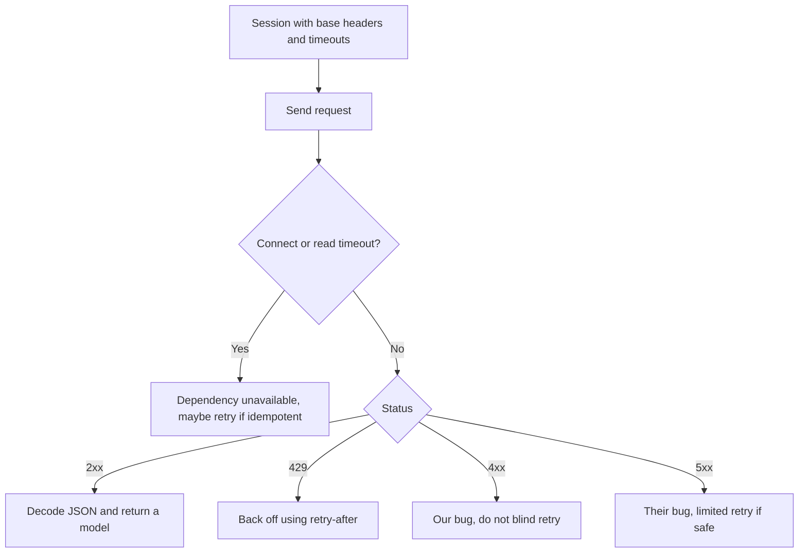

## Why this matters

Backend services spend much of their time calling other services. The `requests` library is the usual synchronous client in interviews, scripts, and older services. The bugs that reach production are not a forgotten URL. They are a missing timeout that pins a worker forever, a connection opened per call, a 404 treated as data because nobody checked the status, and a secret written into a log. Async clients matter later. You cannot use `requests` safely until the synchronous rules are automatic.

## Intuition

HTTP is a request message and a response message over a connection. `requests.get` builds the message, waits for the response, and returns a `Response`. That wait is the dangerous part. Without a timeout, the wait is unbounded. A `Session` keeps a connection pool so the second call to the same host does not repeat the TCP and TLS handshake. Status codes are part of the result. A body that says error inside a 200 is a contract bug. A 500 with an empty body is still a failure. Timeouts, status checks, and pooled connections are the whole lesson.

## Core concept in depth

### Timeouts are not optional

`requests.get(url)` waits until the operating system gives up, which can be many minutes, or never, if the peer sends a byte often enough to keep the connection alive and never finishes. Pass `timeout` as a single float of seconds, or as a pair of connect timeout and read timeout. The pair is the better habit: fail fast if you cannot connect, and allow a longer read for a heavy report. A timeout raises `requests.Timeout`, which is a subclass of `RequestException`. Catch it at the boundary, log the URL and the attempt, and return a controlled error to your caller. Do not retry blindly inside the same user request until you have blown the user's own deadline.

Connect timeout and read timeout answer different failures. A black hole route should hit the connect timeout. A server that accepts and then stalls should hit the read timeout. One number is a compromise. Two numbers are a design.

### Sessions and pools

A `Session` stores headers, auth, and a connection pool. Create it once, pass it into the functions that make calls, and close it on shutdown. A function that constructs a new session per call throws away the pool. In a web worker, the session can live on the application object created at startup. Do not share a session across processes. Threads can share a session in recent `requests` because the pool locks, but a session is still a mutable place for default headers. Set defaults once at construction. Do not mutate session headers per request if another thread might be in a call. Pass per-request headers to `session.get` instead.

Mount an adapter if you need a larger pool for a host you call with high concurrency. The default pool size is small. Past that size, calls block waiting for a free connection, which looks like latency, not like an error. If the profile shows many threads stuck in the pool, raise the pool or lower the concurrency.

### Status, JSON, and errors

`response.status_code` is an int. `response.ok` is true for codes below 400. `response.raise_for_status()` raises `HTTPError` for 4xx and 5xx, and the exception holds the response so you can log the status and a truncated body. Call it before you trust `response.json()`. A 500 page of HTML will throw a JSON decode error that hides the real status if you decode first.

`response.json()` uses the response encoding. A contract that says UTF-8 should be explicit if you have been burned. Do not eval a body. Do not log the full body if it may contain tokens, emails, or card data. Log the status, the path, and a request id.

Separate your client's errors from the dependency's errors. Timeout, connection error, and 5xx are dependency unavailable. 4xx on a request you formed is a bad request you sent, and retrying it will fail again. 429 means back off, preferably using the retry-after header, not a tight loop.

### Retries and idempotency

Retry a connect failure or a 503 on a GET. Retry a POST only when the operation is idempotent and you send an idempotency key the server honors. A payment POST without that key, retried after a timeout, can charge twice because the first request may have succeeded and the response was lost. This is the interview point people miss. Timeout does not mean the server did not do the work.

Use a small retry count and a backoff with jitter. A stampede of retries turns a short outage into a longer one. Put the retry policy in one place, not copied in every call site.

### Headers, auth, and URLs

Build URLs with the library's parameter tools or with a carefully joined base and path. String-concatenating a user id into a URL without escaping breaks on reserved characters. Pass query parameters as a mapping to `params` so they are encoded. Pass JSON as the `json` argument so the content type and the encoding are set. Do not build JSON by hand.

Send auth as a header on the session, from a secret store, not from a constant in the repo. Never put the token in the query string. Query strings leak into access logs. Set a descriptive user-agent so the other team can find your calls.

Redirects follow by default. For a client that must not leave the expected host, disable redirects or check the final URL. An open redirect that your client follows can send the Authorization header somewhere you did not plan if you are careless about which hosts you allow. Prefer not to attach secrets on a client that follows arbitrary redirects.

## Diagram / flowchart



### Dry-run: timeout versus double charge

| Call | Timeout set | Server behavior | Client result | Money moved |
| --- | --- | --- | --- | --- |
| GET invoice | 2s connect, 5s read | stalls after accept | Timeout, retry GET | no |
| POST charge, no key | none | processes, response lost | worker hangs, then a human retries | twice |
| POST charge, idempotency key | 2s and 5s | processes, response lost | Timeout, retry with same key | once |

The third row is the design you defend in an interview. The first row is why GET retries are boring and safe. The second row is the incident.

Status dry-run: status 200 with a JSON object, you decode and return it. Status 503 with HTML, `raise_for_status` fires, you do not call `json`, you log 503 and the path. Status 400, you log the validation message you consider safe, and you fix the caller. Status 200 with HTML because a proxy returned a login page, `json` throws, and you treat decode failure after a successful status as a contract break, not as an empty list.

## Code

```python
def classify(status: int, method: str, idempotent: bool) -> str:
    if status == 429:
        return "backoff"
    if 200 <= status < 300:
        return "ok"
    if 400 <= status < 500:
        return "caller"
    if status >= 500 and method == "GET":
        return "retry"
    if status >= 500 and idempotent:
        return "retry"
    if status >= 500:
        return "unavailable"
    return "unknown"


if __name__ == "__main__":
    samples = [
        (200, "GET", False),
        (404, "GET", False),
        (503, "GET", False),
        (503, "POST", False),
        (503, "POST", True),
        (429, "GET", False),
    ]
    print([classify(*row) for row in samples])
```

The classifier is the policy you would wrap around `session.request` after a timeout check. A real call looks like a session get with a timeout pair, then `raise_for_status`, then `response.json()`. The sandbox function stays pure so tests can lock the policy without a network. In production the session is created at startup, the timeout constants live next to the client, and the classifier decides whether the worker may try again.

Decode JSON only on the ok branch. Truncate logged bodies. Close the session when the process shuts down so sockets do not linger in tests.

## Complexity analysis

| Choice | Latency | Failure mode |
| --- | --- | --- |
| New connection per call | Handshake every time | Slow under load, file-descriptor churn |
| Session pool | Handshake reused | Pool wait if concurrency exceeds the pool |
| No timeout | Fine until it is not | Worker stuck, queue grows |
| Timeout pair | Bounded wait | Explicit Timeout you can count |
| Retry every POST | Hides blips | Duplicate side effects |
| Retry idempotent calls with a cap | Extra load during an outage | Bounded, visible |

Connection reuse is a constant-factor win that shows up at hundreds of requests per second, not in a one-off script. Timeouts are a correctness feature at every request rate. One hung call is enough to stall a worker thread.

## Tricks, tips and patterns

- Always pass a timeout. Prefer a connect and read pair.
- One session per process or per worker, created at startup, closed at shutdown.
- `raise_for_status` before `json`. Do not decode error HTML.
- Retry GET and other idempotent calls. Retry POST only with an idempotency key.
- Cap retries and back off. Honor 429.
- Pass `params` and `json`. Do not concatenate URLs or hand-build JSON text.
- Keep tokens in headers from a secret store. Keep them out of query strings and logs.
- Classify 4xx as caller bugs and 5xx as dependency bugs.

## Common mistakes and edge cases

- A default `requests.get` with no timeout in a request path.
- Opening a session inside the function and closing it before you read the body. Read first, then close, or use the session as a long-lived object.
- Following a redirect to another host with the same Authorization header.
- Treating 204 No Content as a JSON document and throwing on an empty body.
- Retrying a 400 in a loop.
- Logging `response.text` for a payload that contains a password reset token.
- Ignoring `RequestException` subclasses so a DNS failure becomes an unhandled stack in the worker.
- Assuming timeout means the server did not act.

## Interview notes

Say you would use a `Session`, a timeout pair, `raise_for_status`, and retries only for idempotent calls. Mention the double-charge story. Mention you would not log bodies. If they ask about async, say `httpx` with the same rules, and do not call `requests` inside an asyncio loop because it blocks the loop.

Follow-ups:

- **What does timeout not prove?** That the server skipped the work. The response may have been lost after the commit.
- **Why a session?** Connection pooling and a single place for headers and auth.
- **4xx versus 5xx?** You broke the contract versus they failed. Only the second is a retry candidate, and only if the method is safe to repeat.
- **Where do you put the client?** Construct it at process start and inject it. Tests pass a fake or a recorded transport.

A strong extra sentence: propagate a request id header so their logs and yours join up. That is operations, and it is part of calling HTTP like a backend engineer.

## Practice problems

1. **Classify Status** (medium) — map status, method, and an idempotency flag to ok, caller, retry, backoff, or unavailable. [Practice: python-ex-http-classify]
2. **Timeout Pair** (easy) — given connect and read budgets, reject a non-positive budget. [Practice: python-ex-timeout-pair]
3. **Query Build** (easy) — encode query pairs without putting a secret in the query. [Practice: python-ex-query-build]
4. **Retry Cap** (medium) — given failures and a cap, say how many attempts you make and whether you stop. [Practice: python-ex-retry-cap]

## Summary / cheat sheet

- `requests` waits. Pass connect and read timeouts on every call.
- A `Session` pools connections. Create it once. Do not mutate shared headers per call.
- Check status before decoding JSON. `raise_for_status` keeps 4xx and 5xx out of the success path.
- Retry idempotent calls with a cap and backoff. A timed-out POST can still have succeeded.
- Put tokens in headers, not query strings or logs. Pass `params` and `json`.
- 429 means back off. 4xx means fix the caller. 5xx means the dependency failed.
- Do not call this library on an asyncio event loop. It blocks.
- Inject the client so tests do not need the network.

## Further reading

- [requests quickstart](https://requests.readthedocs.io/en/latest/user/quickstart/)
- [requests timeouts](https://requests.readthedocs.io/en/latest/user/advanced/#timeouts)
- [requests sessions](https://requests.readthedocs.io/en/latest/user/advanced/#session-objects)
- [HTTP status codes](https://developer.mozilla.org/en-US/docs/Web/HTTP/Reference/Status)
