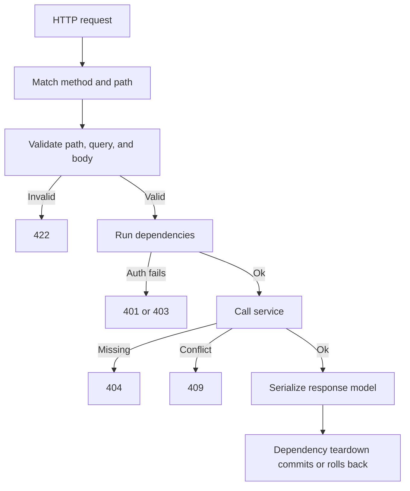

## Why this matters

FastAPI is the framework interviewers and take-homes use when they want a Python HTTP API without a week of boilerplate. It sits on Starlette and Pydantic. You declare path operations, request bodies as models, and dependencies for the database or the current user. The framework validates input and documents the route. The design work is still yours: which status code, which errors are 422 versus 404, where the session is opened, and how you keep business rules out of the route function. A route that is a hundred lines of SQL and policy will not stay testable.

## Intuition

A path operation is a function plus metadata. The decorator says the method and the path. Type hints on parameters say where the values come from: a path segment, a query parameter, or a body model. FastAPI builds a Pydantic model for the body, rejects a bad payload with 422, and calls your function with a real object. Dependencies are functions FastAPI calls first, caching the result for the request when you ask. That is how you get a database session or a user without every route parsing the Authorization header itself.

The function's return value is serialized. A response model strips fields you did not declare, which is how a password hash stays out of the JSON if it was never on the response model. Return the response model, not the ORM object, unless you have deliberately configured that conversion and you know every column is safe.

## Core concept in depth

### A route that does one job

Keep the route thin. Parse and authorize in dependencies. Call a function that places the order or fetches the invoice. Map domain errors to HTTP. Returning a dict works for a demo and becomes a liability when a new key leaks. A response model is the allow-list.

Path parameters are part of the URL and are required. Query parameters are optional filters and pagination. Bodies are for documents you create or replace. Do not put a large filter document in a query string. Do not take an id in the body that contradicts the id in the path. If both exist, reject the mismatch.

Status codes: 200 for a fetched resource, 201 for a create with the new resource in the body, 204 when there is nothing to return, 404 when the id is absent, 409 when a uniqueness rule fails, 401 when the caller is unknown, 403 when the caller is known and not allowed, 422 when the body is the wrong shape. Using 200 for every outcome forces clients to read an error field and guarantees someone will miss it. Using 500 for a missing row hides a client bug in your error rate.

### Dependencies

A dependency is a callable. `Depends(get_session)` runs `get_session` and passes the return value into the route. If the dependency yields, code after the yield runs after the response, which is the right place to commit or roll back a transaction and close the session. A dependency that opens a session and returns it with no close will leak connections under load.

Dependencies can depend on other dependencies. The user dependency reads the header and calls the session dependency. Routes that need a user declare that parameter and do not repeat the header parsing. A dependency that raises `HTTPException` stops the chain with that status. Raise 401 from the auth dependency, not from deep inside a query helper that also runs in a script.

Cache a dependency for the request with the default cache when it is the same session or the same user. Do not cache a dependency that must run twice for two different path ids.

### Errors and validation

Pydantic validation failures become 422 with a list of locations. Do not catch those and rebrand them as 500. Domain `ValueError` should not leak as 500 either. Catch it at the route boundary or with an exception handler and return 400 or 409 with a stable error code in the body. A stack trace in the JSON is a bug. Log the stack on the server.

`HTTPException` is for HTTP mapping. It is not your domain exception hierarchy. The service layer raises `InvoiceNotFound` or returns a result. The API layer translates. That split is what lets the same service run from a worker without importing FastAPI.

### Sync and async routes

`async def` routes run on the event loop. Do not call `requests`, `time.sleep`, or a blocking database driver inside them. Those calls stall every other request on that worker. A sync `def` route runs in a threadpool, which is the right place for a blocking driver if you have not moved to an async one. Mixing them carelessly is the FastAPI performance footgun. Pick the driver that matches the function style. Say which one you picked.

### Testing the app

`TestClient` from Starlette drives the app in-process. Override dependencies to inject a fake session or a fake user. Assert status codes and JSON bodies. Do not bind a real port in a unit test. Test the service function without HTTP as well, so a validation rule has a direct test. The HTTP test checks the mapping: missing row becomes 404, bad body becomes 422, success becomes 201.

## Diagram / flowchart



### Dry-run: create invoice

| Step | Input | Outcome |
| --- | --- | --- |
| Body missing amount | path ok, JSON without amount | 422, service not called |
| Amount zero | valid shape, domain rule | 422 from domain mapping, no insert |
| New id | valid invoice | 201 and a body without internal columns |
| Duplicate id | valid invoice, unique constraint | 409, transaction rolled back |
| Unknown user | bad token | 401 from the auth dependency, service not called |

The service is not called for 422 or 401. That is what you assert with a fake that records calls. If the fake recorded a call on a 422, validation ran too late or you bypassed the model.

Teardown dry-run: the session dependency yields a session, the route returns 201, code after yield commits. The route raises after a flush, code after yield rolls back. A dependency that commits before the route finishes will persist a row the route later decides to reject. Commit at the end.

## Code

```python
def create_status(found_user: bool, duplicate: bool, amount: int) -> int:
    if not found_user:
        return 401
    if amount <= 0:
        return 422
    if duplicate:
        return 409
    return 201


def response_fields(row: dict[str, object]) -> dict[str, object]:
    hidden = {"password_hash", "internal_note"}
    return {key: value for key, value in row.items() if key not in hidden}


if __name__ == "__main__":
    print(create_status(True, False, 500))
    print(create_status(True, True, 500))
    print(create_status(False, False, 500))
    print(sorted(response_fields({"id": "i1", "password_hash": "x", "amount": 500})))
```

In the app, `create_status` becomes a real route that depends on the user and the session, calls the invoice service, and returns a response model. The field filter is the same idea as a response model: internal columns never leave. Tests call `create_status` and the service directly, and one `TestClient` test checks that a missing field is 422. Keep the framework import out of the pure policy so the policy test stays fast.

Lifespan hooks start the session factory and the HTTP client, and close them when the process stops. Do that work in lifespan, not in a route that might run twice.

## Complexity analysis

| Design | Cost | Risk |
| --- | --- | --- |
| Thin route, service object | One extra function call | Low |
| SQL and policy inside the route | None at runtime | Untestable, duplicated in the worker |
| New database engine per request | Connect cost every call | Pool exhaustion and latency |
| Dependency that yields a pooled session | Checkout from the pool | Leak if you forget to close |
| async route plus blocking driver | Blocks the loop | All requests on the worker stall |
| Response model | A copy into the response type | Stops secret fields from leaking |

Validation cost is tiny next to a query. Do not skip the response model to save a copy. The pool and the blocking-call mistake dominate latency.

## Tricks, tips and patterns

- Response models are allow-lists. Put secrets only on the write model.
- Map 401, 403, 404, 409, 422, and 201 on purpose. Do not return 200 with an error flag.
- Open and close sessions in a yielding dependency. Commit after success, roll back on failure.
- Keep domain exceptions free of FastAPI imports. Translate at the edge.
- Override dependencies in tests. Also test the service without HTTP.
- Match `async def` to async drivers and plain `def` to blocking drivers.
- Take the resource id from the path. Reject a body id that disagrees.
- Start clients in the lifespan hook, once per process.

## Common mistakes and edge cases

- Returning an ORM instance that includes a password hash because there was no response model.
- A dependency that returns an open session and never closes it.
- Committing in the middle of the route, then raising 409 after the commit.
- Calling `requests` inside an `async def` route.
- Using 500 for a missing row and training the on-call rotation to ignore 500s.
- Catching validation errors and returning a vague 400 that drops the field location.
- A path `users/me` registered after a parameterized user path so `me` is parsed as an id. Declare static paths so they match the way you intend, and test them.
- Mutable default dependencies or global mutable clients created at import in tests that leak across cases.

## Interview notes

Sketch one route: POST an invoice, Pydantic body, auth dependency, session dependency, service call, 201 or 409 or 422. Mention `TestClient` and dependency overrides. Mention you would not put SQL in the route. Mention blocking versus async in one sentence so they know you have operated a service, not only read a tutorial.

Follow-ups:

- **Why 422 and not 400?** FastAPI's validation layer uses 422 for shape errors. Domain rules can be 400 or 409. Be consistent and document it.
- **How does the session close?** The dependency yields, the framework resumes the generator after the response, you close in a finally block.
- **How do tests avoid the database?** Override the session dependency with a fake, and test the service with the fake directly.
- **What must not appear in the response?** Anything you did not put on the response model: hashes, internal notes, other users' data.

If they ask about middleware, say you would use it for request ids and access logs, not for business rules that belong in a dependency or a service.

## Practice problems

1. **Create Status** (medium) — map user, duplicate, and amount to 201, 401, 409, or 422. [Practice: python-ex-create-status]
2. **Strip Secrets** (easy) — remove hidden keys from a row before it is serialized. [Practice: python-ex-strip-secrets]
3. **Path Versus Body** (medium) — reject a body id that does not match the path id. [Practice: python-ex-id-mismatch]
4. **Attempt Order** (medium) — given a request story, list which of validation, auth, and service run. [Practice: python-ex-route-order]

## Summary / cheat sheet

- A FastAPI route validates input, calls a service, and maps results to status codes and a response model.
- Dependencies inject the user and the session. Yield the session and close it afterward. Commit only on success.
- 422 is a shape error, 401 is unknown, 403 is forbidden, 404 is missing, 409 is a conflict, 201 is created.
- Response models hide fields that must not leave the process.
- Do not block the event loop. Match the route style to the driver.
- Test status mapping with `TestClient` and test rules without HTTP.
- Domain code should not import the web framework.
- Static path segments and resource ids need tests so a literal segment and a parameter do what you think.

## Further reading

- [FastAPI first steps](https://fastapi.tiangolo.com/tutorial/first-steps/)
- [Dependencies](https://fastapi.tiangolo.com/tutorial/dependencies/)
- [Response model](https://fastapi.tiangolo.com/tutorial/response-model/)
- [Testing](https://fastapi.tiangolo.com/tutorial/testing/)
