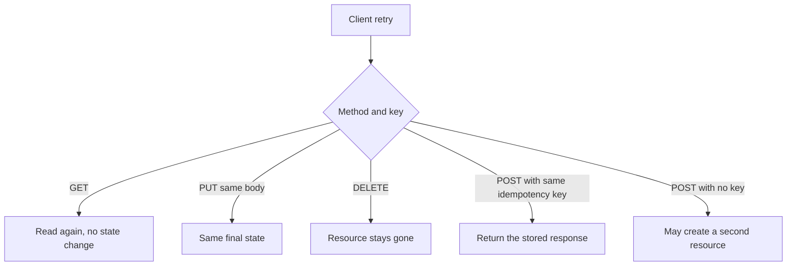

## Why this matters

Frameworks will serve whatever URL you invent. Clients, mobile apps, and other teams have to live with that URL for years. REST, in the form backend interviews mean, is a resource style: nouns in the path, HTTP methods as the verbs, status codes as the outcome, and representations that do not change meaning silently. The failures that hurt are an unbounded list, a POST that creates two charges when the client retries, a delete that returns 200 with a body one day and 204 the next, and error JSON that is a different shape on every route. Design those once.

## Intuition

A resource is a thing the client can name: an invoice, a line item, a user. The URL names it. GET reads and does not change it. PUT replaces it. PATCH changes some fields. POST creates a subordinate resource or runs an action that does not fit a simple replace. DELETE removes it. Safe methods promise not to change server state. Idempotent methods promise that doing them twice is the same as doing them once. GET, PUT, and DELETE are idempotent when you implement them honestly. POST is not, unless you add a key. Clients and proxies rely on those promises when they retry.

## Core concept in depth

### Names and methods

Use plural nouns: `/invoices` and `/invoices/{invoice_id}` is the idea, with the parameter inside the path template the framework already understands. Nest a line only when its life is inside the parent. Do not nest so deep that the client must know five ids to update a name. Do not put verbs in the path for ordinary CRUD. POST on the collection creates. GET on the item reads. A verb path is justified for an action that is not a resource edit, such as sending an invoice, and even then you should be able to say why PUT did not fit.

Query parameters filter and paginate. They do not identify the primary resource. A status filter plus a limit is a filter. A path full of verbs is a different style, and mixing the two in one API is how clients write special cases.

### Status codes you will actually use

Fetched resources return 200. A create returns 201 with the new id in the body. Work accepted for later returns 202. A delete with no body returns 204. A bad shape returns 400 or 422, and you pick one and keep it. An unknown caller is 401. A known caller who is not allowed is 403. A missing id is 404. A duplicate or a stale version is 409. Too many requests is 429. A bug or a dead dependency is 500 or 503.

204 means no body. Do not also send JSON. 404 for a resource the caller may not know about is normal. Some APIs return 404 for forbidden ids so they do not reveal existence. Say which policy you use. Do not mix 403 and 404 for the same situation on different routes.

### Pagination and partial responses

A list endpoint without a limit will eventually return a million rows and time out. Require a limit, cap it, and return a cursor or an offset plus a total only if the total is cheap. Cursors survive inserts better than offsets. Offset pagination skips and duplicates rows when new invoices arrive between pages. A cursor that means "ids greater than the last one you saw, in a stable order" does not. Document the order. An unordered page is not a page the client can walk.

Do not invent a custom envelope that hides the list under three keys unless the whole company uses that envelope. Do return the next cursor. An empty page is 200 with an empty list, not 404. 404 is for a missing single resource.

### Idempotency and concurrency

PUT of the same representation twice leaves the same state. DELETE of a missing id can be 404 or 204, but pick one and document it. A client that retries DELETE must not get a surprise 500. POST create needs an idempotency key header stored with the first response. The second POST with the same key returns the first response and does not insert again. Store the key long enough for the client's retry window, not forever, and store it in the same transaction as the insert.

Lost updates: two clients GET version 3, both PUT a new body based on version 3. Last write wins and one edit disappears. A version column or an ETag with `If-Match` turns the second PUT into 409. The client refetches and retries. Mention this when the resource is money or a shared document. You do not need it for a log append.

### Errors and compatibility

Error bodies need one shape: a code string, a message safe to show, and optional field errors. Do not return a stack trace. Do not return a new shape for validation. Additive JSON changes, new fields, are usually safe for clients that ignore unknown fields. Removing a field, renaming it, or changing a type is a break. Version the API in the path or the header when you must break, and run both versions until callers move. Prefer not to break.

Authentication belongs in a header. Resource design does not replace authorization. Every route still checks that this caller may see this invoice. An id in the URL is not a secret.

## Diagram / flowchart



### Dry-run: retry and conflict

| Action | First result | Retry result | Rows after |
| --- | --- | --- | --- |
| GET one invoice | 200 | 200, same body if unchanged | 1 |
| PUT with version 3, stored version 3 | 200, version becomes 4 | second client still holding version 3 gets 409 | 1 |
| POST with key K | 201, id i1 | 201, id i1, no second insert | 1 |
| POST with no key, timeout, client retries | unknown | second insert i2 | 2 |
| GET a page of two, then the next cursor | 200, two ids and a cursor | following cursor returns the rest without repeats | many, paged |

The fourth row is the bug. The third row is the fix. The second row is optimistic concurrency. Pagination dry-run: offset 0 and offset 2 while someone inserts at the top, and the client sees a duplicate or a skip. A cursor on the last id in a fixed order does not reshuffle the pages already consumed.

## Code

```python
def page(ids: list[str], cursor: str | None, limit: int) -> dict[str, object]:
    if limit < 1 or limit > 100:
        raise ValueError("limit out of range")
    ordered = sorted(ids)
    start = 0
    if cursor is not None:
        if cursor not in ordered:
            raise ValueError("bad cursor")
        start = ordered.index(cursor) + 1
    chunk = ordered[start : start + limit]
    nxt = chunk[-1] if len(chunk) == limit and start + limit < len(ordered) else None
    return {"ids": chunk, "next": nxt}


def same_create(seen: dict[str, str], key: str, new_id: str) -> str:
    if key in seen:
        return seen[key]
    seen[key] = new_id
    return new_id


if __name__ == "__main__":
    ids = ["b", "a", "c", "d"]
    first = page(ids, None, 2)
    print(first)
    print(page(ids, str(first["next"]), 2))
    store: dict[str, str] = {}
    print(same_create(store, "K", "i1"))
    print(same_create(store, "K", "i2"))
```

`page` is cursor pagination on a stable sort. The second call continues after the cursor and does not repeat ids. `same_create` stores the first id for a key and ignores the second proposed id. A real implementation stores the key and the response in the database in one transaction with the invoice insert. The pure functions are what you unit test. The route tests check status codes and that the header is required on POST.

Cap the limit so a client cannot ask for a million rows by passing a huge number. Reject a cursor you did not issue if it is not a valid position. Do not leak rows from another tenant because the cursor was treated as a raw offset into a shared table. The cursor's query must include the tenant.

## Complexity analysis

| API choice | Client cost | Server cost |
| --- | --- | --- |
| Unbounded list | Timeouts, huge JSON | Full table scan and memory |
| Capped cursor page | Extra round trips | Bounded query, stable walk |
| Offset page under writes | Duplicates or gaps | Cheap until deep offsets get slow |
| Idempotency key on create | Store the key | One unique insert, safe retry |
| Last-write-wins PUT | Simple | Lost updates |
| If-Match version | Refetch on 409 | One compare, no lost update |
| Inconsistent error shapes | Special cases per route | Support load |

Deep offsets are O(offset + limit) in many databases because skipped rows are still visited. Cursors that say where the id is greater than the last id stay cheap if the column is indexed. That is a design choice with a complexity consequence.

## Tricks, tips and patterns

- Plural resource nouns. Verbs only for actions that are not CRUD, and even then sparingly.
- GET is safe. PUT and DELETE should be idempotent. POST gets an idempotency key when it has a side effect the client might retry.
- Cap list endpoints. Prefer cursors when the collection changes. Document the sort.
- One error shape. No stack traces. Stable machine-readable codes.
- 201 for create, 204 for an empty delete success, 409 for conflicts and stale versions.
- Additive response fields are compatible. Renames and type changes are not.
- Authorize every id. A guessable URL is not access control.
- Put the tenant in the query that serves a cursor.

## Common mistakes and edge cases

- GET that sends mail or charges a card because it was convenient.
- POST retry that inserts twice after a timeout.
- A list route with no limit used by a mobile client on a large account.
- Offset pages that skip a row when a new row is inserted at the top.
- 204 with a JSON body, which some clients reject.
- 200 for errors, so monitoring never sees the failure.
- Breaking a field name in place without a version.
- A cursor that is only an offset, shared across tenants, so one client walks into another client's page if you forget the tenant filter.

## Interview notes

Design a small invoice API out loud: collection and item URLs, POST with an idempotency key, GET item, GET collection with a limit and a cursor, PUT with a version, DELETE. Name the status codes. Mention authorization per resource. Mention you would not return unbounded JSON. That answer is more specific than a definition of REST.

Follow-ups:

- **What is idempotent?** Repeating the request leaves the same state as one successful call. PUT yes, POST not by default.
- **Why cursors?** Inserts between offset pages duplicate or skip. A stable cursor does not.
- **401 versus 403?** The caller did not prove identity, versus the caller proved identity and is not allowed. Sometimes you collapse both to 404 to hide existence.
- **How do you evolve the API?** Add fields. Version breaks. Do not change types in place.

If they ask about hypermedia links in every body, say you know the idea and that most interview APIs stop at resources, methods, status codes, and pagination. Do not pretend you ship a full hypermedia system unless you have.

## Practice problems

1. **Cursor Page** (medium) — return the next page of sorted ids and the next cursor. [Practice: python-ex-cursor-page]
2. **Idempotent Create** (medium) — the second create with the same key returns the first id. [Practice: python-ex-idempotent-create]
3. **Status Pick** (easy) — choose 200, 201, 204, 404, or 409 for a short scenario. [Practice: python-ex-status-pick]
4. **Version Conflict** (medium) — reject a write whose version does not match the stored version. [Practice: python-ex-version-conflict]

## Summary / cheat sheet

- Resources are nouns. HTTP methods carry the verb. GET must not change state.
- PUT and DELETE should be safe to retry. POST needs an idempotency key when a retry would duplicate a side effect.
- List endpoints require a capped limit. Cursors beat offsets when rows are inserted during paging.
- Use a small, consistent set of status codes and one error document.
- Detect lost updates with a version or `If-Match` when last write wins would drop data.
- Adding a JSON field is compatible. Renaming or retyping is a new version.
- Every resource id is authorized. Pagination queries stay inside the caller's tenant.
- Design the retry story before you design the framework route.

## Further reading

- [HTTP semantics](https://www.rfc-editor.org/rfc/rfc9110.html)
- [MDN HTTP request methods](https://developer.mozilla.org/en-US/docs/Web/HTTP/Reference/Methods)
- [MDN HTTP status codes](https://developer.mozilla.org/en-US/docs/Web/HTTP/Reference/Status)
- [Stripe idempotent requests](https://docs.stripe.com/api/idempotent_requests)
