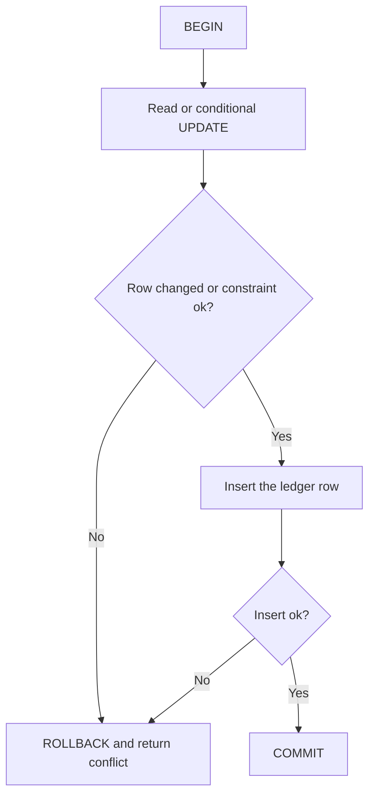

## Why this matters

Most Python backend interviews become SQL interviews halfway through. The service is fine and the query is a full table scan, or two requests debit the same balance, or a join duplicates rows and the invoice total is wrong. You do not need to be a database administrator. You need to write a correct SELECT, know why an index exists, and know what a transaction commits. ORMs later in this module generate this SQL. If you cannot read it, you cannot review it.

## Intuition

A table is a set of rows with named columns. A query describes the rows you want. The engine chooses a plan. WHERE throws rows away. JOIN matches rows from two tables. GROUP BY collapses many rows into one per key. ORDER BY and LIMIT shape the page you return. An index is a side structure that lets the engine find matching rows without reading every row. A transaction is a bracket around several statements that commit together or roll back together. Those six ideas cover the questions that decide a 15 to 20 LPA loop.

## Core concept in depth

### Filtering and projection

SELECT names the columns. Star is convenient in a console and careless in an application: you pull columns you do not need, including ones added later that contain secrets. Name the columns. WHERE runs before grouping. Predicates should be sargable when you care about an index: compare a column to a value, do not wrap the column in a function if you want the index on that column to be usable. `WHERE lower(email) = ...` often cannot use an index on `email` unless you indexed the expression. Store a normalized email if you always search that way.

NULL means unknown. `NULL = NULL` is not true in SQL. Use `IS NULL`. Aggregates skip NULL. `COUNT(*)` counts rows. `COUNT(email)` counts rows whose email is not NULL. Those two numbers diverge the first time a column is optional, and a bug report will say the count is short.

### Joins

INNER JOIN keeps matches only. LEFT JOIN keeps every left row and fills the right side with NULL when there is no match. A left join followed by `WHERE right.id IS NOT NULL` is an inner join in disguise, and it surprises people who thought they were keeping the unmatched parents. Put the right-table predicate in the ON clause if you want to keep the parent.

Joins match every pair that satisfies the condition. If a customer has three invoices and you join customers to invoices to payments without noticing that payments also multiply, a SUM of invoice totals counts the same invoice once per payment. Aggregate the child before you join, or sum distinct ids you have proved are unique. Draw two small tables and the result before you trust a number.

### Grouping and pagination

GROUP BY columns are the ones that identify the bucket. Every other selected column must be aggregated. A database in non-strict mode may let you select a stray column and return an arbitrary value. Do not depend on that. HAVING filters after aggregation. WHERE filters before. "Customers with at least three invoices" is a HAVING on `COUNT(*)`.

ORDER BY must name a stable column if you page. LIMIT without ORDER BY returns an arbitrary subset. Offset pagination gets slower as the offset grows because the engine still walks the skipped rows, and it skips or duplicates if rows are inserted. A cursor of the form "id greater than the last id, order by id" uses an index and stays stable. The REST lesson said the same thing from the API side. This is the query.

### Indexes

An index on `invoices(customer_id, created_at)` supports a filter on customer_id plus an order by created_at for that customer. It does not efficiently support a filter on created_at alone, because the customer_id is the leading column. The leftmost prefix rule is the interview sentence. Equality columns first, then the range or the sort.

Indexes speed reads and slow writes, and they take space. Index foreign keys you join on and columns you filter at high cardinality. Do not index every column because a checklist said so. A unique index is also a constraint: it is how you stop two users with the same email even if two requests race. Check constraints and foreign keys belong in the database, not only in Python. The application will have a bug. The constraint is the last line.

EXPLAIN, or EXPLAIN QUERY PLAN in SQLite, shows whether the plan scans a table or seeks an index. Read it when a page is slow. A sequential scan of a hundred rows is fine. A sequential scan of ten million rows on every request is the incident.

### Transactions and isolation

BEGIN, do the work, COMMIT. If any statement fails, ROLLBACK. Autocommit mode commits every statement, which means a debit can succeed and the matching ledger insert can fail, and you have lost money. Wrap the pair.

The classic race: read balance 100, subtract 40 in Python, write 60, while another transaction did the same and also writes 60. Both thought they saw 100. The fix is one statement, `UPDATE accounts SET balance = balance - 40 WHERE id = ? AND balance >= 40`, and check that one row changed. Or lock the row with `SELECT ... FOR UPDATE` inside a transaction, then update. Optimistic version columns work too: update where version equals the version you read, and treat zero rows as a conflict.

Isolation levels change what concurrent transactions can observe. Read committed is a common default: you do not see uncommitted rows. It still allows the lost update above if you read and write in two statements without a lock or a conditional update. Serializable would abort one of the transactions. Know the anomaly name, lost update, and the SQL you use to prevent it. Do not claim a unique isolation level fixes it unless you can say which engine and which level.

## Diagram / flowchart



### Dry-run: lost update versus conditional update

Two clerks debit 40 from a balance of 100.

| Step | Clerk A | Clerk B | Balance if each writes a computed number | Balance if SQL subtracts with a guard |
| --- | --- | --- | --- | --- |
| Read | sees 100 | sees 100 | 100 | 100 |
| Write | sets 60 | sets 60 | 60, one debit lost | first update to 60, second updates to 20 because it subtracts from the current row |

Join dry-run: customers Ada and Grace. Ada has invoices 10 and 15. Grace has none. An inner join returns two rows, both Ada. A left join returns Ada twice and Grace once with NULL invoice columns. SUM of invoice amount on the inner join is 25. SUM on the left join is still 25 because SUM skips NULL. COUNT of rows on the left join is 3, not 2. If you counted rows to count invoices, Grace invented a phantom invoice. Count the invoice id column, not the star, when unmatched parents exist.

Index dry-run: a query filters customer_id and orders by created_at. A composite index with customer_id first can seek that customer's slice already in time order. An index on created_at alone can walk time across every customer and then throw most rows away. EXPLAIN is how you tell which plan you got.

## Code

```python
def apply_debit(balance: int, amount: int) -> int | None:
    if amount <= 0:
        raise ValueError("amount must be positive")
    if balance < amount:
        return None
    return balance - amount


def invoice_count(rows: list[tuple[str, int | None]]) -> int:
    return sum(1 for _customer, invoice_id in rows if invoice_id is not None)


if __name__ == "__main__":
    print(apply_debit(100, 40))
    print(apply_debit(30, 40))
    rows = [("ada", 1), ("ada", 2), ("grace", None)]
    print(invoice_count(rows))
```

`apply_debit` is the predicate you want in SQL: change the row only when the balance can cover the debit, and treat a miss as a conflict rather than as a silent clamp. `invoice_count` counts real invoice ids so the unmatched parent does not count. The production statements are parameterized, which the SQLite lesson shows. The arithmetic and the join cardinality are the parts interviews ask you to do on a whiteboard.

## Complexity analysis

| Plan | Time | When it is acceptable |
| --- | --- | --- |
| Sequential scan | Θ(n) rows read | Tiny tables, rare reports |
| Index seek plus a small range | Θ(log n + k) | The request path |
| Nested loop join without an index | Θ(n·m) | A bug if both sides are large |
| Index nested loop | Θ(n · log m) roughly, plus matches | The usual indexed join |
| Offset k | Walks k rows to discard them | Shallow pages only |
| Cursor on an indexed column | Seeks the next page | Deep pages |
| Conditional update | One round trip, row lock | The debit path |

A missing index turns a page endpoint into a scan that gets worse every week. The complexity is why you look at EXPLAIN before you rewrite the Python.

## Tricks, tips and patterns

- Name columns. Treat NULL with IS NULL. Count a column when you mean non-NULL values.
- Draw join cardinality on three rows before you SUM.
- WHERE filters before groups. HAVING filters after.
- Put equality columns first in a composite index, then the sort or the range.
- Unique indexes enforce what Python checks only in the happy process.
- One transaction for a debit and its ledger row. Conditional update or row lock stops the lost update.
- ORDER BY a stable key before LIMIT. Prefer a cursor over a deep offset.
- Read EXPLAIN when a query is slow. Do not add an index you cannot name a query for.

## Common mistakes and edge cases

- `WHERE customer_id = NULL` matches nothing. The predicate is IS NULL.
- A left join turned into an inner join by a WHERE on the right table.
- A SUM inflated because a second join multiplied rows.
- LIMIT without ORDER BY, so pages flicker.
- Read-modify-write of a balance in Python across two transactions.
- A function on a column that disables the index you added yesterday.
- Autocommit between the debit and the audit insert.
- Selecting every column, including a secret added to the table later.

## Interview notes

Write the debit as one conditional UPDATE and say you check the row count. Write a left join and say where the filter sits. Mention the leftmost prefix of a composite index. Mention a transaction around the two statements. That is a complete answer. Do not start with "I would use an ORM" until you have said the SQL.

Follow-ups:

- **INNER versus LEFT?** Matches only, versus all of the left plus NULL when the right is missing.
- **Where does a lost update come from?** Two transactions read the same value and each write a result computed from that stale read.
- **What does a unique index buy?** A race-proof constraint, not only a faster lookup.
- **Why is deep OFFSET slow?** The engine visits and discards the skipped rows.

If they ask about isolation, name read committed and the lost update, and say you prevent it in SQL rather than hoping the default isolation does it.

## Practice problems

1. **Conditional Debit** (medium) — subtract only when the balance covers the amount, otherwise signal a miss. [Practice: python-ex-conditional-debit]
2. **Invoice Count** (easy) — count joined rows that actually have an invoice id. [Practice: python-ex-invoice-count]
3. **Index Prefix** (medium) — say whether a composite index serves a given filter and sort. [Practice: python-ex-index-prefix]
4. **Having Split** (medium) — given row filters and aggregate filters, say which clause each belongs in. [Practice: python-ex-having-split]

## Summary / cheat sheet

- SELECT named columns. WHERE before GROUP BY. HAVING after. NULL is unknown, tested with IS NULL.
- INNER JOIN drops unmatched rows. LEFT JOIN keeps them. Filters on the right table belong in ON if you want to keep parents. Watch multiplied SUM.
- Index the leftmost columns you constrain. Unique indexes are constraints. Confirm the plan with EXPLAIN.
- A transaction commits both the debit and the ledger row or neither.
- Do not read a balance in Python and write it back. Subtract in SQL with a guard, or lock the row.
- Page with ORDER BY and a cursor. Deep offsets walk rows you throw away.
- The ORM lesson writes this SQL for you. You still have to recognize it.

## Further reading

- [SQLite query language](https://www.sqlite.org/lang.html)
- [SQLite query planner](https://www.sqlite.org/queryplanner.html)
- [PostgreSQL indexes](https://www.postgresql.org/docs/current/indexes.html)
- [PostgreSQL transaction isolation](https://www.postgresql.org/docs/current/transaction-iso.html)
