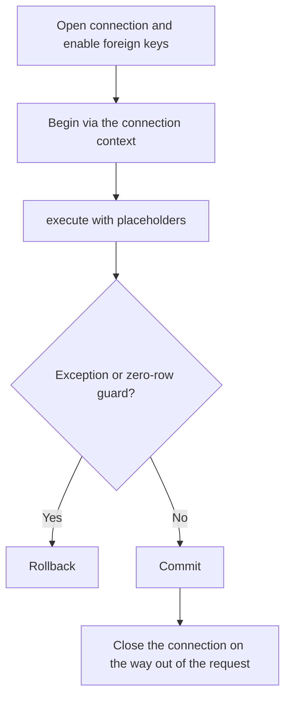

## Why this matters

`sqlite3` ships with Python. Interviews use it because you can show a real INSERT and SELECT without installing a server. Production services often use Postgres, and the habits are the same: parameters instead of string formatting, a transaction around related writes, and a connection per thread or per request rather than a process-wide global you share by accident. SQLite is also the right database for tests of SQL you wrote, as long as you remember which features differ from Postgres.

## Intuition

A connection is a session with the database file. A cursor runs statements. Placeholders in the SQL, usually question marks, are bound to values by the driver. The values are never parsed as SQL. `with connection:` commits if the block succeeds and rolls back if it raises. That is the transaction. `row_factory` decides whether you get tuples or mappings. Foreign keys are off unless you turn them on. Those defaults surprise people who learned SQL on a server that enables them.

## Core concept in depth

### Open, configure, close

`sqlite3.connect(path)` opens a file, or `:memory:` for a private database that dies with the connection. A memory database is perfect for a unit test and useless if you open a second connection and expect to see the same rows. Each connection to `:memory:` is a new database unless you use a shared cache URI on purpose. For a file, enable foreign keys on every connection with `PRAGMA foreign_keys = ON`. SQLite will not enforce them otherwise, and your ON DELETE CASCADE will silently do nothing.

Set `row_factory` to `sqlite3.Row` when you want `row["email"]`. Tuples break when someone inserts a column in the middle of the SELECT list. Close the connection, or use it as a context manager. In a web app, open a connection for the request and close it in the dependency teardown from the FastAPI lesson. Do not store one connection on a global and use it from several threads. SQLite connections are not happy crossing threads unless you set a check flag you should not set just to silence an error. One connection per thread, or a pool that checks out that way.

WAL mode is the pragma you turn on for a file database with readers and one writer. It is a reasonable default for a small service. It is not a substitute for Postgres when you have many writers.

### Parameters, not formatting

```python
cur.execute("SELECT id FROM users WHERE email = ?", (email,))
```

The trailing comma makes a one-tuple. Forget it and you pass a string, and the driver will try to treat the string as a sequence of characters. That bug appears the first time an email is longer than one character and the statement expected one placeholder. Named placeholders, `:email`, bind from a mapping and are easier to read when a statement has many values.

Never build SQL with an f-string or with percent formatting of a user value. `' OR '1'='1` is the textbook injection, and a quote in a real name is the accidental version. Identifiers such as table names cannot be parameters. If a sort column comes from the client, allow it only through a dict of known column names you control, and interpolate that safe name. Do not pass the raw query string through.

`executemany` inserts a sequence of tuples in one call. It is the batch path. A Python loop of single inserts inside a transaction is correct and slower. A loop of inserts that each commit is much slower and is what you get if you forget the transaction.

### Transactions

The connection context manager commits on success and rolls back on exception. It does not open a new transaction style beyond SQLite's rules, and it does not close the connection. Call `execute` inside the block for the debit and the ledger insert. If the second statement raises, the first is rolled back when you leave the block because of the exception. Check `rowcount` after a conditional UPDATE. Zero means the guard failed. Raise your own error so the block rolls back the rest.

Isolation: SQLite's default locking is coarser than Postgres row locks. Two writers serialize. `BEGIN IMMEDIATE` takes the write lock at the start so you fail fast instead of failing at commit. For the debit, a conditional UPDATE is still the right statement. Do not read the balance out, compute in Python, and write it back, even on SQLite. The SQL lesson's race exists here too if you allow overlapping transactions.

### Schema in tests

Create tables in the test from a SQL string you also ship, or from a migration you trust. Insert the fixture rows with parameters. Point the application at the memory connection or a temporary file from `tmp_path`. Assert the rows after the service call. This is an integration test of SQL, and it is still fast. Mocking the cursor to check that a string was executed does not prove the SQL is valid. Prefer a real SQLite database for that assertion, and reserve mocks for a client you cannot run.

Types: SQLite is flexible to a fault. An INTEGER column can store a string if you are not careful with declarations and if you skip strict tables. Enable `STRICT` tables on new schemas if your SQLite version supports them, or check types in Python before insert and with constraints. Dates stored as ISO text sort correctly. Dates stored as a display format do not.

## Diagram / flowchart



### Dry-run: injection versus a parameter

Email input is `ada@example.com`. Both styles return her row.

Email input is a string that closes the quote and adds `OR 1=1`. The formatted SQL becomes a tautology and returns every user. The parameterized SQL searches for a user whose email equals that odd string, finds nobody, and returns an empty list. The query text in the second case never changes. Only the bound value changes. That is the whole defense.

Transaction dry-run: balance 100, debit 40, then the ledger insert raises. Inside the context manager the exception triggers rollback, and a following SELECT sees 100. Without the context manager, and with autocommit, the SELECT sees 60 and no ledger row. The books do not add up. `rowcount` dry-run: balance 30, debit 40, the conditional update changes zero rows, you raise, you do not insert a ledger line for a debit that did not happen.

## Code

```python
import sqlite3


def transfer(conn: sqlite3.Connection, account_id: int, amount: int) -> str:
    if amount <= 0:
        raise ValueError("amount must be positive")
    try:
        with conn:
            cur = conn.execute(
                """
                UPDATE accounts
                SET balance = balance - ?
                WHERE id = ? AND balance >= ?
                """,
                (amount, account_id, amount),
            )
            if cur.rowcount != 1:
                raise ValueError("insufficient balance")
            conn.execute(
                "INSERT INTO ledger(account_id, amount) VALUES (?, ?)",
                (account_id, -amount),
            )
    except ValueError:
        return "rejected"
    return "ok"


def setup() -> sqlite3.Connection:
    conn = sqlite3.connect(":memory:")
    conn.execute("CREATE TABLE accounts(id INTEGER PRIMARY KEY, balance INTEGER NOT NULL)")
    conn.execute("CREATE TABLE ledger(id INTEGER PRIMARY KEY, account_id INTEGER, amount INTEGER)")
    conn.execute("INSERT INTO accounts(id, balance) VALUES (1, 100)")
    return conn


if __name__ == "__main__":
    conn = setup()
    print(transfer(conn, 1, 40))
    print(conn.execute("SELECT balance FROM accounts WHERE id = 1").fetchone()[0])
    print(transfer(conn, 1, 1000))
    print(conn.execute("SELECT balance FROM accounts WHERE id = 1").fetchone()[0])
    print(conn.execute("SELECT COUNT(*) FROM ledger").fetchone()[0])
```

The first transfer commits a balance of 60 and one ledger row. The second transfer's update matches zero rows, raises, and the context manager rolls back. There is still no second ledger row, and the balance stays 60. The SQL text contains question marks only. The amount and the id travel as parameters. A test can run `setup` and `transfer` without a server. Production Postgres would use `%s` or named binds depending on the driver, and the transaction shape would stay.

Remember the one-tuple. `(amount)` without a comma is just parentheses around a number. The driver then errors, or worse, iterates something you did not mean. Write `(amount,)` and read it back in review.

## Complexity analysis

| Pattern | Round trips and locks | Risk |
| --- | --- | --- |
| Parameterized execute | One statement | Injection closed for values |
| f-string SQL | One statement | Injection open |
| executemany inside one transaction | One transaction, many rows | Fast enough for bulk tests and imports |
| Commit per insert | A fsync per row on a file database | Painfully slow |
| Connection per request | Open cost is small on SQLite | Correct thread use |
| Shared connection across threads | Undefined | Corrupt errors and heisenbugs |
| Memory database per test | Setup cost of your schema | Isolated, and invisible to a second connection |

SQLite write throughput is one writer. The win on the application side is fewer commits and set-based statements, not threads hammering one file.

## Tricks, tips and patterns

- Bind every value. Allow-list any identifier that comes from outside.
- Use the connection as a context manager so an exception rolls back.
- Check `rowcount` on a guarded UPDATE before you insert dependent rows.
- Turn foreign keys on for every connection. Consider STRICT tables.
- Use `sqlite3.Row` or explicit column names. Do not index tuples by a magic number in application code.
- One connection per thread or per request. Memory databases are per connection.
- `executemany` for batches, still inside one transaction.
- Test SQL against real SQLite, not against a mocked cursor string.

## Common mistakes and edge cases

- Forgetting the comma in a one-element parameter tuple.
- Formatting SQL with an f-string because the value "came from our database already." Second-order injection is still injection.
- Assuming foreign keys are on. They are not until the pragma.
- Two connections to `:memory:` and a test that cannot see the fixture.
- Using a connection from another thread because a framework reused a global.
- Autocommit between two writes that must agree.
- `rowcount` ignored, so a failed debit still writes a ledger line you added outside the guard.
- A sort field taken from the query string and interpolated into ORDER BY.

## Interview notes

Say you would use `sqlite3` with placeholders, a transaction context, and a conditional update. Mention foreign keys are off by default. Mention one connection per thread. Mention you would run the same statement shape on Postgres with the driver's placeholder style. Offer the one-tuple bug if they want a practical trap.

Follow-ups:

- **Why not format the SQL?** The value would be parsed as SQL. Parameters are data.
- **What does `with conn` do?** Commit if the block exits cleanly, roll back if it raises. It does not close the connection.
- **How do you test this?** A fresh memory database, create the schema, call the function, SELECT the rows.
- **Can you parameterize a column name?** No. Map it from an allow-list.

If they ask about SQL injection you found in a review, describe a value concatenated into a WHERE clause and the parameterized replacement. Do not describe a toy exploit in more detail than that sentence.

## Practice problems

1. **Guarded Transfer** (medium) — apply a debit and a ledger row, or neither, when the balance is too small. [Practice: python-ex-guarded-transfer]
2. **Placeholder Count** (easy) — given a SQL string, count the question-mark placeholders and compare to the parameter count. [Practice: python-ex-placeholder-count]
3. **Allow Sort** (medium) — map a client sort key through an allow-list or reject it. [Practice: python-ex-allow-sort]
4. **Foreign Key Flag** (easy) — given whether the pragma ran, say if a bad child insert is rejected. [Practice: python-ex-fk-flag]

## Summary / cheat sheet

- `sqlite3` is the standard-library database. Use it for real SQL in tests and small tools.
- Placeholders carry values. A one-tuple needs a comma. Never format user data into the statement text.
- `with connection` commits or rolls back. Check `rowcount` for conditional updates.
- Enable foreign keys on every connection. `:memory:` is not shared across connections by default.
- One connection per thread. Close it at the end of the request.
- Batch with `executemany` inside one transaction.
- Assert rows in SQLite. Do not mock the SQL string and call it a database test.
- The placeholder character changes by driver. The rule does not.

## Further reading

- [sqlite3](https://docs.python.org/3/library/sqlite3.html)
- [SQLite foreign keys](https://www.sqlite.org/foreignkeys.html)
- [SQLite STRICT tables](https://www.sqlite.org/stricttables.html)
- [SQLite locking](https://www.sqlite.org/lockingv3.html)
