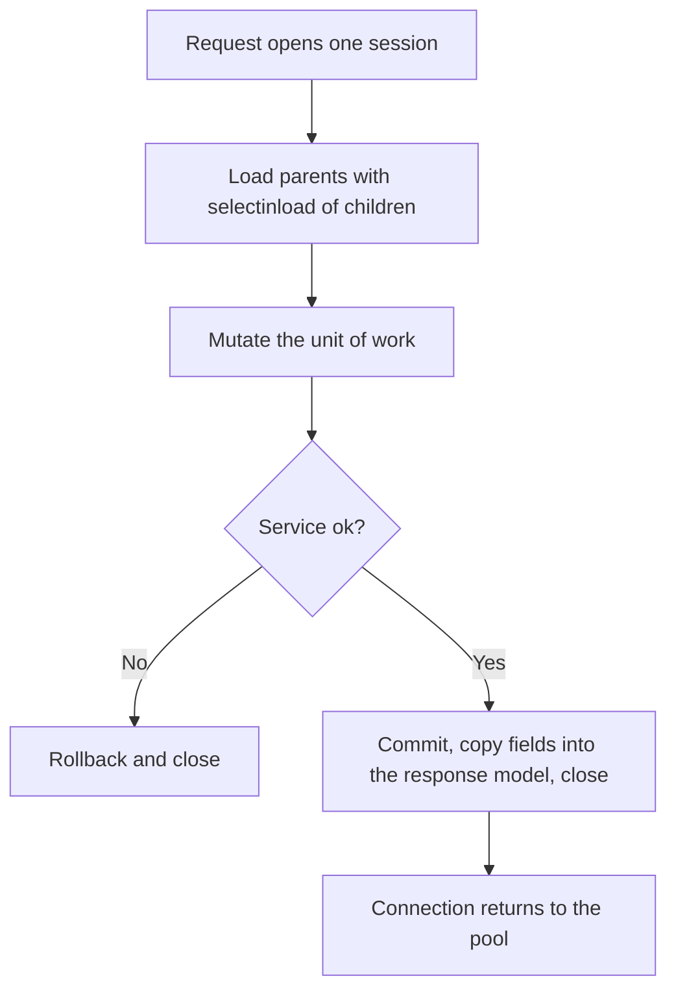

## Why this matters

SQLAlchemy is the library you will meet in Python services that talk to Postgres. The ORM looks like attribute access. That is the trap. `invoice.lines` can hide a SELECT. A list of fifty invoices can hide fifty more SELECTs, and the endpoint times out only after the data grows. The session is a unit of work with an identity map, not a global cache you leave open for the life of the process. Interviews ask you to spot the N+1 query and to say when you commit. Both answers are about the session and the loader, not about memorizing every query API.

## Intuition

You define mapped classes that correspond to tables. A `Session` remembers objects you have loaded or added. When you flush, it sends INSERT, UPDATE, and DELETE for the pending changes. When you commit, it flushes and commits the transaction. If you access a relationship that was not loaded, the default lazy load issues a new SELECT if the session is still open. If the session is closed, you get an error instead of a silent query, which is better in a web app. Eager loading asks for the related rows up front, in one extra query or in the same query, so the template or the serializer does not touch the database.

## Core concept in depth

### Engine, session, lifespan

The engine is a pool of connections aimed at a URL. Create it once at process start. A session factory binds to that engine. Each request gets a session, does its work, commits or rolls back, and closes. Closing returns the connection to the pool. Creating an engine per request builds pools you never use and can exhaust connections on the server. A session stored on a global and reused across requests leaks identity-map state: you see a stale object, or you flush one user's change into another user's request if you are careless with threads. Sessions are not thread-safe. One session per request, used in that request's thread or task.

`session.execute` with a selectable is the 2.0 style, and it is what you should write. The old `Query` API still appears in codebases. Read it, do not add more of it. `session.get(Invoice, id)` loads by primary key and uses the identity map: the second get in the same session does not hit the database. That is a feature inside one unit of work and a source of staleness if the session lives too long.

### Unit of work

Add new objects, mutate attributes, delete. The session tracks dirtiness by instrumenting attribute sets. A bulk SQL update that bypasses the ORM does not update objects already in the identity map. Expire or refresh if you mix styles. Commit at the boundary after the service succeeds. Roll back if the service raises. Do not commit in the middle of a function that might still fail a later check, or you will persist a half-finished invoice. The FastAPI dependency that yields a session is the usual boundary: commit on the way out if the route did not raise, roll back and close in a finally path if it did. Pick one policy and use it everywhere.

Detached objects are instances whose session is closed. Touching an unloaded attribute raises `DetachedInstanceError` if you expired them, or it shows leftover data if you kept the attributes loaded. Configure `expire_on_commit` knowingly. Web handlers that return a response model should copy the fields they need before the session closes, or load everything required while it is open. Returning a live ORM object into a serializer that runs after close is a flaky 500.

### N+1 and loading

The N+1 pattern: one query for the page of parents, then one query per parent for the children, because each relationship lazy-loads. Fifty invoices, fifty line queries, plus the original query. The fix is eager loading. `selectinload` issues a second query that loads all children for the parent ids with an IN clause, which is two queries total. `joinedload` puts a JOIN in the original query, which can multiply parent rows if you are not careful with unique handling. Use `selectinload` for collections. Use `joinedload` for a many-to-one you always need, such as an invoice's customer, where the join does not multiply.

The symptom in logs is the same SELECT text repeated with different ids. Turn on SQL echo in a test or look at the database log. A test can assert the number of statements with an event listener or a query counter. If you only assert the JSON, a later edit can reintroduce the N+1 and the test stays green until production data grows.

`contains_eager` and manual joins are for queries you already joined. Do not sprinkle eager options on every relationship by default. You will pull the entire graph for a route that needed two columns. Load what the response needs.

### Core and ORM

SQLAlchemy Core is tables, insert, select, and connections. The ORM is mapped classes on top. Use the ORM for a unit of work around your domain objects. Use Core, or `session.execute` of an update statement, for a bulk price change where loading a million objects would be the bottleneck. Do not feel you must use one style. Do feel you must know which one a function uses, because bulk SQL skips Python validators on the model unless you repeat them in SQL.

Relationships need foreign keys. `cascade` on a relationship controls whether deleting a parent deletes children in the ORM. The database foreign key ON DELETE is a separate switch. If they disagree, a delete does something different in a test that uses the ORM and a script that uses SQL. Align them.

Transactions and the conditional debit from the SQL lesson still apply. `session.execute` of an UPDATE with a balance guard, then check `rowcount`, then add the ledger object, then commit once. The ORM will not invent that guard for you if you do `account.balance -= 40` from a stale read.

## Diagram / flowchart



### Dry-run: query count for fifty invoices

| Loader | Statements | Rows transferred |
| --- | --- | --- |
| Lazy load in a loop | 1 for invoices plus 50 for lines | Correct data, 51 round trips |
| selectinload of lines | 2 | Same data, one IN query for lines |
| joinedload of lines, forgetting unique | 1 SQL statement | Parent invoices repeated once per line in the raw result |

The third row is still one round trip and can confuse a LIMIT. You asked for 50 invoices, the join produced 50 times the average lines, and the limit applied to joined rows. `selectinload` keeps the limit on the parent query. That is why it is the default recommendation for collections.

Stale session dry-run: request A loads invoice 1 into a process-global session. Request B commits a change with another session. Request A still sees the old object in the identity map and writes it back. Close the session at the end of A and the next request loads fresh.

## Code

```python
def statement_count(parents: int, lines_each: int, strategy: str) -> int:
    if parents < 0 or lines_each < 0:
        raise ValueError("counts must be non-negative")
    if strategy == "lazy":
        return 1 + parents
    if strategy == "selectin":
        return 2 if parents else 1
    if strategy == "join":
        return 1
    raise ValueError("unknown strategy")


def guarded(balance: int, amount: int) -> int | None:
    if amount <= 0:
        raise ValueError("amount must be positive")
    if balance < amount:
        return None
    return balance - amount


if __name__ == "__main__":
    print(statement_count(50, 3, "lazy"))
    print(statement_count(50, 3, "selectin"))
    print(guarded(100, 40))
    print(guarded(10, 40))
```

`statement_count` is the model of the log you should read. The lazy number grows with the page size. The selectin number does not. In the real app the calls are `select(Invoice).options(selectinload(Invoice.lines))` and a session scoped to the request. `guarded` is the check that belongs in the UPDATE predicate so two workers cannot both spend the same balance. Tests of the service use SQLite and count statements. Tests of the route override the session factory. Neither test should require Postgres unless you depend on a Postgres-only feature, and then that test should be marked integration.

## Complexity analysis

| Approach | Queries | Memory | Staleness |
| --- | --- | --- | --- |
| Lazy collection per row | Θ(n) queries | Low per query | Fresh if the session is short |
| selectinload | Θ(1) queries | The page and its children | Same |
| joinedload on a collection with LIMIT | 1 query, wrong limit semantics | Duplicated parent data | Same |
| Session per request | Checkout from the pool | Identity map for one request | Dropped at close |
| Session for the process | 0 open cost | Unbounded identity map | High |
| ORM load of a million rows to update one column | 1 huge read plus a huge flush | The million objects | Use Core update instead |

The N+1 cost is latency from round trips, which dominates CPU. Fixing it is an algorithmic change in the number of queries, the same way the performance module talked about chatty I/O.

## Tricks, tips and patterns

- One engine per process. One session per request. Close it.
- Commit at the service boundary, not between two checks that can still fail.
- `selectinload` collections you will serialize. `joinedload` singular relationships.
- Count SQL statements in a test for any endpoint that returns a list of parents with children.
- Copy into a response model before the session closes.
- Bulk updates can be Core statements. Do not load a million objects to change one column.
- Put lost-update guards in SQL, even if the object looks easier to edit in Python.
- Align ORM cascades and database foreign keys.

## Common mistakes and edge cases

- A global session, or an engine created inside the route.
- Lazy loads in a template after you thought the handler was done, showing up only when the page has many rows.
- `joinedload` plus LIMIT returning fewer parents than you asked for.
- Commit, then touch an expired relationship and emit a query you did not expect, or a detach error.
- A bulk update that leaves in-memory objects stale, then a later flush writes the old values back.
- Forgetting `unique()` on a joined eager result and returning duplicate parents.
- Cascades that delete children in the ORM and a foreign key that restricts, so the flush explodes.
- Hiding the N+1 in development because each developer has three invoices.

## Interview notes

Define N+1 with the fifty-invoice story and name `selectinload` as the fix. Say the session is a unit of work per request, the engine is a process-wide pool, and you commit once. Mention `DetachedInstanceError` if they ask what happens when you serialize after close. Mention you would still use a conditional UPDATE for a balance.

Follow-ups:

- **What is the identity map?** Within one session, one Python object per primary key. A second load returns the same instance.
- **selectinload versus joinedload?** A second query with IN for collections, versus a join that can multiply rows.
- **Why not one session for the process?** It is not thread-safe, it pins memory, and it serves stale state.
- **When do you skip the ORM?** Bulk SQL, reports, and guards that must run inside the database.

If they ask you to spot the bug in a code sample, look for a loop that touches a relationship, a commit in the middle, and a session created next to the query.

## Practice problems

1. **Query Count** (medium) — given a page size and a strategy, return how many statements run. [Practice: python-ex-query-count]
2. **Guarded Balance** (medium) — apply the in-database style guard and report a conflict. [Practice: python-ex-guarded-balance]
3. **Unique Parents** (easy) — collapse joined parent ids that were repeated once per child. [Practice: python-ex-unique-parents]
4. **Session Scope** (easy) — given a described session lifetime, say whether a second request can see a stale object. [Practice: python-ex-session-scope]

## Summary / cheat sheet

- The engine and pool live for the process. The session lives for one request and is not shared across threads.
- Flush sends pending changes. Commit ends the transaction. Roll back on failure. Do not commit halfway.
- Lazy loading per row is the N+1 query. `selectinload` a collection. Be careful with `joinedload` and LIMIT.
- Count statements in tests. Echo SQL when a page gets slow only on large data.
- Copy values out before you close if the serializer must not touch the session.
- Bulk work belongs in Core. Lost updates belong in a SQL predicate, not in a stale attribute.
- The identity map dedupes loads inside one session and goes stale if you never close it.
- ORM cascades and database foreign keys must agree.

## Further reading

- [SQLAlchemy session basics](https://docs.sqlalchemy.org/en/20/orm/session_basics.html)
- [Loading relationships](https://docs.sqlalchemy.org/en/20/orm/queryguide/relationships.html)
- [Session events and expire](https://docs.sqlalchemy.org/en/20/orm/session_state_management.html)
- [Engine and connection pool](https://docs.sqlalchemy.org/en/20/core/pooling.html)
