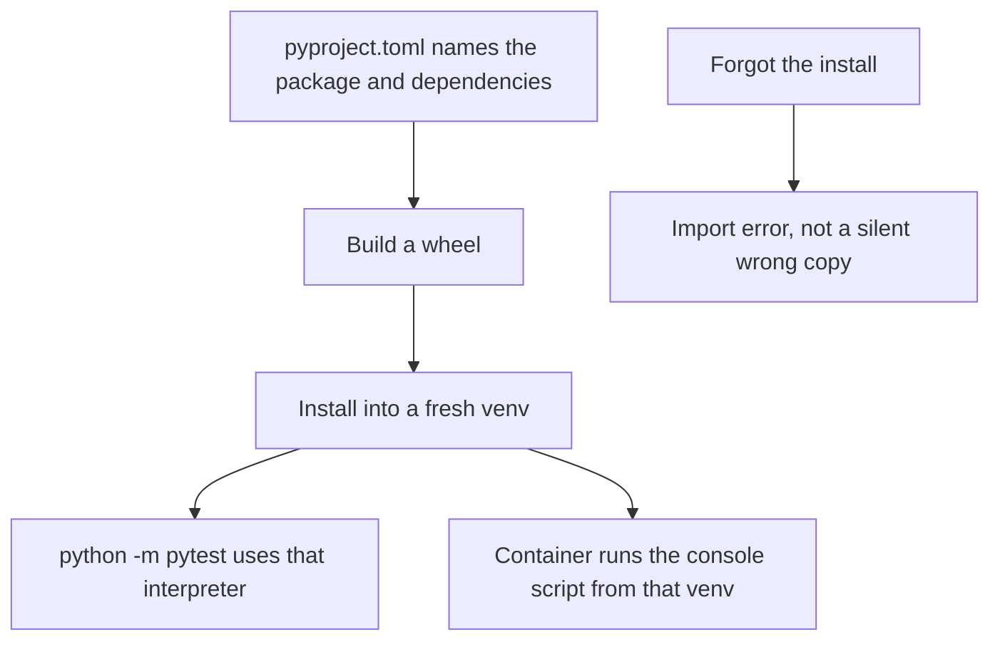

## Why this matters

A project that only runs because you launched Python inside the repository will fail in CI, in a container, and on a teammate's machine. Packaging is how you name the import, declare dependencies, and build a wheel. Interviews for backend roles ask you to explain a virtual environment, pin dependencies, and why a src directory exists. The practical bar is smaller than a full release-engineering job: one installable package, a lockfile or pinned requirements for the app, and a console script or a module you can start with `python -m`.

## Intuition

A virtual environment is a directory with its own interpreter and site-packages. The project is installed into that directory, either as a copy or as an editable link. `pyproject.toml` tells the build tool the package name, the version, the Python version, and the dependencies. The src layout puts the importable package in a src directory so that a test cannot import it unless it is installed. That sounds fussy until a test passes by importing a local folder and production imports an older installed copy, or the reverse. One install path removes the ambiguity.

## Core concept in depth

### The environment

Create a venv with `python -m venv .venv` and use that interpreter. Do not install application dependencies into the system Python. Activate the venv, or call the venv interpreter directly. On Windows that executable lives under `.venv\Scripts\python`. Tools that cannot find pytest are almost always using a different interpreter than the one you installed into. `python -m pytest` uses the interpreter you named. A bare `pytest` uses whatever is first on PATH. Prefer the `-m` form in documentation and CI.

The interpreter version is part of the contract. If production runs 3.12, the venv should be 3.12. A syntax or typing feature from a newer release will pass locally and fail in the image. State `requires-python` in the project table so installers refuse the wrong version.

### The project table

The build-system table names the backend, often setuptools or hatchling. The project table holds the name, the version, `requires-python`, and the dependencies. Dependencies are version specifiers: a lower bound you have tested, sometimes an upper bound when you know a major version breaks you. An unpinned dependency means today's install and next month's install are different artifacts. For an application, pin the full graph in a lockfile. For a library, declare ranges and let the application pin.

Optional dependencies live in the optional-dependencies table. A dev extra holds pytest, ruff, and mypy. Production images install the main dependencies only. CI installs the dev extra. That split keeps the runtime image small and keeps test plugins off the server.

The scripts table maps a command name to `package.module:function`. After install, the venv's bin directory has that command. It is the right way to expose a worker or a CLI. `python -m package` is the other entry, and it needs a `__main__.py` if you want the module to be runnable. Both beat a shell script that sets `PYTHONPATH` by hand.

### Src layout and imports

A typical tree has the package under `src/myapp`, tests next to `pyproject.toml`, and no importable package sitting in the repository root. `pip install -e .` puts an editable install on the path. Tests import `myapp` and get that package. If you forget the install, the import fails immediately instead of silently importing a stray folder you left in the root. Configure the build backend's package discovery to look in src. A flat layout can work and is easier to get wrong. Prefer src for anything you will install in CI.

Inside the package, use absolute imports such as `from myapp.billing import charge`. Relative imports are for intra-package use and break when a file is run as a script. Do not run a package file by path. Run `python -m myapp` or the console script so the package context exists.

### Wheels, images, and secrets

`python -m build` produces an sdist and a wheel. The wheel is what you install. A container image should install the wheel, or install the project, into a venv in the image, as a non-root user, with a lockfile so the build is reproducible. Do not copy the repo and set `PYTHONPATH` to the app directory. Do not pip install as root into the system interpreter and then run the app as root.

Dependencies come from an index you trust. Hashes in a lockfile, or pip's require-hashes mode, stop a swapped artifact. Secrets do not belong in `pyproject.toml`. They belong in the environment at runtime. A package version is not a secret. A database URL is.

Editable installs are for development. Production installs a built wheel so the container does not depend on a bind mount of your laptop. If a bug appears only in production, check that the image's version matches the commit you think you deployed. `importlib.metadata.version` on the package name is the runtime check.

### Application versus library

An application can pin exact versions and release by deploying an image. A library must not pin its dependencies so tightly that two libraries cannot coexist, and it must document a public import path. This course's service is an application. Do not publish it to a public index by accident. Name it, version it, and install it in the image. Private indexes exist for internal libraries. A requirements file generated from the lock is fine if the team already uses one. The principle is a reproducible install, not a specific brand of lockfile.

## Diagram / flowchart



### Dry-run: which copy gets imported

| Setup | Command | What import myapp loads |
| --- | --- | --- |
| Src layout, not installed, cwd is repo root | python -c | ImportError, src is not on the path by default |
| Editable install into the venv | venv python -m pytest | The src tree via the editable link |
| Wheel installed in the image | console script | The files copied into site-packages |
| PYTHONPATH set to the repo and also an older install | python | Whichever copy is first on sys.path, often the wrong one |

The last row is the production incident: a hotfix on the path and an old install, or the reverse. Installing one artifact and not mixing path hacks removes the row.

Version dry-run: `requires-python` says 3.12 or newer. A 3.11 venv fails at install with a clear error. Without that field, the install succeeds and the first 3.12-only syntax fails at runtime in a stack trace that looks like an application bug.

## Code

```python
def accepts_python(major: int, minor: int) -> bool:
    return (major, minor) >= (3, 12)


def runtime_deps(all_deps: list[str], dev_only: set[str]) -> list[str]:
    return [name for name in all_deps if name not in dev_only]


if __name__ == "__main__":
    print(accepts_python(3, 11))
    print(accepts_python(3, 12))
    deps = ["fastapi", "uvicorn", "pytest", "ruff"]
    print(runtime_deps(deps, {"pytest", "ruff"}))
```

`accepts_python` is the check `requires-python` encodes. `runtime_deps` is the split between the image and the dev extra: FastAPI and uvicorn stay, pytest and ruff do not. In the repository those lists live in the project table and the optional-dependencies table, and pip does the filter when you install without the extra. A test of the functions is not a substitute for a clean venv install in CI. Add that install to the pipeline: create a venv, upgrade pip, install the project with the dev extra, run pytest, and in a second job install without the extra and import the package.

## Complexity analysis

| Approach | Reproducible | Failure mode |
| --- | --- | --- |
| System Python, pip install as you go | No | Breaks the next project on the machine |
| Venv, unpinned deps | No, next week drifts | Works today |
| Venv plus lockfile | Yes for builds that honor the lock | Lock must be updated on purpose |
| PYTHONPATH to the repo | Only on that machine | Wrong copy, missing package data |
| Src layout plus editable install | Yes in dev | ImportError until you install, which is the point |
| Wheel in the image | Yes | Build must be in CI, not a laptop copy |

Install time is not the hot path. A wrong import is a correctness bug. Pay for the boring install.

## Tricks, tips and patterns

- One venv per project. Invoke tools with `python -m` so the interpreter is obvious.
- `requires-python` matches production. Dependencies for a service are pinned via a lock.
- Dev tools live in an extra. The runtime image does not install them.
- Src layout plus an editable install. Absolute imports. `python -m` or a console script.
- Build a wheel in CI and install that in the image. Do not set PYTHONPATH.
- Read the installed version from metadata when you need to know what is running.
- Keep secrets out of the project file. They are runtime configuration.
- A clean CI venv is the test that packaging works. Local success is not.

## Common mistakes and edge cases

- Running pytest from a global install against a venv you thought you activated.
- A flat module named the same as a dependency, so imports resolve to the local file.
- Shipping tests and dev dependencies in the production image.
- An editable install in production via a bind mount that differs from the commit the process started with.
- Forgetting package data, such as a SQL file, because it was not included in the wheel. Declare package data and test that it opens after install.
- Pinning nothing, then debugging a transitive upgrade during an incident.
- Committing the venv directory or a secrets file.
- Using sudo pip into the system interpreter.

## Interview notes

Say you would use a venv, a `pyproject.toml` with pinned application dependencies, a src layout, and a wheel install in the container. Mention the dev extra. Mention `python -m` so CI does not pick a random pytest. Mention you would not rely on PYTHONPATH. That is enough. If they want a library answer, switch to version ranges and a public API, and say you would not pin every transitive package in the library itself.

Follow-ups:

- **Why src?** Because tests then import the installed package, not a folder that happens to be the current directory.
- **Editable versus wheel?** Editable for local edits. A wheel for the image so the bits are frozen.
- **How do you reproduce a build?** Lockfile, Python version, and a clean venv. No global site-packages.
- **Where do secrets go?** The environment or a secret store, read at startup, not the package metadata.

Mention lockfile updates as their own change so a dependency bump is reviewable. That is the operational half of packaging.

## Practice problems

1. **Python Gate** (easy) — accept an interpreter version only when it meets the minimum. [Practice: python-ex-python-gate]
2. **Runtime Extra** (easy) — drop dev-only names from the install list. [Practice: python-ex-runtime-extra]
3. **Import Winner** (medium) — given path entries, say which copy of a package is imported. [Practice: python-ex-import-winner]
4. **Script Entry** (easy) — parse a module:function entry point into its two parts. [Practice: python-ex-script-entry]

## Summary / cheat sheet

- A venv isolates the interpreter and site-packages. Use it for every project. Call `python -m`.
- `pyproject.toml` names the package, the Python version, dependencies, extras, and scripts.
- Pin an application's full graph. Keep pytest and ruff in a dev extra.
- Src layout plus install makes imports honest. Absolute imports. Do not run files as scripts.
- Ship a wheel into the image. Do not point PYTHONPATH at a checkout.
- Package data must be included and tested after install.
- Secrets stay out of the package. The version can be read from installed metadata.
- CI should install into a fresh venv. That is the packaging test.

## Further reading

- [Writing your pyproject.toml](https://packaging.python.org/en/latest/guides/writing-pyproject-toml/)
- [Packaging Python projects](https://packaging.python.org/en/latest/tutorials/packaging-projects/)
- [Virtual environments](https://docs.python.org/3/library/venv.html)
- [importlib.metadata](https://docs.python.org/3/library/importlib.metadata.html)
