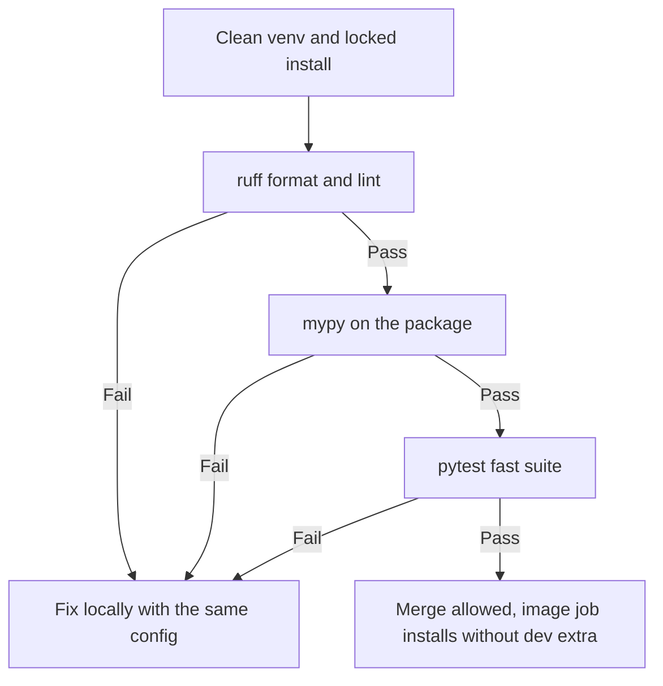

## Why this matters

A quality gate is a command that exits non-zero when the change is not safe to merge. Humans miss an unused import, a failing edge case, and a `None` that the type checker would have flagged. The tools in a Python backend interview and in a real service are boring on purpose: ruff formats and lints, pytest runs the suite, mypy checks the annotations you decided to trust. The design is which checks are required, how fast they are, and how a developer reproduces the CI command locally. A gate nobody can run locally will be fought. A gate that is red on main will be ignored.

## Intuition

Ruff replaces a pile of formatters and linters with one tool that knows common Python mistakes and a stable format. pytest runs the tests you wrote in the testing module. mypy reads the hints from the typing module and refuses a call that does not match. CI installs the package with the dev extra into a fresh venv, then runs the three commands. The order is cheap checks first: format and lint, then types, then tests, or lint and tests in parallel. Failures should name the file and the rule. A red build that only says the script failed, with no log, is not a gate. It is a delay.

## Core concept in depth

### Ruff

Ruff formats in the style of Black and lints a large slice of the rules people used to collect from flake8, isort, and bugbear. `ruff format --check` fails if the formatter would change files. `ruff check` fails on lint. CI uses the check forms. Developers run `ruff format` and `ruff check --fix` before they push. Config lives in `pyproject.toml` under the ruff tool table. Set the target Python version to production's version. Select a rule set you will actually fix. A config that enables every rule and then ignores a thousand lines teaches nothing.

Useful rules for a service include import sorting, unused imports, mutable default arguments, and bare except. Do not fight the formatter about line length in every review. Pick a length, often 88 or 100, and stop discussing it. `ruff check --fix` is safe for many rules and unsafe for a few that change behavior. Read the diff. An automatic fix that deletes a function you meant to export is still your commit.

Line-level ignores belong on the line, with a reason, for a rule you disagree with in that spot. File-level ignores belong on generated code. A global ignore of a rule you keep violating means the rule is not really on.

### pytest in CI

The testing module covered how to write tests. The gate is the command: `python -m pytest` from a clean install, with the fast suite as the default and integration tests marked and run in a later job if they need services. Strict markers and strict config fail on a typo in a marker instead of silently doing nothing. A coverage floor is optional. A floor without meaningful asserts gets gamed. If you set one, exclude the tests themselves and do not let the number drop. Fail the job on a failed test, not on a coverage comment.

Store a large log as a CI artifact. A developer should reproduce the job with the same pytest flags. Put those flags in `pyproject.toml` under the pytest ini options so local and CI do not drift. A wrapper script is fine if it is the only way to run tests and CI calls that script too.

### mypy

`mypy src` checks the package. Checking tests is worthwhile once the tests are typed, and noisy before that. Start with the package. The typing module explained strictness. In the gate, turn on as much strictness as the team will keep green. A mypy run that is allowed to fail is not a gate. Either it blocks merge or you delete it. Options such as warning on untyped definitions for new packages, and ignoring missing imports only for libraries with no stubs, named one by one, are a sane start. Do not globally ignore missing imports or you will not notice a typo in an import.

Third-party stubs install as dev dependencies. Pin them. A stub upgrade can turn the build red without an application change. That is a real change. Review it.

### The pipeline

A merge request runs, at least, a locked install with the dev extra, then `ruff format --check` and `ruff check`, then mypy on the package, then `python -m pytest` for the fast suite. Cache the venv only if the cache key includes the lockfile. A stale cache that skips an install will test old dependencies and look green. The production image job installs without the dev extra and does not need ruff or mypy inside the image.

Pre-commit hooks are a convenience, not the gate. They can be skipped. CI cannot, if you protect the branch. Document the three commands in the project readme so a new hire does not invent a fourth way.

### What you still review

The gate does not know if a debit can be lost or if a timeout is missing. It knows the formatted code, the lint rules, the type contracts, and the tests you wrote. Review the tests and the SQL. Let the tools review the commas. A comment that only says the formatter would fix this is a process bug: run the formatter and do not spend the review on it.

## Diagram / flowchart



### Dry-run: a change that should go red

| Change | ruff | mypy | pytest | Merge |
| --- | --- | --- | --- | --- |
| Unused import | fail check | pass | pass | no |
| Annotated to return int, returns None | pass | fail | maybe pass if no test | no |
| Debit guard removed, test exists | pass | pass | fail | no |
| Debit guard removed, no test | pass | pass | pass | yes, and the gate was not enough |
| Formatter-only diff | fail format check until formatted | pass | pass | no until formatted |

The fourth row is why the testing module exists. The first three rows are why the tools are in CI rather than in a wiki. A format-only commit should not be mixed with a behavior change if you can avoid it, so blame stays readable. It is acceptable when the alternative is a review about whitespace.

Config drift dry-run: CI sets line length 100 and a laptop uses the default. The job fails on lines the author just formatted. One config file, read by both, ends the argument.

## Code

```python
def gate(lint_ok: bool, types_ok: bool, tests_ok: bool) -> str:
    if not lint_ok:
        return "ruff"
    if not types_ok:
        return "mypy"
    if not tests_ok:
        return "pytest"
    return "pass"


if __name__ == "__main__":
    print(gate(False, True, True))
    print(gate(True, False, True))
    print(gate(True, True, False))
    print(gate(True, True, True))
```

`gate` is the pipeline in miniature: the first failing stage is the one you report, and a pass requires all three. CI should still run all three when you can afford the minutes, so the author fixes lint and a test in one push. Fail-fast is kinder for a long suite. Either policy is fine if the log names the stage. The function returns the first failure to make the priority obvious in a test. A real workflow file calls the tools. It does not reimplement lint.

Keep the commands identical in the readme and the workflow. When a developer says the build is wrong, the first check is whether their venv matches the lockfile and the Python version. The second check is whether they ran the check mode or only the autofix mode.

## Complexity analysis

| Gate | Time on a small service | What it refuses |
| --- | --- | --- |
| ruff format and check | Seconds | Style drift, many bug patterns |
| mypy on typed code | Seconds to a minute | A class of None and type mismatches |
| Fast pytest | Seconds to a minute | Regressions you wrote tests for |
| Integration pytest | Minutes | Contract breaks with a real database |
| No gate, review only | Reviewer time, unbounded | Whatever the reviewer noticed that day |

Running the fast three on every push is cheaper than one production rollback. The slow suite can run on merge to main or on a schedule if it needs external services, and then it must still be able to fail the release.

## Tricks, tips and patterns

- One `pyproject.toml` configures ruff, pytest, and mypy. CI and laptops read it.
- `ruff format --check` in CI. `ruff format` locally. Do not debate the output.
- `python -m pytest` and `python -m mypy` with the venv interpreter.
- Strict markers, a fast default suite, integration tests in a later job.
- mypy blocks merge, or it is deleted. Ignore missing imports per library, not globally.
- Branch protection is what makes the gate real. Hooks are optional speed.
- Cache dependencies only when the cache key includes the lockfile.
- Keep the runtime image free of ruff, mypy, and pytest.

## Common mistakes and edge cases

- A workflow that runs pytest from the system interpreter.
- Format check and local format using different line lengths.
- mypy installed but the step is allowed to fail, so it never blocks.
- A baseline of hundreds of ignored errors that grows every week. Burn it down or freeze it and forbid new ones.
- Tests that need a network in the fast job, so the gate is flaky and people rerun until green.
- Autofix applied without reading the diff.
- A green main that someone bypassed with an admin merge, and then every later change is red. Protect the branch.
- Coverage that counts tests with weak asserts. Do not celebrate the number.

## Interview notes

Say the merge gate is ruff, mypy, and pytest in a clean venv from a lockfile, configured in `pyproject.toml`, with branch protection. Mention you would reproduce a red build by running the same commands, not by guessing. Mention tools do not replace a test for the debit race or a review of SQL. That balance sounds like you have used CI rather than listed product names.

Follow-ups:

- **Why ruff?** One fast tool for format and lint, config next to the code, same result in CI and locally.
- **What if mypy is noisy?** Narrow the scope to the package, pin stubs, and make the remaining errors real. Do not leave the job red.
- **How do you handle a flaky test?** Fix it or quarantine it with a ticket. Do not rerun the job as the fix.
- **What is not in the gate?** Product behavior you never tested, load, and a security review of auth. Say so.

If they ask what you would add next, name a vulnerability audit of dependencies and a migration check for the database. Do not add ten more linters before the first three are required.

## Practice problems

1. **First Failure** (easy) — report the first failing stage among lint, types, and tests. [Practice: python-ex-first-failure]
2. **Dev Image** (easy) — given package names, say which ones stay out of the runtime image. [Practice: python-ex-dev-image]
3. **Marker Strict** (medium) — reject an unknown pytest marker. [Practice: python-ex-marker-strict]
4. **Cache Key** (medium) — say whether a venv cache may be reused for a new lockfile hash. [Practice: python-ex-venv-cache]

## Summary / cheat sheet

- The gate is ruff, then mypy, then pytest, in a clean venv, on a protected branch.
- Configure all three in `pyproject.toml` so local commands match CI.
- Format check fails the build. Developers format before push. Do not review whitespace by hand.
- mypy either blocks or does not exist. Scope ignores tightly.
- The fast test suite is the default and does not need the network. Integration tests are a separate job.
- Cache installs only with the lockfile in the cache key.
- The runtime image does not contain the dev tools.
- A green gate means the checks you wrote passed. It does not mean the design is right.

## Further reading

- [Ruff](https://docs.astral.sh/ruff/)
- [pytest configuration](https://docs.pytest.org/en/stable/reference/customize.html)
- [mypy configuration](https://mypy.readthedocs.io/en/stable/config_file.html)
- [Packaging Python projects](https://packaging.python.org/en/latest/tutorials/packaging-projects/)
