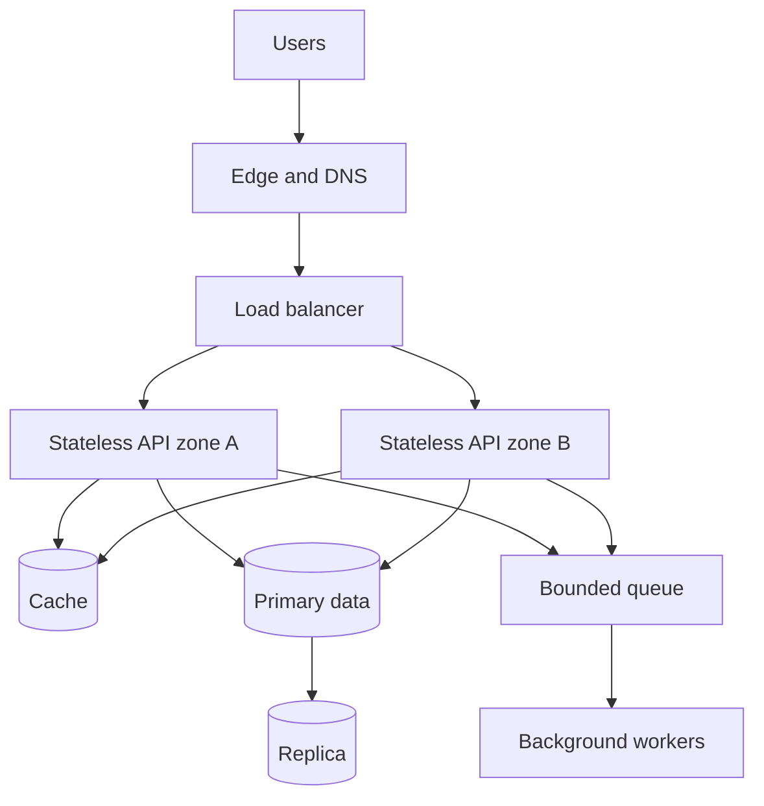

## Why this matters

A feature that works on a laptop fails in production for reasons that have nothing to do with the feature. Traffic grows, a disk fills, a zone loses power, a deploy ships a slow query, or a dependency starts timing out. Interviewers at product companies use scalability, availability, and reliability as the first filter: if you cannot define them, measure them, and name the mechanism that improves each one, the rest of the design is guesswork.

These three words are not synonyms. A system can scale and still be unavailable. It can be available and still return wrong answers. It can be reliable for a single user and collapse when a second region is added. This lesson fixes the vocabulary, the formulas, and the failure domains you will reuse in every case study.

## Intuition

A coffee shop can serve more customers by training one barista to work faster, by adding baristas behind the same counter, or by opening another shop across town. Those are vertical scaling, horizontal scaling, and geographic distribution. The door being unlocked is availability. Getting the drink you ordered, every time, is reliability. How long you stand in line is latency. How many drinks leave the counter per hour is throughput.

Growth is not only "more users." It is more data, more features per request, more regions, and more unevenness. A shop that is quiet at 7 a.m. and slammed at 8:30 a.m. needs a design for the peak, not the average. A shop that keeps yesterday's orders correct even when the card reader blips is reliable. A shop whose door is open while the espresso machine is down is available and useless.

## Core concept in depth

### Scalability

Scalability is the ability to handle growth in load by adding resources, with cost and complexity that stay acceptable. Load is not one number. Separate at least four axes:

- **Request rate.** Queries per second, writes per second, or messages per second. Peaks matter more than daily averages.
- **Data volume.** Rows, objects, or bytes stored, plus the working set that must stay in memory.
- **Concurrency.** Simultaneous in-flight requests, websocket connections, or checkout sessions.
- **Fan-out.** How many downstream calls one user request triggers. A timeline read that touches 20 services scales worse than a key-value get, even at the same QPS.

**Vertical scaling** means a larger machine: more CPU, RAM, or faster disks. It is operationally simple, preserves a single-node programming model, and has a hard ceiling. The blast radius of a failure is the whole service. Failover often means a cold or warm standby of similar size, which you pay for even when idle.

**Horizontal scaling** means more machines. It requires a way to spread work: a load balancer for stateless workers, a partition key for data, or a queue for background jobs. The ceiling is much higher. The new costs are coordination, uneven partitions, deployment orchestration, and partial failure.

**Elasticity** is how fast you can add or remove that capacity relative to the load curve. A daily batch cluster that scales in hours is elastic enough. A flash-sale API that needs capacity in seconds is not, unless instances are pre-warmed.

A useful interview sentence: "This service is stateless and horizontally scalable; the bottleneck will move to the database, which we partition by user id once a single primary exceeds its write rate or disk."

### Load shapes

Designs fail when the load shape is wrong, not when the average is wrong.

| Shape | What it looks like | Design consequence |
| --- | --- | --- |
| Diurnal | Daily rise and fall | Scheduled capacity plus modest headroom |
| Spiky / flash | Short bursts, 10x to 100x | Queues, admission control, pre-warmed pools |
| Growing | Month-over-month rise | Partition plan before the cliff, not after |
| Fan-in | Many clients, one hot key | Split hot keys, caching, request coalescing |
| Fan-out | One request, many downstream calls | Timeouts, bulkheads, smaller payloads |

Headroom is planned spare capacity. A common starting point is to size for peak and keep 30 to 50 percent spare so a zone loss or a bad deploy does not immediately saturate the rest. That spare is not waste; it is the availability budget made concrete.

### Availability

Availability is the proportion of time the service is able to serve correct-enough responses. The textbook ratio is:

**Availability = MTTF / (MTTF + MTTR)**

MTTF is mean time to failure: how long the service typically runs before an incident. MTTR is mean time to repair: detection plus diagnosis plus mitigation plus recovery. You can raise availability by failing less often or by repairing faster. In practice, detection time dominates MTTR for teams that do not page on symptoms. A 10-minute outage you notice in 8 minutes is mostly a detection problem.

Nines are a shorthand for that ratio over a year of 365.25 days, about 525,960 minutes:

| Target | Max downtime per year | Per month (approx.) | What it forces |
| --- | --- | --- | --- |
| 99 percent (two nines) | about 3.65 days | about 7.3 hours | A single instance can survive |
| 99.9 percent (three nines) | about 8.8 hours | about 44 minutes | Redundancy, fast rollback |
| 99.95 percent | about 4.4 hours | about 22 minutes | Multi-AZ, practiced failover |
| 99.99 percent (four nines) | about 52 minutes | about 4.4 minutes | Automation, no human in the critical path |
| 99.999 percent (five nines) | about 5 minutes | about 26 seconds | Extreme cost; rare for whole products |

Nines compose badly. If a user request needs three independent services each at 99.9 percent, and any failure fails the request, availability is 0.999 cubed, about 99.7 percent. That is why deep synchronous call chains destroy product availability even when every team "meets its SLO." Prefer fewer synchronous dependencies, or degrade: show a cached price, drop recommendations, accept the order and reconcile later.

**Redundancy** is the mechanism. Run at least two instances in distinct failure domains. A failure domain is a boundary that fails together: a process, a machine, a rack, an availability zone, a region, a provider. Multi-instance on one machine does not survive a kernel panic. Multi-AZ does not survive a region-wide control-plane bug. State the domain you are redundant across.

Active-active means all replicas serve traffic. Active-passive means a standby takes over on failure. Active-active needs a story for split brain and for data conflicts. Active-passive needs a story for failover time, which counts against MTTR and therefore against the nines.

### Reliability

Reliability is the probability that the system performs its intended function, correctly, under stated conditions, for a stated interval. Availability asks "could the user connect and get a response?" Reliability asks "was the response the right one, and did we keep our promises about data?"

A ledger that is up and double-charges a card is available and unreliable. A cache that serves a stale price during a partition may be available under an eventual-consistency contract and still reliable relative to that contract. The contract is the important part. Define correctness before you claim reliability.

Related quantities interviewers expect:

- **MTBF** (mean time between failures) is the average time between the start of one failure and the start of the next. In repairable systems people often use MTBF loosely where MTTF is more precise. Say which interval you mean.
- **Error rate** is failed operations divided by attempted operations. It is a reliability signal even when the process is "up."
- **Durability** is the probability that acknowledged data is not lost. Object storage quoting eleven nines of durability is a different claim from four nines of availability. Durability comes from replication, checksums, and repair; availability comes from serving replicas being reachable.
- **Fault, error, failure.** A fault is the underlying defect or event (disk dies). An error is the incorrect internal state (checksum mismatch). A failure is the externally visible deviation (the read returns 500). Good design turns faults into contained errors before they become user-visible failures.

**Fault tolerance** is continued correct operation in the presence of specified faults. It is never "we handle any failure." Name the faults: crash of one process, loss of one zone, disk corruption, clock skew, duplicate delivery. If the fault is outside the set, the system is allowed to stop.

### Graceful degradation and overload

Reliability under stress is a product decision. Define which features shed first. Typical order: analytics beacons, recommendations, personalization, then search quality, then reads of historical data, and last the core write (place order, send message, pay). **Admission control** rejects work early with a clear status when the queue is past a limit, which is more reliable than accepting work that will time out after holding scarce threads.

**Backpressure** propagates "slow down" to the caller instead of buffering without bound. Unbounded queues convert a short overload into a long outage, because the queue keeps accepting work the service can no longer drain. Bound the queue, measure its age, and shed.

### Putting the three together

A concrete target you can say out loud: "Checkout must be available 99.95 percent measured at the edge, with p99 latency under 400 ms for the synchronous path, and payment authorization must be correct under retries. We will run active-active across three zones, keep a 40 percent capacity headroom, and degrade recommendations if error rate exceeds 1 percent." That sentence contains scalability (headroom and zones), availability (99.95 percent), and reliability (correct authorization under retries). Latency budgets are the next lesson; consistency models come after that.

## Diagram



The diagram separates the scalable stateless tier from the stateful tier and from asynchronous work. Losing zone A removes capacity but not the service, as long as zone B plus the data tier still form a quorum or a promotable primary.

### Dry-run: a zone failure during peak

Assume peak demand is 6,000 requests per second. Each instance handles 200 requests per second at the latency SLO. Two zones, equal traffic.

| Step | Zone A | Zone B | What you check |
| --- | --- | --- | --- |
| Steady peak | 15 instances, 3,000 rps | 15 instances, 3,000 rps | CPU near 60 percent, not 95 |
| Zone A lost | 0 | must absorb 6,000 rps | Need 30 healthy instances in B, or shed |
| With 50 percent headroom planned per zone | 15 running, 8 warm | 15 running, 8 warm | B can reach about 4,600 rps quickly; rest must shed or burst |
| User-visible result | errors or degraded reads | core writes still succeed | Availability of core path holds; full fidelity does not |

If you only staff 15 instances per zone and both run hot, a zone loss is an outage even though "we are multi-AZ." Redundancy without spare capacity is a diagram, not a design.

## Runnable Python

Capacity and availability arithmetic you can rerun with interview numbers:

```python
def nines_downtime_minutes(nines: int, minutes_per_year: float = 525_960) -> float:
    # Three nines means 99.9 percent, so the unavailable fraction is 0.001.
    unavailable = 10 ** (-nines)
    return round(minutes_per_year * unavailable, 2)


def chain_availability(component_availabilities: list[float]) -> float:
    product = 1.0
    for a in component_availabilities:
        product *= a
    return round(product, 6)


def instances_for_peak(peak_rps: float, per_instance_rps: float, headroom: float) -> int:
    if per_instance_rps <= 0:
        raise ValueError("per_instance_rps must be positive")
    needed = peak_rps / per_instance_rps
    return int((needed * (1 + headroom)) + 0.999)


if __name__ == "__main__":
    print("three nines minutes", nines_downtime_minutes(3))
    print("chain", chain_availability([0.999, 0.999, 0.999]))
    print("instances", instances_for_peak(6000, 200, 0.5))
```

Walk the third call: 6,000 / 200 = 30 instances at the SLO, times 1.5 headroom = 45 instances. Split across two zones you want about 23 per zone so one zone plus rapid scale-out can carry the peak, or you explicitly shed. The chain call shows three 99.9 percent dependencies landing near 99.7 percent.

## Complexity / trade-off analysis

| Choice | Improves | Costs |
| --- | --- | --- |
| Vertical scale | Simplicity, single-node latency | Ceiling, large blast radius, expensive idle standby |
| Horizontal scale | Ceiling, smaller blast radius | Partitioning, deploys, uneven load, distributed debugging |
| Multi-AZ active-active | Zone-failure availability | Data replication lag, conflict handling, more cost |
| Active-passive failover | Simpler writes | MTTR includes promotion; capacity must already exist |
| Deep synchronous fan-out | Fresh data on one request | Availability is the product of dependencies |
| Graceful degradation | Core-path availability | Product complexity, stale or missing secondary features |
| Bounded queues | Reliability under overload | Rejected work the client must retry or drop |
| More headroom | Survive spikes and zone loss | Money; can hide inefficient code |

There is no universal winner. A read-heavy catalog can scale out behind a cache cheaply. A strongly consistent ledger scales out only with a clear partition key and a conflict policy. Say which axis you are scaling and which fault you are tolerating.

## Tricks, tips, patterns

- Ask for the availability target in nines and the failure domain before drawing boxes. "Highly available" is not a requirement.
- Convert nines into a downtime budget so the interviewer hears minutes, not a slogan.
- Multiply availabilities for synchronous dependencies. It changes designs.
- Separate durability from availability when you talk about storage.
- Put a number on headroom. "We will keep 40 percent spare at peak" is a design; "we will autoscale" is a hope.
- Name the shed order. Core write last, analytics first.
- Bound every queue and alert on age, not only on depth.
- Prefer repairing faster (detection, rollback, failover drills) when failing less often is already expensive.

## Common mistakes and edge cases

- Calling a service highly available because it runs in Kubernetes. Orchestration restarts processes; it does not create a second zone or a second copy of the data.
- Staffing both zones at 90 percent CPU. Zone loss then exceeds remaining capacity.
- Equating uptime of the load balancer with user-perceived availability. Partial brownouts and error rates count.
- Using averages for load. The peak and the hot key decide capacity.
- Unbounded retries from clients. They multiply load during the incident and extend MTTR.
- Confusing a durability claim with an availability claim.
- Ignoring maintenance. A failover you have never practiced will miss a four-nines budget.
- Treating reliability as "no bugs." Specify the fault set and the correctness contract.

## Interview notes

Spend the first few minutes on requirements, not boxes. Write functional behaviors, then non-functional targets: peak QPS, data size, availability nines, failure domain, and what "correct" means for the write. Estimate, then draw the smallest design that meets them. Only then add redundancy and a degradation plan.

When challenged with "a zone dies," walk the dry-run table: remaining capacity, promotion or quorum, what the user sees, how long detection takes. When challenged with "traffic 10x," say whether you scale the stateless tier, the data tier, or both, and which one hits a ceiling first.

Interviewers score trade-off sentences. "We accept stale recommendations so checkout availability is not the product of the recommender's availability" is a stronger answer than "we use microservices."

## Practice problems

1. **Nines budget (easy).** A product promises 99.95 percent availability per quarter. How many minutes of downtime is that? If one incident already consumed 20 minutes, what monthly posture do you recommend for the rest of the quarter?
2. **Dependency math (medium).** Checkout calls inventory, pricing, and payments synchronously, each measured at 99.95 percent. What is the combined availability if any error fails the checkout? Propose one dependency to remove from the critical path and what the user sees instead.
3. **Zone loss (medium).** Peak is 8,000 rps. Instances serve 250 rps at the SLO. You have two zones. How many instances do you run in total with 40 percent headroom, and what fails if each zone is staffed with exactly half of the no-headroom count?

Related lessons: [Latency and throughput](/lessons/sd-latency-throughput), [CAP, PACELC, and consistency](/lessons/sd-cap-pacelc-consistency), [Back-of-envelope estimation](/lessons/sd-back-of-envelope).

## Summary / cheat sheet

- Scalability is growth in requests, data, concurrency, or fan-out, handled by adding resources you can name.
- Vertical scale is simple and capped. Horizontal scale needs a spread mechanism and a partition story.
- Availability is MTTF / (MTTF + MTTR), spoken as nines and as minutes of downtime.
- Synchronous dependencies multiply unavailability. Degrade or shrink the critical path.
- Reliability is correct behavior under a stated fault set. Durability is not availability.
- Size for peak plus headroom. Redundancy without spare capacity does not survive a zone loss.
- Bound queues, shed low-value work first, and measure repair time honestly.

## Further reading

- [Google SRE book: Embracing Risk](https://sre.google/sre-book/embracing-risk/)
- [Google SRE book: Service Level Objectives](https://sre.google/sre-book/service-level-objectives/)
- [AWS Well-Architected Reliability pillar](https://docs.aws.amazon.com/wellarchitected/latest/reliability-pillar/welcome.html)
- [Designing Data-Intensive Applications, Kleppmann](https://dataintensive.net/)
- [The Tail at Scale, Dean and Barroso](https://research.google/pubs/the-tail-at-scale/)
