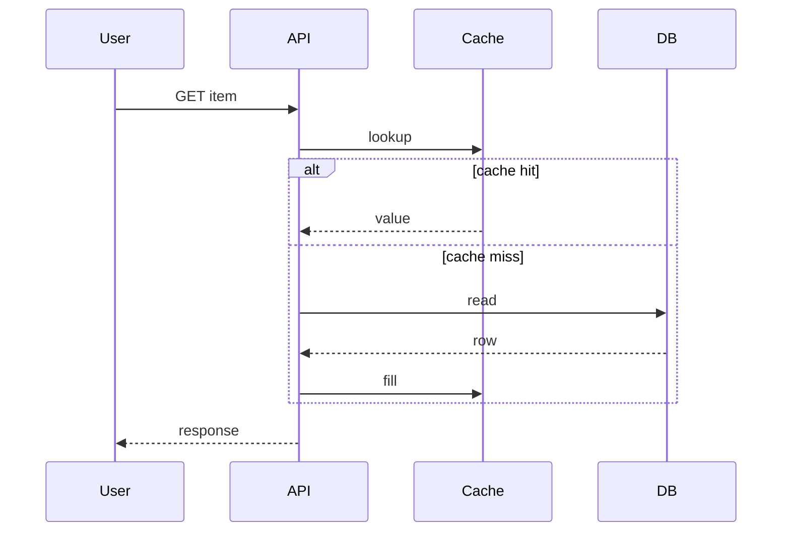

## Why this matters

Product interviews rarely ask for a faster average. They ask why p99 blew up, why adding servers did not raise throughput, or why a page that calls eight services feels slow even though each service looks healthy. Latency and throughput are the two load metrics every capacity table depends on. If you mix them up, you will cache the wrong thing, batch at the wrong layer, or set a timeout that is longer than the user's patience and shorter than the dependency's retry storm.

## Intuition

Latency is how long one unit of work takes from the user's point of view. Throughput is how many units finish per second. A single barista can pour a careful drink in 40 seconds (latency) and therefore about 90 drinks an hour (throughput) if she never stops. Two baristas double throughput if the counter and the cups keep up. Making each drink faster improves both, until the oven or the payment terminal becomes the queue.

A highway makes the same point. Latency is your travel time. Throughput is cars per hour past a point. At low traffic both are fine. Near capacity, a small increase in arrivals causes travel time to explode. That curve, not the idle-road average, is what production feels like at peak.

## Core concept in depth

### Definitions you can defend

**Latency** (or response time) is the elapsed time from a request being sent until the corresponding response is usable. Break it into pieces when the interviewer asks where the time went:

- **Network time.** Propagation plus transmission plus queueing in switches. Round trip inside one region is often well under a millisecond between zones and around a millisecond between nearby zones; cross-continent round trips are tens to a couple of hundred milliseconds.
- **Service time.** CPU, disk, and downstream calls while the server is actively working.
- **Queue time.** Waiting behind other requests. This is the term that explodes near saturation.
- **Client time.** DNS, TLS handshake, rendering, retries the user did not ask for.

**Throughput** is completed work per unit time: requests per second, rows per second, messages per second, or bytes per second. Measure completed work, not accepted work. A server that accepts 10,000 requests per second and times out 40 percent of them does not have 10,000 of goodput.

**Bandwidth** is the maximum throughput of a channel. Throughput is what you actually achieve. A 10 Gbit/s NIC with tiny packets and high loss will deliver much less goodput than its bandwidth.

**Goodput** is useful application data per second, excluding retries, protocol overhead, and failed attempts.

Latency and throughput are related but not reciprocals once there is concurrency. A service can have high latency and high throughput by keeping many requests in flight (video transcode). It can have low latency and low throughput (a lock-step consensus round with a tiny payload). The interview question is which one the product budget constrains.

### Percentiles, not averages

The mean hides the tail. A service with most calls at 20 ms and a thin tail at 2 seconds can still advertise a flattering average while a fraction of users see a broken product. Report:

| Percentile | Meaning | Typical use |
| --- | --- | --- |
| p50 | Half of requests are faster | Typical user, sanity check |
| p95 | 1 in 20 is slower | Common SLO companion |
| p99 | 1 in 100 is slower | User-visible SLO for APIs |
| p99.9 | 1 in 1,000 is slower | Large fan-out, payments, ads |

If you serve 500 requests per second, p99 is five bad requests every second, all day. That is not an edge case. It is a queue of unhappy users.

Percentiles do not add. If service A is 50 ms at p99 and service B is 50 ms at p99, a serial call is not 100 ms at p99. The slow cases are not perfectly correlated, and they are not perfectly independent either. Shared queues, garbage collection, and noisy neighbors correlate them. The safe interview move is to budget the critical path as a sum of p99s when you are being conservative, then measure the combined histogram.

### Little's law

Little's law is an identity, not a model of a particular queue: the average number of items in a stable system equals the average arrival rate times the average time spent in the system.

**L = λ × W**

L is concurrency (in-flight requests). λ is throughput in arrivals per second. W is average latency in seconds. If a checkout API averages 200 ms and you want to sustain 2,000 completions per second, average concurrency is 2,000 × 0.2 = 400 in-flight requests. Those 400 must fit in thread pools, database connections, and memory. If the pool is 50, you will queue or reject long before the CPU is "used up."

This is the fastest way to size connection pools in an interview. State λ, state the latency budget W, multiply.

### Why the tail explodes near saturation

For a simple single-server queue, time in queue grows like 1 / (1 − utilization). At 50 percent utilization the queue term is modest. At 90 percent it is large. At 99 percent it dominates service time. That is why "CPU is only 70 percent" can still mean a bad p99 if the work is bursty, locked, or single-threaded on one hot key.

Practical consequences:

- Plan peak utilization with slack. Many services aim to run the latency-sensitive tier around 50 to 70 percent of the saturation knee, not at 95 percent.
- A hot lock or a single-threaded event loop saturates at one core no matter how many cores the machine has.
- Autoscaling on average CPU reacts after the tail has already hurt users. Scale on queue age, p99, or schedule headroom for known peaks.

### Tail at scale and fan-out

If one user request must collect 100 parallel backend calls, and each call is slow with probability 0.01 independently, the chance that the request hits at least one slow call is about 1 − 0.99^100, roughly 63 percent. The user-level tail is much worse than the service-level tail. This is the "tail at scale" problem.

Mitigations that interviewers recognize:

- **Hedge requests.** Send a second copy after a delay (for example at the p95 of the first) and take the winner. Use only for idempotent reads. Cap hedges so you do not double load during an incident.
- **Tied requests.** Send two copies to two replicas immediately and cancel the loser. Costs capacity. Useful for short, critical reads.
- **Trim fan-out.** Ask for the best 20 results, not all 100 shards. Return partial results with a deadline.
- **Deadline propagation.** Give each hop a remaining time budget so a child does not keep working after the parent has given up.
- **Caches and replication** so the read does not touch every shard.

### Batching, pipelining, and concurrency

Batching raises throughput and often hurts latency, because the first item waits for the batch to fill or for a timer. A 10 ms batch window is invisible in analytics and painful on a keystroke path. State the window and the max batch size.

Pipelining keeps multiple requests in flight on one connection so round-trip time does not cap throughput. HTTP/2 and gRPC streams do this. Head-of-line blocking remains a risk if one large response stalls the connection; HTTP/3 reduces that at the transport layer.

Concurrency improves throughput until a shared resource saturates: a database pool, a lock, a disk, or a rate limit. Past that point more concurrency only adds queue time.

### Latency budgets

Write a budget that sums to the user goal. Example for a 300 ms interactive read:

| Hop | Budget |
| --- | --- |
| Edge TLS and routing | 30 ms |
| API gateway and auth | 20 ms |
| Application logic | 30 ms |
| Cache get | 5 ms |
| Cache miss to database | 40 ms, on the miss path only |
| Downstream recommendation, async or hedged | not on the critical path |
| Serialization and response | 15 ms |

If the sum of mandatory hops already exceeds the SLO, no tuning story saves you. Cut a hop, cache, or move work off the request.

### Timeouts, retries, and the latency SLO

A timeout is a latency decision. A client timeout shorter than the server's p99 creates false failures and retries. A timeout longer than the user budget holds threads past the point of usefulness. Set the client timeout from the remaining deadline, and limit retries to idempotent calls with jittered backoff and a budget (a maximum extra load factor). Retries turn a latency problem into a throughput problem.

## Diagram



### Dry-run: Little's law and a pool

| Input | Value | Derived |
| --- | --- | --- |
| Target goodput | 2,000 rps | λ |
| SLO average latency | 200 ms | W = 0.2 s |
| In-flight requests | 400 | L = λ × W |
| DB calls per request | 2 | 800 DB ops/s |
| Pool size if each DB call holds a conn for 20 ms | 16 average, size the pool above the tail | 800 × 0.02 = 16 |
| If p99 DB time rises to 200 ms during a stall | 160 connections wanted | Pool of 30 becomes the queue |

The pool, not the CPU, is the bottleneck as soon as backend latency climbs. Say this out loud when someone proposes "just add app servers."

## Runnable Python

```python
def littles_law(throughput_rps: float, latency_seconds: float) -> float:
    return throughput_rps * latency_seconds


def queue_multiplier(utilization: float) -> float:
    if utilization <= 0 or utilization >= 1:
        raise ValueError("utilization must be between 0 and 1")
    # Single-server intuition: queue factor grows as 1/(1-u).
    return 1 / (1 - utilization)


def fanout_slow_probability(n: int, p_slow: float) -> float:
    return 1 - (1 - p_slow) ** n


def latency_budget_ok(hops_ms: list[float], slo_ms: float) -> dict:
    total = sum(hops_ms)
    return {"total_ms": total, "slack_ms": slo_ms - total, "fits": total <= slo_ms}


if __name__ == "__main__":
    print("in_flight", littles_law(2000, 0.2))
    print("queue_factor_at_0.9", round(queue_multiplier(0.9), 2))
    print("fanout", round(fanout_slow_probability(100, 0.01), 3))
    print(latency_budget_ok([30, 20, 30, 5, 15], 300))
```

The fan-out print is about 0.63: most user requests see at least one slow shard even though each shard is slow only 1 percent of the time. The queue factor at 90 percent utilization is 10, so a 5 ms service time becomes on the order of 50 ms of queue-inclusive time in that simple model. Real systems are messier; the direction is what you argue with.

## Complexity / trade-off analysis

| Choice | Latency | Throughput | Risk |
| --- | --- | --- | --- |
| Cache hit path | Drops toward memory or network RTT | Rises until hot keys or bandwidth | Stale reads, stampede on miss |
| Batching | Adds wait up to the window | Fewer round trips, better compression | Bad for interactive RPCs |
| More concurrency | Helps until the shared pool saturates | Rises then collapses into queueing | Thread and connection exhaustion |
| Hedged reads | Cuts tail | Extra load, especially during incidents | Unsafe on non-idempotent writes |
| Tighter timeout | Fails fast, frees capacity | Can reduce goodput via retries | False errors if set inside normal p99 |
| Higher utilization | Tail gets worse | More work per machine | A spike becomes an outage |
| Partial fan-out | Bounded by a deadline | Less backend work | Incomplete results |

## Tricks, tips, patterns

- Ask whether the SLO is p50, p95, or p99, and at what throughput. "Low latency" is not a number.
- Use Little's law to size in-flight work and pools before you draw a second box.
- Keep latency-sensitive utilization well below the knee. Quote a target such as 60 percent at peak.
- Put only mandatory hops on the critical path. Everything else is async, cached, or best-effort.
- Propagate deadlines. Do not let children outlive the parent request.
- Hedge only idempotent reads, and cap the extra QPS.
- Measure histograms. Averages and single "max" gauges lie in opposite directions.
- Separate goodput from accepted QPS when you talk about overload.

## Common mistakes and edge cases

- Adding app servers when the database pool or a hot key is saturated. Throughput stays flat and latency rises.
- Adding p99 numbers of serial hops as if they were a precise sum. Use it as a conservative budget, then measure.
- Setting retries with no budget. A p99 incident becomes a traffic multiplier.
- Batching the autocomplete path the same way you batch analytics.
- Ignoring cold start, TLS, and DNS on the first request. The warm p50 is not the user p50.
- GC pauses, stop-the-world compaction, and noisy neighbors creating correlated tails across replicas. Hedges then all hit the same pause.
- Coordinated misses: a cache TTL expiring for a hot key sends the entire fan-in to the database at once.

## Interview notes

Draw the critical path and label each hop with a millisecond budget that sums inside the SLO. Then say what happens at peak utilization. If the interviewer doubles QPS, recompute Little's law and point at the first saturated pool.

A strong close: "p99 at the API is dominated by fan-out to inventory shards. I will deadline at 80 ms, return partial stock, and hedge the empty shards once. Writes stay single-path and idempotent so we do not hedge them."

Mention one real number from the latency table you memorized: sequential memory is far cheaper than a cross-region round trip, and a disk seek is a different universe from a cache hit. You do not need a full Jeff Dean list, but you need the orders of magnitude.

## Practice problems

1. **Pool sizing (easy).** An API must sustain 1,500 rps at 100 ms average latency. How many requests are in flight? If each request holds one database connection for 10 ms, what is the average connection demand?
2. **Fan-out tail (medium).** A home feed calls 40 services. Each is slower than 100 ms with probability 0.02, treated as independent. Estimate the probability the feed exceeds 100 ms if it waits for all of them. What design change cuts that probability without doubling steady-state load?
3. **Utilization knee (medium).** Service time is 8 ms. Using the 1/(1−u) queue factor as a directional model, compare queue-inclusive time at 50 percent and 90 percent utilization. What headroom do you recommend for a checkout path?

Related: [Back-of-envelope estimation](/lessons/sd-back-of-envelope), [Caching](/lessons/sd-caching).

## Summary / cheat sheet

- Latency is time per operation. Throughput is completed operations per second. Bandwidth is a ceiling. Goodput excludes waste.
- SLO latency is a percentile at a stated load. Means hide the tail.
- Little's law: concurrency = throughput × latency. Use it to size pools.
- Queue time grows sharply as utilization approaches 1. Leave slack on the critical path.
- Fan-out multiplies the chance of hitting a slow replica. Deadline, trim, or hedge idempotent reads.
- Batching buys throughput with waiting. Do not batch keystrokes and payments the same way.
- Timeouts and retries are part of the latency design. Budget both.

## Further reading

- [The Tail at Scale, Dean and Barroso](https://research.google/pubs/the-tail-at-scale/)
- [Little's law](https://en.wikipedia.org/wiki/Little%27s_law)
- [Google SRE book: Handling Overload](https://sre.google/sre-book/handling-overload/)
- [AWS Builders' Library: Timeouts, retries, and backoff with jitter](https://aws.amazon.com/builders-library/timeouts-retries-and-backoff-with-jitter/)
- [Designing Data-Intensive Applications, Kleppmann](https://dataintensive.net/)
